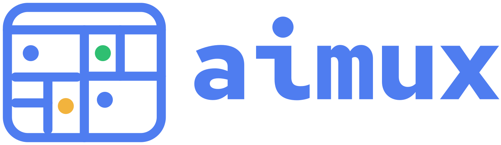
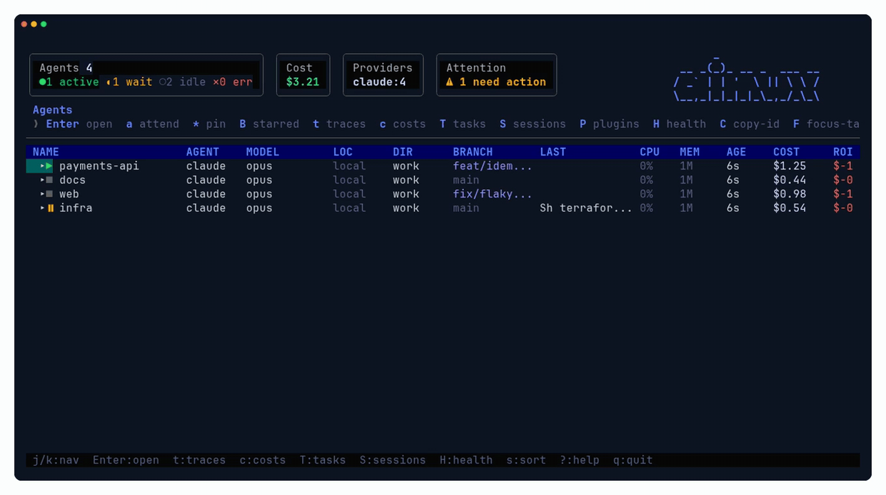
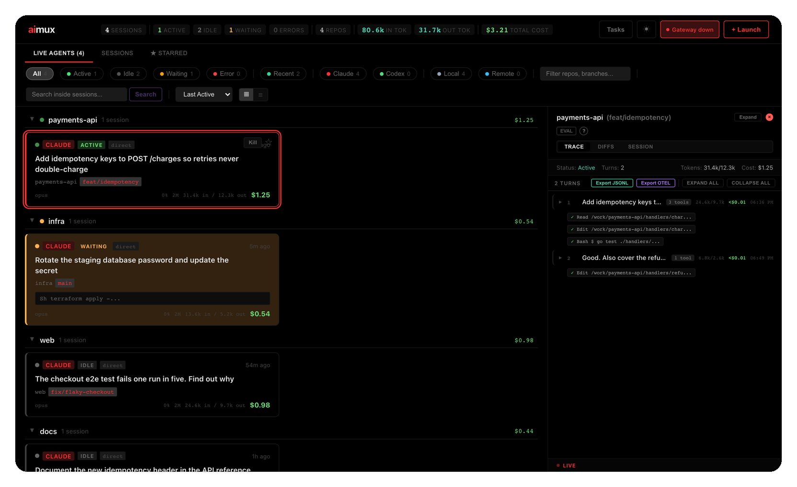
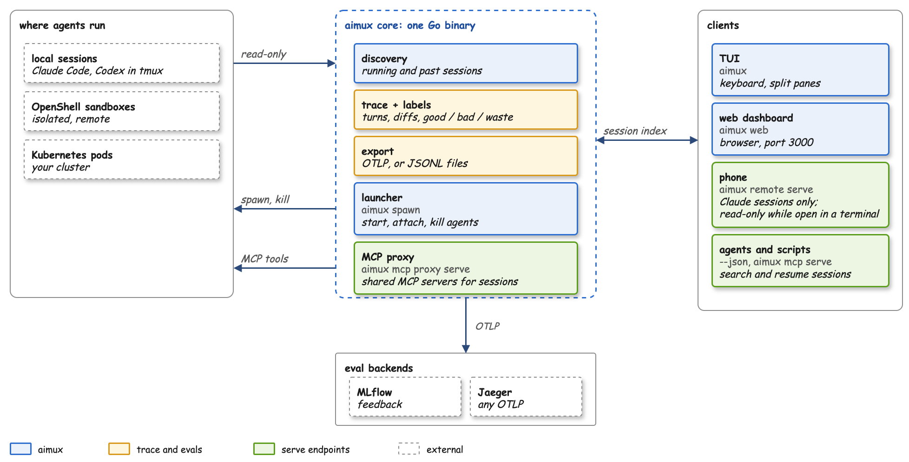

<h1 align="center"></h1>

<p align="center">Mission control for AI coding agents: see, steer and evaluate every session.</p>

<p align="center">
  <a href="https://github.com/zanetworker/aimux/releases/latest"></a>
  <a href="https://github.com/zanetworker/aimux/actions"></a>
  <a href="LICENSE"></a>
</p>

<p align="center">
  <a href="https://aimux.ai">Docs</a> ·
  <a href="#install">Install</a> ·
  <a href="#quickstart">Quickstart</a> ·
  <a href="https://github.com/zanetworker/aimux/releases">Changelog</a>
</p>

<p align="center">
  
  <br><em>Four agents in one list, then one agent's trace beside its live session, a turn labeled GOOD, and cost per project.</em>
</p>

You run five agents in five tmux panes and lose track of which one rewrote `auth.go`. aimux finds every running and past session, shows each one turn by turn (prompts, tool calls, diffs), and lets you label turns so the good and bad runs become eval data.

## Install

```sh
brew install zanetworker/aimux/aimux
```

Requires tmux. No config, SDK or instrumentation: aimux reads the session files Claude Code and Codex already write.

## Quickstart

```sh
aimux agents
```

```text
PID   PROVIDER  STATUS   PROJECT       MODEL
7     claude    Active   payments-api  opus
25    claude    Idle     docs          opus
13    claude    Idle     web           opus
19    claude    Waiting  infra         opus
```

Then open the dashboard:

```sh
aimux          # terminal UI
aimux web      # browser UI at localhost:3000
```

## Why aimux

- **See every agent at once.** Running and past Claude Code and Codex sessions in one list, with live status, CPU, tokens and cost, and search across all of them ("which agent edited auth.go?").
- **Know what each agent actually did.** A turn-by-turn trace of prompts, tool calls and diffs, with a PR-style review panel. [Tracing →](https://aimux.ai/guides/tracing/)
- **Turn real runs into evals.** Label turns GOOD, BAD or WASTE and export them as MLflow feedback, to any OTLP backend, or as JSONL. [MLflow →](https://aimux.ai/guides/mlflow-integration/)
- **Run and reach agents anywhere.** Launch them locally, in OpenShell sandboxes or on Kubernetes. From your phone, follow your Claude sessions, continue idle ones and answer approvals. [Remote sandboxes →](https://aimux.ai/guides/remote-sandboxes/)

## What's inside

| Area | What you get | Docs |
|---|---|---|
| Discover | Auto-discovery of Claude Code and Codex, live status (working, idle, needs you, error; the same words on the phone), cross-session search, starred sessions, generated titles | [Web dashboard](https://aimux.ai/guides/web-dashboard/) |
| Trace and review | Turn-by-turn trace, inline diffs, PR-style review panel, live diff pane beside the session terminal | [Tracing](https://aimux.ai/guides/tracing/) |
| Cost | Per-agent and per-turn cost with model-aware pricing | [Cost tracking](https://aimux.ai/guides/cost-tracking/) |
| Evaluate | GOOD / BAD / WASTE labels with notes; export to MLflow, Jaeger or any OTLP backend, or JSONL | [MLflow](https://aimux.ai/guides/mlflow-integration/) |
| Launch | Six-axis launcher, saved profiles, quick-launch directories, launches from Google Tasks, continue an idle session with `aimux chat` | [Launch modes](https://aimux.ai/guides/launch-modes/), [Tasks](https://aimux.ai/guides/tasks/), [Chat](https://aimux.ai/guides/chat/) |
| Run remotely | OpenShell sandboxes with terminal, traces and kill; agents on Kubernetes pods | [Remote sandboxes](https://aimux.ai/guides/remote-sandboxes/), [Kubernetes](https://aimux.ai/advanced/k8s-quickstart/) |
| Reach | `aimux remote serve`: follow and continue Claude sessions from the iPhone app or the phone web client over tailscale, answer approvals, type into sessions open in iTerm2, and open a phone session on the Mac | [Remote access](https://aimux.ai/guides/remote-access/) |
| Share MCP | `aimux mcp proxy install`: your stdio MCP servers run once in a shared daemon, each at its own endpoint under its original name (permission rules unchanged), started on first call and stopped when idle; `aimux mcp serve`: session search and resume tools for agents | [MCP proxy](https://aimux.ai/guides/mcp-proxy/) |
| Interfaces | Keyboard TUI with split panes; web dashboard with cards, filters and dark/light themes; desktop and terminal-bell notifications | [TUI keys](https://aimux.ai/guides/tui-keybindings/), [Notifications](https://aimux.ai/guides/notifications/) |
| Extend | Plugin tabs, new providers, `--json` on every listing command, `aimux agent-context` for the full CLI contract | [Plugins](https://aimux.ai/guides/plugins/), [Agent usage](https://aimux.ai/guides/agent-usage/), [Add a provider](https://aimux.ai/advanced/adding-a-provider/) |

Use the Claude Code or Codex built-in history instead if you run one agent at a time; aimux pays off when several run in parallel.

**What it doesn't do:** it doesn't plan or orchestrate multi-agent work, and it only supports Claude Code and Codex today ([add a provider](https://aimux.ai/advanced/adding-a-provider/)).

<p align="center">
  
  <br><em>The web dashboard (<code>aimux web</code>): every agent by project, and one agent's trace.</em>
</p>

## How it works

<p align="center">
  
</p>

## Usage

| Task | Command |
|---|---|
| Search past sessions in all projects | `aimux sessions "auth.go" --all --list --json --limit 5` |
| Start an agent and wait for it | `aimux spawn claude --dir ./proj --wait --json` |
| Resume a past session | `aimux resume <session-id>` |
| Jump to a running agent's iTerm2 pane | `aimux jump <session-id or pid>` |
| Continue a Claude session that is not open in a terminal | `aimux chat <session-id> "next step?"` |
| Export a trace | `aimux export <session-id>` |
| Follow Claude sessions from your phone | `aimux remote serve` (via tailscale serve) |
| Share MCP servers across sessions | `aimux mcp proxy install --dry-run`, then `aimux mcp proxy install` |

<details>
<summary>All commands</summary>

```text
agent-context  Machine-readable CLI surface for agents
agents         List running AI agents
chat           Send a message to an existing Claude session and stream the reply
collect        Run headless OTEL collector
configs        List named agent configurations
environments   List configured environments
export         Export a session trace
feedback       Send feedback about the CLI
jump           Bring a running agent's terminal pane to the front
kill           Kill a running agent
mcp            MCP server for session search and remote agents
profile        Manage saved configuration profiles
remote         API for your sessions from other devices, through tailscale serve
resume         Resume a past session
sessions       Browse and search past sessions
spawn          Start a new AI agent session
version        Show aimux version
web            Launch web dashboard
```

</details>

Full docs: [getting started](https://aimux.ai/getting-started/), [configuration](https://aimux.ai/configuration/).

## Contributing

Issues and PRs welcome. Run `aimux feedback "..."` to report friction straight from the CLI.

## License

[MIT](LICENSE)
