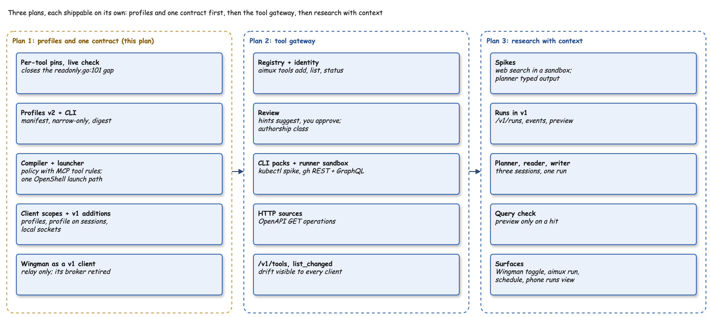

# Plan 1: Profiles and one contract, Implementation Plan

> **For agentic workers:** REQUIRED SUB-SKILL: Use superpowers:subagent-driven-development (recommended) or superpowers:executing-plans to implement this plan task-by-task. Steps use checkbox (`- [ ]`) syntax for tracking.

**Goal:** Every aimux client asks for a session with a profile over remote API v1; profiles compile into OpenShell sandboxes with MCP tool rules; the read-only tools are pinned per tool; Wingman becomes a relay client of v1 and its own broker is retired.

**Architecture:** Per-tool pins guard the existing read-only MCP server. A v2 profile manifest (YAML, narrow-only inheritance, digest) is compiled into an OpenShell policy, an agent MCP config and harness flags, and launched through one OpenShell path. `internal/remoteapi` gains profiles, a `profile` on `POST /v1/sessions`, client scopes and per-client Unix sockets; its broker routes profile sessions to a page engine (ACP, no tools) or a sandbox engine (claude in OpenShell). Wingman's native host only relays its existing panel protocol to v1.

**Tech Stack:** Go 1.x (aimux module `github.com/zanetworker/aimux`), cobra, mark3labs/mcp-go, `gopkg.in/yaml.v3`, `github.com/ai-openshell/sdk-go` v0.1.8 (OpenShell 0.1.7 CLI as fallback), `@agentclientprotocol/claude-agent-acp@0.101.0`.

**Spec:** `docs/superpowers/specs/2026-11-10-tool-gateway-profiles-design.md` (owner-approved 2026-11-11). Read sections "Hardening" (H1 to H6 are in this plan; H7 is a follow-up), "Design 0", "1. Tool gateway" (Pins, Listeners), "2. Profiles v2", "4. Wingman as a client", "Spike first" and "Decisions after the builder check".



This is plan 1 of 3. Plan 2 (tool gateway: registry, review, CLI packs, HTTP sources, `/v1/tools`, `tools/list_changed` wiring) and plan 3 (runs, planner/reader/writer, query check, research profiles, `aimux run` and `schedule`) follow and are written after this plan ships. Profiles that need them (`research`, `research-with-work`) are defined as built-ins here but refused at launch with `not available yet` until their plan lands.

## Global Constraints

- Branch: `git switch -c feat/aimux-core` in `~/go/src/github.com/zanetworker/aimux-wingman` (the Wingman work stays staged and carries over). **Never commit**: every "Stage" step runs `git add <paths>` only; the owner commits.
- Test-first, one red-green cycle per function. `go test ./... -race` passes at the end of every task.
- No em dashes, no `---` rules, no `>` blockquotes in any doc, comment or help text written.
- Today's `aimux mcp proxy serve` on `127.0.0.1:7381` keeps its behaviour and exposure (spec anti-goal).
- `POST /v1/sessions` without `profile` behaves exactly as today; every fixture in `api/testdata/clients/` keeps passing; OpenAPI changes are additive.
- Pins: per tool; hash covers name, `inputSchema`, `outputSchema`, `annotations`; excludes `description` and `title`; key order and whitespace never change a hash. Pin freshness: verified at server build and before a call when the last verification is older than 60 seconds.
- Profiles: one `extends`; a child may only narrow; wildcards in `tools` rejected unless `unsafe_patterns: true`; unknown YAML fields are an error; digest is `sha256:` over the canonical resolved manifest.
- Compiled MCP endpoints: one per gateway server path `/mcp/<server>`, `protocol: mcp`, `enforcement: enforce`, `mcp.versions: ["2025-06-18", "2025-11-25"]`, explicit `initialize`, `notifications/initialized`, `tools/list`, `ping`, and `tools/call` by exact tool name.
- Claude Code adapter output for sandboxed claude: `--tools ""`, `--strict-mcp-config`, `--setting-sources ""`, `--allowedTools` with exact `mcp__<server>__<tool>` names (no wildcards).
- Sandbox egress stays as verified: gateway host `host.containers.internal:7390`, `allowed_ips: ["192.168.127.254/32"]`; binaries `/usr/bin/node`, `/usr/lib/node_modules/@anthropic-ai/claude-code/bin/claude.exe`; image `localhost/wingman-sandbox:2.1.319`; provider `wingman-claude`; gateway `-g local`.
- Default client scopes: `wingman`: `page`, `research`, `work-readonly`, `research-with-work`; `device` (paired phone or browser): the same plus `coding`; `cli`: all.
- OpenShell access goes through `sandboxlaunch.Backend`, one implementation, no runtime switch: the SDK (`github.com/ai-openshell/sdk-go` v0.1.8, pinned) if every Task 6 spike check passes, otherwise the CLI, with the failing check recorded in the ledger. The gateway comes from `~/.config/openshell/gateways/<name>/metadata.json` (`gateway_endpoint`, `auth_mode`), name `local` by default; `plaintext` and mTLS supported, OIDC refused with `OIDC gateways are not supported from aimux yet; use the openshell CLI`. Workspace `default`.
- Profiles are harness-neutral: `harness: claude-code` is the default and the only adapter in plan 1; `codex` and others fail with `harness not supported yet`. Every security-relevant restriction in a profile must appear in the compiled OpenShell policy; the harness config mirrors it (enforced versus cooperative).
- Hardening defaults: step-up window 60 seconds, Secure Enclave only for `runs: host` profiles (H1); Wingman limits `max_sessions: 2`, `turns_per_minute: 20`, beyond them `429 client_limit` (H5); `remote serve` refuses to start without device login unless `--unsafe-no-device-login` (H3).
- Never overwrite `~/go/bin/aimux`. Live checks use `~/.aimux/wingman/bin/aimux` (rename to `~/.aimux/bin/aimux` is out of scope).

## Review Focus

1. A server that reorders its tools or edits only a description: the tool stays callable (pins must not churn). Test in Task 1.
2. A backend that is down when a call needs re-verification: the call is refused with a clear error, the server stays up, and the next verification after the backend returns works. Test in Task 1.
3. A profile file with a typo (`tool:` instead of `tools:`) or a widening child: rejected with the file and field named, never silently ignored. Test in Task 2.
4. Wingman asking for an unknown profile or one outside its scope: `400 unknown_profile` or `403 profile_not_allowed`, nothing started, and the panel shows the message. Tests in Tasks 10 and 12.
5. The panel opening while the core server is not running, or two panels at once: the relay starts `aimux remote serve --local-only` once, both panels connect, and a start failure is shown in the panel. Test in Task 12.

## File structure

```diff
 internal/
+  toolgateway/            # pins and live verification (grows in plan 2)
+    pin.go                #   PinTool, Pins, PinStore
+    verify.go             #   Verifier: Check, Invalidate
+    tokens.go             #   session-bound gateway tokens (H2)
~  mcpproxy/
~    server.go             #   WithCallGuard option, used by the forwarder
~    readonly.go           #   BuildReadonly takes pins; Allowed + Pinned
~  profile/
~    profile.go            #   v1 store kept for migration only
+    manifest.go           #   Manifest, Load, Resolve, Digest, builtins
+    builtin/*.yaml        #   page, research, work-readonly, research-with-work, coding, base
+    compile.go            #   Compile(Manifest, ToolSets) -> Compiled (policy, providers, servers, Intent)
+  harnessconfig/          # harness adapters: Intent -> launch config
+    harnessconfig.go      #   Adapter, Intent, Spec, For(name)
+    claude.go             #   Claude Code: print mode in a sandbox, ACP page session
+  sandboxlaunch/          # the one OpenShell launch path
+    backend.go            #   Backend interface (one implementation); Launcher
+    gateway.go            #   resolve gateway from openshell metadata.json
+    sdk.go                #   SDK backend, or cli.go only if the spike fails
+    archive.go            #   copy transcripts to ~/.aimux/archive
+  clientscope/scope.go    # clients.yaml, defaults, Allowed
+  profilerun/             # engines the broker routes profile sessions to
+    page.go               #   from browserhost/pageengine.go
+    sandbox.go            #   from browserhost/workengine.go, on sandboxlaunch
+    store.go              #   session -> profile, client, page
~  remoteapi/
~    api.go                #   profile fields, routes, LocalHandler
+    profiles_api.go       #   GET /v1/profiles, /v1/profiles/{name}
~    broker wiring (remoteapp/server.go)  # Send routes profile sessions
~  browserhost/            # broker, router, history, engines removed; relay + nmframe stay
+    relay.go              #   panel protocol <-> v1 over the wingman socket
 api/remote-v1.openapi.yaml + api/testdata/clients/profiles/*.json
 cmd/aimux/cmd/profile.go, remote.go, browser.go
+test/secondclient/        # integration test client over the Unix socket
```

### Task 1: Per-tool pins and live verification (closes the `readonly.go:101` gap)

**Files:**
- Create: `internal/toolgateway/pin.go`, `internal/toolgateway/verify.go`, tests beside them
- Modify: `internal/mcpproxy/server.go:13-100` (option + forwarder), `internal/mcpproxy/readonly.go:55-122`, `cmd/aimux/cmd/browser.go` (setup writes pins; `readonlyServer.start` passes them)

**Interfaces:**
- Produces:
  - `toolgateway.PinTool(raw json.RawMessage) (string, error)`: `"sha256:<hex>"`.
  - `type Pins map[string]map[string]string` (server, tool, pin); `func (p Pins) Filter(cat *mcpproxy.Catalog) *mcpproxy.Catalog` keeps only tools whose live pin equals the stored one.
  - `type PinStore struct{ Path string }`; `Load() (Pins, error)` (missing file = empty `Pins`), `Save(Pins) error` (0600). Default path `~/.aimux/tools/pins.json`.
  - `type Verifier struct{ Pins Pins; List func(ctx context.Context, server string) ([]json.RawMessage, error); MaxAge time.Duration; Now func() time.Time }`; `func (v *Verifier) Check(ctx context.Context, server, tool string) error`; `func (v *Verifier) Invalidate(server string)`. `MaxAge` defaults to 60s.
  - `var ErrToolChanged`, `ErrToolNotPinned`, `ErrVerifyFailed` (wrap the listing error).
  - `mcpproxy.WithCallGuard(func(ctx context.Context, server, tool string) error) ServerOption`: the forwarder calls it before `pool.Call`; a non-nil error returns a tool error result (not a transport error) whose text names the tool and the reason.
  - `mcpproxy.BuildReadonly(ctx, cfg, pins toolgateway.Pins, rejectLog)`: catalog becomes `pins.Filter(cat.Allowed(cfg.Allow))`, servers get `WithCallGuard(verifier.Check)` with `List` backed by `pool.Lease(...).ListToolsRaw`.
  - `aimux browser setup` writes pins for the tools currently allowed (trust on first use of the hand-reviewed allowlist), printing each pinned tool; plan 2 replaces this with `aimux tools review`.

- [ ] **Step 1: Write the failing pin tests** in `internal/toolgateway/pin_test.go`:
  - `TestPinTool_IgnoresDescriptionTitleAndKeyOrder`: two tools equal except `description`, `title` and JSON key order give equal pins.
  - `TestPinTool_ChangesWithSchemaOrAnnotations`: changing `inputSchema.properties.query.type` from `string` to `number`, adding an `outputSchema`, or flipping `annotations.readOnlyHint` each gives a different pin.
  - `TestPinTool_RejectsNoName`: a tool without `name` returns an error.
  - `TestPins_FilterDropsChangedAndUnpinned`: a catalog with `wiki_search` (pinned, same), `wiki_read` (pinned, schema changed) and `new_tool` (unpinned) keeps only `wiki_search`.
  - `TestPinStore_MissingFileIsEmpty` and `TestPinStore_SaveIs0600`.
- [ ] **Step 2: Run** `go test ./internal/toolgateway/ -run Pin -v`. Expected: FAIL, package does not compile.
- [ ] **Step 3: Implement `PinTool`, `Pins.Filter`, `PinStore`** in `pin.go`. Canonical form: decode into `map[string]any`, keep only `name`, `inputSchema`, `outputSchema`, `annotations`, re-marshal with sorted keys (Go's `encoding/json` sorts map keys), hash.
- [ ] **Step 4: Run** the same command. Expected: PASS.
- [ ] **Step 5: Write the failing verifier tests** in `verify_test.go` (fake `List`, fake clock):
  - `TestVerifier_SameNameChangedSchemaIsRefused`: the regression test for the gap; pins hold `search` v1, `List` now returns `search` with a changed `inputSchema`; after `MaxAge` passes, `Check(ctx,"jira","search")` returns `ErrToolChanged`.
  - `TestVerifier_DescriptionOnlyChangeStaysAllowed` (Review Focus 1).
  - `TestVerifier_CachesForMaxAge`: two checks 10s apart call `List` once; a check after 61s calls it again.
  - `TestVerifier_InvalidateForcesRelist`.
  - `TestVerifier_ListErrorFailsClosedThenRecovers` (Review Focus 2): `List` errors, `Check` returns `ErrVerifyFailed`; `List` recovers, the next `Check` returns nil.
  - `TestVerifier_UnpinnedToolRefused`: `ErrToolNotPinned`.
- [ ] **Step 6: Run** `go test ./internal/toolgateway/ -v`. Expected: FAIL.
- [ ] **Step 7: Implement `Verifier`** in `verify.go`: per-server cache of `{at time.Time, pins map[string]string, err error}` under a mutex; concurrent checks for one server share one listing.
- [ ] **Step 8: Run** it. Expected: PASS.
- [ ] **Step 9: Write the failing mcpproxy tests**: `TestCallGuard_RefusesBeforeBackend` in `internal/mcpproxy/server_test.go` (a guard returning an error yields `IsError: true` with the reason, and the fake backend sees no call); `TestBuildReadonly_HidesChangedTool` in `readonly_test.go` (backend tool schema differs from the pin: the tool is absent from the server's tool list).
- [ ] **Step 10: Run** `go test ./internal/mcpproxy/ -run 'CallGuard|BuildReadonly' -v`. Expected: FAIL.
- [ ] **Step 11: Implement** `WithCallGuard`, the new `BuildReadonly` signature and its callers; in `browser.go` setup, write pins via `PinStore`, and in `readonlyServer.start` load them; an empty store makes the read-only server expose no tools and log `no pinned tools: run aimux browser setup`.
- [ ] **Step 12: Run** `go test ./... -race`. Expected: PASS.
- [ ] **Step 13: Stage** `git add internal/toolgateway internal/mcpproxy cmd/aimux/cmd/browser.go`.

### Task 2: Profile manifest v2

**Files:**
- Create: `internal/profile/manifest.go`, `internal/profile/builtin/{base,page,research,work-readonly,research-with-work,coding}.yaml` (embedded with `//go:embed`), `manifest_test.go`, `testdata/`
- Modify: `internal/profile/profile.go` (doc comment: v1 store, read only for migration)

**Interfaces:**
- Produces:
  - `type Manifest struct { Name, Extends, Harness string /* default "claude-code" */; Model ModelRef; Runs string /* "host" | "acp" | "sandbox" | "run" */; Tools []string; Network NetworkSpec; Files FilesSpec; Credentials []string; Settings SettingsSpec; UnsafePatterns bool \`yaml:"unsafe_patterns"\`; Roles map[string]string /* research-with-work: role -> profile */; Available bool \`yaml:"-"\` }`
  - `type NetworkSpec struct{ Default string; Allow []string }` (allow items: `model`, `gateway`, `web`), `FilesSpec{ Read, Write []string }`, `SettingsSpec{ InheritUser bool \`yaml:"inherit_user"\` }`, `ModelRef{ Provider, Name string }`.
  - `func LoadDir(dir string) (map[string]Manifest, error)`: `<name>.yaml` files, strict decoding (`yaml.Decoder.KnownFields(true)`), file name must equal `name`.
  - `func Resolve(name string, user map[string]Manifest) (Manifest, error)`: builtins first (`builtin:<name>`), user files may not shadow a builtin name; walks `extends`; errors: `ErrUnknownProfile`, `ErrWidens` (message names the field and the added value), `ErrCycle`, `ErrWildcard`.
  - `func (m Manifest) Digest() string`: `"sha256:<hex>"` over canonical JSON of the resolved manifest.
  - `func MigrateV1(old []Profile) []Manifest`: `extends: builtin:base`, `runs: host`, model from provider and model, no tools.
  - Builtins: `base` (runs host, no tools, network default deny allow [model], inherit_user false); `page` (runs `acp`: the no-tools ACP session on the host, as Wingman's Page lane does today; allow [model]; no tools); `work-readonly` (runs sandbox, tools `[wiki:readonly, jira:readonly, slack:readonly, google:readonly]`, allow [model, gateway]); `coding` (runs host, inherit_user true, network default allow); `research` and `research-with-work` with `Available: false` until plan 3.

- [ ] **Step 1: Write the failing tests**: `TestResolve_ChildNarrowsTools`; `TestResolve_ChildWideningToolsIsErrWidens` (message contains `tools` and the added name); `TestResolve_ChildWideningNetworkIsErrWidens`; `TestResolve_Cycle`; `TestResolve_UnknownParent`; `TestLoadDir_UnknownFieldRejected` (a file with `tool:`; error names file and field; Review Focus 3); `TestLoadDir_NameMustMatchFile`; `TestResolve_WildcardRejectedUnlessUnsafe`; `TestDigest_StableAcrossKeyOrder`; `TestDigest_ChangesWithTools`; `TestBuiltins_AllResolveAndPageHasNoTools`; `TestMigrateV1_CarriesProviderModelDir`, `TestResolve_HarnessDefaultsToClaudeCode`, `TestResolve_ChildCannotChangeHarness`.
- [ ] **Step 2: Run** `go test ./internal/profile/ -v`. Expected: FAIL.
- [ ] **Step 3: Implement** `manifest.go` and the builtin files. Narrowing check per field: tools, network allow, files read and write, credentials must be subsets of the parent's; `network.default` may go `allow` to `deny` but not back; `inherit_user` may go true to false only.
- [ ] **Step 4: Run** it. Expected: PASS.
- [ ] **Step 5: Stage** `git add internal/profile`.

### Task 3: Profile CLI

**Files:** Modify `cmd/aimux/cmd/profile.go`; test `cmd/aimux/cmd/profile_test.go`.

**Interfaces:**
- Consumes: `profile.LoadDir`, `Resolve`, `Digest`, `MigrateV1`, `clientscope` is NOT used here.
- Produces: `aimux profile list` (name, runs, available, digest short), `aimux profile show <name>` (resolved manifest as YAML plus `digest:`), `aimux profile check <name>` (exit 1 with the error), `aimux profile migrate` (writes `~/.config/aimux/profiles/<name>.yaml` for each v1 entry that has no file yet; never overwrites). `save|get|delete` keep working on the v1 store and print `note: v1 profiles are replaced by ~/.config/aimux/profiles; run aimux profile migrate` once per invocation. Profile dir: `$AIMUX_PROFILE_DIR` or `~/.config/aimux/profiles`.

- [ ] **Step 1: Write the failing tests**: `TestProfileList_ShowsBuiltinsWithDigest`, `TestProfileShow_PrintsResolvedAndDigest`, `TestProfileCheck_ExitsNonZeroOnWidening`, `TestProfileMigrate_WritesOnceNeverOverwrites`, `TestProfileSave_PrintsMigrationNote`.
- [ ] **Step 2: Run** `go test ./cmd/aimux/cmd/ -run Profile -v`. Expected: FAIL.
- [ ] **Step 3: Implement** the subcommands; `--json` (root flag) prints the resolved manifest as JSON for `show` and `list`.
- [ ] **Step 4: Run** it. Expected: PASS.
- [ ] **Step 5: Stage** `git add cmd/aimux/cmd/profile.go cmd/aimux/cmd/profile_test.go`.

### Task 4: Harness adapter (Claude Code)

**Files:** Create `internal/harnessconfig/harnessconfig.go`, `claude.go`, tests. Move from: `internal/browserhost/workengine.go` (`WorkArgv`, `MCPConfig`) and `pageengine.go` (the `_meta` options).

**Interfaces:**
- Consumes: nothing from earlier tasks (Task 5, the compiler, fills this package's `Intent`).
- Produces:
  - `type Intent struct { Mode string /* "print" | "acp" */; Model string; Tools map[string][]string /* server -> exact tool names */; Web, Files, InheritUser bool; ResumeID string }`
  - `type Spec struct { Argv []string; MCPConfig func(baseURL, token string) string; ACPMeta map[string]any }`
  - `type Adapter interface { Name() string; Config(i Intent) (Spec, error) }`; `func For(name string) (Adapter, error)` (`claude-code` only; anything else `ErrHarnessNotSupported` with the message `harness not supported yet`).
  - Claude Code, print mode: `claude -p --output-format stream-json --verbose --tools "" --strict-mcp-config --mcp-config wingman-mcp-config-file --allowedTools <exact mcp__server__tool list> --setting-sources ""` plus `--model` and `--resume` when set; `--tools ""` becomes `--tools "WebSearch,WebFetch"` only when `Web` is true. ACP mode: `ACPMeta` is `{"claudeCode": {"options": {"tools": [], "settingSources": [], "mcpServers": {}, "strictMcpConfig": true}}}` when `Tools` is empty and `InheritUser` is false.

- [ ] **Step 1: Write the failing tests**: `TestClaudePrint_ExactAllowedTools` (no `*` anywhere in argv), `TestClaudePrint_NoWebUnlessIntent`, `TestClaudePrint_NoUserSettings`, `TestClaudePrint_ResumeAndModel`, `TestClaudeACP_PageMetaLocksEverything`, `TestClaudeMCPConfig_OnlyIntentServers` (a server not in `Tools` is absent), `TestFor_CodexNotSupported`.
- [ ] **Step 2: Run** `go test ./internal/harnessconfig/ -v`. Expected: FAIL.
- [ ] **Step 3: Implement**, moving the argv and `_meta` code from `browserhost` and keeping its existing assertions.
- [ ] **Step 4: Run** `go test ./... -race`. Expected: PASS.
- [ ] **Step 5: Stage** `git add internal/harnessconfig internal/browserhost`.

### Task 5: Compiler: profile to OpenShell policy, providers, gateway list and harness intent

**Files:** Create `internal/profile/compile.go`, `compile_test.go`, `testdata/compile/work-readonly.policy.yaml` (golden).

**Interfaces:**
- Consumes: `Manifest`; `harnessconfig.Intent` (Task 4); `toolgateway.Pins` for the tool names of a `<server>:readonly` set (in plan 1 a reviewed set is the pinned tools of that server).
- Produces:
  - `type ToolSets func(set string) (server string, tools []string, err error)`; `func PinnedSets(p toolgateway.Pins) ToolSets` (`"jira:readonly"` -> `jira`, sorted pinned names; unknown set -> error).
  - `type Compiled struct { Profile, Digest, Sandbox string /* "aimux-<profile>" */; Image, Provider string; PolicyYAML []byte; Servers map[string][]string; Intent harnessconfig.Intent }`
  - `func Compile(m Manifest, sets ToolSets, gw GatewayAddr) (Compiled, error)`; `type GatewayAddr struct{ Host string; Port int; AllowedIPs []string }` (defaults from Global Constraints).
  - `Compile` refuses `runs: host`/`acp` profiles with `ErrNotSandboxed` and `Available: false` with `ErrNotAvailable`.

- [ ] **Step 1: Write the failing tests**:
  - `TestCompile_WorkReadonlyMatchesGolden`: compiled policy equals the golden file, which has the filesystem and landlock block of today's `wingman/sandbox/policy.yaml`, one `protocol: mcp` endpoint per server with `path: /mcp/<server>`, the versions and handshake methods from Global Constraints, and `tool: { any: [...] }` with exactly the pinned names.
  - `TestCompile_NoWebUnlessAllowed`: `work-readonly` policy has no endpoint other than the gateway.
  - `TestCompile_IntentMirrorsPolicy`: `Intent.Tools` holds exactly the server and tool names in the policy's MCP rules, `Intent.InheritUser` is false, `Intent.Web` and `Intent.Files` match the network and files fields (the enforced and cooperative views agree).
  - `TestCompile_UnknownSetIsError`, `TestCompile_RefusesHostProfile`, `TestCompile_RefusesUnavailable`.
  - `TestCompile_SandboxNameAndDigest`: `aimux-work-readonly`, digest equals `m.Digest()`.
- [ ] **Step 2: Run** `go test ./internal/profile/ -run Compile -v`. Expected: FAIL.
- [ ] **Step 3: Implement** `Compile` by building the policy as Go structs and marshalling with `yaml.v3` (no string templates).
- [ ] **Step 4: Run** it. Expected: PASS.
- [ ] **Step 5: Validate the golden file against OpenShell**: `openshell -g local sandbox create --name aimux-compile-check --from localhost/wingman-sandbox:2.1.319 --policy internal/profile/testdata/compile/work-readonly.policy.yaml --provider wingman-claude --no-auto-providers --no-tty --detach -- sleep infinity`, wait for `Ready` in `openshell -g local sandbox list`, then `openshell -g local sandbox delete aimux-compile-check`. Expected: created and Ready (the policy is accepted). If the gateway is down, start it as in `wingman/docs/project-context.md` and say so in the report.
- [ ] **Step 6: Stage** `git add internal/profile/compile.go internal/profile/compile_test.go internal/profile/testdata/compile`.

### Task 6: OpenShell Go SDK spike, launcher, gateway resolver, transcript archive

**Files:** Create `internal/sandboxlaunch/{backend.go,gateway.go,sdk.go,archive.go}` and tests (`cli.go` instead of `sdk.go` only if the spike fails); `internal/sandboxlaunch/spike_test.go` behind build tag `openshell_live`. Modify `go.mod` (add `github.com/ai-openshell/sdk-go v0.1.8`), `internal/compose/adapter.go:102` (default image to `localhost/wingman-sandbox:2.1.319`, overridable as today).

**Interfaces:**
- Consumes: `profile.Compiled`; `harnessconfig.Spec` (Task 4) for the argv and MCP config.
- Produces:
  - `type Gateway struct{ Name, Endpoint, AuthMode string }`; `func ResolveGateway(home, name string) (Gateway, error)` reads `~/.config/openshell/gateways/<name>/metadata.json`; `auth_mode` `plaintext` or mTLS accepted, `oidc` returns the OIDC error from Global Constraints, a missing file names the path and suggests `openshell gateway list`.
  - `type Backend interface { Ensure(ctx context.Context, c profile.Compiled) error; Exec(ctx context.Context, c profile.Compiled, mcpConfig string, args []string) (io.ReadCloser, error); Download(ctx context.Context, sandbox, remotePath, localPath string) error }`
  - `func NewSDKBackend(client v1.ClientInterface, workspace string) Backend` (`v1` is `github.com/ai-openshell/sdk-go/openshell/v1`): `Ensure` creates with `SandboxSpec{Template: {Image}, Providers: [c.Provider], Policy: <parsed c.PolicyYAML>, Command: ["sleep","infinity"]}` then `WaitReady`; if present and the recorded digest differs, `Config().Update` with `ConfigUpdate{Name, Policy, ExpectedResourceVersion}` and waits until `Policy().GetStatus` reports the new revision loaded. `Exec` uploads the MCP config to `/tmp/aimux-mcp-<random>.json` with `Files().Upload` from a 0600 local temp file, runs `Exec().Stream` with `NoLoginShell: true` and the config path in the args, and removes the remote file when the stream ends. The digest is recorded in sandbox annotations if the SDK exposes them, otherwise in `PolicyDir/<sandbox>.digest`.
  - Only if the spike fails: `func NewCLIBackend(run Runner, policyDir string) Backend` (today's verified path: `sandbox create`, `policy set --yes --wait`, `sandbox exec` with the stdin config wrapper from `browserhost.workWrapper`, `exec cat` for downloads) instead of `NewSDKBackend`, with the same tests.
  - `type Launcher struct{ Backend Backend }` with `Ensure`, `Exec` delegating; `func Connect(ctx context.Context, g Gateway) (Backend, error)` dials the gateway, reads its version through `Health()`, and refuses a major version other than 0 with `unsupported OpenShell gateway version <v>`.
  - `func Archive(ctx context.Context, b Backend, sandbox, sessionID, archiveDir string) error`: `Download` of `/sandbox/.claude/projects/-sandbox/<sessionID>.jsonl` to `archiveDir/openshell-<sandbox>/<sessionID>.jsonl` (0600); a session ID that is not a UUID is refused.

- [ ] **Step 1: Spike the SDK against the owner's gateway** in `spike_test.go` (`go test -tags openshell_live ./internal/sandboxlaunch/ -run Spike -v`), one subtest per check, each logging its result: (a) `ResolveGateway(home, "local")` then `NewClient` plaintext to its endpoint and `Health()`, logging the gateway version; (b) create `aimux-sdk-spike` from `localhost/wingman-sandbox:2.1.319` with provider `wingman-claude` and the golden `work-readonly` policy, `WaitReady`; (c) `Config().Update` with a changed policy and `ExpectedResourceVersion`, then a stale version is refused; (d) `Files().Upload` of a 0600 file and `stat -c %a` on it inside the sandbox; (e) `Exec().Stream` of `claude -p --output-format stream-json ... "say ok"` with the uploaded MCP config, reading the `result` line; (f) `Files().Download` of the session transcript; (g) delete the sandbox. Record every result in the ledger, then the ruling: all pass means SDK-only; any failure means CLI-only for plan 1, naming the check. If (d) shows a world-readable file, the SDK backend passes the config through `Exec().Interactive` stdin instead and the spike repeats (e).
- [ ] **Step 2: Write the failing unit tests** (SDK backend on the SDK's fake client in `openshell/v1/fake`, CLI backend on a fake `Runner`): `TestSDKEnsure_CreatesWithPolicyAndProvider`, `TestSDKEnsure_UpdatesOnlyWhenDigestChanged`, `TestSDKEnsure_StaleVersionRetriedOnce`, `TestSDKExec_UploadsConfigAndRemovesIt`, `TestResolveGateway_Plaintext`, `TestResolveGateway_OIDCRefused`, `TestResolveGateway_MissingNamesPath`, `TestConnect_RefusesUnknownMajor`, `TestArchive_RejectsNonUUID`, `TestArchive_Writes0600UnderProviderDir`.
- [ ] **Step 3: Run** `go test ./internal/sandboxlaunch/ -v`. Expected: FAIL.
- [ ] **Step 4: Implement** the resolver and the one backend the ruling picked; if it is the CLI, move `workWrapper` and its test (`browserhost/wrapper_sh_test.go`) into `cli.go`, otherwise delete them with Wingman's broker in Task 12.
- [ ] **Step 5: Run** `go test ./... -race` and `go mod tidy && git diff --stat go.mod go.sum`. Expected: PASS; only the SDK and its dependencies added (gRPC, protobuf and oauth2 are already indirect dependencies).
- [ ] **Step 6: Confirm the archive is searchable**: `grep -rn '\.aimux/archive' internal/history internal/search` shows the folder is scanned; if it scans only certain subfolder names, name the archive subfolder to match and update the test.
- [ ] **Step 7: Stage** `git add go.mod go.sum internal/sandboxlaunch internal/compose/adapter.go internal/browserhost`.

### Task 7: Client scopes

**Files:** Create `internal/clientscope/scope.go`, `scope_test.go`.

**Interfaces:**
- Produces: `type Scopes struct{ Clients map[string]Client }`; `type Client struct{ Profiles []string; Socket string; MaxSessions int `yaml:"max_sessions"`; TurnsPerMinute int `yaml:"turns_per_minute"`; StepUpKinds []string `yaml:"step_up_kinds"` }`; `func (s Scopes) Limit(client string) (maxSessions, turnsPerMinute int)` (0 means unlimited); `func Load(path string) (Scopes, error)` (missing file = `Defaults()`; file entries replace a client's defaults; unknown fields are errors); `func Defaults() Scopes` (values in Global Constraints; `wingman.Socket = ~/.aimux/clients/wingman.sock`); `func (s Scopes) Allowed(client, profile string) bool` (unknown client: false; `cli` may use any profile). Path: `~/.config/aimux/clients.yaml`.

- [ ] **Step 1: Write the failing tests**: `TestDefaults_WingmanLimits2And20`, `TestDefaults_DeviceStepUpSecureEnclaveOnly`, `TestDefaults_WingmanNeverCoding`, `TestDefaults_DeviceHasCoding`, `TestAllowed_UnknownClientFalse`, `TestLoad_FileReplacesClientDefaults`, `TestLoad_UnknownFieldRejected`, `TestLoad_MissingFileIsDefaults`.
- [ ] **Step 2: Run** `go test ./internal/clientscope/ -v`. Expected: FAIL.
- [ ] **Step 3: Implement.**
- [ ] **Step 4: Run** it. Expected: PASS.
- [ ] **Step 5: Stage** `git add internal/clientscope`.

### Task 8: Session-bound gateway tokens (H2)

**Files:** Create `internal/toolgateway/tokens.go`, `tokens_test.go`. Modify `internal/mcpproxy/daemon.go` (`DaemonOptions` gains `Tokens`), `internal/mcpproxy/readonly.go`.

**Interfaces:**
- Consumes: `toolgateway.Verifier` (Task 1), `profile.Compiled.Servers` (Task 5).
- Produces: `type Tokens struct{ ... }`; `func (t *Tokens) Issue(session string, allow map[string][]string) (token string, err error)` (32 random bytes, hex); `func (t *Tokens) Revoke(session string)`; `func (t *Tokens) Lookup(token string) (session string, allow map[string][]string, ok bool)` (constant-time compare); `DaemonOptions.Tokens *toolgateway.Tokens`: when set, the bearer must be an issued token, `/mcp/<server>` must be in its allow map (else `403`), `tools/list` shows only its tools for that server, and the call guard refuses a tool outside it before the pin check. The single `Token` field keeps working for `aimux browser verify`.

- [ ] **Step 1: Write the failing tests**: `TestTokens_IssueLookupRevoke`, `TestTokens_RevokedTokenRefused`, `TestDaemon_TokenOnlyReachesItsServers` (a token for `jira` gets 403 on `/mcp/slack`), `TestDaemon_ToolsListFilteredPerToken`, `TestDaemon_CallOutsideTokenListRefused` (a token allowing only `wiki_search` calling `wiki_read` gets a tool error; the backend sees no call).
- [ ] **Step 2: Run** `go test ./internal/toolgateway/ ./internal/mcpproxy/ -run 'Token|Daemon_' -v`. Expected: FAIL.
- [ ] **Step 3: Implement**; tokens never appear in logs (assert in `TestDaemon_TokenNeverLogged` that a captured log has no token substring).
- [ ] **Step 4: Run** `go test ./... -race`. Expected: PASS.
- [ ] **Step 5: Stage** `git add internal/toolgateway internal/mcpproxy`.

### Task 9: Profile engines and broker routing

**Files:**
- Create: `internal/profilerun/{store.go,page.go,sandbox.go}` and tests
- Modify: `internal/remoteapp/server.go:290-310` (Send routing)
- Move from: `internal/browserhost/pageengine.go`, `workengine.go` (their tests move too)

**Interfaces:**
- Consumes: `sandboxlaunch.Launcher`, `ExecArgv`, `Archive`; `profile.Compile`, `PinnedSets`; `acprun` (as `pageengine.go` uses it today).
- Produces:
  - `type Meta struct{ Profile, Digest, Client, URL, Title string; Created time.Time }`; `type Store struct{ Path string }` (`~/.aimux/sessions/profiles.json`, 0600): `Put(session string, m Meta) error`, `Get(session string) (Meta, bool)`, `FindPage(client, url, profile string) (session string, ok bool)` (latest), `List(client string) map[string]Meta`.
  - `type Engine interface{ New(ctx context.Context, m Meta, page string) (session string, err error); Send(ctx context.Context, session, text string, onEvent func(acprun.Event)) (string, error); Cancel(session string) error }`.
  - `NewPageEngine(mgr *acprun.Manager, cwd, model string) Engine` (`_meta` from the Claude Code adapter in ACP mode; today's Page lane behaviour: warm spare, no tools, model switch via `session/set_config_option` with `sonnet`/`opus`, page text sent in the first prompt via today's `Prompt` framing).
  - `NewSandboxEngine(l *sandboxlaunch.Launcher, compile func(profile string) (profile.Compiled, error), gw func() (baseURL string, tokens *toolgateway.Tokens, err error)) Engine` (issues a token per session with `Compiled.Servers` as its allow map, revokes it when the session ends; argv and MCP config come from `harnessconfig.For(m.Harness)`) (claude in the sandbox; the session id is the claude session UUID from the stream; `Archive` after every finished turn; stderr token redaction as today).
  - `type Router struct{ Store *Store; Engines map[string]Engine /* by Manifest.Runs: "acp", "sandbox" */; Fallback func(ctx context.Context, session, text string, onEvent func(acprun.Event)) (string, error) }`; `Send` and `Cancel` with the `BrokerDeps` signatures; sessions without `Meta` go to `Fallback` (today's `router.Send`).

- [ ] **Step 1: Write the failing tests**: `TestStore_FindPageLatest`, `TestStore_File0600`, `TestRouter_ProfileSessionGoesToEngine`, `TestRouter_PlainSessionGoesToFallback` (existing behaviour untouched), `TestSandboxEngine_ArchivesAfterTurn`, `TestSandboxEngine_TokenPerSessionRevokedAtEnd`, `TestSandboxEngine_RedactsTokenInErrors`, `TestPageEngine_NoToolsMeta` (the `_meta.claudeCode.options` sent is `{tools:[], settingSources:[], mcpServers:{}, strictMcpConfig:true}`).
- [ ] **Step 2: Run** `go test ./internal/profilerun/ -v`. Expected: FAIL.
- [ ] **Step 3: Implement**, moving code from `browserhost` and keeping its existing tests passing in the new package.
- [ ] **Step 4: Wire** `remoteapp/server.go`: `Send: profileRouter.Send, Cancel: profileRouter.Cancel` with `Fallback: router.Send`.
- [ ] **Step 5: Run** `go test ./... -race`. Expected: PASS, including every `internal/remoteapi` test.
- [ ] **Step 6: Stage** `git add internal/profilerun internal/remoteapp internal/browserhost`.

### Task 10: Remote API v1 additions

**Files:**
- Create: `internal/remoteapi/profiles_api.go`, tests; `api/testdata/clients/profiles/*.json`
- Modify: `internal/remoteapi/api.go` (`API` fields, `newSession`, `listSessions`, `Session`), `api/remote-v1.openapi.yaml`, `internal/remoteapi/contract_test.go`

**Interfaces:**
- Consumes: `clientscope.Scopes`, `profilerun.Store`, `profile.Resolve`, the engines through new `API` fields.
- Produces:
  - `API` fields: `Profiles func() (map[string]profile.Manifest, error)`, `Scopes clientscope.Scopes`, `ClientOf func(r *http.Request) string` (tailnet routes: `device`), `ProfileSessions *profilerun.Store`, `NewProfileSession func(ctx context.Context, m profilerun.Meta, page string) (string, error)`.
  - `GET /v1/profiles`: `[{name, runs, available, digest, allowed}]` where `allowed` is for the caller's client. `GET /v1/profiles/{name}`: the resolved manifest plus `digest`; unknown name `404 unknown_profile`.
  - `POST /v1/sessions` body adds optional `profile`, `url`, `title`, `pageText` (max 512 KiB, as Wingman today; larger is `413 page_too_large`). With `profile`: `cwd` is not required; unknown profile `400 unknown_profile`; outside scope `403 profile_not_allowed`; `available: false` `409 profile_not_available`; nothing is started on any error. With the same `client`, `url` and `profile` as an existing session, the turn goes to that session (`FindPage`), so a page keeps one conversation per profile.
  - `Session` adds `profile`, `client`, `page {url,title}` (omitted when empty). `GET /v1/sessions` adds query `client` and `url` filters.
  - H1 step-up: a request from a `device` client for a profile with `runs: host` needs the caller's device-login session to be under 60 seconds old (`devicelogin.Session.Created`) and the device kind in the client's `StepUpKinds`; otherwise `403 step_up_required` with `{"maxAge": 60}`, and nothing starts. Requests without `profile` are unchanged unless `remote_access.step_up_legacy: true`.
  - H4 audit: every request on a local socket writes an audit line (client, action, profile, digest, URL host only, result) through the existing `devicelogin.Audit` writer; scope refusals and limit refusals included.
  - H5 limits: per client, more than `MaxSessions` running sessions or `TurnsPerMinute` started turns gives `429 client_limit` with `Retry-After`.
  - Wingman history delete maps to `PATCH /v1/sessions/{id}/meta` with a new `hidden: true` field, backed by the existing hide mechanism behind `history.VisibleOpts` (locate it with `git grep -n "Hidden" internal/history`).

- [ ] **Step 1: Write the failing tests**: `TestProfiles_ListMarksAllowedForCaller`, `TestProfiles_GetUnknown404`, `TestNewSession_ProfileOutsideScope403NothingStarted` (Review Focus 4), `TestNewSession_UnknownProfile400`, `TestNewSession_UnavailableProfile409`, `TestNewSession_PageTooLarge413`, `TestNewSession_SamePageReusesSession`, `TestNewSession_WithoutProfileUnchanged` (today's fixture), `TestListSessions_FilterByClientAndURL`, `TestPatchMeta_HiddenHidesFromList`, `TestStepUp_OldLoginRefused403`, `TestStepUp_PasskeyDeviceRefusedForCoding`, `TestStepUp_FreshSecureEnclaveLoginAllowed`, `TestStepUp_LegacyRequestUnchangedByDefault`, `TestAudit_LocalRequestWritesLineWithoutText`, `TestLimits_ThirdWingmanSession429`, and fixtures `api/testdata/clients/profiles/list.json`, `new-session-scope.json` exercised by `contract_test.go`.
- [ ] **Step 2: Run** `go test ./internal/remoteapi/ -v`. Expected: the new tests FAIL, every existing test passes.
- [ ] **Step 3: Implement** the routes, `newSession` branch and fields; update the OpenAPI file (additive) and its schema test.
- [ ] **Step 4: Run** `go test ./... -race`. Expected: PASS; `api/testdata/clients/` fixtures unchanged and passing.
- [ ] **Step 5: Stage** `git add internal/remoteapi api`.

### Task 11: Local client sockets and `--local-only`

**Files:** Modify `internal/remoteapi/api.go` (`LocalHandler`), `internal/remoteapp/server.go`, `cmd/aimux/cmd/remote.go`; tests.

**Interfaces:**
- Produces:
  - `func (a *API) LocalHandler(client string) http.Handler`: the same routes as `Handler`, no tailnet or device-login checks, `ClientOf` fixed to `client`, `netguard` rules for loopback still applied to Host headers (`Host` must be `aimux.local`).
  - `aimux remote serve` listens on every `clientscope` client with a `Socket` (directory 0700, socket 0600, stale socket removed only when no process answers on it); `--local-only` skips the tailnet listener and needs no `--allow`.
  - A second `remote serve` exits 0 with `already running (pid N)` when the wingman socket answers.
  - H3: `remote serve` with the tailnet listener and device login off exits 1 with `device login is off: any local process could claim a tailnet login; pass --unsafe-no-device-login to run anyway`. `--local-only` does not need device login.

- [ ] **Step 1: Write the failing tests**: `TestLocalHandler_ClientIsFixed` (a request claiming another client in a header is still `wingman`), `TestLocalHandler_RejectsForeignHost`, `TestServe_LocalOnlyNeedsNoAllow`, `TestServe_SocketPermissions`, `TestServe_SecondInstanceExitsZero`, `TestServe_RefusesWithoutDeviceLogin`, `TestServe_UnsafeFlagAllowsIt`.
- [ ] **Step 2: Run** `go test ./internal/remoteapi/ ./internal/remoteapp/ ./cmd/aimux/cmd/ -run 'Local|Serve' -v`. Expected: FAIL.
- [ ] **Step 3: Implement.**
- [ ] **Step 4: Run** `go test ./... -race`. Expected: PASS.
- [ ] **Step 5: Stage** `git add internal/remoteapi internal/remoteapp cmd/aimux/cmd/remote.go`.

### Task 12: Wingman as a relay client

**Files:**
- Create: `internal/browserhost/relay.go`, `relay_test.go`
- Delete: `internal/browserhost/{broker.go,router.go,history/}` and their tests (engines moved in Task 9)
- Modify: `cmd/aimux/cmd/browser.go` (`host` runs the relay; `setup` also writes pins and the clients file default if absent; `verify` unchanged)

**Interfaces:**
- Consumes: v1 over `~/.aimux/clients/wingman.sock`.
- Produces: `type Relay struct{ Socket string; Start func(ctx context.Context) error; Dial func(ctx context.Context) (net.Conn, error) }`; `func (r *Relay) Serve(ctx context.Context, in io.Reader, out io.Writer) error` speaking the existing native-messaging frames (`nmframe`) and the existing `Request`/`Event` JSON (the extension is unchanged). Mapping:

| Panel request | v1 call |
|---|---|
| `ask` lane `page` | `POST /v1/sessions {profile: page, url, title, pageText, text}`, then follow `events` |
| `ask` lane `work` | the same with `profile: work-readonly` |
| `cancel` | `POST /v1/sessions/{id}/cancel` |
| `history.list` | `GET /v1/sessions?client=wingman` grouped into `history.Page` by `page.url` |
| `history.get` | `GET /v1/sessions?client=wingman&url=` then `GET /v1/sessions/{id}?turns=50` |
| `history.delete` | `PATCH /v1/sessions/{id}/meta {hidden: true}` for each session of that URL |

H6: `aimux browser host` reads the caller origin Chrome passes as its first argument and exits with a native-messaging error frame unless it equals `chrome-extension://<pinned id>/` (the id written by `aimux browser install`).

Events map `update` deltas to `delta`, tool calls to `tool_call`, `turn_done` to `done`, `turn_error` and HTTP errors to `error` with the server's message (`profile_not_allowed` reads "Wingman is not allowed to use this profile").

- [ ] **Step 1: Write the failing tests** (fake v1 server on a temp socket): `TestRelay_AskPageMapsToProfileSession`, `TestRelay_AskWorkUsesWorkReadonly`, `TestRelay_ErrorsShowServerMessage` (403 and 400 bodies reach the panel as `error` events; Review Focus 4), `TestRelay_StartsServerOnceWhenSocketMissing` (two concurrent relays call `Start` once, both connect; a failing `Start` becomes an `error` event; Review Focus 5), `TestRelay_HistoryListGroupsByURL`, `TestRelay_CancelMaps`, `TestHost_RefusesOtherOrigin`, `TestRelay_LimitErrorShown` (a `429 client_limit` reaches the panel as "Too many Wingman questions at once; try again in a moment").
- [ ] **Step 2: Run** `go test ./internal/browserhost/ -v`. Expected: FAIL.
- [ ] **Step 3: Implement** the relay; `Start` runs `aimux remote serve --local-only` detached (setsid, as today's broker start) with the binary of the running host.
- [ ] **Step 4: Delete** the retired files and run `go test ./... -race` and `go vet ./...`. Expected: PASS, and `git grep -n "browserhost.NewBroker\|history.db" -- '*.go'` prints nothing.
- [ ] **Step 5: Stage** `git add -A internal/browserhost cmd/aimux/cmd/browser.go`.

### Task 13: Second client integration test

**Files:** Create `test/secondclient/secondclient_test.go` (build tag none; uses fakes for engines, real `remoteapi` + `LocalHandler` on a temp Unix socket).

**Interfaces:** Consumes everything above through HTTP only; imports no `internal/browserhost` code.

- [ ] **Step 1: Write the tests**: `TestSecondClient_PageSessionRoundTrip` (as client `cli`: list profiles, start a `page` session with page text, follow events to `turn_done`, see it in `GET /v1/sessions?client=cli`), `TestSecondClient_WorkReadonlyRoutesToSandboxEngine`, `TestSecondClient_WingmanSocketCannotUseCoding` (on the wingman socket, `profile: coding` returns 403 and the fake engines saw nothing).
- [ ] **Step 2: Run** `go test ./test/secondclient/ -v`. Expected: PASS if Tasks 9 to 11 are right; a failure is a bug in those tasks (9 to 11), fixed there.
- [ ] **Step 3: Stage** `git add test/secondclient`.

### Task 14: Docs and live acceptance

**Files:** Modify `README.md` (aimux), `docs-site` page for profiles and remote API if one exists for each (`git grep -ln "aimux profile" docs-site` and `remote serve`), `CHANGELOG`/`RELEASE_NOTES.md` Unreleased, `wingman/docs/project-context.md`, `wingman/README.md`.

- [ ] **Step 1: Docs**: profiles v2 (format, builtins, `list|show|check|migrate`), client scopes and `clients.yaml`, `remote serve --local-only` and sockets, pins and `aimux browser setup` writing them, Wingman as a v1 client. Run the `qa-tools:behavior-validator` checks on `aimux profile list|show|check`.
- [ ] **Step 2: Build the branch binary** to `~/.aimux/wingman/bin/aimux` (`go build -o ~/.aimux/wingman/bin/aimux ./cmd/aimux`), never to `~/go/bin/aimux`.
- [ ] **Step 3: Ask the owner before the live run**: the owner's `aimux remote serve` (pid from `pgrep -fl "aimux remote serve"`, from `~/go/bin/aimux`) holds the tailnet port. Plan: start the branch binary with `--local-only` only, which does not touch the tailnet listener. Proceed only with the owner's yes.
- [ ] **Step 4: Live checks** (record each output in the ledger): `aimux browser setup` prints pinned tools; `aimux profile show work-readonly` prints the digest; Wingman in Chrome Beta answers a Page question and a Work question; `GET /v1/sessions?client=wingman` over the socket lists both; the injection page at `http://127.0.0.1:8766/injection.html` produces no tool call outside the pinned set (sandbox log shows only `engine:l7-mcp` allows for pinned names); `curl --unix-socket ~/.aimux/clients/wingman.sock -X POST http://aimux.local/v1/sessions -d '{"profile":"coding","text":"x"}'` returns 403; three concurrent Wingman questions give one `429`; `~/.aimux/logs/remote-audit.log` has lines for the Wingman requests with no question text.
- [ ] **Step 5: Stage** the docs and report to the owner for commit.

## Self-review notes

- Spec coverage for plan 1: Design 0 (contract additions for profiles and sessions, transports, scopes, one broker, Wingman fold, archive), Tool gateway pins and listeners, Profiles v2 and compiler, Wingman as a client, MCP spike consequences. Deferred by design to plan 2: registry, review, authorship classes, CLI packs, runner sandbox, HTTP sources, `/v1/tools`, `tools/list_changed` wiring (the `Verifier.Invalidate` hook exists for it). Deferred to plan 3: runs, the three calls, query check, `aimux run`, `schedule`, the `sessions` source, phone runs view. Hardening H1 to H6 are in Tasks 7, 8, 10, 11 and 12; H7 (gateway interceptor) is a short follow-up plan between plans 1 and 2. The OpenShell Go SDK is adopted behind `sandboxlaunch.Backend`, gated by the Task 6 spike: SDK-only if it passes, CLI-only if it fails, never both. A harness adapter (Task 4) turns the compiler's harness-neutral intent into launch config.
- `spawn --profile` is not in plan 1: `spawn` targets terminals (tmux, iTerm2); it moves onto profiles with `aimux run` in plan 3 so both share one flag behaviour.
