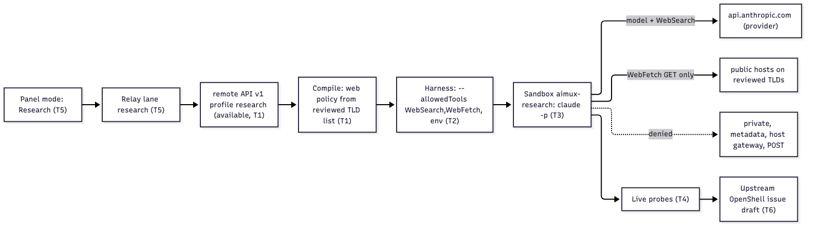

# Plan 1.5: Research Profile Implementation Plan

> **For agentic workers:** REQUIRED SUB-SKILL: Use superpowers:subagent-driven-development (recommended) or superpowers:executing-plans to implement this plan task-by-task. Steps use checkbox (`- [ ]`) syntax for tracking.

**Goal:** Make the builtin `research` profile available: Claude Code answers with WebSearch and WebFetch inside an OpenShell sandbox whose only web egress is GET to public hosts on a reviewed TLD list, reachable from Wingman as a Research mode.

**Architecture:** The profile compiler turns `network.allow: web` into one read-only OpenShell network policy built from a reviewed TLD list. The Claude Code adapter allows exactly `WebSearch,WebFetch` when the intent has web. The sandbox engine runs `research` like `work-readonly` (no tool gateway endpoint). The Wingman relay and panel gain a third lane, `research`.

**Tech Stack:** Go (aimux), OpenShell 0.1.7 policy YAML, Claude Code 2.1.319 in `localhost/wingman-sandbox:2.1.319`, TypeScript + vitest (wingman extension).

**Spec:** `docs/superpowers/specs/2026-11-10-tool-gateway-profiles-design.md` (profiles, enforced vs cooperative) and `docs/superpowers/specs/2026-11-14-research-profile-spike.md` (Recommendation section is binding for policy shape and flags).

## Global Constraints

- Owner decision (2026-11-14): WebSearch plus WebFetch on a reviewed TLD wildcard list, GET only, private ranges blocked; an upstream OpenShell issue is drafted and shown to the owner before filing.
- Web policy shape (spike): one endpoint per TLD, `host: "**.*.<tld>"`, `port: 443`, `protocol: rest`, `enforcement: enforce`, `access: read-only`, no `allowed_ips`, binaries `/usr/bin/node` and `/usr/lib/node_modules/@anthropic-ai/claude-code/bin/claude.exe`. Policy name `public_web_readonly`.
- Reviewed TLD list v1 (exact): `com, org, net, io, dev, ai, app, edu, gov, co, me, info, uk, de, eu`. Never `**.*.*`: it matches the host-gateway aliases (`host.containers.internal` and siblings), which OpenShell authorizes as trusted, bypassing the private-address block (verified live 2026-11-14).
- Reviewed apex list v1 (exact hosts, stopgap until upstream any-host-public lands, then removed): `github.com, gitlab.com, stripe.com, python.org, kubernetes.io, redhat.com, anthropic.com, openai.com, arxiv.org, npmjs.com, pypi.org, go.dev, pkg.go.dev, endoflife.date`. Each is one endpoint with the same read-only shape plus `allowed_ips` restricted to public ranges (the spike's "public complement"; Task 1 confirms the exact list OpenShell accepts next to the provider endpoint without an ambiguity error, else the host is dropped with a ledger note).
- Page context in Research: sent only when the "Use this page" chip is on. Default on, except on private origins (list v1: `mail.google.com, docs.google.com, drive.google.com, calendar.google.com, *.slack.com, app.slack.com, redhat.atlassian.net, *.atlassian.net`), where it starts off. When on for a private origin the panel shows: "This page's text can reach the web in Research mode." Rationale: private text plus web egress is the one leak path (spike, open risk 1).
- Harness flags for web: `--tools WebSearch,WebFetch --allowedTools WebSearch,WebFetch` (plus any MCP names), `--strict-mcp-config`, `--setting-sources ""`; env `DISABLE_TELEMETRY=1`, `DISABLE_ERROR_REPORTING=1`.
- OpenShell sandbox names are at most 19 characters.
- `research` holds no private data: it has no tools and no `gateway` (ruling: drop `wiki:readonly` from `research`; private context arrives with `research-with-work` in plan 3).
- Test-first, one red-green cycle per function. No commits (leave changes staged). No em dashes, no `---` lines, no `>` blockquotes in docs.
- Never touch `~/go/bin/aimux`, the running OpenShell gateway, or the sandboxes `aimux-work-readonly` and `wingman-work`.

## Review Focus

1. A user profile that `extends: builtin:research` and narrows `network.allow` to drop `web`: compiles with no `public_web_readonly` policy and no web tools (Task 1, Task 2 tests).
2. A user profile that adds `web` to a parent without it: rejected as widening (existing narrow-only check; Task 1 asserts it still holds for `web`).
3. Changing the TLD list changes `PolicyDigest`, so a running sandbox gets the new policy (Task 1).
4. A research question on a page the extension cannot read still runs, with the chip disabled and no page text (Task 5).
5. Switching tabs or navigating resets the panel mode to Page, as the work toggle does today (Task 5).

## File Structure

- `internal/profile/builtin/research.yaml`: drop `tools`, keep `network.allow: [model, web]`.
- `internal/profile/builtin/web-tlds.txt` and `web-apex.txt` (new, embedded): the reviewed TLD and apex lists, one per line, `#` comments.
- `internal/profile/manifest.go`: `research` leaves the `unavailable` set.
- `internal/profile/compile.go`: web policy, `Intent.Web`, sandbox name length check.
- `internal/harnessconfig/claude.go`, `harnessconfig.go`: web in `--allowedTools`, `Spec.Env`.
- `internal/sandboxlaunch/cli.go` (wrapper): export `Spec.Env` before `claude`.
- `internal/profilerun/sandbox.go`, `work.go`: run with no MCP servers; WebFetch tool events carry the URL.
- `internal/profilerun/research_live_test.go` (new, gated by `AIMUX_LIVE_RESEARCH=1`).
- `internal/browserhost/relay.go`: lane `research` maps to profile `research`.
- `clientscope` defaults already list `research` for wingman; confirm only.
- Extension `src/state.ts`, `src/panel.ts`, `src/privacy.ts` (new), `sidepanel.html`, `panel.css`: three-way mode and the Use this page chip.
- Docs: `docs-site/.../guides/profiles.mdx` builtins table, `guides/wingman.mdx`, `RELEASE_NOTES.md`, wingman `README.md`.

### Task 1: Compile `research` with a web policy

**Files:** Modify `internal/profile/compile.go`, `internal/profile/manifest.go`, `internal/profile/builtin/research.yaml`; Create `internal/profile/builtin/web-tlds.txt`, `internal/profile/testdata/compile/research.golden.yaml`; Test `internal/profile/compile_test.go`, `compile_policydigest_test.go`.

**Interfaces:**
- Produces: `func WebTLDs() []string` and `func WebApexHosts() []string` (sorted, from embedded `web-tlds.txt` and `web-apex.txt`); `Compiled.Intent.Web == true` for profiles allowing `web`; `Compiled.Sandbox` unchanged format `"aimux-" + name`; new `ErrNameTooLong` (wraps `ErrUnsupported`).

- [ ] **Step 1: Failing tests**
  - `TestCompile_ResearchWebPolicy`: `Resolve("research")` then `Compile` succeeds; YAML equals `research.golden.yaml`; policy `public_web_readonly` has 15 wildcard endpoints, each `host` `**.*.<tld>` for exactly the Global Constraints list, plus one exact endpoint per apex host with public-only `allowed_ips`, `port: 443`, `protocol: rest`, `enforcement: enforce`, `access: read-only`, `allowed_ips` empty; no `/mcp/` endpoint; `Servers` empty; `Intent.Web` true.
  - `TestCompile_WebDroppedByChild`: a user profile `extends: builtin:research` with `network.allow: [model]` compiles with no `public_web_readonly` and `Intent.Web` false.
  - `TestResolve_AddingWebWidens`: child of `builtin:work-readonly` adding `web` fails with the existing widening error.
  - `TestCompile_ApexHostsExact`: every apex host appears once as an exact host, never with a wildcard, and its `allowed_ips` excludes `10.0.0.0/8`, `172.16.0.0/12`, `192.168.0.0/16`, `127.0.0.0/8`, `169.254.0.0/16`.
  - `TestPolicyDigest_ChangesWithTLDs`: compiling with a test-injected TLD list `[com]` vs `[com, org]` gives different `PolicyDigest` (inject via an unexported package var the test swaps).
  - `TestCompile_SandboxNameTooLong`: a user profile named `research-with-work2` (sandbox name 25 chars) fails with `ErrNameTooLong`; `work-readonly` (19) passes.
  - `TestBuiltins_ResearchAvailable`: `research` listed with `Available` true; `research-with-work` still false.
- [ ] **Step 2:** Run `go test ./internal/profile/ -run 'Research|Web|TLD|NameTooLong'`; expect FAIL.
- [ ] **Step 3:** Implement: embed `web-tlds.txt`; replace the `web` rejection with the policy; endpoint struct gains `Access string yaml:"access,omitempty"` (and MCP-only fields become `omitempty` so the existing golden files stay byte-identical, check this); name length check before building; `research.yaml` per File Structure; remove `research` from `unavailable`.
- [ ] **Step 4:** `go test ./internal/profile/...` PASS, including unchanged existing goldens.

### Task 2: Harness allows the web tools

**Files:** Modify `internal/harnessconfig/claude.go`, `harnessconfig.go`; Test `internal/harnessconfig/claude_test.go`.

**Interfaces:**
- Consumes: `Intent.Web` (Task 1).
- Produces: `Spec.Env map[string]string`; for print mode with `Web`, `--allowedTools` is the comma-joined sorted union of `WebFetch`, `WebSearch` and the MCP names; `Env` is `{"DISABLE_TELEMETRY":"1","DISABLE_ERROR_REPORTING":"1"}` for every print-mode spec.

- [ ] **Step 1: Failing tests**: `TestClaudePrint_WebAllowsBothTools` (argv has `--tools WebSearch,WebFetch` and `--allowedTools WebFetch,WebSearch`); `TestClaudePrint_WebPlusMCP` (allowedTools `WebFetch,WebSearch,mcp__wiki__wiki_search`); `TestClaudePrint_NoWebNoWebTools` (neither name anywhere in argv); `TestClaudePrint_EnvDisablesTelemetry`.
- [ ] **Step 2:** run, FAIL. **Step 3:** implement. **Step 4:** `go test ./internal/harnessconfig/...` PASS.

### Task 3: Sandbox engine runs research

**Files:** Modify `internal/sandboxlaunch/cli.go` (wrapper env), `internal/profilerun/sandbox.go`, `internal/profilerun/work.go`; Test `internal/sandboxlaunch/wrapper_sh_test.go`, `internal/profilerun/sandbox_test.go`, `work_test.go`.

**Interfaces:**
- Consumes: `Spec.Env` (Task 2), `Compiled.Servers` possibly empty (Task 1).
- Produces: wrapper exports each `Spec.Env` entry (names must match `^[A-Z_][A-Z0-9_]*$`, values `^[A-Za-z0-9._-]*$`, else the launch fails) before exec of `claude`; a turn with no servers issues no gateway token and writes an MCP config with no servers; a `WebFetch` `tool_use` yields a tool event whose snippet is its `url` input.

- [ ] **Step 1: Failing tests**: `TestWrapper_ExportsEnv` (the real wrapper under `sh`, env visible to a fake `claude`); `TestWrapper_RejectsBadEnv`; `TestSandboxEngine_NoServersNoToken` (fake launcher; tokens.Issue not called; MCP config has empty `mcpServers`); `TestParseStream_WebFetchSnippetIsURL`; `TestSandboxEngine_ResearchTurnArchives` (archive still runs and the archived transcript path is recorded as for work-readonly).
- [ ] **Step 2:** run, FAIL. **Step 3:** implement. **Step 4:** `go test ./internal/sandboxlaunch/... ./internal/profilerun/...` PASS.

### Task 4: Live probes (gated)

**Files:** Create `internal/profilerun/research_live_test.go`.

- [ ] **Step 1:** `TestLive_ResearchProbes`, skipped unless `AIMUX_LIVE_RESEARCH=1`. Through the real `SandboxEngine` and CLI launcher on gateway `local`, with sandbox name override `aimux-rsch-live` (deleted in `t.Cleanup`, and the test fails if it still exists afterwards): one WebSearch question answers; WebFetch of `https://en.wikipedia.org/wiki/OpenShell` answers; a prompt asking to fetch `http://169.254.169.254/`, `http://host.containers.internal:7381/` and to POST to `https://httpbin.org/post` reports failures, and `openshell -g local logs` for the sandbox shows DENIED lines for each. Record the run in the plan's ledger.
- [ ] **Step 2:** Controller runs it once with the owner's gateway up: `AIMUX_LIVE_RESEARCH=1 go test ./internal/profilerun -run TestLive_ResearchProbes -v -timeout 15m`. Expected PASS.

### Task 5: Research mode in Wingman

**Files:** Modify `internal/browserhost/relay.go` (`profileOfLane`), extension `src/state.ts`, `src/panel.ts`, `sidepanel.html`, `panel.css`; Test `internal/browserhost/relay_test.go`, extension `test/state.test.ts`, `test/panel.test.ts`; Docs per File Structure.

**Interfaces:**
- Produces: lanes `page | research | work`; `TabState.mode: Lane` replaces `workOn` (`laneFor(tab)` returns `tab.mode`); `TabState.usePage: boolean` (Research only; default per Global Constraints private-origin list, reset on navigation); `isPrivateOrigin(url): boolean` in `src/privacy.ts`; relay maps `research` to profile `research`; a research ask sends page text only when `usePage` is on (URL and title always).

- [ ] **Step 1: Failing tests**: `TestRelay_AskResearchUsesResearchProfile`; `state.test.ts` "mode resets to page on navigation, keeps on anchor jumps" (replaces the work-toggle test); `panel.test.ts` "Research mode asks without reading the page" (no extract call, lane `research`), "the mode control is a radio group with Page, Research, My work" (role `radiogroup`, arrow keys move, `aria-checked`), "an unreadable page still allows Research", "Use this page is on by default on a public page and sends the page text", "on mail.google.com it starts off and sends no page text; turning it on shows the warning and sends it", `isPrivateOrigin` table test (each list entry, a subdomain of `*.slack.com`, a public host, an unparsable URL as private).
- [ ] **Step 2:** run, FAIL. **Step 3:** implement; restyle with the existing panel tokens (no new colors); run `impeccable detect` on `sidepanel.html` + `panel.css` until 0 findings. **Step 4:** Go relay tests and `npx vitest run`, `npx tsc --noEmit`, `npm run build` PASS.
- [ ] **Step 5:** Docs: profiles builtins table (`research` available, no tools, `model` and `web`), wingman guide (three modes, what Research can reach, the TLD list and the apex gap), RELEASE_NOTES Highlights line, wingman README.

### Task 6: Upstream OpenShell issue draft (controller)

- [ ] Draft the issue with the `qa-tools:issue-preview` skill for NVIDIA/OpenShell: a public-only any-host endpoint (`**` limited to public addresses, or hostless `allowed_ips` that can coexist with a provider endpoint on the same port), evidence from the spike (`crates/openshell-policy/src/lib.rs:1687-1690`, `:1512-1519`, `ambiguity.rs`, query strings dropped at `l7/relay.rs:2141`), with the `openshell-podman` relevance noted. Save to `docs/superpowers/specs/2026-11-14-openshell-public-any-host-issue.md`. Show the owner; file only on an explicit yes.

## Final verification (controller)

`scripts/golangci-lint-hook.sh` (0 issues), `go vet ./...`, `go test ./... -race -count=1`, extension `npx vitest run` and `npx tsc --noEmit`, rebuild `~/.aimux/wingman/bin/aimux` (atomic mv) and the extension, then a live Research question from the panel.
