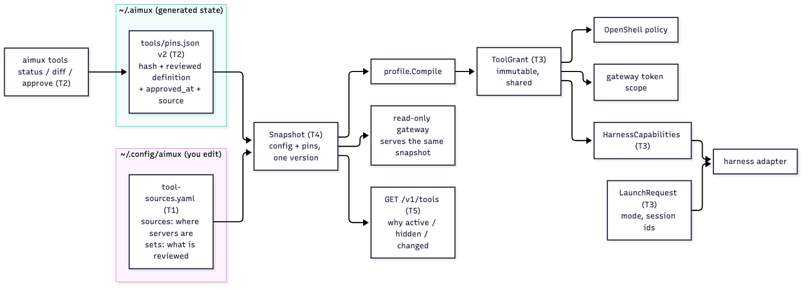

# Plan 2a: Tool Registry, Pin Review and Grant Types Implementation Plan

> **For agentic workers:** REQUIRED SUB-SKILL: Use superpowers:subagent-driven-development (recommended) or superpowers:executing-plans to implement this plan task-by-task. Steps use checkbox (`- [ ]`) syntax for tracking.

**Goal:** Make the tool layer safe to build more clients and a model proxy on: one user-edited registry of tool sources and reviewed sets, pins that change only with an explicit reviewed diff, one immutable grant shared by policy, token and harness, one consistent snapshot, and an explain endpoint.

**Architecture:** `~/.config/aimux/tool-sources.yaml` replaces `~/.aimux/wingman/readonly.json` (migrated automatically). Pins move to a v2 record that stores the reviewed definition and provenance, and only `aimux tools approve` writes them. `profile.Compile` returns a `ToolGrant` instead of a shared map, and `harnessconfig.Intent` splits into capabilities and launch details. Config and pins load as one versioned `Snapshot` that the compiler, the gateway and `GET /v1/tools` all read.

**Tech Stack:** Go (aimux), YAML (strict, KnownFields), JSON (generated state).

**Spec:** `docs/superpowers/specs/2026-11-10-tool-gateway-profiles-design.md` (registry, review, `/v1/tools`; plan 2 scope) plus the Codex architecture review of 2026-11-15 (saved in the plan 1.5 ledger folder), which refined names and the trust model.

This is plan 2a. Plan 2b (curated CLI packs, the `aimux-tools` runner sandbox, HTTP sources, `tools/list_changed` wiring, authorship classes) follows after 2a ships.

## Global Constraints

- Registry file: `~/.config/aimux/tool-sources.yaml`, strict YAML (unknown keys are errors naming file and key), top-level `version: 1`, `sources:` (name -> `{type: mcp-http, url}` or `{type: local-notes, root}`), `sets:` (name like `google:readonly` -> `{source, tools: [exact names]}`). One file, so an endpoint cannot be paired with the wrong review.
- Migration: when the registry is absent and `~/.aimux/wingman/readonly.json` exists, setup copies it into the registry, validates it, keeps the old file renamed `readonly.json.migrated`, and never overwrites an existing registry.
- The wiki stops being special: it is a `local-notes` source; the hard-coded research path default is removed (a notes source is added only when configured, e.g. `aimux tools add notes --folder <dir>`).
- Pins v2: `~/.aimux/tools/pins.json` with `version: 2`, per tool `{hash, definition (canonical JSON that was hashed), approved_at, source}`; v1 files are read and upgraded on the next approve.
- Only `aimux tools approve` writes pins. `aimux browser setup` never approves silently: it prints the diff and the approve command (`--accept-pins` exists for automation and says so loudly).
- Pins detect schema changes; they do not prove a tool is read-only. Docs and command output say so.
- `ToolGrant` is immutable (unexported fields, accessor methods, no shared maps); policy rendering, token scope and adapters all consume it.
- `harnessconfig` splits into `Capabilities` (tools grant, web, file grants, inherit user, model) and `Launch` (mode, resume id, session id). A future Codex or Gemini adapter reads the same two.
- Snapshot: one immutable value `{version, sources, sets, pins}`; the compiler and the gateway use the same snapshot version per turn; reloads swap atomically.
- `GET /v1/tools` is read-only and scoped like `/v1/profiles`: per set and tool, status `active | unpinned | changed | unavailable | not_allowed` with a reason.
- CLI shape (owner-approved 2026-11-15): one noun per concern, same verbs: `aimux tools status|diff|approve|add|remove`, `aimux sandbox status|setup|verify`, `aimux router status|test`, `aimux browser status|setup|uninstall` (Chrome native host and extension id only), front door `aimux setup` (runs only missing steps; interactive review of changed tools when on a terminal, never approves when not), and `aimux doctor` (read-only checks with live probes, one fix command per problem). Every `status` is read-only with `--json`; stable exit codes; a `Next:` hint on stderr; `aimux agent-context` lists the new commands. `aimux browser setup` keeps working: Chrome-only plus a pointer to the other nouns.
- Testing along the way (owner rule): every task ends with an Exercise step that runs the real built binary (`go build -o $SCRATCH/aimux ./cmd/aimux`, never `~/go/bin/aimux`) on the owner's Mac, read-only unless the task says otherwise, and records the output in the task report; the controller checks it before marking the task complete.
- Test-first, one cycle per function. No commits (leave changes staged). No em dashes, no `---` lines, no `>` blockquotes in docs.

## Review Focus

1. A user with an existing `readonly.json` and no registry upgrades: setup migrates, profiles keep working, and nothing is re-pinned (Task 1, Task 2).
2. A backend changes a tool's schema between turns: the gateway hides it, `/v1/tools` says `changed` with the diff available via `aimux tools diff`, and a running session keeps working with the rest (Task 2, Task 4, Task 5).
3. Config edited while a turn is compiling: the turn uses one snapshot version end to end; the next turn sees the new one (Task 4).
4. `aimux tools approve` run twice, or with nothing changed: idempotent, no new provenance timestamps (Task 2).
5. A registry typo (`sorces:`) or a set pointing at an unknown source: a clear error and `remote serve` still starts, with that set unavailable (Task 1).

### Task 1: Tool-source registry and migration

**Files:** Create `internal/toolreg/registry.go` (+ test); modify `internal/mcpproxy/readonly.go` (consume the registry instead of `ReadonlyConfig` defaults), `cmd/aimux/cmd/browser.go` (migration), docs.

**Interfaces (produces):** `toolreg.Registry{Version int; Sources map[string]Source; Sets map[string]Set}`; `toolreg.Load(path string) (Registry, error)` (strict); `toolreg.Migrate(oldReadonlyPath, registryPath string) (migrated bool, err error)`; `toolreg.DefaultPath(home string) string`.

- [ ] **Step 1: Failing tests:** `TestLoad_Strict` (typo -> error naming file and key), `TestLoad_SetUnknownSource` (error names the set; other sets still load with a per-set error list), `TestMigrate_FromReadonlyJSON` (allowlist and backends carried over; old file renamed `.migrated`), `TestMigrate_NeverOverwrites`, `TestNotesSourceNotDefault` (no notes source unless configured).
- [ ] **Step 2:** FAIL. **Step 3:** implement; wire `remote serve` and setup. **Step 4:** PASS; full suite, vet, lint 0, layer check (`toolreg` imports no frontend or remote API packages).
- [ ] **Exercise:** run the migration on a temp HOME seeded with a copy of the owner's `readonly.json`; show the produced `tool-sources.yaml`; then the real `aimux tools status` is not yet available, so print the loaded registry via a test helper.

### Task 2: Pin review: status, diff, approve

**Files:** Modify `internal/toolgateway/pin.go` (v2 record), create `cmd/aimux/cmd/tools.go` (+ test); modify `browser.go` (no silent approve).

**Interfaces:** `toolgateway.PinRecord{Hash, Definition json.RawMessage, ApprovedAt time.Time, Source string}`; `toolgateway.Diff(live, pinned) []Change` with `Change{Set, Tool, Kind /* added|removed|changed */, Before, After json.RawMessage}`; CLI `aimux tools status [--json]`, `aimux tools diff [set] [--json]`, `aimux tools approve [set|set/tool ...] [--all]`; `aimux browser setup --accept-pins`.

- [ ] **Step 1: Failing tests:** v1 pins read and upgraded on approve; `diff` shows added/removed/changed with a readable field-level diff of the definition; `approve` writes only the named tools, idempotent; setup prints the diff and the approve command and writes no pins; `--accept-pins` approves and prints a warning line; status JSON stable.
- [ ] **Step 2:** FAIL. **Step 3:** implement. **Step 4:** PASS; docs: profiles guide "Reviewed tool sets and pins" updated to the approve flow.

Task 2 also moves pinning out of `aimux browser setup`: setup reports pending review and points to `aimux tools diff`; `--accept-pins` stays as the explicit automation path.
- [ ] **Exercise:** on a scratch copy of the owner's pins and registry (HOME pointed at a temp dir seeded with copies), run `aimux tools status`, `diff`, `approve` for one tool; show outputs. Then `aimux tools status --json` against the real files (read-only).

### Task 3: `ToolGrant` and the Intent split

**Files:** Modify `internal/profile/compile.go`, `internal/harnessconfig/harnessconfig.go`, `claude.go`, every caller (`internal/profilerun`, `internal/toolgateway` token issue, `cmd/aimux/cmd/browser.go` verify).

**Interfaces:** `profile.ToolGrant` with `Servers() []string`, `Tools(server string) []string`, `Empty() bool`, `Digest() string`; `Compiled.Grant ToolGrant` (replaces `Servers` and `Intent.Tools`); `harnessconfig.Capabilities{Grant ToolGrantView; Web bool; Files FileGrant; InheritUser bool; Model string}`, `harnessconfig.Launch{Mode, ResumeID, SessionID string}`, `Adapter.Config(c Capabilities, l Launch) (Spec, error)`.

- [ ] **Step 1: Failing tests:** mutating anything returned from a grant cannot change the grant; policy, token scope and `--allowedTools` produced from one grant match exactly (one table test across all three); claude argv unchanged byte for byte for page, research and work-readonly (golden argv tests); `Files` carries read and write path lists.
- [ ] **Step 2:** FAIL. **Step 3:** implement (pure refactor plus the new types; no behaviour change). **Step 4:** PASS; full suite.

- [ ] **Exercise:** run the real `aimux profile show work-readonly` and a dry compile helper (test-only or `aimux sandbox status --json` from Task 6 if available) to confirm the compiled policy digest for the owner's current pins is unchanged by the refactor.

### Task 4: One snapshot for compiler and gateway

**Files:** Create `internal/toolreg/snapshot.go`; modify `internal/toolgateway/readonly_server.go` (Refresh swaps a snapshot), `internal/remoteapp` wiring, `internal/profilerun` (compile from a snapshot).

**Interfaces:** `toolreg.Snapshot{Version string /* hash of registry+pins */}` with accessors; `toolreg.Store` with `Current() Snapshot` and `Reload() (Snapshot, changed bool, err error)` (atomic swap); compile and the gateway's per-session guard both record the snapshot version used.

- [ ] **Step 1: Failing tests:** a reload during a turn does not change the version that turn compiled with; the gateway refuses a call made under a token issued for an older snapshot only if the tool changed (not for unrelated edits); version is stable for identical inputs.
- [ ] **Step 2:** FAIL. **Step 3:** implement. **Step 4:** PASS; race tests.

- [ ] **Exercise:** start a scratch `remote serve --local-only` on a temp HOME seeded with copies, edit the registry while a fake turn compiles, confirm versions in logs.

### Task 5: `GET /v1/tools` explain endpoint

**Files:** Create `internal/remoteapi/tools_api.go` (+ test), OpenAPI, docs (remote-access).

**Interfaces:** `GET /v1/tools` -> `{"snapshot": version, "sets": [{"name", "source", "status", "tools": [{"name", "status", "reason", "approvedAt"}]}]}`; scoped: a client sees only sets used by profiles in its scope; confined clients allowed.

- [ ] **Step 1: Failing tests:** each status with its reason; scope filtering; no definitions or credentials in the response; OpenAPI contract test.
- [ ] **Step 2:** FAIL. **Step 3:** implement. **Step 4:** PASS; full suite, lint 0.

- [ ] **Exercise:** query `GET /v1/tools` on the scratch serve over its local socket as client wingman and as cli; show both.

### Task 6: `aimux sandbox` noun (moved out of browser)

**Files:** Create `cmd/aimux/cmd/sandbox.go` (+ test); modify `browser.go` (delegate; Chrome-only), docs.

**Interfaces:** `aimux sandbox status [--json]` (image present, provider present, OpenShell gateway reachable, per-profile sandbox existence and policy digest vs compiled), `aimux sandbox setup` (image build + provider, idempotent), `aimux sandbox verify` (today's `browser verify` checks); `aimux browser verify` and the sandbox parts of `browser setup` call these and print a deprecation hint.

- [ ] **Step 1: Failing tests** with fake exec for each status line, idempotent setup, verify delegation, `--json` schema. **Step 2:** FAIL. **Step 3:** implement. **Step 4:** PASS.
- [ ] **Exercise:** real `aimux sandbox status` and `status --json` on the owner's Mac (read-only).

### Task 7: `aimux router` noun

**Files:** Create `cmd/aimux/cmd/router.go` (+ test), docs.

**Interfaces:** `aimux router status [--json]` (decider name, backends, model, threshold, key source found by existence only, config file path and validity), `aimux router test "<question>" [--facts page-readable,site-private,use-page] [--json]` (runs the real decider, prints mode, confidence, probabilities, decided, source, ms, cost; never runs the question; logs a decision line marked `test`).

- [ ] **Step 1: Failing tests** with a fake backend; key never printed; bad config message. **Step 2:** FAIL. **Step 3:** implement. **Step 4:** PASS.
- [ ] **Exercise:** real `aimux router status` and two real `aimux router test` calls (one web, one workspace question) with the owner's key; show outputs and cost.

### Task 8: `aimux setup` front door and `aimux doctor`

**Files:** Create `cmd/aimux/cmd/setup.go`, `doctor.go` (+ tests); `agent-context` entries; docs (getting started, a troubleshooting page).

**Interfaces:** `aimux setup [--yes] [--json]`: runs each concern's status, then only the missing setup steps (sandbox setup, browser setup when a Chrome extension id is known, tools review), interactive review of changed tools on a TTY, never approves when not a TTY or with `--json`; prints the five-line summary (sandbox, tools, router, browser, gateway). `aimux doctor [--json]`: read-only checks with live probes and a fix command per problem, covering at least: tool not in any set, changed tool pending review, router key only in the shell environment, port 7390 held by a serve, OpenShell gateway down, Wingman serve on an older binary, sandbox policy digest stale.

- [ ] **Step 1: Failing tests** with fakes for every check and the TTY vs non-TTY approval rule. **Step 2:** FAIL. **Step 3:** implement. **Step 4:** PASS.
- [ ] **Exercise:** real `aimux doctor` and `aimux setup` (non-interactive, `--json`) on the owner's Mac; show both; confirm the second `aimux setup` run changes nothing.

## Final verification (controller)

Lint 0, `go test ./... -race`, layer check; migrate the owner's live `readonly.json` once (backup kept), run `aimux tools status`, then a Workspace question in Wingman and `GET /v1/tools` from the CLI.
