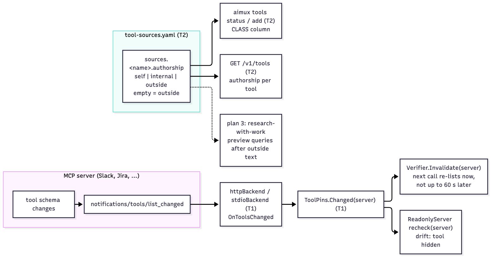

# Plan 2b: Tool Changes Seen at Once, and Authorship Classes

> **For agentic workers:** REQUIRED SUB-SKILL: Use superpowers:subagent-driven-development (recommended) or superpowers:executing-plans to implement this plan task-by-task. Steps use checkbox (`- [ ]`) syntax for tracking.

**Goal:** A tool server's `notifications/tools/list_changed` closes the pin freshness window at once, and every tool source carries an authorship class (`self`, `internal`, `outside`) that the CLI and `GET /v1/tools` show.

**Architecture:** Backends that can receive notifications expose `OnToolsChanged`; the read-only build wires it to a new `ToolPins.Changed(server)`, which invalidates the call guard's verifier and triggers the gateway's existing per-server recheck. Authorship is one optional field on a registry source; empty means `outside`. Plan 3 (`research-with-work`) is its first consumer; this plan only records and shows it.

**Tech Stack:** Go 1.26, mcp-go v1.5.0 (client `OnNotification`, server `SendNotificationToAllClients`), YAML (`gopkg.in/yaml.v3`, strict).

**Spec:** `docs/superpowers/specs/2026-11-10-tool-gateway-profiles-design.md`, sections "Decisions after the builder check" (Pin freshness) and "Owner decisions after the builder check" (Outside-authored sources are marked). Builds on plan 2a: `docs/superpowers/plans/2026-11-15-plan2a-tool-registry-and-review.md`.

Plan 2c (`2026-11-16-plan2c-runner-cli-http.md`) covers the runner sandbox, CLI packs and HTTP sources; it does not depend on this plan.



## Global Constraints

- Pin freshness (spec, verbatim): "The gateway verifies each source's live tool list against the pins when a session starts, whenever the source sends `tools/list_changed`, and otherwise at most every 60 seconds before a call. ... The window is at most 60 seconds and closes immediately on a change notification."
- Authorship classes (spec, verbatim): "`self` (notes, wiki, the owner's own docs), `internal` (internal Jira, internal Slack channels) or `outside` (Gmail, Slack Connect channels, external Jira comments, anything others can write into)." "default `outside` when unsure".
- `tool-sources.yaml` stays `version: 1`; the new key is optional, so files without it load unchanged. `KnownFields(true)` stays on.
- `GET /v1/tools` changes are additive (new optional field), and `api/remote-v1.openapi.yaml` is updated in the same task.
- No em dashes in code comments, docs or CLI text. User-facing changes update `docs-site` and `RELEASE_NOTES.md` (v0.15.0 is not tagged yet) in the same task.
- Test-first, one test-implement cycle per function. Gates per task: `go test -race` on touched packages, `go vet ./...`, `golangci-lint run` 0 issues.

## Review Focus

1. A notification that arrives while a call's verification is in flight: the call must not use a listing older than the notification. Test in Task 1 (`TestVerifier_InvalidateDuringCheck_NextCallRelists`).
2. A burst of notifications (a server that sends `list_changed` on every list): one relist at a time, not one per notification. Test in Task 1 (`TestReadonlyServer_NotificationBurst_OneRelist`).
3. A backend restarted by the pool (new process, new client): its notifications must still reach the guard. Test in Task 1 (`TestBuildReadonly_RestartedBackendStillNotifies`).
4. An old aimux binary reading a registry that now has `authorship:`: strict decoding fails the whole file. The rollback note in Task 2's release-notes step says so, and `aimux tools add` writes the key only when it is not `outside`.
5. A typo such as `authorship: Outside`: rejected with the source named, not silently treated as `outside`. Test in Task 2 (`TestLoad_AuthorshipInvalid`).

### Task 1: `tools/list_changed` invalidates the pins at once

**Files:**
- Modify: `internal/mcpproxy/pool.go` (interface), `internal/mcpproxy/httpbackend.go`, `internal/mcpproxy/stdio.go:190`, `internal/mcpproxy/readonly.go` (`ToolPins`, `BuildReadonly`, `BuildReadonlyBackends`)
- Modify: `internal/toolgateway/pin.go` (`Pins.Guard`), `internal/toolgateway/snapshot.go` (`SnapshotPins`), `internal/toolgateway/readonly_server.go` (wire `Changed` to `recheck`)
- Test: `internal/mcpproxy/httpbackend_test.go`, `internal/mcpproxy/readonly_test.go`, `internal/toolgateway/verify_test.go`, `internal/toolgateway/readonly_server_test.go`

**Interfaces:**
- Produces in `mcpproxy`:
  - `type ToolsChangedNotifier interface { OnToolsChanged(func()) }`, implemented by `*httpBackend` and `*stdioBackend`. The callback runs on the client's notification goroutine and must not block.
  - `ToolPins` gains `Changed(server string)`. `passPins` (test) implements it as a no-op.
  - `BuildReadonly` and `BuildReadonlyBackends` register, for every started backend that implements `ToolsChangedNotifier`, a callback that calls `pins.Changed(server)` on the pins current at that moment (the pool's `OnStart` hook; the pins in effect change on rebuild, so look them up at callback time).
- Produces in `toolgateway`:
  - `func (p Pins) Verifier(list func(ctx context.Context, server string) ([]json.RawMessage, error)) *Verifier`; `Pins.Guard` becomes `p.Verifier(list).Check`.
  - `SnapshotPins.Changed(server string)`: invalidates its verifier for `server` and calls an `onChanged func(server string)` hook that `ReadonlyServer` sets to its existing `recheck(server)`.
- Consumes: `Verifier.Invalidate(server)` (`verify.go:67`), `ReadonlyServer.recheck` (`readonly_server.go:219`), `PoolOptions.OnStart` (`pool.go:40`).

- [ ] **Step 1: Write the failing tests**

```go
// httpbackend_test.go: a real mcp-go Streamable HTTP server sends the notification.
func TestHTTPBackend_ToolsChangedCallback(t *testing.T) {
	// start a fixture server with one tool, startHTTP against it,
	// b.OnToolsChanged(func(){ close(got) }),
	// srv.SendNotificationToAllClients("notifications/tools/list_changed", nil)
	// select { case <-got: case <-time.After(2*time.Second): t.Fatal("no callback") }
}

// verify_test.go
func TestVerifier_InvalidateDuringCheck_NextCallRelists(t *testing.T) {
	// fakeList returns schema A; Check passes at t=0.
	// change fakeList to schema B (same name), Invalidate("s") with the clock still at t=0
	// Check(ctx, "s", tool) returns ErrToolChanged (no 60 s wait).
}

// readonly_test.go
func TestBuildReadonly_ListChangedHidesChangedToolImmediately(t *testing.T) {
	// fixture HTTP server with tool search_messages pinned at schema A
	// BuildReadonly with real Pins; call succeeds
	// swap the tool's input schema to B on the server, send list_changed
	// wait for the callback (poll pins verifier up to 2 s), then CallTool -> error result naming "changed"
	// assert elapsed < 5 s with the verifier's MaxAge left at 60 s
}
func TestBuildReadonly_RestartedBackendStillNotifies(t *testing.T) {
	// as above, but Close the backend via the pool first so the next call starts a new one;
	// the notification from the new connection still hides the changed tool
}

// readonly_server_test.go
func TestReadonlyServer_NotificationBurst_OneRelist(t *testing.T) {
	// refreshRig; 20 Changed("slack") calls in a row
	// the relist counter for "slack" is 1 (or 2 if one was already in flight), never 20
}
```

- [ ] **Step 2: Run to verify they fail**

Run: `go test ./internal/mcpproxy/ ./internal/toolgateway/ -run 'ToolsChanged|InvalidateDuringCheck|ListChanged|StillNotifies|NotificationBurst' -race`
Expected: FAIL (undefined `OnToolsChanged`, `Changed`, `Pins.Verifier`).

- [ ] **Step 3: Implement**

- `httpBackend.OnToolsChanged(fn)`: register with `b.c.OnNotification` a handler that calls `fn` only for method `notifications/tools/list_changed` (`mcp.MethodNotificationToolsListChanged`). Several registrations are allowed.
- `stdioBackend.OnToolsChanged(fn)`: the stdio client already has one `OnNotification` (progress, `stdio.go:190`); add a second handler for the same method.
- `ReadonlyServer`: set `SnapshotPins.onChanged` to `recheck`, which already serializes relists per server (`relistMu`, `relisting`); confirm the burst test passes without new locking, add a per-server pending flag only if it does not.
- Log one line per notification: `tools changed: <server> (notification)`.

- [ ] **Step 4: Run to verify they pass, then the packages**

Run: `go test -race ./internal/mcpproxy/ ./internal/toolgateway/ ./internal/remoteapp/`
Expected: PASS (the known `remoteapp` TempDir cleanup flake aside: rerun once).

- [ ] **Step 5: Docs and commit**

Update the pin freshness sentence in `docs-site/src/content/docs/guides/wingman.mdx` (or wherever "60 seconds" is described for tools: `grep -rn "60 s\|60 seconds" docs-site/src/content/docs`) to say a server's change notification is acted on at once. Commit: `toolgateway: act on tools/list_changed at once`.

### Task 2: Authorship class per source

**Files:**
- Modify: `internal/toolreg/registry.go` (`Source`, `checkSource`, `Default()`, `fromLegacy`), `internal/toolreg/edit.go` (`AddSource`)
- Modify: `cmd/aimux/cmd/tools.go` (`status` column, `add --authorship`), `internal/remoteapi/tools_api.go` (`ToolSetInfo`), `api/remote-v1.openapi.yaml`
- Test: `internal/toolreg/registry_test.go`, `cmd/aimux/cmd/tools_test.go`, `cmd/aimux/cmd/tools_add_test.go`, `internal/remoteapi/tools_api_test.go`

**Interfaces:**
- Produces in `toolreg`:
  - `const (AuthorshipSelf = "self"; AuthorshipInternal = "internal"; AuthorshipOutside = "outside")`
  - `Source.Authorship string \`yaml:"authorship,omitempty"\`` (empty means outside)
  - `func (s Source) Class() string`: returns `Authorship`, or `AuthorshipOutside` when empty.
  - `AddSource(path, name string, src Source, tools []string)` unchanged; callers set `src.Authorship`.
- Produces in `remoteapi`: `ToolSetInfo.Authorship string \`json:"authorship,omitempty"\``, filled with `Source.Class()` for every set whose source exists.
- Consumes: `toolsStatus` (`tools.go:182`), `mcpSource` (`tools.go:490`), the notes case of `add` (`tools.go:437`).

- [ ] **Step 1: Write the failing tests**

```go
// registry_test.go
func TestLoad_AuthorshipValues(t *testing.T) {
	// sources with authorship self, internal, outside and none all load;
	// Class() returns self, internal, outside, outside
}
func TestLoad_AuthorshipInvalid(t *testing.T) {
	// authorship: Outside -> SourceErrors["x"] mentions `authorship "Outside" must be self, internal or outside`
	// other sources in the file still load
}
func TestDefault_Authorship(t *testing.T) {
	// Default(): slack, jira, google have Class() == "outside" (Slack Connect, external Jira comments, Gmail)
}
func TestMigrate_NotesAreSelf(t *testing.T) {
	// fromLegacy: the wiki/notes source gets Authorship "self"; the others none
}

// tools_add_test.go
func TestToolsAdd_NotesDefaultsSelf(t *testing.T)    // `tools add notes --folder X` writes authorship: self
func TestToolsAdd_MCPDefaultsOutsideOmitted(t *testing.T) // `tools add mcp --url ...` writes no authorship key
func TestToolsAdd_AuthorshipFlag(t *testing.T)       // `--authorship internal` writes it; `--authorship bogus` exits 2, file unchanged

// tools_test.go
func TestToolsStatus_ClassColumn(t *testing.T) {
	// header is "SET TOOL STATUS CLASS APPROVED REASON"; jira rows show "outside"
	// --json: each tool entry has "authorship"
}

// tools_api_test.go
func TestListTools_Authorship(t *testing.T) {
	// GET /v1/tools: the notes set has "authorship":"self", jira "outside"
}
```

- [ ] **Step 2: Run to verify they fail**

Run: `go test ./internal/toolreg/ ./cmd/aimux/cmd/ ./internal/remoteapi/ -run 'Authorship|NotesAreSelf|ClassColumn|DefaultsSelf|DefaultsOutside' -race`
Expected: FAIL (unknown field `Authorship`).

- [ ] **Step 3: Implement**

`checkSource` validates the value; `add` takes `--authorship self|internal|outside` with defaults `self` for notes and `outside` for mcp, and writes the key only when it differs from `outside`. `status` text output adds the CLASS column after STATUS; JSON adds `authorship` to each tool entry. `ToolStatus` (`review.go:81`) gains `Authorship string \`json:"authorship,omitempty"\`` filled from the registry, so status and the API share one source.

- [ ] **Step 4: Run to verify they pass**

Run: `go test -race ./internal/toolreg/ ./internal/toolgateway/ ./cmd/aimux/cmd/ ./internal/remoteapi/`
Expected: PASS.

- [ ] **Step 5: Docs and commit**

- `docs-site/src/content/docs/configuration.mdx`: the `tool-sources.yaml` table gets the `authorship` key (values, default `outside`, what each means, verbatim from the spec).
- `docs-site` `aimux tools` reference: the CLASS column and `add --authorship`.
- `api/remote-v1.openapi.yaml`: `authorship` on the set object, enum `self | internal | outside`.
- `RELEASE_NOTES.md` v0.15.0: one bullet, plus a rollback line: "an older aimux refuses a `tool-sources.yaml` with `authorship:`; remove the key to go back."

Commit: `toolreg: authorship class per source`.

## Done when

- `go test -race ./...` passes (known flakes rerun once), `go vet ./...` and `golangci-lint run` report 0.
- Live: with `remote serve` running, `aimux tools status` shows the CLASS column; a test MCP server added with `aimux tools add mcp --url http://127.0.0.1:<port>/mcp` that changes a pinned tool and sends `list_changed` gets that tool refused on the very next call (serve log line `tools changed: <server> (notification)`).
