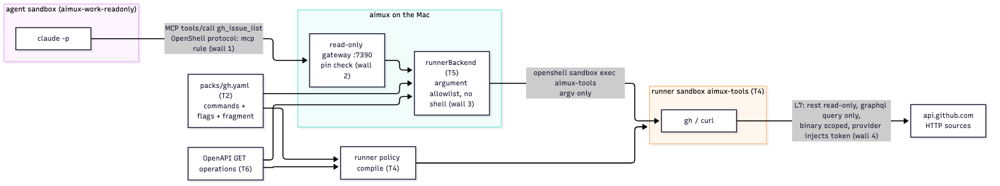

# Plan 2c: Runner Sandbox, CLI Packs and HTTP Sources

> **For agentic workers:** REQUIRED SUB-SKILL: Use superpowers:subagent-driven-development (recommended) or superpowers:executing-plans to implement this plan task-by-task. Steps use checkbox (`- [ ]`) syntax for tracking.

**Goal:** Agents in a profile sandbox can call reviewed read-only CLI commands (`gh` first) and read-only HTTP API operations as ordinary gateway tools, executed in a separate `aimux-tools` OpenShell sandbox whose network policy allows only reads.

**Architecture:** Two new registry source types, `cli` (a curated pack) and `http-openapi` (GET operations of an OpenAPI document), become `mcpproxy.Backend`s in the read-only gateway. Their `ListToolsRaw` synthesizes MCP tool definitions (so pins, review, `ToolGrant` and the agent's `protocol: mcp` rules work unchanged), and their `CallTool` checks arguments against the allowlist, then runs `gh` or `curl` with an argv (never a shell) inside `aimux-tools`. That sandbox's policy is compiled from the approved sources: L7 `rest` read-only and `graphql` query-only endpoints, binary-scoped, with credentials injected by OpenShell providers.

**Tech Stack:** Go 1.26, mcp-go v1.5.0, OpenShell CLI (`openshell -g local`, gateway as installed; the spike records the version), `gh`, `curl`, `github.com/getkin/kin-openapi` only if Task 6 needs more than GET operations and parameters (prefer a minimal decoder; decide in Task 6 Step 3).

**Spec:** `docs/superpowers/specs/2026-11-10-tool-gateway-profiles-design.md`: "What OpenShell enforces and what aimux adds" (table), "Curated CLI packs", "Pins", "Testing and acceptance" (CLI packs), "Decisions after the builder check" (tool-runner sandbox). Builds on plan 2a; independent of plan 2b.



## Global Constraints

- Spec, verbatim: "The gateway does not execute CLI commands or HTTP calls on the host. It hands each approved call to a separate OpenShell sandbox, `aimux-tools`, whose policy holds the packs' and HTTP sources' L7 fragments (method and path, binary-scoped) and whose providers inject the tools' credentials. The agent sandbox can reach only the gateway."
- Spec, verbatim: "A pack is data: subcommand plus flag allowlist, and an optional OpenShell policy fragment (API host, L7 method and path rules, binary path, credential provider). Packs are versioned with the CLI version they were written for." "`gh` ... fragment has two endpoints: `protocol: rest` with `access: read-only`, and `path: /graphql` with `protocol: graphql` allowing `operation_type: query` only. A CLI upgrade re-checks the pack; unknown subcommands stay hidden."
- Pins (spec): "CLI: subcommand and flag allowlist plus binary version; HTTP: method and path template" are in the hash. Here they go into the synthesized tool's `inputSchema` and `annotations`, which `PinTool` already hashes (`pin.go:22`); no change to the hash function.
- Arguments: no shell anywhere; every value is checked against its flag's type and pattern; values starting with `-`, containing control characters or NUL are refused; unknown subcommands and flags are refused (spec acceptance: "argument allowlist rejects unknown subcommands, flags and shell metacharacters").
- Credentials never appear in argv, logs, tool output or `pins.json`; the sandbox sees only OpenShell's placeholder.
- Sandbox names are at most 19 characters (`maxSandboxName`); `aimux-tools` is 11.
- No em dashes in code comments, docs or CLI text. User-facing changes update `docs-site` and `RELEASE_NOTES.md` in the same task. Test-first. Gates per task: `go test -race` on touched packages, `go vet ./...` (darwin and linux), `golangci-lint run` 0 issues.

## Review Focus

1. A flag value that is itself a flag (`--repo=--help`, `--repo -x`): refused, never passed to `gh`. Test in Task 2 (`TestValidate_ValueLooksLikeFlag`).
2. `gh` upgraded inside the image: every `gh_*` tool shows `changed` until re-approved, and calls are refused meanwhile. Test in Task 5 (`TestRunnerBackend_BinaryVersionChangeIsDrift`).
3. A huge or hanging command (`gh search issues` with a slow API): the call returns an error result within 30 s and output is capped at 256 KiB, marked as cut. Test in Task 5 (`TestRunnerBackend_TimeoutAndCap`).
4. An OpenAPI path parameter carrying `../` or `?`: percent-encoded into one segment, never changing the path template. Test in Task 6 (`TestBuildURL_ParamCannotEscapeTemplate`).
5. The runner sandbox missing or stopped when a call arrives: one `Ensure`, then the call; a failing `Ensure` gives an error result naming `aimux sandbox setup`, not a hang. Test in Task 5 (`TestRunnerBackend_EnsureFailsCleanly`).

### Task 1: Spike: OpenShell read-only L7 for REST and GraphQL, providers, exec

No production code. Answers the questions the later tasks depend on, against the owner's local gateway.

**Files:**
- Create: `docs/superpowers/specs/2026-11-16-runner-sandbox-spike.md` (results, with the exact policy YAML that worked)
- Scratch only: policy files and a throwaway sandbox `aimux-spike-tools`, deleted at the end

- [ ] **Step 1:** Record `openshell --version` and the gateway version. Build or pick an image with `gh` and `curl` (start from `localhost/wingman-sandbox:2.1.319`; if it lacks `gh`, write a two-line Containerfile `FROM` it that installs the `gh` RPM, pinned).
- [ ] **Step 2:** Create `aimux-spike-tools` with a policy holding `api.github.com:443` twice: `protocol: rest`, `access: read-only`; and `path: /graphql`, `protocol: graphql` with a rule allowing `operation_type: query`. Binaries: the `gh` and `curl` paths. Check and record:
  - `gh api repos/cli/cli` succeeds (REST GET).
  - `gh api -X POST repos/<owner>/<private test repo>/issues -f title=x` is denied with `policy_denied` (record the exact error text `gh` prints).
  - `gh api graphql -f query='{ viewer { login } }'` succeeds; a mutation (`addStar`) is denied.
  - `python3 -c 'import urllib.request; urllib.request.urlopen("https://api.github.com")'` (a binary not in the list) is denied.
- [ ] **Step 3:** Provider: create provider `aimux-github` from a GitHub token (Keychain item `aimux-github`, read only to pass it to `openshell provider create`), attach it, confirm `gh auth status` inside sees a token and that `env` shows a placeholder, not the token.
- [ ] **Step 4:** Exec: time 10 runs of `openshell -g local sandbox exec aimux-spike-tools -- gh --version` (p50, p95), and whether stdout and the exit code come back intact.
- [ ] **Step 5:** REST method and path rules for HTTP sources: confirm the YAML for allowing `GET` on a path template with a wildcard segment (for example `/repos/*/issues`), and that `access: read-only` blocks `POST`, `PUT`, `PATCH`, `DELETE`.
- [ ] **Step 6:** Write the spike doc: each check with the command and its output, the exact YAML shapes for `rest` (access and rules) and `graphql` rules, the provider type, exec latency. End with rulings: go, or what Task 4 must change. Delete the sandbox and provider.

### Task 2: `internal/clipack`: pack format, the `gh` pack, argument checking

**Files:**
- Create: `internal/clipack/pack.go`, `internal/clipack/validate.go`, `internal/clipack/tools.go`, `internal/clipack/packs/gh.yaml` (embedded with `//go:embed packs/*.yaml`)
- Test: `internal/clipack/pack_test.go`, `internal/clipack/validate_test.go`, `internal/clipack/tools_test.go`

**Interfaces:**
- Produces:
```go
type Pack struct {
	Name       string     `yaml:"name"`        // "gh"; tool names are <name>_<command>
	Binary     string     `yaml:"binary"`      // absolute path inside aimux-tools
	Version    string     `yaml:"version"`     // CLI version written for, "major.minor"
	Credential *Cred      `yaml:"credential,omitempty"`
	Commands   []Command  `yaml:"commands"`
	Policy     []Endpoint `yaml:"policy"`      // shapes as recorded by the Task 1 spike
}
type Cred struct { Provider, Keychain, Env string } // yaml: provider, keychain, env
type Command struct {
	Name  string          `yaml:"name"`  // "issue_list"
	Argv  []string        `yaml:"argv"`  // ["issue","list"]
	Fixed []string        `yaml:"fixed"` // appended verbatim, e.g. ["--json","number,title,state,url"]
	Flags map[string]Flag `yaml:"flags"` // key without dashes: "repo" -> --repo
	Args  []Flag          `yaml:"args"`  // positional, in order
	Description string    `yaml:"description"`
}
type Flag struct {
	Name     string   `yaml:"name,omitempty"` // positional args only
	Type     string   `yaml:"type"`           // string | int | enum | bool
	Pattern  string   `yaml:"pattern,omitempty"`
	Values   []string `yaml:"values,omitempty"`
	Min, Max int      // yaml: min, max (int only)
	Required bool     `yaml:"required,omitempty"`
}
func Builtin(name string) (Pack, error)                   // from the embedded packs
func Load(data []byte) (Pack, error)                       // strict decode + checks
func (p Pack) Argv(command string, in map[string]any) ([]string, error) // validated argv, binary first
func (p Pack) Tools(binaryVersion string) ([]json.RawMessage, error)    // MCP tool definitions
```
- `Tools` emits per command: `name` `<pack>_<command>`, `description`, `inputSchema` (object; one property per flag and positional arg with `type`, `pattern`, `enum`, `minimum`, `maximum`; `required`; `additionalProperties: false`), and `annotations` `{"readOnlyHint": true, "x-aimux-pack": "<name>@<version>", "x-aimux-binary": "<binaryVersion>", "x-aimux-argv": [...Argv, ...Fixed]}`.

- [ ] **Step 1: Failing tests**

```go
func TestBuiltinGH_Loads(t *testing.T) // commands issue_list, issue_view, pr_list, pr_view, repo_view, release_list; every pattern compiles
func TestLoad_RejectsUnknownKey(t *testing.T)
func TestLoad_RejectsWriteSubcommand(t *testing.T) // argv first word in {create, edit, delete, close, merge, comment, api} -> error naming it
func TestArgv_Happy(t *testing.T) // issue_list {repo:"cli/cli", state:"open", limit:5} -> [/usr/bin/gh issue list --repo cli/cli --state open --limit 5 --json number,title,state,url] (flags in sorted key order)
func TestValidate_UnknownFlag(t *testing.T)        // {"web": true} -> error `unknown flag "web"`
func TestValidate_ValueLooksLikeFlag(t *testing.T) // repo "--help", repo "-x" -> refused
func TestValidate_ShellMetacharacters(t *testing.T) // repo "cli/cli;rm -rf /", "$(id)", "a\nb", "a\x00b" -> refused by pattern or control check
func TestValidate_IntBounds(t *testing.T)          // limit 0, 101, "5" (string) -> refused; 1 and 100 accepted
func TestValidate_EnumAndRequired(t *testing.T)    // state "merged" refused; missing repo refused
func TestValidate_UnknownCommand(t *testing.T)
func TestTools_ShapeAndVersionInAnnotations(t *testing.T) // PinTool(tool) differs when binaryVersion differs; same input twice gives the same hash
```

- [ ] **Step 2:** Run `go test ./internal/clipack/ -race`. Expected: FAIL (package missing).
- [ ] **Step 3:** Implement. `gh.yaml` uses the Task 1 spike's policy shapes; `repo` pattern `^[A-Za-z0-9_.-]{1,100}/[A-Za-z0-9_.-]{1,100}$`; issue and PR numbers are `int` 1 to 10000000; `limit` 1 to 100 default not set (gh's default applies). Write-capable subcommands are refused at load (list in the test).
- [ ] **Step 4:** Run `go test ./internal/clipack/ -race`. Expected: PASS.
- [ ] **Step 5:** Commit: `clipack: pack format, gh pack, argument allowlist`.

### Task 3: Registry source types `cli` and `http-openapi`

**Files:**
- Modify: `internal/toolreg/registry.go` (`TypeCLI`, `TypeHTTPOpenAPI`, `Source` fields, `checkSource`), `internal/toolreg/snapshot.go` (`Endpoint`), `internal/mcpproxy/readonly.go` (`ReadonlyConfig.Runner`, `ReadonlyConfigFrom`), `internal/profile/compile.go` (`RegistrySets` unchanged in behavior; confirm sets of new types resolve)
- Test: `internal/toolreg/registry_test.go`, `internal/mcpproxy/readonly_test.go`, `internal/profile/compile_test.go`

**Interfaces:**
- Produces in `toolreg`:
  - `const TypeCLI = "cli"; const TypeHTTPOpenAPI = "http-openapi"`
  - `Source` gains `Pack string \`yaml:"pack,omitempty"\`` (cli), `Spec string \`yaml:"spec,omitempty"\`` (http-openapi: absolute path to a local OpenAPI file), `BaseURL string \`yaml:"base_url,omitempty"\`` (http-openapi: `https://` only), `Credential string \`yaml:"credential,omitempty"\`` (http-openapi: provider name).
  - `Endpoint()` returns `pack:<name>` for cli and `BaseURL` for http-openapi (so `SourceChanged` drops approvals when either changes).
- Produces in `mcpproxy`: `ReadonlyConfig.Runner map[string]toolreg.Source` (cli and http-openapi sources by name).
- Consumes: `clipack.Builtin` (Task 2) for checking that `pack` names a builtin pack.

- [ ] **Step 1: Failing tests**

```go
func TestLoad_CLISource(t *testing.T)            // {type: cli, pack: gh} loads; pack: nope -> SourceErrors names "unknown pack nope"
func TestLoad_HTTPOpenAPISource(t *testing.T)    // spec absolute + base_url https loads; http:// or relative spec -> error
func TestLoad_FieldsOfOtherTypesRefused(t *testing.T) // cli with url:, mcp-http with pack: -> error
func TestEndpoint_NewTypes(t *testing.T)         // "pack:gh"; base URL
func TestReadonlyConfigFrom_Runner(t *testing.T) // cli and http-openapi land in Runner, not HTTP or Notes
func TestCompile_CLISetInGrant(t *testing.T)     // work-readonly + a gh:readonly set -> grant has server "gh" with its pinned tools; policy has /mcp/gh rule
```

- [ ] **Step 2:** Run the tests. Expected: FAIL.
- [ ] **Step 3:** Implement. `checkSource` rejects fields that belong to another type (the strict decoder accepts them since they are now known keys).
- [ ] **Step 4:** Run `go test -race ./internal/toolreg/ ./internal/mcpproxy/ ./internal/profile/`. Expected: PASS.
- [ ] **Step 5:** Commit: `toolreg: cli and http-openapi source types`.

### Task 4: The `aimux-tools` runner sandbox: policy, image, provider, status

**Files:**
- Create: `internal/profile/runner.go` (`CompileRunner`), `sandbox/aimux-tools/Containerfile`
- Modify: `internal/profile/compile.go` (`endpoint` gains the `rest` and `graphql` rule shapes from the spike), `cmd/aimux/cmd/sandbox.go` (setup builds the image and the providers packs need; status lists `aimux-tools`), `internal/sandboxlaunch/cli.go` (`Ensure` takes the providers from `Compiled.Providers`)
- Test: `internal/profile/runner_test.go`, `cmd/aimux/cmd/sandbox_test.go`, `internal/sandboxlaunch/cli_backend_test.go`

**Interfaces:**
- Produces in `profile`:
  - `const RunnerSandbox = "aimux-tools"`; `const RunnerImage = "localhost/aimux-tools:<gh version from the spike>"`
  - `Compiled.Providers []string` replaces the single `Provider` use in `Ensure` (`Provider` stays for the profile sandboxes and is `Providers[0]` there).
  - `func CompileRunner(snap toolreg.Snapshot, packs func(string) (clipack.Pack, error), specs func(toolreg.Source) ([]httpsource.Operation, error)) (Compiled, error)`: one network policy per approved cli or http-openapi source (only sources with at least one active pin), binaries from the pack (or `curl` for HTTP), providers from the pack's `Credential.Provider` and the source's `Credential`. No filesystem writes beyond `/tmp`. `Compiled.Snapshot` is set so tokens and digests behave as for profiles.
  - `httpsource.Operation` is defined by Task 6 (`profile` imports `httpsource`, never the reverse). Until Task 6 lands, Task 4 declares the package with just that type, and `specs` returns nothing, so http-openapi sources compile to no endpoints.
- Consumes: `clipack.Pack.Policy` (Task 2), `toolreg.TypeCLI`, `TypeHTTPOpenAPI` (Task 3), `sandboxlaunch.NewCLIBackend` `Ensure`.

- [ ] **Step 1: Failing tests**

```go
func TestCompileRunner_GHPolicy(t *testing.T)        // policy YAML has api.github.com rest access read-only and /graphql graphql query-only, binaries [/usr/bin/gh], providers [aimux-github]
func TestCompileRunner_OnlyApprovedSources(t *testing.T) // a cli source with no active pins compiles to no endpoints
func TestCompileRunner_DigestStable(t *testing.T)    // same snapshot twice -> same PolicyDigest; a new pin -> different
func TestCompileRunner_NoModelOrGateway(t *testing.T) // the runner policy has no model host and no host.containers.internal
func TestEnsure_PassesEveryProvider(t *testing.T)    // fakeRunner argv has --provider aimux-github (and no wingman-claude for the runner)
func TestSandboxStatus_ListsRunner(t *testing.T)     // status shows aimux-tools with recorded and compiled digests
func TestSandboxSetup_RunnerImageAndProvider(t *testing.T) // setupMachine: builds localhost/aimux-tools, creates aimux-github only when Keychain item aimux-github exists, says how to add it otherwise
```

- [ ] **Step 2:** Run. Expected: FAIL.
- [ ] **Step 3:** Implement; Containerfile pins the base and the `gh` RPM version recorded by the spike.
- [ ] **Step 4:** Run `go test -race ./internal/profile/ ./internal/sandboxlaunch/ ./cmd/aimux/cmd/`. Expected: PASS.
- [ ] **Step 5:** Docs (`profile-to-sandbox.mdx`: the runner sandbox and its policy; `troubleshooting.mdx`: `aimux sandbox status` row) and commit: `profile: aimux-tools runner sandbox`.

### Task 5: `runnerBackend` for CLI sources

**Files:**
- Create: `internal/mcpproxy/runner.go`
- Modify: `internal/mcpproxy/readonly.go` (`ReadonlyStarter` starts a `runnerBackend` for `cfg.Runner` entries), `internal/sandboxlaunch/cli.go` (`RunTool`)
- Test: `internal/mcpproxy/runner_test.go`, `internal/sandboxlaunch/cli_backend_test.go`

**Interfaces:**
- Produces in `sandboxlaunch`: `func (b *cliBackend) RunTool(ctx context.Context, sandbox string, argv []string) (stdout, stderr []byte, exit int, err error)`, running `openshell -g local sandbox exec <sandbox> -- argv...` through the `Runner` seam.
- Produces in `mcpproxy`:
  - `type ToolRunner interface { Ensure(ctx context.Context) error; RunTool(ctx context.Context, argv []string) (stdout, stderr []byte, exit int, err error) }` (the runner sandbox, bound by the caller).
  - `func NewCLIBackend(server string, pack clipack.Pack, run ToolRunner) Backend`. On start it runs `<binary> --version` once and keeps the parsed version; `ListToolsRaw` returns `pack.Tools(version)`; `CallTool` maps the tool name to a command, builds argv with `pack.Argv`, runs it with a 30 s timeout, returns stdout as text (capped at 256 KiB with a final line `[output cut at 256 KiB]`), and on a non-zero exit an `IsError` result with the first 2 KiB of stderr.
- Consumes: `clipack.Pack` (Task 2), `profile.CompileRunner` and `RunnerSandbox` (Task 4), `ReadonlyConfig.Runner` (Task 3).

- [ ] **Step 1: Failing tests**

```go
func TestRunnerBackend_ListsPackTools(t *testing.T)  // fake ToolRunner answers --version "gh version 2.83.1"; tools carry x-aimux-binary "2.83.1"
func TestRunnerBackend_CallRunsArgv(t *testing.T)    // gh_issue_list {repo:"cli/cli"} -> RunTool got exactly the validated argv; result text is stdout
func TestRunnerBackend_RefusesBadArgsWithoutRunning(t *testing.T) // repo "--help" -> RequestError, RunTool never called
func TestRunnerBackend_NonZeroExit(t *testing.T)     // exit 1, stderr "HTTP 403: policy_denied" -> IsError result containing it
func TestRunnerBackend_TimeoutAndCap(t *testing.T)   // slow runner -> error within 30 s (inject a short timeout in the test); 300 KiB stdout -> 256 KiB + marker
func TestRunnerBackend_BinaryVersionChangeIsDrift(t *testing.T) // through BuildReadonlyBackends with real Pins: pinned at 2.83.1, runner now says 2.84.0 -> tool hidden, call refused as changed
func TestRunnerBackend_EnsureFailsCleanly(t *testing.T) // Ensure error -> IsError result naming `aimux sandbox setup`, no RunTool
func TestRunTool_Argv(t *testing.T)                  // sandboxlaunch: fakeRunner sees [openshell -g local sandbox exec aimux-tools -- /usr/bin/gh issue list ...]
func TestRunnerBackend_NoCredentialInOutput(t *testing.T) // a stderr containing the fake token value is redacted before it is returned or logged
```

- [ ] **Step 2:** Run. Expected: FAIL.
- [ ] **Step 3:** Implement. The redaction in the last test uses the provider placeholder pattern recorded by the spike; the real token never reaches aimux, so the test asserts the placeholder passes through and no Keychain value is read here.
- [ ] **Step 4:** Run `go test -race ./internal/mcpproxy/ ./internal/sandboxlaunch/ ./internal/toolgateway/`. Expected: PASS.
- [ ] **Step 5:** Commit: `mcpproxy: CLI tools run in the aimux-tools sandbox`.

### Task 6: HTTP sources from OpenAPI GET operations

**Files:**
- Create: `internal/httpsource/openapi.go`, `internal/httpsource/url.go`, `internal/mcpproxy/httpsource.go`
- Test: `internal/httpsource/openapi_test.go`, `internal/httpsource/url_test.go`, `internal/mcpproxy/httpsource_test.go`, fixtures `internal/httpsource/testdata/*.yaml`

**Interfaces:**
- Produces in `httpsource`:
  - `type Operation struct { ID, Path string; Params []Param }` (method is always GET) and `type Param struct { Name, In, Type string; Enum []string; Required bool }` (`In` is `path` or `query`).
  - `func Operations(spec []byte) (ops []Operation, ignored int, err error)` reading OpenAPI 3.0 or 3.1 (YAML or JSON): every `get` with an `operationId`; other operations are counted in `ignored`. Parameter schema types: string, integer, boolean, enum.
  - `func Tools(source string, baseURL string, ops []Operation) ([]json.RawMessage, error)`: tool `<source>_<operationId>` (operationId sanitized to `[a-z0-9_]`); annotations `{"readOnlyHint": true, "x-aimux-http": "GET <path template>", "x-aimux-base": "<baseURL>"}`.
  - `func BuildURL(baseURL, pathTemplate string, in map[string]any, params []Param) (string, error)`: path values with `url.PathEscape`, query values with `url.Values`, unknown keys refused.
- Produces in `mcpproxy`: `func NewHTTPSourceBackend(server string, src toolreg.Source, run ToolRunner) Backend`; `CallTool` runs `curl -sS --fail-with-body --max-time 25 --proto =https -H 'Accept: application/json' <url>` (argv, no `-X`, no `-d`) with the same cap and error handling as Task 5.
- Consumes: `ToolRunner` (Task 5), `TypeHTTPOpenAPI` (Task 3); `profile.CompileRunner` (Task 4) consumes `Operation`.

- [ ] **Step 1: Failing tests**

```go
func TestOperations_OnlyGETWithID(t *testing.T)      // fixture with get, post, put, a get without operationId -> one op; counts reported
func TestTools_HashIncludesMethodAndPath(t *testing.T) // changing the path template changes PinTool; changing description does not
func TestBuildURL_Happy(t *testing.T)                // /repos/{owner}/{repo}/issues + {owner:"cli", repo:"cli", state:"open"} -> https://api.github.com/repos/cli/cli/issues?state=open
func TestBuildURL_ParamCannotEscapeTemplate(t *testing.T) // owner "../admin", "a?b=c", "a/b" -> each stays one encoded segment
func TestBuildURL_UnknownOrMissing(t *testing.T)     // extra key refused; missing required path param refused
func TestHTTPSourceBackend_CurlArgv(t *testing.T)    // RunTool got exactly [curl -sS --fail-with-body --max-time 25 --proto =https -H Accept: application/json <url>]
func TestCompileRunner_HTTPPathRules(t *testing.T)   // (profile) GET rules per approved operation, path params as the spike's wildcard form
```

- [ ] **Step 2:** Run. Expected: FAIL.
- [ ] **Step 3:** Implement with a minimal decoder (only `paths`, operations, `operationId`, `parameters`, `$ref` to `components/parameters`); add `kin-openapi` only if a real spec the owner names needs more, and record that ruling.
- [ ] **Step 4:** Run `go test -race ./internal/httpsource/ ./internal/mcpproxy/ ./internal/profile/`. Expected: PASS.
- [ ] **Step 5:** Commit: `httpsource: OpenAPI GET operations as gateway tools`.

### Task 7: `aimux tools add cli|http`, docs, live acceptance

**Files:**
- Modify: `cmd/aimux/cmd/tools.go` (`add` kinds `cli` and `http`), `docs-site/src/content/docs/configuration.mdx`, the `aimux tools` reference, `docs-site/src/content/docs/guides/wingman.mdx`, `RELEASE_NOTES.md`, `README.md` ("What's inside" row)
- Test: `cmd/aimux/cmd/tools_add_test.go`

**Interfaces:**
- `aimux tools add cli <pack> [--name N] [--tools t1,t2]`: source `{type: cli, pack}`; default set `<name>:readonly` with every pack command unless `--tools`.
- `aimux tools add http --spec <file> --base-url https://... --name N [--credential provider] [--tools ...]`: copies nothing; stores the absolute spec path.
- Both print the next step: `aimux tools approve <name>:readonly`, then `aimux sandbox setup` when the runner image or a provider is missing.

- [ ] **Step 1: Failing tests**

```go
func TestToolsAdd_CLI(t *testing.T)            // add cli gh -> source and set written; unknown pack exits 2 with the list of packs
func TestToolsAdd_HTTP(t *testing.T)           // relative --spec or http:// base exits 2, file unchanged
func TestToolsAdd_HTTPListsOperations(t *testing.T) // prints "3 GET operations, 2 others ignored"
```

- [ ] **Step 2:** Run. Expected: FAIL. **Step 3:** Implement. **Step 4:** `go test -race ./cmd/aimux/cmd/`. Expected: PASS.
- [ ] **Step 5: Live acceptance (owner's machine; record outputs in the ledger)**
  1. `aimux tools add cli gh && aimux tools approve gh:readonly && aimux sandbox setup`
  2. In Wingman Workspace (after adding `gh:readonly` to `work-readonly`'s tools in a user profile that extends it, or to the builtin if the owner agrees): "list open issues in cli/cli" answers, and the panel lists `gh_issue_list` as called.
  3. From inside `aimux-tools`: `gh api -X POST repos/<owner>/<test repo>/issues -f title=x` is `policy_denied` (spec acceptance: "a mutation from inside the sandbox gets `policy_denied`").
  4. A direct `tools/call` for `gh_issue_create` (not in the set) from the agent sandbox is `policy_denied` at the network (plan 1's MCP rules, now covering `gh`).
- [ ] **Step 6:** Docs and commit: `tools: add cli and http sources`.

## Done when

- Every task's tests pass under `-race`; `go vet ./...` (darwin and linux) and `golangci-lint run` report 0.
- The four live acceptance checks in Task 7 Step 5 pass and are recorded.
- `aimux sandbox status` lists `aimux-tools` with matching digests; `aimux tools status` lists the `gh_*` tools as active.
