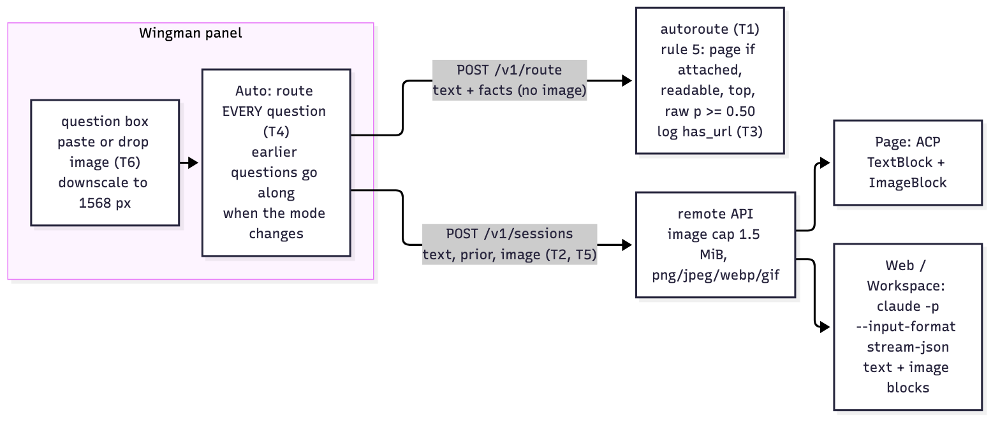

# Plan 2d: Route Every Question, and Images in Questions

> **For agentic workers:** REQUIRED SUB-SKILL: Use superpowers:subagent-driven-development (recommended) or superpowers:executing-plans to implement this plan task-by-task. Steps use checkbox (`- [ ]`) syntax for tracking.

**Goal:** In Wingman's Auto mode every question is routed on its own (a follow-up can move from Page to Web), Page is decided more often when the page is attached, and the owner can paste or drop an image into a question in any mode.

**Architecture:** The panel stops reusing the first pick and sends the earlier questions along when the mode changes; aimux adds rule 5 to the mode router and logs whether a question had a link. Images ride the existing ask path as one optional `image` field: the panel downscales, the relay and remote API pass it through with a size and type check, Page sends an ACP image block, Web and Workspace switch `claude -p` to `--input-format stream-json` and send text and image blocks.

**Tech Stack:** Go 1.26 (aimux, `github.com/coder/acp-go-sdk` v0.13.5 `acp.ImageBlock`), TypeScript (Wingman extension, vitest), Claude Code `claude -p`, `@agentclientprotocol/claude-agent-acp` 0.101.0 (advertises `promptCapabilities.image`).

**Spec:** this plan carries its own decisions (no separate spec): owner choices on 2026-11-17 (images = paste or attach; mode switch passes earlier questions only), and the router evaluation `docs/superpowers/specs/2026-11-17-auto-router-rules-eval.md` (rule 5 at 0.50; no hard link rule).

## Global Constraints

- Owner choice, verbatim: images mean "Paste or attach images: you paste or drop an image (screenshot) into the question box and ask about it."
- Owner choice, verbatim: on a mode change the new mode sees "your earlier questions (already shared with the router), not earlier answers or page text."
- Router: keep today's rule (decided when confidence >= 0.25) and add rule 5: also decide `page` when the page is readable, `use_page` is on, page is the top allowed mode and the model's raw page probability is >= 0.50 (raw: before the allowed filter renormalizes). No hard "link means web" rule.
- The route request never carries the image; only the question text and the facts go to OpenRouter, as today.
- Image limits: png, jpeg, webp or gif; at most 1.5 MiB after base64; the panel downscales to at most 1568 px on the long edge before sending. One image per question.
- No em dashes in code comments, docs or UI text. User-facing changes update both repos' docs (aimux docs-site and RELEASE_NOTES.md; the Wingman README). Test-first. Gates: aimux `go test -race` on touched packages, `go vet ./...`, `golangci-lint run`; extension `npx tsc --noEmit`, `npx vitest run`, `node build.mjs`.

## Review Focus

1. A follow-up that changes mode loses context: the new mode must get the earlier questions (and only questions), in order, capped. Test in Task 4 and Task 2.
2. A pasted file that is not an image, or is huge (a 40 MB PNG, an animated GIF, an SVG with script): refused or downscaled in the panel, refused by the API if it slips through. Tests in Task 6 and Task 5.
3. An image in a question to Workspace is treated as untrusted data like page text (injected text inside a screenshot must not change what tools are allowed; the gateway walls are unchanged). Test in Task 5 that the image block is framed under the same "untrusted data" preamble.
4. The sandbox's `claude` version accepts image blocks over `--input-format stream-json`: checked live before Task 5 relies on it (Task 5 Step 1).
5. History: a turn with an image reloads as text plus an "[image]" marker, never the image bytes in history. Test in Task 6.

### Task 1: Router rule 5

**Files:** `internal/decide/decide.go` (Answer gains raw probabilities), `internal/autoroute/autoroute.go` (rule 5 after Ask), tests in both.

- Produces: `decide.Answer.RawProbabilities map[string]float64` (the backend's probabilities before the allowed filter; logged as `raw_probabilities`), and in `autoroute.Route`: when the decider returned undecided with reason low_confidence, decide `page` if `f.PageReadable && f.UsePage`, page is allowed, page is the argmax of the allowed probabilities and `RawProbabilities["page"] >= 0.50`; Result.Source stays `model`, Result.Reason empty, and the decision log line records `rule: "page_attached"`.
- [ ] Failing tests: `TestRoute_Rule5_DecidesAttachedPage` (page 0.54, web 0.40, conf 0.18, readable, use_page -> page decided), `TestRoute_Rule5_NeedsUsePage` (use_page false -> undecided), `TestRoute_Rule5_UsesRawProbability` (page not allowed is irrelevant; web-only allowed renormalized to 0.9 never triggers rule 5), `TestRoute_Rule5_TypoStillAsks` (page 0.37, web 0.44 -> undecided).
- [ ] Implement; run `go test -race ./internal/decide/ ./internal/autoroute/`. Docs: the Auto paragraph in docs-site `guides/wingman.mdx` and RELEASE_NOTES.

### Task 2: Earlier questions reach a new mode

**Files:** `internal/remoteapi/profiles_api.go` (`newSessionRequest.Prior []string \`json:"prior"\``), `api/remote-v1.openapi.yaml` (`NewSessionRequest.prior`), `internal/remoteapi/broker.go` (`TurnOptions.Prior`), `internal/profilerun/page.go` and `sandbox.go` (prompt), `internal/browserhost/protocol.go` and `relay.go` (forward `prior`), tests.

- Produces: `prior`: at most 5 earlier questions of this page's conversation, each at most 2,000 characters, oldest first; 400 when over. The turn prompt adds, before the question and inside the same untrusted framing, a block "Earlier questions in this conversation (asked in another mode; their answers are not shown):" with the questions as a list. Sent only on the first turn in a lane after a mode change (the panel decides; aimux uses it whenever present).
- [ ] Failing tests: `TestNewSession_PriorValidated` (6 items or a 2,001-character item -> 400), `TestPagePrompt_IncludesPrior`, `TestSandboxPrompt_IncludesPrior` (block present, questions in order, no answers), `TestRelay_ForwardsPrior`.
- [ ] Implement; run tests; update OpenAPI and docs (remote-access.mdx request table).

### Task 3: Log whether a routed question has a link

**Files:** `internal/autoroute/autoroute.go`, `internal/decide/log.go`, tests.

- Produces: the decision log line gains `has_url: true` when the question contains an `http://` or `https://` URL; nothing else about the text is logged. The panel's existing feedback line (kept or changed) is unchanged, so later analysis can compare link questions against the final mode.
- [ ] Failing test `TestLog_HasURLNoText` (line has has_url, never the URL or text). Implement; run.

### Task 4: Panel routes every question

**Files (wingman repo):** `extension/src/panel.ts` (remove the follow-up short-circuit at ~699-702; compute `prior` when the lane differs from the last answered lane), `extension/src/state.ts` (`autoLane` becomes the last answered lane, used only to detect a mode change), `extension/src/route.ts` (`AutoWhy` drops `follow-up`), `extension/src/native.ts` (`AskInput.prior?: string[]`), tests in `extension/test/panel.test.ts`, `route.test.ts`.

- [ ] Failing tests: `routes every Auto question, not only the first`, `a follow-up routed to another mode sends the earlier questions as prior (max 5, oldest first, no answers)`, `a follow-up in the same mode sends no prior`, `@web still overrides without routing`.
- [ ] Implement; `npx tsc --noEmit`, `npx vitest run`, `node build.mjs`. README: Auto routes each question.

### Task 5: Images through aimux

**Files:** `internal/remoteapi/profiles_api.go` (`newSessionRequest.Image *imageInput` with `mimeType`, `data`), OpenAPI, `internal/remoteapi/broker.go` (`TurnOptions.Image`), `internal/acprun/run.go` and `manager.go` (prompt gains optional image: `[]acp.ContentBlock{TextBlock, ImageBlock}`), `internal/profilerun/page.go`, `internal/profilerun/sandbox.go` and `internal/harnessconfig/claude.go` (add `--input-format stream-json`, write one NDJSON user message with text and image blocks), `internal/sandboxlaunch/cli.go` (stdin carries the NDJSON line after the MCP config line), `internal/browserhost/protocol.go`, `relay.go`, tests.

- [ ] **Step 1 (live check, before relying on it):** in `aimux-research`, run `claude -p --input-format stream-json --output-format stream-json --verbose` with one NDJSON user message holding a text block and a small PNG image block; confirm it answers about the image. Record the claude version and the exact NDJSON shape in the report. If it fails, rule: Web and Workspace refuse images with a clear message and only Page takes them in this plan.
- [ ] Failing tests: `TestNewSession_ImageValidated` (bad mime, over 1.5 MiB base64, bad base64 -> 400 with `image_invalid`; `maxProfileBody` raised to fit 512 KiB page text plus the image), `TestPageEngine_SendsImageBlock` (fake ACP runner sees TextBlock then ImageBlock), `TestSandboxEngine_StreamJSONWithImage` (argv has `--input-format stream-json`; stdin line 2 is one JSON user message with text then image), `TestSandboxEngine_TextOnlyUnchanged` (no image: stdin text form unchanged), `TestImage_UntrustedFraming` (the text block carries the same untrusted-data preamble).
- [ ] Implement; run `go test -race` on remoteapi, acprun, profilerun, sandboxlaunch, harnessconfig, browserhost. Docs: remote-access.mdx request fields and limits, wingman.mdx.

### Task 6: Panel paste and drop

**Files (wingman repo):** `extension/src/panel.ts` (paste and drop on `#ask`), new `extension/src/image.ts` (`prepareImage(file: Blob): Promise<{mimeType, data, width, height} | {error}>`: type check, decode, downscale to 1568 px long edge via OffscreenCanvas, re-encode png or jpeg, cap 1.5 MiB base64), `extension/sidepanel.html` and `src/panel.css` (a thumbnail chip with remove), `extension/src/native.ts` (`AskInput.image?`), `extension/src/state.ts` (`UiTurn.image?: true` marker), tests `extension/test/image.test.ts`, `panel.test.ts`.

- [ ] Failing tests: `paste of an image shows a removable chip and the ask carries it`, `drop of a non-image file shows "Only images (PNG, JPEG, WebP, GIF)"`, `an oversized image is downscaled under the cap`, `the route request never carries the image`, `history shows [image] for a turn that had one`.
- [ ] Implement; tsc, vitest, build. README: paste or drop a screenshot.

### Task 7: Live acceptance (owner present)

- [ ] Auto: on an article, "list takeaways" answers in Page without the picker; then "what does https://github.com/cli/cli say about releases" routes to Web, and the Web answer knows the earlier question.
- [ ] Image: paste a screenshot in Page ("what is in this image"), in Web, and in Workspace; each answers about the image.
- [ ] Record results in the ledger; update RELEASE_NOTES "checked live" lines.

## Done when

All task tests pass, aimux and extension gates are green, Task 7 is recorded.
