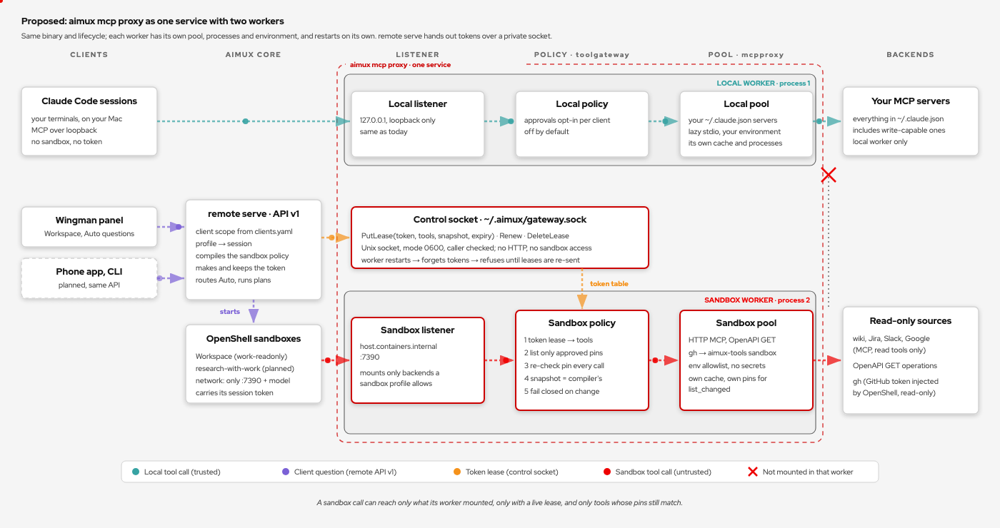

# Plan 3a: Sandbox Gateway Worker, Token Leases and Tool Review

> **For agentic workers:** REQUIRED SUB-SKILL: Use superpowers:subagent-driven-development (recommended) or superpowers:executing-plans to implement this plan task-by-task. Steps use checkbox (`- [ ]`) syntax for tracking.

**Goal:** The read-only tool gateway leaves `aimux remote serve` and runs as its own worker process of the `aimux mcp proxy` service; `remote serve` hands it per-turn tokens as leases over a private Unix socket; the owner sees and approves new backend tools in one step, and a turn tells the client which of its tools are held back.

**Architecture:** One binary, two launchd jobs: the existing local proxy (127.0.0.1:7381, unchanged) and a new sandbox gateway worker (127.0.0.1:7390, reached from sandboxes as `host.containers.internal:7390`). The worker runs today's `toolgateway.ReadonlyServer` nearly unchanged, with its own pool and a minimal child environment, plus a control socket `~/.aimux/gateway.sock` that takes `PutLease`, `Renew` and `DeleteLease` from `remote serve`. Pools are never shared between the two workers.

**Tech Stack:** Go 1.26, `github.com/mark3labs/mcp-go` 1.5, `golang.org/x/sys/unix` (peer credentials), launchd, `gopkg.in/yaml.v3` node edits (`internal/toolreg/edit.go`).

**Spec:** this plan carries its own decisions (owner and Claude, 2026-11-17, with a Codex review). Design figure: `docs/superpowers/specs/images/gateway-architecture-v2.svg`; flow figure: `docs/superpowers/specs/images/gateway-traffic-flow.svg`. Research-with-work is Plan 3b; normal sessions on profiles and HTTP install are Plan 4.

## Global Constraints

- The local proxy (`aimux mcp proxy serve`, port 7381, `com.aimux.mcp-proxy`) keeps its behavior byte for byte: no new flags required, no token, no pins. No task edits its serve path except `status` output.
- The sandbox gateway keeps address `127.0.0.1:7390` and URL `http://host.containers.internal:7390` (`toolgateway.ReadonlyAddr`, `ReadonlyURL`); compiled sandbox policies do not change.
- The two workers never share a `mcpproxy.Pool`, a starter, a catalog cache or a backend process (Codex review: `pool.go:81` keys slots by server name only).
- Tokens are made by `remote serve` (32 random bytes, `randomToken`), sent once per turn in `PutLease`, kept only in memory on both sides, never written to disk or logged; logs name the session, never the token.
- A new token per turn, as today (`profilerun/sandbox.go:262`). Lease TTL 15 minutes; `remote serve` renews every 2 minutes while the turn runs; `DeleteLease` when the turn's process exits.
- Fail closed: unknown, expired or deleted lease means 401; a worker that restarts knows no leases until they are put again; a tool whose pin differs between the lease's snapshot and the worker's current snapshot is dropped from that lease (today's `Tokens.Current` rule).
- Control socket: `~/.aimux/gateway.sock`, mode 0600, directory `~/.aimux` 0700; every connection's peer uid must equal `os.Getuid()` (darwin `LOCAL_PEERCRED`); HTTP/1.1 JSON over the socket; never exposed on a TCP listener.
- Sandbox worker child processes get only `PATH`, `HOME`, `LANG`, `TMPDIR` from the worker's environment plus each source's own `env`.
- No em dashes in code comments, docs or CLI text. User-facing changes update docs-site (`guides/tool-gateway.mdx` or the page that documents `aimux tools`, `guides/wingman.mdx`, `guides/remote-access.mdx`) and RELEASE_NOTES.md. Test-first. Gates: `go test -race` on touched packages, `go vet ./...`, `golangci-lint run`.

## Review Focus

1. The worker restarts in the middle of a turn: the sandbox's next call gets 401, `remote serve`'s renew sees `unknown_lease` and puts the full lease again, and the call after that works. Test in Task 5.
2. The worker is not installed or not running: a Workspace turn fails at once with "the tool gateway is not running: run `aimux mcp proxy gateway install`", and `remote serve` never binds 7390 itself. Test in Task 5.
3. A stale socket file left by a crash, or a path that is not a socket: the worker removes only a socket file it owns that does not answer, and refuses to start otherwise. Test in Task 2.
4. The owner edits pins between compile and `PutLease`, so the lease's snapshot version differs from the worker's: the worker reloads, then keeps only tools whose pins match in both. Test in Task 1 and Task 3.
5. A backend times out during the fresh listing at turn start: the lease is still accepted (the per-call check stays), the timeout is logged once, and the turn is not held more than 5 seconds. Test in Task 3.

### Task 1: Leases in the token table

**Files:** Create `internal/toolgateway/lease.go`, `internal/toolgateway/lease_test.go`. Modify `internal/toolgateway/tokens.go`.

**Interfaces:**
- Produces:
  - `type Lease struct { Session string; Token string; Allow map[string][]string; Version string; Pins map[string]map[string]string; Expires time.Time }` with JSON tags `session, token, allow, version, pins, expires`. `Pins` is each allowed tool's pin under the lease's snapshot (server, then tool).
  - `func (t *Tokens) Put(l Lease) error`: replaces any lease for `l.Session`; errors on empty session or token, or `Expires` not in the future.
  - `func (t *Tokens) Renew(session string, until time.Time) error`: `ErrUnknownLease` when absent.
  - `Tokens.Revoke(session)` (exists) is `DeleteLease`.
  - `Lookup` treats an expired lease as absent and drops it; it applies the same-pins rule against `Current` using `Lease.Pins` (not a `toolreg.Snapshot`, which does not cross processes).
  - `var ErrUnknownLease = errors.New("unknown lease")`.
  - `Tokens.Issue` stays for in-process callers (`aimux sandbox`, tests) and becomes a wrapper that builds a Lease with a 15 minute expiry.

- [ ] Failing tests in `lease_test.go`: `TestPut_LookupReturnsAllow`; `TestLookup_ExpiredLeaseIsAbsent` (clock injected via `Tokens.Now func() time.Time`); `TestRenew_UnknownLease` (returns `ErrUnknownLease`); `TestRenew_ExtendsExpiry`; `TestPut_ReplacesSameSession` (old token no longer found); `TestLookup_DropsToolWhosePinChanged` (lease pins `{jira:{search:"sha256:a"}}`, Current has `sha256:b`: search absent from allow); `TestPut_RejectsPastExpiry`; `TestIssue_StillWorks`.
- [ ] Run `go test -race ./internal/toolgateway/ -run 'Lease|Put|Renew|Lookup|Issue'`: fail.
- [ ] Implement; run: pass. Run the whole package.
- [ ] Commit: `toolgateway: leases with expiry and per-tool pins in the token table`.

### Task 2: Control socket

**Files:** Create `internal/toolgateway/control.go`, `control_client.go`, `control_test.go`, `internal/toolgateway/peercred_darwin.go`, `peercred_other.go`.

**Interfaces:**
- Consumes: Task 1 `Lease`, `Tokens.Put/Renew/Revoke`, `ErrUnknownLease`.
- Produces:
  - `const ControlSocketName = "gateway.sock"`; `func ControlSocketPath(home string) string` (`<home>/.aimux/gateway.sock`).
  - `type ControlHandler interface { PutLease(ctx context.Context, l Lease) error; Renew(session string, until time.Time) error; DeleteLease(session string); Observed() map[string]Observed; Status() ControlStatus }`.
  - `type ControlStatus struct { Version string; Leases int; Backends []string; Down []string; StartedAt time.Time }`.
  - `func ListenControl(path string) (net.Listener, error)`: creates `~/.aimux` 0700 if missing, refuses a path that exists and is not a socket, removes a socket that refuses connections, refuses one that answers (another worker runs: error "another tool gateway is running"), listens, chmods 0600.
  - `func ServeControl(ctx context.Context, ln net.Listener, h ControlHandler) error`: routes `PUT /v1/leases/{session}` (body Lease; 204), `POST /v1/leases/{session}/renew` (body `{"until": RFC3339}`; 204, 404 `{"error":"unknown_lease"}`), `DELETE /v1/leases/{session}` (204, idempotent), `GET /v1/observed`, `GET /v1/status`. Every connection's peer uid is checked first (`peerUID(conn) (int, error)`); mismatch closes it.
  - `type ControlClient struct { Path string; Timeout time.Duration }` (default 5 s) with `PutLease`, `Renew`, `DeleteLease`, `Observed`, `Status`, mapping 404 unknown_lease to `ErrUnknownLease` and a refused or missing socket to `ErrGatewayNotRunning`.
  - `var ErrGatewayNotRunning = errors.New("the tool gateway is not running: run `aimux mcp proxy gateway install`")`.

- [ ] Failing tests: `TestControl_PutRenewDeleteRoundTrip` (fake handler records calls); `TestControl_RenewUnknownMapsToErrUnknownLease`; `TestControl_SocketMode0600`; `TestListenControl_RemovesDeadSocket`; `TestListenControl_RefusesLiveSocket`; `TestListenControl_RefusesRegularFile`; `TestControlClient_NoSocketIsNotRunning`; `TestControl_TokenNeverInErrorText` (a failed PUT's error string does not contain the token); `TestPeerUID_Self` (darwin only, matches `os.Getuid()`).
- [ ] Run `go test -race ./internal/toolgateway/ -run Control`: fail. Implement; pass.
- [ ] Commit: `toolgateway: control socket for leases (0600, peer uid checked)`.

### Task 3: The sandbox gateway worker

**Files:** Create `internal/toolgateway/worker.go`, `worker_test.go`, `internal/toolgateway/snapshots.go` (moved from `internal/remoteapp/profileserve.go` `toolSnapshots`, `snapshotFiles`), `cmd/aimux/cmd/mcp_proxy_gateway.go`, `_test.go`. Modify `internal/toolgateway/readonly_server.go` (export `RelistNow`), `internal/mcpproxy/readonly.go` (`ReadonlyStarter` takes a base environment), `internal/remoteapp/profileserve.go` (uses the moved `toolgateway.Snapshots`).

**Interfaces:**
- Consumes: Tasks 1 and 2.
- Produces:
  - `type Snapshots` (was `toolSnapshots`) with `func NewSnapshots(home string, log func(string, ...any)) *Snapshots` and `Turn() toolreg.Snapshot` (same reload rules: file stamp change, else at most every 60 s).
  - `func (r *ReadonlyServer) RelistNow(ctx context.Context, servers []string) map[string]error` (exported wrapper of `relistNow`, bounded by ctx).
  - `type Worker struct { Home string; Server *ReadonlyServer; Tokens *Tokens; Snaps *Snapshots; FreshListTimeout time.Duration /* 5 s */ }` implementing `ControlHandler`. `PutLease`: if `l.Version != Snaps.Turn().Version()` reload and refresh the server first; then `Tokens.Put(l)`; then `RelistNow` on the lease's servers within `FreshListTimeout`, logging (not failing) a timeout.
  - `func RunWorker(ctx context.Context, w *Worker) error`: starts `ReadonlyServer` on 7390 and the control socket; stops both on ctx end.
  - `mcpproxy.ReadonlyStarter(cfg ReadonlyConfig, baseEnv []string) Starter`; the worker passes `MinimalEnv()` (`PATH`, `HOME`, `LANG`, `TMPDIR` from `os.Environ()`), the old callers pass nil (unchanged).
  - Command `aimux mcp proxy gateway serve` runs `RunWorker` (flags: none; logs to stderr).
  - Fix from the plan 2c ledger ("http pin baseline"): a changed snapshot rebuilds an http source's pin baseline, so an approved http change is served without a restart.

- [ ] Failing tests in `worker_test.go`: `TestWorker_PutLeaseReloadsOnNewerVersion`; `TestWorker_PutLeaseRelistsLeaseServers` (fake server records `RelistNow` servers); `TestWorker_FreshListTimeoutStillAcceptsLease` (relist blocks: Put returns within 5 s plus 200 ms, lease present, one log line); `TestWorker_LeaseOnlyServesItsTools` (end to end on a loopback listener with a fake HTTP MCP backend: token A lists only its tool, token B refused another's); `TestWorker_ChildEnvIsMinimal` (a stdio test backend prints its environment: only the four keys plus the source env); `TestWorker_ApprovedHTTPChangeServedWithoutRestart`. In `cmd`: `TestMCPProxyGatewayServe_Help`.
- [ ] Run `go test -race ./internal/toolgateway/ ./internal/mcpproxy/ ./cmd/aimux/cmd/ -run 'Worker|Gateway|ReadonlyStarter'`: fail. Implement; pass; run the three packages fully plus `./internal/remoteapp/`.
- [ ] Commit: `toolgateway: sandbox gateway worker with its own pool, minimal env and fresh listing per lease`.

### Task 4: Install, status and doctor

**Files:** Modify `internal/mcpproxy/launchd.go` (reuse for a second label), `cmd/aimux/cmd/mcp_proxy_gateway.go`, `cmd/aimux/cmd/mcp_proxy.go` (status), `cmd/aimux/cmd/doctor.go`, tests.

**Interfaces:**
- Produces: `aimux mcp proxy gateway install` (launchd label `com.aimux.tool-gateway`, `RunAtLoad` and `KeepAlive` true, args `mcp proxy gateway serve`, logs `~/.aimux/logs/tool-gateway.log`), `uninstall`, `status` (calls `ControlClient.Status`: version, leases, backends, down). `aimux mcp proxy status` prints a `tool gateway:` line (running with N leases, or not installed). `aimux doctor` reports the gateway worker. `aimux browser install` and `aimux setup` install it when a profile with tools is in use (they already set up the gateway's sources).

- [ ] Failing tests: `TestGatewayInstall_WritesPlist` (label, args, KeepAlive); `TestGatewayInstall_Idempotent`; `TestProxyStatus_ShowsGatewayLine` (fake ControlClient); `TestDoctor_GatewayNotRunning` (fix line names the install command).
- [ ] Implement; run `go test -race ./internal/mcpproxy/ ./cmd/aimux/cmd/`. Docs: the tool gateway page and RELEASE_NOTES (new command, new launchd job).
- [ ] Commit: `mcp proxy: gateway install, status and doctor`.

### Task 5: remote serve uses the worker

**Files:** Modify `internal/profilerun/sandbox.go` (Gateway field), `internal/remoteapp/profileserve.go` (drop `lazyGateway` and the in-process `ReadonlyServer`), `cmd/aimux/cmd/browser.go` and `cmd/aimux/cmd/sandbox.go` (use the worker when it runs), tests.

**Interfaces:**
- Consumes: `ControlClient`, `Lease`, `ErrUnknownLease`, `ErrGatewayNotRunning`.
- Produces:
  - `type Leases interface { PutLease(ctx context.Context, l toolgateway.Lease) error; Renew(ctx context.Context, session string, until time.Time) error; DeleteLease(ctx context.Context, session string) error }`; `SandboxEngine.Gateway` becomes `func() (baseURL string, leases Leases, err error)`.
  - Per turn with a non-empty grant: make the token, `PutLease` with `Allow = c.Grant.Scope()`, `Version = c.Snapshot.Version()`, `Pins` from `c.Snapshot` for the allowed tools, `Expires = now + 15m`; start a renew loop every 2 minutes; on `ErrUnknownLease` put the whole lease again; on process exit stop the loop and `DeleteLease` (errors logged, not returned).
  - `GET /v1/tools` reads `Observed` from the worker (`ControlClient.Observed`); when the worker is not running, tools whose source the gateway never listed are `unknown`, as today.
  - `aimux browser verify` and `aimux sandbox` use the running worker (lease through the socket); when none runs they start an in-process `ReadonlyServer` as today. `remote serve` never starts one.

- [ ] Failing tests: `TestSandboxTurn_PutsLeaseThenDeletes` (fake Leases records put, delete; order and fields, token never logged); `TestSandboxTurn_RenewsLongTurn` (fake clock: two renews in 11 minutes); `TestSandboxTurn_RePutsOnUnknownLease`; `TestSandboxTurn_GatewayNotRunningFailsFast` (error text names the install command; no listener opened on 7390); `TestToolsAPI_ObservedFromWorker`; `TestRemoteServe_NoGatewayListener` (serve wiring never calls `net.Listen` for 7390).
- [ ] Run `go test -race ./internal/profilerun/ ./internal/remoteapp/ ./internal/remoteapi/ ./cmd/aimux/cmd/`: fail. Implement; pass.
- [ ] Docs: remote-access.mdx and wingman.mdx (Workspace needs the gateway worker; how to check it), RELEASE_NOTES.
- [ ] Commit: `remote serve: turn tokens as leases on the gateway worker`.

### Task 6: New tools on a server, and approve into a set

**Files:** Modify `internal/toolgateway/review.go`, `internal/toolreg/edit.go`, `cmd/aimux/cmd/tools.go`, tests.

**Interfaces:**
- Produces:
  - `StatusNewOnServer = "new_on_server"`: `Review` adds, after the set rows and the not_in_registry rows, one row per tool that a source's live listing offers but no set lists and no pin covers; `Reason` "offered by <source>, not in any set"; `Set` empty.
  - `func AddToSet(path, set, tool string) error` in `toolreg/edit.go` (uses `editFile`; error when the set is missing or its source does not list the tool live is the caller's check; adding a tool already in the set is a no-op).
  - `aimux tools approve <source>/<tool> --add-to-set <set>`: requires the set's source to equal `<source>`; prints the tool's definition as `diff` does; adds the tool to the set, then pins it; prints a warning line when the tool's annotations lack `readOnlyHint: true` ("the server does not mark this tool read-only; the set is named <set>"). Without `--add-to-set` the command is unchanged.
  - `GET /v1/tools` reports `new_on_server` like the CLI.

- [ ] Failing tests: `TestReview_NewOnServer` (live has search, new_tool; set lists search; new_tool row with the reason); `TestReview_NewOnServerSkipsPinned`; `TestAddToSet_AppendsKeepsComments`; `TestAddToSet_NoOpWhenPresent`; `TestToolsApprove_AddToSet_PinsAndAdds`; `TestToolsApprove_AddToSet_WrongSource` (refused, file unchanged); `TestToolsApprove_AddToSet_WarnsWithoutReadOnlyHint`; `TestToolsAPI_NewOnServer`.
- [ ] Implement; run `go test -race ./internal/toolgateway/ ./internal/toolreg/ ./internal/remoteapi/ ./cmd/aimux/cmd/`. Docs: the `aimux tools` page (new status, new flag), RELEASE_NOTES.
- [ ] Commit: `tools: new_on_server status and approve --add-to-set`.

### Task 7: The turn says which tools are held back

**Files:** Modify `internal/profilerun/sandbox.go` (notice at turn start), `internal/profilerun/lane.go` (`LaneEvent` type `notice`), `internal/remoteapi` (session update for a notice), `internal/browserhost/relay.go` and `protocol.go` (forward `notice`, and forward an error `code`: plan 2d ledger follow-up), tests; wingman `extension/src/panel.ts` only if it does not already render `notice` events above the answer (check first; if it does, no wingman change).

**Interfaces:**
- Produces: `func HeldBack(reg toolreg.Registry, pins toolgateway.PinFile, live map[string]toolgateway.LiveSource, sets []string) []toolgateway.ToolStatus` in `internal/toolgateway/review.go` (statuses `changed`, `unpinned`, `source_changed`, `new_on_server` for the given sets' sources). A sandbox turn whose profile grants sets emits, before the first delta, one `LaneEvent{Type: "notice", Text: ...}` when `HeldBack` is non-empty: "<n> tools held for review (jira: search_v2 changed; mysrc: new_tool new): run `aimux tools status`". At most one notice per turn; no notice when nothing is held. The relay forwards it as `Event{Type: "notice", Text}` and forwards `Code` on error events.

- [ ] Failing tests: `TestHeldBack_OnlyGrantedSets`; `TestSandboxTurn_NoticeBeforeFirstDelta`; `TestSandboxTurn_NoNoticeWhenNothingHeld`; `TestRelay_ForwardsNotice`; `TestRelay_ForwardsErrorCode` (an `image_invalid` 400 reaches the event as `code`).
- [ ] Implement; run `go test -race ./internal/toolgateway/ ./internal/profilerun/ ./internal/remoteapi/ ./internal/browserhost/`; extension gates if touched. Docs: wingman.mdx, RELEASE_NOTES.
- [ ] Commit: `turns: notice for held-back tools; relay forwards notices and error codes`.

### Task 8: Live acceptance (owner present)

- [ ] `aimux mcp proxy gateway install`; `aimux mcp proxy status` shows both workers; `lsof -nP -iTCP:7390` shows the gateway worker's pid, not remote serve's.
- [ ] Wingman Workspace: "what are my open Jira issues" answers; `aimux mcp proxy gateway status` shows one lease during the turn and none after.
- [ ] `launchctl kickstart -k gui/$(id -u)/com.aimux.tool-gateway` during a long Workspace turn: the turn continues after the re-put (Review Focus 1).
- [ ] Stop the gateway job; a Workspace turn fails with the install hint (Review Focus 2); start it again.
- [ ] Add a tool to a local test MCP server; within 60 s `aimux tools status` shows `new_on_server`; the next Workspace turn shows the held-back notice; `aimux tools approve <src>/<tool> --add-to-set <set>`; the next turn can use it.
- [ ] Claude Code sessions through 7381 work throughout (local worker untouched).
- [ ] Record results in the ledger; RELEASE_NOTES "checked live" lines.

## Done when

All task tests pass, the gates are green, Task 8 is recorded, and `remote serve` no longer opens port 7390.
