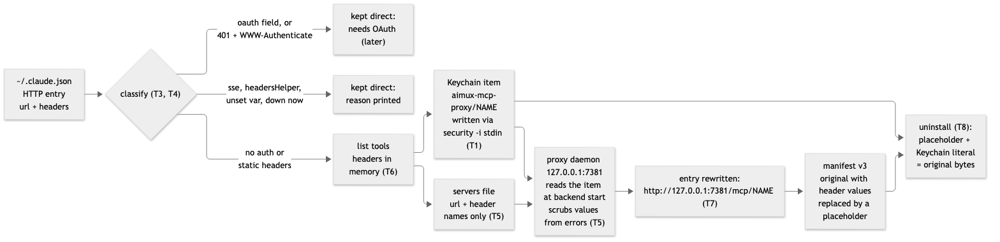

# Plan 4a: HTTP Servers Behind `aimux mcp proxy`

**For agentic workers:** REQUIRED SUB-SKILL: Use superpowers:subagent-driven-development (recommended) or superpowers:executing-plans to implement this plan task-by-task. Steps use checkbox (`- [ ]`) syntax for tracking.

**Goal:** `aimux mcp proxy install` also moves Claude Code's HTTP MCP servers that need no OAuth (no auth, or a static `headers` map) behind the shared proxy, with header values moved into the macOS Keychain; servers that need OAuth stay direct and are named; `uninstall` restores every original entry byte for byte; `status` shows HTTP servers like stdio ones.

**Architecture:** Core (`internal/mcpproxy`) classifies each HTTP entry in `~/.claude.json` (static rules, then one unauthenticated-or-header-carrying `initialize` POST that detects a 401 OAuth challenge or a server that is down), lists the tools of the movable ones with their headers held in memory, writes one Keychain item per server (`internal/keyring`, value sent on stdin, never argv), saves a definition holding only the URL and the header names, and lets the daemon read the item when it starts the backend. The install edit, the manifest and the uninstall edit are the stdio ones, extended: the manifest keeps each HTTP original with its header values replaced by a placeholder, and uninstall puts the exact original value tokens back from the Keychain.

**Tech Stack:** Go 1.26, `github.com/mark3labs/mcp-go` v1.5.0 (`transport.NewStreamableHTTP`, `WithHTTPHeaders`), `/usr/bin/security` (macOS Keychain), `internal/jsonedit`.

**Spec:** this plan carries its own decisions (no separate spec). It extends the stdio install described in the package comment of `internal/mcpproxy/install.go` and `docs/superpowers/specs/2026-11-09-mcp-proxy-server-hooks-design.md`. OAuth servers are a later plan (Plan 5).



## Decisions

1. **Endpoint name.** An HTTP server gets the same endpoint as a stdio one: `/mcp/<name>` (`EndpointPath`), and its entry becomes `{"type":"http","url":"http://127.0.0.1:<port>/mcp/<name>"}` (`entryFor`). Tool names (`mcp__<name>__<tool>`) and permission rules do not change. An entry whose URL already is a proxy URL on the install port (any name) is the proxy's own and is never classified.
2. **Re-running install is idempotent.** A server in the manifest is never moved twice; its Keychain item is not rewritten. A moved HTTP server whose entry came back with its headers (a stale session saved an old copy) is drift, reported by status, as for stdio. Servers kept direct because they were down are tried again on the next run. A Keychain item left by a crashed run (item exists, server not in the manifest) is overwritten (`-U`).
3. **Header values that reference variables.** `${VAR}` and `${VAR:-default}` in the URL and in header values are resolved at install time with `expandValue` (as stdio install does: the daemon runs under launchd without the shell's variables). The resolved value goes into the Keychain; the original text (`Bearer ${TOKEN}`) is kept beside it so uninstall restores it. A reference to a variable that is unset and has no default keeps the server direct with the reason `uses ${NAME}, which is unset in this shell`.
4. **A server that is down at install time** (connection refused, DNS failure, or no answer within 5 s) is kept direct for this run with the reason `not reachable now; run install again when it is up`. It is not recorded as a skip, so the next install tries again; the rest of install goes ahead. A server that answers but then fails to list its tools fails install as a stdio server does (fix it or `--skip` it). The OAuth probe runs for loopback servers too: `google_workspace` listens on `0.0.0.0:8000` and needs OAuth.
5. **`--skip` and `--unskip`** accept any server in `mcpServers` that is not the proxy's own: stdio, movable HTTP, and also OAuth servers (recorded, so they stay direct when OAuth support lands in Plan 5). An unknown name is still an error: `--skip X: no MCP server by that name in <path>` (the word "stdio" is dropped).
6. **Keychain layout.** One generic password per server that has headers: service `aimux-mcp-proxy/<server>`, account `aimux`. Its value is JSON `{"headers":{"<Name>":{"value":"<resolved>","literal":"<raw JSON string token as in the file>"}}}`. Headerless servers have no item. Server names outside `[A-Za-z0-9._-]` are kept direct (reason `name has characters a Keychain item name cannot carry`) when they have headers.
7. **Manifest format 3.** `MovedEntry` gains `Keychain string` (the item's service, empty for stdio and headerless HTTP). `Original` of such an entry holds the entry with each header value token replaced by the placeholder `"[in Keychain]"`. Manifest gains `Direct []KeptDirect` (servers the last install found need OAuth, so status can name them without probing). This aimux reads formats 2 and 3 and writes 3; an older aimux refuses format 3 ("written by a newer aimux"), which protects the placeholders.

## Global Constraints

- Header values never appear in stdout, stderr, the daemon log, any error string, the manifest, the servers file, the catalog, the plist, the backup install writes, or any process's argv. The Keychain write sends the value as hex on `security -i`'s stdin.
- Copy, verbatim: kept-direct reason for OAuth servers `needs OAuth (later)`; the install and status line prefix `kept direct: `.
- Keychain service `aimux-mcp-proxy/<server>`, account `aimux`; probe timeout 5 s per server, probes run in parallel.
- Only `type: "http"` entries (Streamable HTTP) move. `type: "sse"` is kept direct with `SSE transport (not supported behind the proxy)`; an entry with `headersHelper` with `headersHelper (headers made by a script)`; a `headers` value that is not an object of strings with `headers is not a map of strings`.
- Business rules (classification, reasons, redaction, restore, Keychain naming) live in `internal/mcpproxy`; `cmd/aimux/cmd` only wires paths and real dependencies.
- Uninstall restores each original entry byte for byte, including the header value tokens as written (escapes, spacing, member order).
- No em dashes in code comments, docs or CLI text. User-facing changes update `docs-site/src/content/docs/guides/mcp-proxy.mdx`, `RELEASE_NOTES.md` and the command help in the same change.
- Never print or read secret values from `~/.claude.json` or the Keychain while developing; inspect structure only (`jq 'keys'`, types).
- Gates: `go test -race ./internal/keyring/ ./internal/mcpproxy/ ./cmd/aimux/cmd/`, `go vet ./...`, `golangci-lint run`.

## Not Doing

OAuth servers (Plan 5). Rotating a header value without uninstalling (Plan 5, with `aimux mcp proxy edit` for HTTP). Project-scoped `mcpServers` under `projects.<path>`. Linux secret store writes (install keeps HTTP servers with headers direct off macOS). Rewriting existing `~/.aimux/backups` copies of `~/.claude.json` (install only reports them; see Task 7).

## Review Focus

1. A header value leaks through a side door: an error from a server that echoes the request (`401: Authorization: Bearer ...`), a Keychain tool's output, a `%v` of a config struct. Sentinel sweep test in Task 7, scrub test in Task 5.
2. Uninstall after the owner's file was reformatted by Claude Code (members reordered, spacing changed) and with header values that use JSON escapes (`A`, `\/`): the restored entry must equal the original bytes. Tests in Task 2 and Task 8.
3. A crash between the Keychain write and the config edit, then install again: the run must succeed and leave one item, not fail on "item exists". Test in Task 7.
4. An HTTP server with no `oauth` field that still needs OAuth (answers 401 with `WWW-Authenticate`), and a local dev server that is down: neither may fail the whole install or end up behind the proxy. Tests in Task 4 and Task 6.
5. The Keychain item is missing or locked when the daemon starts the backend: the server fails with an error that names the item and how to fix it, never a value, and other servers keep working. Test in Task 5.

### Task 1: Keychain writes and deletes

**Files:** `internal/keyring/keyring.go` (seam `runStdin`), `internal/keyring/keyring_darwin.go` (`Store`, `Delete`), `internal/keyring/keyring_linux.go` and `keyring_other.go` (return `ErrUnsupported`), tests `internal/keyring/keyring_darwin_test.go`, `keyring_store_test.go`.

**Interfaces:**
- Produces:

```go
var ErrUnsupported = errors.New("no writable secret store on this platform")
// Store sets the generic password for service (account "aimux"), replacing
// an existing one. The value never appears on a command line.
func Store(service, value string) error
// Delete removes it; a missing item is not an error.
func Delete(service string) error
```

- [ ] **Failing tests:** `TestStore_ValueNeverInArgv` (seam records argv and stdin; argv is exactly `/usr/bin/security -i`; stdin is one line `add-generic-password -U -a aimux -s aimux-mcp-proxy/x -X <hex of value>\n`; the value's plain bytes appear in neither), `TestStore_ReadsBackAndComparesValue` (read-back seam returns another value: error `keychain item aimux-mcp-proxy/x did not take the new value`, error text does not contain either value), `TestStore_RejectsServiceWithSpaceOrQuote` (no command run), `TestStore_ToolFailureKeepsOnlyExitStatus` (seam fails with exit 45 and output containing the value: error says `exit status 45` only), `TestDelete_MissingItemIsNil` (exit 44 is nil), `TestDelete_ArgvHasNoValue`. Linux and other: `TestStore_Unsupported` returns `ErrUnsupported`.
- [ ] **Darwin-only live test** `TestStore_LiveKeychain`, skipped unless `AIMUX_KEYCHAIN_IT=1`: stores an 8 KiB random value under `aimux-mcp-proxy/it-<random>`, reads it back equal, deletes it, probes absent.
- [ ] **Implement.** `security -i` reports a failed command on stderr but may exit 0, so `Store` always verifies by reading the item back with `keychainSource.Lookup` and comparing in memory. Output of `security -i` is discarded.
- [ ] **Run** `go test -race ./internal/keyring/` (and once with `AIMUX_KEYCHAIN_IT=1` on the Mac). Commit.

### Task 2: Header redaction and the secret item

**Files:** create `internal/mcpproxy/httpsecret.go`, `internal/mcpproxy/httpsecret_test.go`.

**Interfaces:**
- Produces:

```go
const headerPlaceholder = `"[in Keychain]"`
func HeaderService(server string) string // "aimux-mcp-proxy/" + server
// redactHeaders returns raw with each value token of its "headers" object
// replaced by headerPlaceholder, and the replaced tokens (raw JSON string
// literals, quotes included) by header name. Every other byte is kept.
func redactHeaders(raw json.RawMessage) (json.RawMessage, map[string]string, error)
// restoreHeaders is the inverse: each placeholder under "headers" becomes
// literals[name]; a missing literal is an error.
func restoreHeaders(redacted json.RawMessage, literals map[string]string) (json.RawMessage, error)
type headerSecret struct {
    Headers map[string]headerItem `json:"headers"`
}
type headerItem struct {
    Value   string `json:"value"`   // resolved; what the daemon sends
    Literal string `json:"literal"` // the token as in the file; what uninstall writes back
}
func encodeHeaderSecret(s headerSecret) (string, error)
func decodeHeaderSecret(v string) (headerSecret, error)
```

- [ ] **Failing tests:** `TestRedactHeaders_RoundTripIsByteExact` (table: compact entry; pretty-printed with tabs; `headers` before `url`; value with `A`, `\/`, `\"` escapes; two headers; restore(redact(x)) equals x byte for byte), `TestRedactHeaders_OnlyHeaderValuesChange` (url and a nested `"headers"` key inside another object are untouched), `TestRedactHeaders_RedactedHoldsNoValue` (sentinel value absent from the redacted bytes), `TestRedactHeaders_DuplicateHeaderNameIsError`, `TestRestoreHeaders_MissingLiteralIsError`, `TestHeaderSecret_RoundTrip`, `TestDecodeHeaderSecret_ErrorHasNoValue` (malformed input with a sentinel: error text lacks it).
- [ ] **Implement** with `json.Decoder.Token` and `InputOffset` to find the value spans; build the output by splicing spans, never by re-marshalling the entry.
- [ ] **Run** `go test -race ./internal/mcpproxy/ -run 'Redact|Restore|HeaderSecret'`. Commit.

### Task 3: Classify the Claude config's HTTP entries

**Files:** `internal/mcpproxy/config.go` (new `LoadClaudeHTTPServers`), `internal/mcpproxy/config_test.go`.

**Interfaces:**
- Consumes: `expandValue` (config.go), `redactHeaders` (Task 2), `EntryURL` (install.go).
- Produces:

```go
type HTTPEntry struct {
    Raw      json.RawMessage   // as in the Claude config
    URL      string            // variables resolved
    Headers  map[string]string // resolved values; never printed
    Literals map[string]string // header name -> raw token, from redactHeaders
}
type KeptDirect struct {
    Server string `json:"server"`
    Reason string `json:"reason"`
}
const ReasonNeedsOAuth = "needs OAuth (later)"
// LoadClaudeHTTPServers returns the type "http" entries that may move and
// the HTTP and SSE entries kept direct with their reason, sorted by name.
// Entries that point at the proxy on port are left out of both.
func LoadClaudeHTTPServers(path string, port int, canStoreSecrets bool) (map[string]HTTPEntry, []KeptDirect, error)
```

- [ ] **Failing tests:** `TestLoadClaudeHTTP_NoAuthAndStaticHeadersMove` (deepwiki-like entry and one with `headers` both returned; `Headers` resolved), `TestLoadClaudeHTTP_OAuthFieldKeptDirect` (reason exactly `needs OAuth (later)`), `TestLoadClaudeHTTP_SSEKeptDirect`, `TestLoadClaudeHTTP_HeadersHelperKeptDirect`, `TestLoadClaudeHTTP_NonStringHeaderKeptDirect`, `TestLoadClaudeHTTP_ProxyEntriesIgnored` (`http://127.0.0.1:7381/mcp/other` under name `x` is in neither result), `TestLoadClaudeHTTP_VariablesResolved` (`t.Setenv("TOK","abc123")`: header `Bearer ${TOK}` resolves to `Bearer abc123`, literal stays `"Bearer ${TOK}"`; `${MISSING:-d}` resolves to `d`), `TestLoadClaudeHTTP_UnsetVariableKeptDirect` (reason `uses ${MISSING}, which is unset in this shell`), `TestLoadClaudeHTTP_HeadersWithoutSecretStoreKeptDirect` (`canStoreSecrets=false`: headerless still moves; with headers reason `headers need the macOS Keychain`), `TestLoadClaudeHTTP_BadNameWithHeadersKeptDirect`, `TestLoadClaudeServers_StillStdioOnly` (existing behavior unchanged).
- [ ] **Implement; run** `go test -race ./internal/mcpproxy/ -run LoadClaude`. Commit.

### Task 4: Reachability and OAuth check

**Files:** create `internal/mcpproxy/httpcheck.go`, `internal/mcpproxy/httpcheck_test.go`.

**Interfaces:**
- Produces:

```go
type HTTPReach int
const (
    Reachable HTTPReach = iota
    NeedsOAuth            // 401 with a WWW-Authenticate challenge
    Unreachable           // refused, DNS failure, or no answer in time
)
var httpCheckTimeout = 5 * time.Second
// CheckHTTPServer POSTs one MCP initialize request with headers and reads
// only the status line and WWW-Authenticate; the body is discarded.
func CheckHTTPServer(ctx context.Context, url string, headers map[string]string) HTTPReach
// checkAll runs check for each entry in parallel and splits the result.
func checkAll(ctx context.Context, entries map[string]HTTPEntry, check func(context.Context, string, map[string]string) HTTPReach) (move []string, kept []KeptDirect, oauth []KeptDirect)
```

- Reasons: `NeedsOAuth` without headers gives `needs OAuth (later)`; with headers `the server refused its headers (401)`; `Unreachable` gives `not reachable now; run install again when it is up`. Any other status (200, 400, 405, 500) is `Reachable`: listing decides.
- [ ] **Failing tests** (httptest servers): `TestCheckHTTP_401WithChallengeIsNeedsOAuth`, `TestCheckHTTP_401WithoutChallengeIsReachable`, `TestCheckHTTP_SendsHeaders` (server asserts the header arrived), `TestCheckHTTP_ClosedPortIsUnreachable`, `TestCheckHTTP_SilentServerTimesOut` (`httpCheckTimeout` shortened to 50 ms; returns `Unreachable` in under 1 s), `TestCheckAll_RunsInParallel` (three servers each sleeping 200 ms finish in under 450 ms), `TestCheckAll_ReasonsAndSplit` (headered 401 gets the refused-headers reason; `oauth` holds only the challenge cases).
- [ ] **Implement; run** `go test -race ./internal/mcpproxy/ -run Check`. Commit.

### Task 5: HTTP definitions in the daemon

**Files:** `internal/mcpproxy/stdio.go` (`ServerConfig` fields), `internal/mcpproxy/httpbackend.go` (scrubbing), create `internal/mcpproxy/definition.go` (`DefinitionStarter`, `SystemSecrets`), `internal/mcpproxy/reload.go` (`NewLiveStarter`, `LiveStarter.Set` take the reader), `internal/mcpproxy/edit.go` (refuse HTTP), `cmd/aimux/cmd/mcp_proxy.go` (serve and refresh use `DefinitionStarter`), `cmd/aimux/cmd/mcp_proxy_install.go` (`proxyRefreshFor` too), tests `definition_test.go`, `httpbackend_test.go`, `edit_test.go`.

**Interfaces:**
- Consumes: `HeaderService`, `decodeHeaderSecret` (Task 2), `keyring.System(service).Lookup`.
- Produces:

```go
// ServerConfig gains (omitempty, so stdio files are unchanged):
//   Type        string   `json:"type,omitempty"`        // "http" for a moved HTTP server
//   URL         string   `json:"url,omitempty"`
//   HeaderNames []string `json:"headerNames,omitempty"` // values in Keychain item HeaderService(name)
type SecretReader func(ctx context.Context, service string) (string, error)
func SystemSecrets() SecretReader // keyring.System(service).Lookup
// DefinitionStarter starts stdio definitions as StdioStarter does and HTTP
// ones with HTTPStarter, reading their headers from secrets at each start.
func DefinitionStarter(cfgs map[string]ServerConfig, resolved []string, secrets SecretReader) Starter
func NewLiveStarter(cfgs map[string]ServerConfig, resolved []string, secrets SecretReader) *LiveStarter
func (l *LiveStarter) Set(cfgs map[string]ServerConfig, resolved []string)
```

- `httpBackend` keeps a `*scrubber` built from its header values and applies it to every error it returns (start, list, call). A missing or unreadable item fails the start with `keychain item aimux-mcp-proxy/<name> is missing or locked (<cause without value>); run aimux mcp proxy uninstall and install again`.
- [ ] **Failing tests:** `TestDefinitionStarter_HTTPSendsKeychainHeaders` (fake reader returns an item; httptest MCP server asserts the header and lists one tool), `TestDefinitionStarter_StdioUnchanged`, `TestDefinitionStarter_MissingItemErrorNamesItemOnly` (reader returns `keyring.ErrNotFound`: error contains the service, other servers in the same pool still start), `TestDefinitionStarter_ItemLacksHeaderIsError`, `TestHTTPBackend_ErrorsScrubHeaderValues` (server answers 500 with the sentinel header echoed in the body; the start or call error and the pool's `LastError` lack it), `TestServerConfig_StdioJSONUnchanged` (marshal of a stdio config equals today's bytes), `TestReload_HTTPDefinitionChangeRetiresBackend` (URL change is in `Changed`), `TestEditServer_RefusesHTTP` (error `<name> is an HTTP server; aimux mcp proxy edit changes stdio servers only`).
- [ ] **Implement; run** `go test -race ./internal/mcpproxy/ ./cmd/aimux/cmd/`. Commit.

### Task 6: Plan, dry run and `--skip` for HTTP servers

**Files:** `internal/mcpproxy/install.go` (`Installer` fields, `plan`, `DryRun`, `PrintPlan`), tests in `internal/mcpproxy/install_test.go` (extend `newInstallFX` with a `memSecrets` and a fake `CheckHTTP`).

**Interfaces:**
- Consumes: `LoadClaudeHTTPServers` (Task 3), `checkAll`, `CheckHTTPServer` (Task 4), `HTTPStarter`, `RefreshCatalog`.
- Produces:

```go
// Installer gains:
//   CheckHTTP func(ctx context.Context, url string, headers map[string]string) HTTPReach // nil: CheckHTTPServer
//   Secrets   SecretStore                                                              // nil: no HTTP server with headers moves
type SecretStore interface {
    Put(service, value string) error
    Get(ctx context.Context, service string) (string, error)
    Delete(service string) error
}
// InstallPlan gains:
//   HTTP       []string     // the names in Move that are HTTP servers
//   KeptDirect []KeptDirect // HTTP servers kept direct this run, with reason
// listHTTP lists the tools of names with their headers held in memory and
// saves them in the catalog at catalogPath; failures by server.
func (i Installer) listHTTP(catalogPath string, entries map[string]HTTPEntry, names []string) map[string]error
```

- `plan` returns the HTTP entries too (its fourth result becomes a struct `planInput{stdio map[string]ServerConfig; http map[string]HTTPEntry; manifest *Manifest}`). It calls `LoadClaudeHTTPServers(path, i.Port, i.Secrets != nil)`. A moved server or a recorded skip is never probed. `DryRun` lists HTTP servers through `listHTTP` into the temporary catalog; it never calls `Secrets`.
- `PrintPlan` prints HTTP moves as `  deepwiki (http) -> http://127.0.0.1:7381/mcp/deepwiki`, and each kept-direct server as `Would keep direct: <name>: <reason>`.
- [ ] **Failing tests:** `TestPlan_MovesStdioAndHTTP` (Move holds both, HTTP holds the HTTP names), `TestPlan_OAuthAndDownServersKeptDirect` (fake check: one `NeedsOAuth`, one `Unreachable`; neither in Move; reasons verbatim), `TestPlan_MovedAndSkippedNotProbed` (fake check records calls: none for those names), `TestPlan_SkipAcceptsHTTPAndOAuthNames`, `TestPlan_SkipUnknownName` (error `--skip nope: no MCP server by that name in`), `TestDryRun_ListsHTTPWithoutSecrets` (memSecrets records zero calls; catalog file unchanged), `TestPrintPlan_HTTPLines`.
- [ ] **Implement; run** `go test -race ./internal/mcpproxy/ -run 'Plan|DryRun'`. Commit.

### Task 7: Install moves HTTP servers

**Files:** `internal/mcpproxy/install.go` (`Install`, `saveDefinitions`, `switchServers`, `landed`, `extended`, manifest v3, `LoadManifest`), tests in `install_test.go`.

**Interfaces:**
- Consumes: Tasks 2 to 6.
- Produces:

```go
const manifestVersion = 3 // LoadManifest also reads 2
// MovedEntry gains Keychain string `json:"keychain,omitempty"`.
// Manifest gains Direct []KeptDirect `json:"direct,omitempty"` (replaced each run: the challenge cases from checkAll).
// movedEntry builds the record for one server from its raw original:
// redacted Original and Keychain set when the entry has headers.
func (i Installer) movedEntry(name string, raw json.RawMessage) (MovedEntry, error)
// switchServers takes unchanged in place of defs: it reports whether the
// entry still matches what the daemon was given (stdio: same resolved
// definition; HTTP: JSON-equal to the original read before the edit).
func switchServers(old json.RawMessage, move []string, unchanged func(name string, raw json.RawMessage) bool, originals map[string]json.RawMessage, entry func(string) json.RawMessage, record func(string, json.RawMessage) (MovedEntry, error)) (json.RawMessage, map[string]MovedEntry, error)
```

- Order in `Install`: plan; forgetRemoved; snapshotDaemon; stdio `Refresh` then `listHTTP`; Keychain `Put` for HTTP servers with headers (the deferred restore also deletes every item this run wrote); `saveDefinitions` (HTTP: `ServerConfig{Type: "http", URL: resolved, HeaderNames: sorted}`); ensureDaemon; probeMoved; backup; manifest; edit. The final output adds `kept direct: <name>: <reason>` lines. The backup install writes of `~/.claude.json` is the pre-edit file with each moved server's header values replaced by `"[in Keychain]"` (`redactHeaders`); uninstall never reads backups, it rebuilds from the Keychain. When older files in `~/.aimux/backups` still contain the `headers` of a server this run moved (checked by header name and server name, never by value), install prints once: `note: <n> older backups in ~/.aimux/backups still hold header values for <names>; delete them with: rm <paths>`.
- [ ] **Failing tests:** `TestInstall_MovesHTTPEntry` (entry becomes the proxy entry; servers file holds url and `headerNames`, no value; memSecrets holds the item with value and literal), `TestInstall_NoHeaderValueAnywhere` (sentinel header value: absent from the manifest, servers file, catalog, plist, captured stdout, fake launchctl argv), `TestInstall_ManifestV3RedactedOriginal` (Original has `"[in Keychain]"`, Keychain field set; headerless HTTP entry has no Keychain field and a verbatim Original), `TestInstall_ProbeFailureDeletesItemsItWrote` (config untouched, memSecrets empty, servers file restored), `TestInstall_RerunAfterCrashOverwritesItem` (item and no manifest entry: install succeeds, one item), `TestInstall_RerunIsNoOp` (second run: no Put, no edit, output says nothing new to move), `TestInstall_HTTPEntryChangedDuringInstallRefused`, `TestInstall_DownServerKeptDirectRestMoves`, `TestInstall_RecordsNeedsOAuthInManifest`, `TestInstall_BackupHasNoHeaderValue` (sentinel absent from the new backup; the rest of the backup equals the pre-edit bytes), `TestInstall_NotesOlderBackupsWithHeaders` (an older backup with the server's headers: the note names its path, never a value; no note when none), `TestLoadManifest_ReadsV2AndV3`, `TestLoadManifest_RefusesV4`. The existing stdio install tests pass unchanged.
- [ ] **Implement; run** `go test -race ./internal/mcpproxy/`. Commit.

### Task 8: Uninstall restores exactly

**Files:** `internal/mcpproxy/install.go` (`Uninstall`, `restoreServers`, `forgetRemoved`), tests in `install_test.go`.

**Interfaces:**
- Produces:

```go
// restoreServers additionally returns the names it restored or found
// already restored.
func restoreServers(old json.RawMessage, servers map[string]MovedEntry) (json.RawMessage, []string, []string, error)
// unredacted returns m.Servers with each Keychain-backed Original rebuilt
// from its item; any unreadable item fails before anything changes.
func (i Installer) unredacted(ctx context.Context, m *Manifest) (map[string]MovedEntry, error)
```

- After the edit and `dropMoved`, `Uninstall` deletes the items of restored servers; for a server whose entry the owner changed or removed it keeps the item and prints `Kept Keychain item aimux-mcp-proxy/<name> (its entry changed since install); remove it with: security delete-generic-password -s aimux-mcp-proxy/<name>`. A failed delete is a note, not an error. `forgetRemoved` deletes the item of a server the owner removed.
- [ ] **Failing tests:** `TestInstallUninstall_HTTPByteIdentical` (whole `~/.claude.json` equals its pre-install bytes; entries include escapes and a `${VAR}` header), `TestUninstall_AfterReformatRestoresOriginalBytes` (file rewritten pretty-printed with members reordered after install: each HTTP entry's bytes equal the original's), `TestUninstall_UnreadableItemChangesNothing` (memSecrets Get fails: config, manifest and agent untouched; error names the item, not a value), `TestUninstall_DeletesItemsOfRestoredOnly` (owner-changed entry keeps its item, note printed), `TestForgetRemoved_DeletesItem`, `TestUninstall_DeleteFailureIsNote`.
- [ ] **Implement; run** `go test -race ./internal/mcpproxy/`. Commit.

### Task 9: Status, hooks and kept-direct reporting

**Files:** `internal/mcpproxy/install.go` (`InstallStatus`, `PrintInstallStatus`), `internal/mcpproxy/hooks.go` (`CheckMessage` wording), `cmd/aimux/cmd/mcp_proxy_style.go` (`printInstallState`), tests in `install_test.go`, `hooks_test.go`, `cmd/aimux/cmd/mcp_proxy_status_test.go`.

**Interfaces:**
- Produces: `InstallState.KeptDirect []KeptDirect \`json:"keptDirect,omitempty"\``. `InstallStatus` never probes the network: `NotProxied` holds stdio and movable HTTP servers not moved and not skipped (minus names in `Manifest.Direct`); `KeptDirect` holds the static reasons from `LoadClaudeHTTPServers` plus `Manifest.Direct` for names still in the config.
- Status lines: `printInstallState` adds one dim note per reason, `kept direct: needs OAuth (later): Amplitude, alphaxiv, brand, ...`; the not-installed line says `moves Claude Code's stdio and HTTP servers behind the proxy`. The daemon table needs no change: an HTTP server is a row like any other.
- [ ] **Failing tests:** `TestInstallStatus_HTTPNotProxiedAndKeptDirect`, `TestInstallStatus_NoNetwork` (fake check fails the test if called), `TestInstallStatus_HTTPDrift` (moved HTTP entry back with its headers: in `Drifted`, not in `NotProxied`), `TestHookCheck_NamesHTTPNotOAuth` (SessionStart message names a movable HTTP server, never an OAuth one), `TestPrintInstallState_KeptDirectLine` (exact line above), `TestProxyStatus_HTTPServerRow` (a report with an HTTP server prints its row with state, tools, last call), `TestProxyStatusJSON_KeptDirect`.
- [ ] **Implement; run** `go test -race ./internal/mcpproxy/ ./cmd/aimux/cmd/`. Commit.

### Task 10: CLI wiring, docs and live acceptance

**Files:** `cmd/aimux/cmd/mcp_proxy_install.go` (set `Secrets` to a `keyring`-backed store on darwin, nil elsewhere; `CheckHTTP` default; help text of `install`, `uninstall`, `--skip`, `--unskip`), `docs-site/src/content/docs/guides/mcp-proxy.mdx` (sections "Switch Claude Code to the proxy", "Skip servers", "Security", new "HTTP servers and the Keychain"), `RELEASE_NOTES.md` (Unreleased), test `cmd/aimux/cmd/mcp_proxy_install_test.go`.

- [ ] **Failing tests:** `TestInstallHelp_MentionsHTTPAndKeychain` (Long text names HTTP servers, the Keychain and `needs OAuth (later)`), `TestSkipFlagHelp_NotStdioOnly`, `TestProxyInstaller_SecretsWired` (darwin: non-nil; build tag test for other platforms: nil).
- [ ] **Implement; run all gates:** `go test -race ./internal/keyring/ ./internal/mcpproxy/ ./cmd/aimux/cmd/`, `go vet ./...`, `golangci-lint run`.
- [ ] **Live acceptance (owner present):** `aimux mcp proxy install --dry-run` lists deepwiki, excalidraw, mermaid, productpages and the reachable local servers as moves, and Amplitude, alphaxiv, brand, claude-design, google_workspace, granola, lennysdata, snipd as `kept direct: needs OAuth (later)`; devpulse and customer-intelligence (remote, not in the owner's list) land wherever the probe puts them, and the owner confirms that before going on; `install`; `status` shows the moved HTTP servers in the table; a new Claude Code session calls one deepwiki tool and one productpages tool through the proxy; `security find-generic-password -s aimux-mcp-proxy/productpages` (no `-w`) shows the item; `grep -c` of the productpages header name in `~/.claude.json` is 0; `uninstall`; compare a hash of each restored entry with the backup's (`jq -c '.mcpServers.productpages' | shasum`, never printing values): equal; `install` again. Record the results in RELEASE_NOTES "checked live".
- [ ] Commit.

## Done When

All task tests pass, the gates are green, the live acceptance is recorded, and `docs-site` and `RELEASE_NOTES.md` describe HTTP servers behind the proxy.
