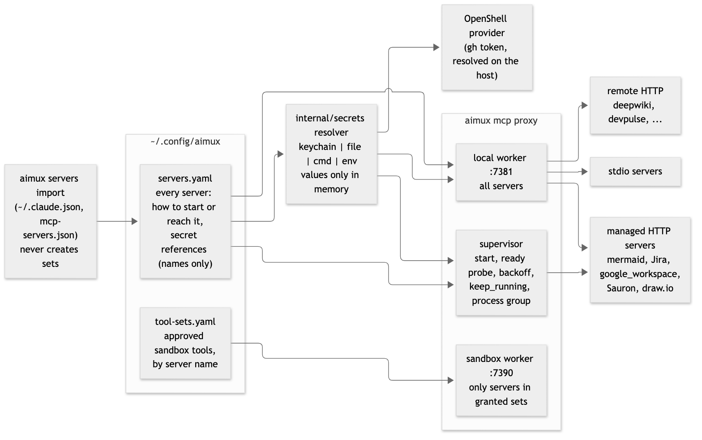

# Plan 4c: One Server Registry, Pluggable Secrets and Managed Local Servers

> **For agentic workers:** REQUIRED SUB-SKILL: Use superpowers:subagent-driven-development (recommended) or superpowers:executing-plans to implement this plan task-by-task. Steps use checkbox (`- [ ]`) syntax for tracking.

**Goal:** Every MCP server aimux knows is defined once in `~/.config/aimux/servers.yaml` with its secrets as references (Keychain, file, command or environment); sandbox tool approvals move to `tool-sets.yaml` and point at servers by name; aimux starts and supervises the owner's local HTTP servers (mermaid, Jira, google_workspace, Sauron, draw.io) instead of five iTerm panes.

**Architecture:** `internal/toolreg` gains a server inventory (`servers.yaml`) next to the set file (`tool-sets.yaml`); `tool-sources.yaml` still loads for one release as both. A new `internal/secrets` resolves typed references on the trusted host, keeps values in memory only and registers each value with one scrubber. A supervisor in `internal/mcpproxy` runs servers that have both `command` and `url`: port check, readiness probe, backoff, crash-loop state, `keep_running`, one process group each, an explicit environment. The local proxy serves every server; the sandbox gateway serves only servers in granted sets, and approvals are bound to each server's identity digest, not its URL.

**Tech Stack:** Go 1.26, `gopkg.in/yaml.v3`, `golang.org/x/sys/unix` (O_NOFOLLOW, fstat), launchd, `internal/keyring` (existing `Source` interface: keychain, secret service, env, file).

**Spec:** this plan carries its own decisions (owner and Claude, 2026-11-17, with a Codex review; the Codex answer is summarized in Global Constraints). Depends on Plan 4a (HTTP servers behind the proxy, with its pre-merge change to `SecretRefs`/`SecretRef`/`KeychainRef`/`resolveSecret`) and Plan 3a (sandbox gateway worker, `toolgateway` pins with `PinRecord.Source`) being merged first.

## Global Constraints

- Two files, two jobs: `servers.yaml` says what exists and how to start or reach it; `tool-sets.yaml` says what sandboxes may use. Nothing in `servers.yaml` grants a sandbox anything. Import never creates a set.
- A server's transport follows its fields: `command` only is stdio; `url` only is remote HTTP; `command` and `url` is managed HTTP (aimux starts it, then connects).
- Secrets are typed references, never values, in every file aimux writes. Backends: `keychain: {item, field}`, `file: {path, key}`, `cmd: {argv, timeout, ttl}`, `env: {name}`. No URI string parsing.
- `cmd`: `argv[0]` absolute path, no shell, default timeout 5 s (max 30 s), stdout only and at most 64 KiB, stderr discarded, errors carry only the program path and exit status; success cached until `ttl` (default none: resolved at each start), failure cached 30 s.
- `file`: opened with O_NOFOLLOW, then fstat: regular file, owned by the user, mode 0600 or stricter, else refused with the reason. Dotenv parsed strictly: `KEY=value` lines, optional quotes, `#` comments, no interpolation, no `export`, no command substitution.
- `env`: the aimux process environment (launchd's, not the interactive shell's); `aimux secrets check` says so next to every `env` reference.
- `keychain`: one item per server, `aimux/<server>`, value JSON `{"headers": {...}, "env": {...}}`; Plan 4a's per-server header items stay readable by a `keychain` reference with `field`.
- Every resolved value is registered with the scrubber before any process start or network call; scrubbing is defense in depth, never a reason to put child stderr or command output into an error.
- Sandboxes never receive `file`, `cmd` or host `env` references or their values directly; values reach a sandbox only through an OpenShell credential provider filled on the host (today: gh).
- Managed servers: a port already in use fails the start with `port 
 is in use (another <name> started by hand?); stop it, or set adopt_existing: true`; aimux never kills or adopts a process it did not start unless `adopt_existing: true`, and then only after an MCP `initialize` answers on that URL. Readiness: MCP `initialize` POST to `url` (default) or TCP connect, deadline 30 s, retry every 250 ms. Restart backoff 1 s doubling to 60 s; 5 crashes in 5 minutes is `crash_loop` (no more restarts until `aimux servers restart <name>`). Each server runs in its own process group; stop sends SIGTERM to the group, SIGKILL after 5 s.
- A managed or stdio child's environment is exactly: `PATH`, `HOME`, `LANG`, `TMPDIR` from aimux, the server's literal `env:` values, and its resolved secret `env`. Nothing else is inherited.
- Floating commands (`go run`, `npx` or `pnpm dlx` without `@<version>`, `uvx` without `==<version>` or `@<version>`): refused for any server referenced by a set (`floating command; pin a version or a built binary`), allowed with one warning line for local-only servers.
- Approvals are bound to `Server.Identity()`: sha256 over transport, normalized url, command, args, cwd, sorted secret names (not values), and for a managed or stdio server the sha256 of the resolved executable file. A changed identity makes every pinned tool of that server `source_changed` when the server is sandbox-reachable (it backs a set some profile grants): those tools are held until approved again. For a local-only server a changed identity is recorded and shown (`aimux tools status`: `binary changed since approval`) but does not block, unless the client's profile turns local approvals on (owner decision, 2026-11-18).
- `~/.aimux/mcp-servers.json` is generated (schema 4, with the registry's digest), never edited, and never holds an expanded value.
- No em dashes in code comments, docs or CLI text. User-facing changes update docs-site (`guides/mcp-proxy.mdx`, the `aimux tools` page, a new `guides/servers.mdx`) and RELEASE_NOTES.md. Test-first. Gates: `go test -race` on touched packages, `go vet ./...` (with `internal/frontend/web/dist` present), `golangci-lint run`.

## Review Focus

1. The owner's hand-started Jira is still running on 8001 when aimux starts managed Jira: the start fails with the port message, the hand-started process is untouched, and `aimux servers status` shows the reason. Test in Task 5.
2. A `cmd` reference hangs, or prints the secret on stderr and exits 1: the resolve fails after its timeout with only the program path and exit status, the child process group is killed, and the value never appears anywhere. Test in Task 2.
3. Import finds `JirAIa` in `~/.claude.json` and a different `JirAIa` in `mcp-servers.json`: nothing is written, the conflict names both sources, and `--prefer claude|proxy` resolves it. Test in Task 7.
4. The owner changes a managed server's `args` after approving its tools for a set: the sandbox gateway serves none of them (`source_changed`) until `aimux tools approve`; the local proxy still serves them. Test in Task 4.
5. Sauron's token refresh fails at every start: after 5 crashes in 5 minutes it is `crash_loop`, backoff stopped growing at 60 s, other servers keep running, and status shows the last 20 lines of its log path, not the lines. Test in Task 5.

### Task 1: Discover which secrets a server needs (read-only)

**Files:** create `internal/secrets/discover.go`, `discover_test.go`; `cmd/aimux/cmd/servers.go` (new `aimux servers` command group, `discover` subcommand).

**Interfaces:**
- Produces: `func Discover(def ServerDef) []Finding` with `type Finding struct { Name string; Where string; Kind string }` (`Kind`: `config_ref` for `${NAME}` in the server's current definition, `dotenv_key` for a key in `cwd/.env` or `cwd/../.env`, `source_read` for `os.getenv("NAME")`, `os.environ["NAME"]`, `os.Getenv("NAME")`, `process.env.NAME` found by scanning at most 2,000 files under `cwd`). Never reads a value: dotenv is read for keys only (the part before `=`), and the scan matches names only.
- `aimux servers discover <name>` prints one line per finding and a suggested reference per name (`file: {path: <cwd>/.env, key: NAME}` when a dotenv key exists, else `keychain: {item: aimux/<name>, field: NAME}`).

- [ ] Failing tests: `TestDiscover_ConfigRefs`; `TestDiscover_DotenvKeysOnly` (a `.env` with `JIRA_TOKEN=sentinel-xyz`: finding present, `sentinel-xyz` absent from every Finding field and from command output); `TestDiscover_SourceReadsPythonGoNode`; `TestDiscover_ScanCap` (2,001 files: stops, one note); `TestServersDiscover_SuggestsFileRefWhenDotenv`.
- [ ] Implement; run `go test -race ./internal/secrets/ ./cmd/aimux/cmd/ -run Discover`. Commit.
- [ ] Owner step (not code): run `aimux servers discover` for the Jira and Sauron definitions (Task 9 drafts them) and pick each reference; record the choices in the ledger by name only.

### Task 2: The secret resolver

**Files:** create `internal/secrets/ref.go`, `resolver.go`, `scrub.go`, `backend_keychain.go`, `backend_file.go`, `backend_cmd.go`, `backend_env.go`, tests per file. Uses `internal/keyring` for the Keychain and secret service lookups.

**Interfaces:**
- Produces:
  - `type Ref struct { Keychain *KeychainRef `yaml:"keychain,omitempty"`; File *FileRef `yaml:"file,omitempty"`; Cmd *CmdRef `yaml:"cmd,omitempty"`; Env *EnvRef `yaml:"env,omitempty"` }` (exactly one set; `Validate() error`); `KeychainRef{Item, Field string}`, `FileRef{Path, Key string}`, `CmdRef{Argv []string; Timeout, TTL time.Duration}`, `EnvRef{Name string}`.
  - `type Refs struct { Env map[string]Ref; Headers map[string]Ref }` with `Names() []string` (sorted `env:NAME`, `header:Name`).
  - `type Resolver struct { ... }`, `func NewResolver(opts Options) *Resolver`, `func (r *Resolver) Resolve(ctx context.Context, server string, refs Refs) (Values, error)` where `Values{Env, Headers map[string]string}`; `func (r *Resolver) Scrubber() *Scrubber`; `func (s *Scrubber) Scrub(string) string` (exact value plus URL-query, URL-path and JSON-escaped forms, decoded Basic credentials; values shorter than 8 bytes are scrubbed only as whole tokens).
  - `func (r *Resolver) Check(ctx context.Context, server string, refs Refs) []CheckResult` (`Name`, `Backend`, `OK`, `Reason`; never a value) for `aimux secrets check`.
  - `func Store(server, name, value string) error` writing field `name` of item `aimux/<server>` (through `keyring.Store`, Plan 4a) for `aimux secrets set`.
  - Plan 4a's `mcpproxy.SecretRef`/`SecretRefs`/`resolveSecret` become thin aliases over these types (one resolver).

- [ ] Failing tests: `TestRef_ExactlyOneBackend`; `TestKeychain_FieldFromJSONItem`; `TestKeychain_Plan4aHeaderItemReadable`; `TestFile_RejectsSymlink`; `TestFile_RejectsGroupReadable`; `TestFile_RejectsOtherOwner` (seam); `TestFile_StrictDotenv` (no interpolation of `${X}`, no `$(cmd)`); `TestCmd_NoShell` (argv `["/bin/echo","$HOME"]` returns the literal); `TestCmd_RelativeArgv0Refused`; `TestCmd_TimeoutKillsGroup` (child sleeps; resolve fails at timeout, no child left); `TestCmd_StderrNeverInError` (child prints a sentinel to stderr and exits 1: error is `cmd /bin/x: exit status 1`); `TestCmd_OutputCap`; `TestCmd_TTLCache` and `TestCmd_FailureCache30s` (fake clock); `TestEnv_DaemonEnvOnly`; `TestResolver_ScrubberRegisteredBeforeReturn`; `TestScrub_EncodedForms`; `TestCheck_NeverHasValue`.
- [ ] Implement; run `go test -race ./internal/secrets/ ./internal/keyring/`. Commit.

### Task 3: servers.yaml and tool-sets.yaml

**Files:** create `internal/toolreg/servers.go`, `sets.go`, `migrate_split.go`, tests; modify `internal/toolreg/registry.go` (`Load` builds the combined view), `snapshot.go` (snapshot covers both files), `edit.go` (`AddSource` stays only for `aimux tools add`, writing to the two files).

**Interfaces:**
- Produces:
  - `func ServersPath(home string) string` (`~/.config/aimux/servers.yaml`), `func SetsPath(home string) string` (`~/.config/aimux/tool-sets.yaml`).
  - `type Server struct { Command []string; Cwd string; URL string; Env map[string]string; Secrets secrets.Refs; KeepRunning bool `yaml:"keep_running"`; AdoptExisting bool `yaml:"adopt_existing"`; Ready *ReadyProbe; Kind string /* existing source types: local-notes, cli, http-openapi; empty for MCP */; Root, Pack, Spec, BaseURL string; Authorship string }`; `func (s Server) Transport() string` (`stdio`, `http`, `managed-http`, or the Kind); `type ReadyProbe struct { Type string /* mcp | tcp */; Timeout time.Duration }`.
  - `type Inventory struct { Version int; Servers map[string]Server; Errors map[string]error }`; `func LoadInventory(path string) (Inventory, error)`.
  - The existing `Registry` keeps its shape for callers: `Sources` is built from the inventory's servers that sets reference plus all servers (local-only ones carry `LocalOnly: true`), `Sets` from `tool-sets.yaml`. A set naming an unknown server is a `SetErrors` entry.
  - Legacy: when `servers.yaml` and `tool-sets.yaml` are absent and `tool-sources.yaml` exists, `Load` reads it as both (one stderr note per process: `tool-sources.yaml is read for this release; run aimux servers migrate`). `aimux servers migrate` writes the two files from it, keeps it as `tool-sources.yaml.migrated`, and changes no pins.

- [ ] Failing tests: `TestTransport_FromFields` (table: command only, url only, both, kind); `TestLoadInventory_UnknownFieldIsServerError` (one bad server leaves others); `TestSets_UnknownServerIsSetError`; `TestLoad_LegacyToolSources` (no new files: same Registry as today's fixtures); `TestLoad_NewFilesWinOverLegacy`; `TestMigrateSplit_RoundTrip` (Registry before equals after); `TestMigrateSplit_KeepsComments`; `TestSnapshotVersion_CoversBothFiles`.
- [ ] Implement; run `go test -race ./internal/toolreg/ ./internal/toolgateway/ ./internal/profile/`. Commit.

### Task 4: Approvals bound to server identity; floating commands

**Files:** `internal/toolreg/servers.go` (`Identity`), `internal/toolgateway/pin.go`, `review.go`, `snapshot.go` (use `Identity` where `Endpoint` was recorded), `internal/profile/compile.go` (floating check), tests.

**Interfaces:**
- Produces: `func (s Server) Identity(hashFile func(path string) (string, error)) (string, error)` (`"id:" + hex(sha256)` over the fields in Global Constraints; the executable is resolved like exec does with the server's PATH); `PinRecord.Source` stores the identity for new approvals; a v2 pin whose `Source` is an endpoint string still matches when it equals `Server` endpoint (today's `Source.Endpoint()`), and the next approve rewrites it. `func Floating(argv []string) (bool, string)`. Compile drops a set's server with `floating command; pin a version or a built binary` when floating; `aimux servers status` warns for local-only floating servers.

- [ ] Failing tests: `TestIdentity_ChangesWithArgs`, `TestIdentity_ChangesWithBinaryContent`, `TestIdentity_IgnoresSecretValues` (same names, different values: equal), `TestIdentity_ChangesWithSecretNames`; `TestReview_ArgsChangedIsSourceChanged` (Review Focus 4); `TestReview_V2EndpointPinStillMatches`; `TestFloating` (table: `go run .`, `npx -y drawio-mcp-server`, `npx -y drawio-mcp-server@2.4.0`, `uvx workspace-mcp`, `uvx workspace-mcp==1.2.3`, absolute binary); `TestCompile_FloatingServerInSetDropped`.
- [ ] Implement; run `go test -race ./internal/toolreg/ ./internal/toolgateway/ ./internal/profile/`. Commit.

### Task 5: The supervisor for managed HTTP servers

**Files:** create `internal/mcpproxy/supervisor.go`, `supervisor_test.go`, `internal/mcpproxy/childenv.go`; modify `internal/mcpproxy/pool.go` (a managed server's backend start goes through the supervisor), `stdio.go` (stdio children use `childenv`).

**Interfaces:**
- Consumes: `toolreg.Server`, `secrets.Resolver`.
- Produces: `type Supervisor struct { ... }`, `func NewSupervisor(opts SupervisorOptions) *Supervisor` (`Resolver`, `LogDir` default `~/.aimux/logs/servers`, `Now`, `Listen probe` seams); `func (s *Supervisor) Ensure(ctx context.Context, name string, def toolreg.Server) (url string, err error)` (start if needed, wait for readiness); `func (s *Supervisor) Stop(name string)`; `func (s *Supervisor) StartKeepRunning(ctx context.Context, servers map[string]toolreg.Server)`; `func (s *Supervisor) Status() map[string]ServerState` with `State` in `stopped`, `starting`, `ready`, `backoff`, `crash_loop`, `port_in_use`, `adopted`, plus `PID`, `Restarts`, `LastError` (scrubbed), `LogPath`. `func ChildEnv(base map[string]string, literal map[string]string, resolved map[string]string) []string` (the four base keys only). Logs rotate at 10 MiB, two kept.

- [ ] Failing tests (a tiny test MCP HTTP server binary built in `TestMain`): `TestSupervisor_StartsAndWaitsForReady`; `TestSupervisor_PortInUseFails` (Review Focus 1: listener held by the test; error text exact; the test's listener untouched); `TestSupervisor_AdoptExistingNeedsInitialize`; `TestSupervisor_RestartBackoff` (fake clock: 1, 2, 4 s); `TestSupervisor_CrashLoopAfter5In5Min` (Review Focus 5); `TestSupervisor_KeepRunningStartsAtLaunch`; `TestSupervisor_IdleStopCountsInFlight`; `TestSupervisor_StopKillsGroup` (server forks a grandchild: gone after Stop); `TestChildEnv_OnlyBaseLiteralAndResolved` (a sentinel in the test process env is absent); `TestSupervisor_SecretResolvedAtEachStart` (cmd ref without ttl runs per start); `TestSupervisor_LastErrorScrubbed`.
- [ ] Implement; run `go test -race ./internal/mcpproxy/`. Commit.

### Task 6: The local proxy serves from servers.yaml

**Files:** `cmd/aimux/cmd/mcp_proxy.go` (serve and refresh read the inventory), `internal/mcpproxy/definition.go` (starter for stdio, http, managed-http from `toolreg.Server` plus `secrets.Resolver`), `internal/mcpproxy/config.go` and `install.go` (generated `mcp-servers.json` schema 4), `internal/mcpproxy/edit.go` (`aimux mcp proxy edit` prints `edit <servers.yaml path>; the proxy reloads it` and exits 2), `internal/mcpproxy/reload.go` (watch both files), tests.

**Interfaces:**
- Produces: `mcp-servers.json` schema 4: `{"schema":4,"registry":"<inventory digest>","servers":{name:{"transport":...,"identity":...}}}`, no command env values, no URLs with resolved variables; the daemon builds starters from the inventory, never from this file. A server whose secrets do not resolve starts with error `secret <name> of <server>: <reason>` and other servers serve.

- [ ] Failing tests: `TestServe_FromInventory` (stdio, remote http, managed http each list a tool); `TestGeneratedServersFile_NoValues` (sentinel secret and an env literal absent); `TestServe_UnresolvedSecretOnlyFailsThatServer`; `TestReload_InventoryEditRestartsChangedServer`; `TestProxyEdit_PointsAtServersYAML`.
- [ ] Implement; run `go test -race ./internal/mcpproxy/ ./cmd/aimux/cmd/`. Commit.

### Task 7: Import, never creating sets

**Files:** create `internal/toolreg/importer.go`, `importer_test.go`; modify `internal/mcpproxy/install.go` (install imports, then moves Claude entries as in Plan 4a), `cmd/aimux/cmd/servers.go` (`aimux servers import [--prefer claude|proxy] [--dry-run]`), `cmd/aimux/cmd/mcp_proxy_install.go`.

**Interfaces:**
- Produces: `func Import(claude json.RawMessage, generated []byte, inv Inventory) (Inventory, []Conflict, error)`; a `${VAR}` in a Claude entry becomes `secrets.env.VAR: {env: {name: VAR}}` and the import report lists it as "check: set it with aimux secrets set or pick another backend"; an already-expanded value in an old `mcp-servers.json` (`resolvedByInstall`) is never copied: the report names the variable and the server and asks for `aimux secrets set <server> <VAR>`. Writes `servers.yaml` only (atomic, comments kept); never `tool-sets.yaml`. A Claude entry that is already a proxy URL is skipped.

- [ ] Failing tests: `TestImport_NoSetsCreated` (tool-sets.yaml byte-identical; slack-write imported local-only); `TestImport_ConflictWritesNothing` (Review Focus 3); `TestImport_PreferClaude`; `TestImport_VarBecomesEnvRef`; `TestImport_ExpandedValueNeverCopied` (sentinel absent from servers.yaml and output); `TestImport_ProxyEntriesSkipped`; `TestImport_Idempotent`.
- [ ] Implement; run `go test -race ./internal/toolreg/ ./internal/mcpproxy/ ./cmd/aimux/cmd/`. Commit.

### Task 8: Sandbox side reads the split files; gh as a reference

**Files:** `internal/profile/runner.go` (credential from a ref), `internal/clipack/pack.go`, `packs/gh.yaml` (`credential: {provider: aimux-github, ref: {keychain: {item: aimux-github}}, env: GH_TOKEN}`), `internal/sandboxlaunch` provider import (value from `secrets.Resolver`, sent to `openshell provider` on stdin as today), the gateway worker (Plan 3a) snapshot from `LoadInventory` plus sets, tests.

**Interfaces:**
- Produces: `clipack.Credential{Provider string; Ref secrets.Ref; Env string}`; the old `keychain:` field still parses for one release and maps to `Ref.Keychain{Item: <value>}`. The sandbox gateway builds its servers only from servers referenced by granted sets; a set referencing a local-only server with a write-capable tool still needs explicit approval (no change to review rules).

- [ ] Failing tests: `TestGhPack_KeychainRef`; `TestGhPack_LegacyKeychainField`; `TestProviderImport_ValueFromResolverNotRef` (argv and the sandbox spec hold no value and no ref); `TestGatewaySnapshot_OnlySetServers` (a local-only server is never built by the sandbox worker); `TestCompile_FileOrCmdRefNeverInPolicy`.
- [ ] Implement; run `go test -race ./internal/profile/ ./internal/clipack/ ./internal/sandboxlaunch/ ./internal/toolgateway/ ./internal/gatewayworker/`. Commit.

### Task 9: The owner's five servers, secrets commands, docs

**Files:** `cmd/aimux/cmd/servers.go` (`status`, `restart`, `logs <name>`, `add-to-claude <name>`), `cmd/aimux/cmd/secrets.go` (`aimux secrets set <server> <NAME>` prompts without echo or reads stdin, never argv; `aimux secrets check [server]`), `docs-site/src/content/docs/guides/servers.mdx` (with the five entries below as the worked example), `RELEASE_NOTES.md`, tests.

- The five drafted entries (owner fills secret refs after Task 1):
  - `mermaid`: `command: [mcp-mermaid, -t, streamable]`, `url: http://127.0.0.1:3033/mcp`, local-only (floating warning: global npm binary; pin later).
  - `JirAIa`: `command: [/Users/azaalouk/product-ops/Jira/mcp-server/.venv/bin/python3, server.py, --transport, streamable-http, --port, "8001"]`, `cwd: /Users/azaalouk/product-ops/Jira/mcp-server`, `url: http://127.0.0.1:8001/mcp`, `secrets.env.JIRA_TOKEN: <owner picks>`.
  - `google_workspace`: `command: [uvx, workspace-mcp==<version>, --transport, streamable-http]`, `cwd: /Users/azaalouk/go/src/github.com/zanetworker/google_workspace_mcp`, `url: http://127.0.0.1:8000/mcp`, `keep_running: true` (its Google login lives in its own credentials directory).
  - `telemetry` (Sauron): `command: [/Users/azaalouk/.aimux/bin/sauron-mcp]` built once with `go build -o ~/.aimux/bin/sauron-mcp ./cmd/mcp-server` in the sauron repo, `url: http://127.0.0.1:8080/mcp`, `keep_running: true`, `secrets.env: <owner picks after discover>`.
  - `drawio`: `command: [npx, -y, drawio-mcp-server@2.4.0, --transport, http, --http-port, "4000", --extension-port, "4001"]`, `url: http://127.0.0.1:4000/mcp`, `keep_running: true`; `aimux servers add-to-claude drawio` adds its proxy entry to `~/.claude.json`.
- `aimux servers status` lists every server with transport, state, PID, restarts, last error (scrubbed), and `kept direct` reasons from Plan 4a.

- [ ] Failing tests: `TestSecretsSet_ValueNeverInArgvOrOutput`; `TestSecretsCheck_Table`; `TestServersStatus_States`; `TestAddToClaude_WritesProxyEntryOnly`; `TestServersRestart_ClearsCrashLoop`.
- [ ] Implement; run all gates. Commit.

### Task 10: Live acceptance (owner present)

- [ ] `aimux servers migrate`; `aimux servers import --dry-run`, then `import`: no set created (`git diff` of `tool-sets.yaml` empty).
- [ ] With all five iTerm panes running: `aimux servers status` shows `port_in_use` for each managed server (Review Focus 1). Stop one pane at a time; `aimux servers restart <name>`; status `ready`; a new Claude Code session calls one tool per server (Jira `get_system_status`, telemetry `test_connection`, google_workspace `list_calendars`, deepwiki `read_wiki_structure`, drawio one read tool).
- [ ] Kill managed Jira's process group: it comes back within 2 s; `aimux servers logs JirAIa` shows the restart.
- [ ] `aimux secrets check`: every reference `ok`, no value shown; `security find-generic-password -s aimux/<server>` (no `-w`) shows only items the owner chose.
- [ ] Log out and back in (or `launchctl kickstart` the proxy): the three `keep_running` servers are up without any pane.
- [ ] Record results; RELEASE_NOTES "checked live"; the owner decides when to stop using `~/start-mcp-servers.sh`.

## Done when

All task tests pass, the gates are green, Task 10 is recorded, and the five servers run under aimux with no iTerm pane.
