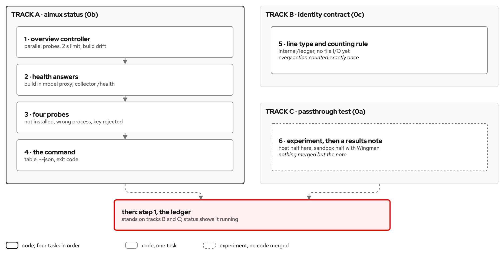

# First Slice (steps 0a, 0b, 0c) Implementation Plan

> **For agentic workers:** REQUIRED SUB-SKILL: Use superpowers:subagent-driven-development (recommended) or superpowers:executing-plans to implement this plan task-by-task. Steps use checkbox (`- [ ]`) syntax for tracking.

**Goal:** Deliver the three things the design says need nothing else: one `aimux status` over the four background services, the identity contract with the reader rule that counts every action once, and a recorded answer to whether Claude Code's subscription login works through a local door.

**Architecture:** `aimux status` is one controller function that runs a list of probes in parallel under a time limit and returns one structure; the CLI draws a table or JSON from it. The identity contract is a short document plus a new `internal/ledger` package holding the line type and the pure counting rule, with no file I/O yet. The passthrough test is a throwaway experiment whose only product is a results note.

**Tech Stack:** Go, cobra, `text/tabwriter`, the repo's real `testdata/fakecodex` (no mocks), `httptest` for services.

**Spec:** `docs/superpowers/specs/2026-11-23-aimux-governance-metering-and-evals-design.md`, sections 1, 2, 4 and "Build order" steps 0a to 0c.



The three tracks share no files, so they can run at the same time. Track A is four tasks in order.

## Global Constraints

- Controller first: logic in `internal/controller` (or the new `internal/ledger`), each front an adapter.
- Test first. No mocks: real `httptest` servers and real files in `t.TempDir()`.
- Every commit message carries a `# parity:` line (TUI and web do not show status yet: `# parity: N/A (CLI only; dashboard reads --json later)`).
- Work in a worktree under `~/go/src/github.com/zanetworker/aimux-worktrees/`; commit and push with `git ship`; no `Co-Authored-By` trailer.
- Four states only, spelled exactly: `ok`, `degraded`, `down`, `not installed`.
- Service order is fixed: `model proxy`, `mcp proxy`, `tool gateway`, `collector`.
- Each probe gets 2 seconds; probes run in parallel; asking never starts, restarts or changes anything.
- Output never contains a key, a token or an environment value; under 100 columns; readable without colour; ages, not timestamps.
- The stable model proxy changes only through `scripts/model-proxy-promote promote`, run by the owner outside Claude Code.
- Docs touched by a user-facing change are updated in the same push (README command list, CHANGELOG Unreleased).

## Review Focus

1. A port answered by something that is not aimux: status must say `down` with reason `wrong process`, not `ok` and not a crash. (Task 3)
2. A service that hangs without closing the connection: the command returns within about 2 seconds with the other three rows intact. (Task 1)
3. A build string with no commit count (`dev`, or a tagged release `v0.15.0`): no false "older than the CLI" line. (Task 1)
4. A hook event delivered twice, and an MCP proxy line for a call the hook also reported: each counted once. (Task 5)
5. A secondary line with no call id: listed as unmatched, never counted, never dropped silently. (Task 5)


## Part A: `aimux status` (step 0b)

### Task 1: The overview controller

**Files:**
- Create: `internal/controller/status.go`
- Test: `internal/controller/status_test.go`

**Interfaces:**
- Produces:

```go
type ServiceState string

const (
	ServiceOK           ServiceState = "ok"
	ServiceDegraded     ServiceState = "degraded"
	ServiceDown         ServiceState = "down"
	ServiceNotInstalled ServiceState = "not installed"
)

type Attention struct {
	Problem string `json:"problem"`
	Fix     string `json:"fix"`
}

type ServiceStatus struct {
	Name         string       `json:"name"`
	State        ServiceState `json:"state"`
	Reason       string       `json:"reason,omitempty"`        // "wrong process", "key rejected", "no answer in 2s"
	Build        string       `json:"build,omitempty"`         // full version string as the service reports it
	BuildNote    string       `json:"build_note,omitempty"`    // "restart pending" or "pinned"; empty otherwise
	StartedAt    *time.Time   `json:"started_at,omitempty"`
	Address      string       `json:"address,omitempty"`
	LastActivity *time.Time   `json:"last_activity,omitempty"`
	ActivityNote string       `json:"activity_note,omitempty"` // "turn", "call", "span", or "3 leases"
	RestartFix   string       `json:"-"`                       // command that restarts this service
	Attention    []Attention  `json:"attention,omitempty"`
}

type StatusProbe struct {
	Name string
	Run  func(ctx context.Context) ServiceStatus
}

type StatusOverview struct {
	CLIBuild string          `json:"cli_build"`
	Services []ServiceStatus `json:"services"`
}

func ServicesOverview(ctx context.Context, cliBuild string, probes []StatusProbe, limit time.Duration) StatusOverview
func (o StatusOverview) Attention() []Attention // every service's items, prefixed "<name>: ", in service order
func BuildNumber(version string) string         // "v0.14.0-184-g398934a7" -> "184"; anything else -> version unchanged
```

- [ ] **Step 1: Write the failing tests** in `status_test.go`:
  - `TestServicesOverview_KeepsProbeOrderAndRunsInParallel`: four probes each sleeping 300 ms return within 1 s, rows in the order given.
  - `TestServicesOverview_SlowProbeIsDown`: a probe that blocks on `<-ctx.Done()` with `limit = 100*time.Millisecond` yields `State == ServiceDown`, `Reason == "no answer in 100ms"`, its `Name` kept, and the other rows unchanged.
  - `TestServicesOverview_FlagsOlderBuild`: service build `v0.14.0-128-gd7cf3658`, CLI `v0.14.0-184-g398934a7`, `RestartFix: "aimux mcp proxy restart"` adds `Attention{Problem: "build 128 is older than the CLI (184)", Fix: "aimux mcp proxy restart"}` and leaves `State` as `ok`.
  - `TestServicesOverview_NoDriftLineWhenNoted`: same builds with `BuildNote: "pinned"` or `"restart pending"` adds no attention item.
  - `TestServicesOverview_NoDriftWithoutCount`: builds `dev` or `v0.15.0` on either side add no attention item.
  - `TestBuildNumber`: the three cases in the signature comment.
  - `TestStatusOverview_AttentionPrefixesName`: `"tool gateway: 1 of 5 backends down (slack)"`.
- [ ] **Step 2: Run** `go test ./internal/controller -run 'ServicesOverview|BuildNumber|StatusOverview' -v`. Expected: FAIL, undefined names.
- [ ] **Step 3: Implement** the types and functions in `status.go`. Each probe runs in its own goroutine with `context.WithTimeout(ctx, limit)`; a probe that has not returned when its context ends is replaced by the down row. Drift is compared on `BuildNumber` only when both sides parse to a number and the service's is lower.
- [ ] **Step 4: Run** the same command. Expected: PASS. Then `go test -race ./internal/controller`.
- [ ] **Step 5: Commit** `feat(status): services overview controller`.

### Task 2: A build in the model proxy's health, and a health answer on the collector

The model proxy's `/health` reports no build, and the collector has no health endpoint (its `/debug` can return prompt excerpts and must not be used).

**Files:**
- Modify: `internal/modelproxy/health.go` (add `Version string \`json:"version,omitempty"\`` to `Health`; set it from a value passed in at construction), the `serve` command that constructs the backend, `internal/otel/receiver.go` (add `GET /health`)
- Test: `internal/modelproxy/health_test.go`, `internal/otel/receiver_test.go`

**Interfaces:**
- Produces: `modelproxy.Health.Version`; and on the collector, `GET /health` answering

```go
type ReceiverHealth struct {
	Service    string     `json:"service"` // always "aimux-collector"
	Version    string     `json:"version"`
	StartedAt  time.Time  `json:"started_at"`
	LastSpanAt *time.Time `json:"last_span_at,omitempty"`
}
```

- [ ] **Step 1: Write the failing tests**: `TestHealth_ReportsVersion` (a backend built with version `"v0.14.0-184-gabc"` reports it in `GET /health`); `TestReceiverHealth` (status 200, `service == "aimux-collector"`, the version given at construction, `last_span_at` absent before any span and set after one `POST /v1/traces`); `TestReceiverHealth_CarriesNoSpanContent` (after a span whose attributes contain the string `SECRET-PROMPT`, the `/health` body does not contain it).
- [ ] **Step 2: Run** `go test ./internal/modelproxy ./internal/otel -run 'Health' -v`. Expected: FAIL.
- [ ] **Step 3: Implement.** Pass the binary's version from `cmd/aimux/cmd` (the package-level version the `version` command prints) into both constructors.
- [ ] **Step 4: Run** the same command, then `make test`. Expected: PASS.
- [ ] **Step 5: Commit** `feat(health): build in model proxy health; collector health answer`.

### Task 3: The four probes

**Files:**
- Create: `cmd/aimux/cmd/status_probes.go`
- Test: `cmd/aimux/cmd/status_probes_test.go`

**Interfaces:**
- Consumes: `controller.StatusProbe`, `controller.ServiceStatus`; `readProxyHealth(ctx, addr, key)` in `model_proxy_status.go`; the MCP proxy's `Status func() (mcpproxy.StatusReport, error)` as the existing `mcp proxy status` command builds it; the tool gateway's `toolgateway.ControlStatus` as `gatewayRow` in `mcp_proxy_status_page.go` obtains it; `ReceiverHealth` from Task 2.
- Produces: `func defaultStatusProbes(env statusEnv) []controller.StatusProbe`, where `statusEnv` carries the four addresses, the launchd plist directory, a key lookup `func() (string, error)`, and the readers above as fields so tests can point them at `httptest` servers.

Mapping, one probe each:

| Service | `ok` when | `degraded` when | Activity | `RestartFix` |
|---|---|---|---|---|
| model proxy | `/health` status is `ok` | `/health` status is `degraded` (Reason from it) | `Requests.LastOKAt`, note `turn` | `scripts/model-proxy-promote promote` |
| mcp proxy | `StatusReport.Running` | never | newest last call across `Servers`, note `call` | `aimux mcp proxy restart` |
| tool gateway | `len(Down) == 0` | `len(Down) > 0`, attention `"N of M backends down (names)"`, fix `aimux mcp proxy status` | note `"N leases"` | `aimux mcp proxy restart` |
| collector | `/health` answers with `service == "aimux-collector"` | never | `LastSpanAt`, note `span` | `launchctl kickstart -k gui/$(id -u)/com.azaalouk.aimux-collect` |

Common rules for every probe:
- connection refused and no launchd plist for the service: `not installed`;
- connection refused with a plist present: `down`, Reason `not running`;
- an answer that is not the expected shape (wrong JSON, or the collector's `service` field differs): `down`, Reason `wrong process`;
- HTTP 401 or 403: `down`, Reason `key rejected`;
- the MCP proxy's existing "upgrade restart pending" state sets `BuildNote: "restart pending"`.

- [ ] **Step 1: Write the failing tests**, one `httptest` server (or none) per case: `TestProbe_ModelProxyOK`, `_ModelProxyDegraded`, `_NotInstalled` (no listener, empty plist dir), `_DownNotRunning` (no listener, plist file present), `_WrongProcess` (a server answering `200 hello` on every path), `_KeyRejected` (401), `_GatewayBackendsDown` (asserts the attention text `1 of 5 backends down (slack)`), `_CollectorWrongService`, `_McpRestartPending`.
- [ ] **Step 2: Run** `go test ./cmd/aimux/cmd -run Probe -v`. Expected: FAIL.
- [ ] **Step 3: Implement** `status_probes.go`.
- [ ] **Step 4: Run** the same command. Expected: PASS.
- [ ] **Step 5: Commit** `feat(status): probes for the four services`.

### Task 4: The command and its output

**Files:**
- Create: `cmd/aimux/cmd/status.go`
- Modify: `cmd/aimux/cmd/root.go` (register), `README.md` (command list), `CHANGELOG.md` (Unreleased)
- Test: `cmd/aimux/cmd/status_test.go`

**Interfaces:**
- Consumes: `controller.ServicesOverview`, `defaultStatusProbes`, `mcpproxy.Ago` for ages.
- Produces: `aimux status` (`cobra.NoArgs`), honouring the existing global `--json`.

Exact text output for the overview in the test below (two spaces between columns, as `tabwriter` with padding 2 gives):

```
aimux v0.14.0-184    4 services, 2 need attention

SERVICE       STATE     BUILD  UP   ADDRESS         LAST ACTIVITY
model proxy   ok        184    38m  127.0.0.1:7385  turn 2m ago
mcp proxy     ok        128 !  2d   127.0.0.1:7381  call 12h ago
tool gateway  degraded  184    2d   127.0.0.1:7390  3 leases
collector     ok        184    2d   127.0.0.1:4318  span 4s ago

NEEDS ATTENTION                                   FIX
tool gateway: 1 of 5 backends down (slack)        aimux mcp proxy status
mcp proxy: build 128 is older than the CLI (184)  aimux mcp proxy restart
```

Rules the test pins: the header shows the CLI version without its `-g<hash>` suffix; `!` follows a build that has an attention item; a `BuildNote` replaces the `!` (`128 (restart pending)`); a `down` row shows its Reason in the LAST ACTIVITY column; a `not installed` row shows `-` in BUILD, UP, ADDRESS and LAST ACTIVITY; the NEEDS ATTENTION block is omitted when empty and the header then reads `4 services, all ok`.

- [ ] **Step 1: Write the failing tests**: `TestStatus_Table` (the block above, byte for byte, from a fixed overview and clock); `TestStatus_AllOK` (no attention block, returns nil); `TestStatus_ReturnsErrorWhenAttention` (non-nil error whose text is `2 services need attention`); `TestStatus_NotInstalledAloneIsOK` (one `not installed` row, no attention, nil error); `TestStatus_JSON` (`--json` output unmarshals into `controller.StatusOverview` equal to the input, and contains no `RestartFix`); `TestStatus_Under100Columns` (every line of the table output is at most 99 characters).
- [ ] **Step 2: Run** `go test ./cmd/aimux/cmd -run TestStatus -v`. Expected: FAIL.
- [ ] **Step 3: Implement** `status.go`: `func runStatus(ctx context.Context, o controller.StatusOverview, out io.Writer, now time.Time, asJSON bool) error`, and the cobra command that builds the overview with a 2 second limit and calls it.
- [ ] **Step 4: Run** the same command, then `make test` and `make lint-linux`. Expected: PASS.
- [ ] **Step 5: Run it for real**: `go run ./cmd/aimux status; echo "exit=$?"` and `go run ./cmd/aimux status --json | head -20`. Paste both outputs into the PR. Then run `qa-tools:behavior-validator` on the command.
- [ ] **Step 6: Commit** `feat(status): aimux status` and open the PR. The model proxy's new health field only goes live after the owner runs promote.


## Part B: the identity contract (step 0c)

### Task 5: The line type and the counting rule

**Files:**
- Create: `internal/ledger/line.go`, `internal/ledger/count.go`, `docs/ledger-identity.md`
- Test: `internal/ledger/count_test.go`

**Interfaces:**
- Produces:

```go
package ledger

type Kind string

const (
	KindModelCall Kind = "model_call"
	KindToolCall  Kind = "tool_call"
	KindVerdict   Kind = "verdict"
	KindSwitch    Kind = "switch"
)

type Line struct {
	At        time.Time `json:"at"`
	Kind      Kind      `json:"kind"`
	Writer    string    `json:"writer"`              // "model-proxy", "mcp-proxy", "tool-gateway", "collector"
	Seq       uint64    `json:"seq"`                 // per writer, only goes up
	EventID   string    `json:"event_id,omitempty"`  // hook events: call id + hook event name
	Run       string    `json:"run,omitempty"`
	Session   string    `json:"session,omitempty"`
	Turn      string    `json:"turn,omitempty"`
	Call      string    `json:"call,omitempty"`
	Secondary bool      `json:"secondary,omitempty"` // a cross-check, not the record
}

type Counted struct {
	Lines     []Line              // the lines that count, in time order
	Unmatched []Line              // secondary lines with no call id, or lines with no session
	Gaps      map[string][]uint64 // per writer, sequence numbers missing between the lowest and highest seen
}

func Count(lines []Line) Counted
```

The rule `Count` implements, which `docs/ledger-identity.md` states in prose with the table from the spec's section 2:
1. Two lines from the same writer with the same non-empty `EventID` are one line; the earliest is kept.
2. A secondary `tool_call` is dropped when any non-secondary `tool_call` has the same non-empty `Call`.
3. A secondary `tool_call` with an empty `Call` goes to `Unmatched`.
4. A secondary `tool_call` with a `Call` no primary line has is counted.
5. Any line with an empty `Session` goes to `Unmatched`, except a line whose writer is `tool-gateway` (an admin-token caller has no session, and its calls and verdicts still count). A secondary line already dropped by rule 2 is not listed.
6. Input order does not change the result.
7. Two primary tool calls with the same call id are one invocation; the earliest is kept. (Added after the pre-push review, with rule 4 counting a sole secondary witness even without a session, gaps reported as ranges, and `ToSession` on a switch line.)

- [ ] **Step 1: Write the failing tests**: `TestCount_EachActionOnce` feeds one model call (`model-proxy`, call `m1`), one hook-reported tool call (`collector`, call `t1`, event id `t1:PostToolUse`), the same hook event again, a secondary MCP line for `t1`, and a verdict, all in session `s1` turn `1`, and asserts `len(Lines) == 3` with kinds model call, tool call, verdict; `TestCount_SecondaryWithoutPrimaryCounts`; `TestCount_SecondaryWithoutCallIsUnmatched`; `TestCount_NoSessionIsUnmatched`; `TestCount_GatewayLinesWithoutSessionCount`; `TestCount_OtherWritersWithoutSessionStayUnmatched`; `TestCount_OrderIndependent` (the first test's input in three shuffles gives equal results); `TestCount_Gaps` (writer `model-proxy` with seq 1, 2, 5 gives `Gaps["model-proxy"] == []uint64{3, 4}`).
- [ ] **Step 2: Run** `go test ./internal/ledger -v`. Expected: FAIL, package does not exist.
- [ ] **Step 3: Implement** `line.go` and `count.go`, and write `docs/ledger-identity.md`: which id each kind of line carries, where each writer gets it (copy the spec's section 2 table), the six rules above, and the two open checks from the spec's "Unverified" list (items 8 and 9) marked as not yet confirmed.
- [ ] **Step 4: Run** the same command with `-race`. Expected: PASS.
- [ ] **Step 5: Commit** `feat(ledger): line type and the one-line-that-counts rule`.


## Part C: the passthrough test (step 0a)

An experiment, not a feature. Nothing from it is merged except the results note.

### Task 6: Does the subscription login work through a local door?

**Files:**
- Create (scratch, not committed): a forwarder of about 40 lines in the session's scratch directory
- Create (committed): `docs/superpowers/specs/2026-11-24-passthrough-spike-results.md`

- [ ] **Step 1: Write the forwarder**: `httputil.NewSingleHostReverseProxy` to `https://api.anthropic.com`, listening on `127.0.0.1:7399`, with `FlushInterval: -1` so streaming passes through. It logs one line per request: method, path, status, duration, and the **names** of the request headers. It never logs a header value or a body.
- [ ] **Step 2: Host half.** In a fresh terminal on the subscription login (no API key set): `ANTHROPIC_BASE_URL=http://127.0.0.1:7399 claude -p "Use the Bash tool to run: echo passthrough-ok. Then reply with the output." --allowedTools Bash`. Record: did it authenticate; which header name carried the credential; were there at least two `POST /v1/messages` (the tool call and its result); did output stream; any request to a path other than `/v1/messages`.
- [ ] **Step 3: Interactive half.** The same with an interactive `claude` session for three turns, one of them with a tool call, then `/model` to a second Claude model and one more turn. Record whether the model name in the request changed.
- [ ] **Step 4: Sandbox half.** Hand to the Wingman session: the same forwarder reachable as `host.containers.internal:7399` from an OpenShell sandbox using the `wingman-claude` provider. Record the same observations.
- [ ] **Step 5: Write the results note**: what worked, what failed with the exact error text, the header names seen, and one line each on what the answer means for spec section 6 (passthrough engine), section 5 (what the meter can see) and section 2 (the third weak join). Stop the forwarder and delete the scratch file.
- [ ] **Step 6: Commit** the note only.


## Self-review notes

- Spec coverage: section 4's status rules map to Tasks 1, 3 and 4; "one health answer" is started by Task 2 (two services gain what they lacked) and its extraction into a shared package is deliberately left to the step that has a second consumer; section 2's contract and section 1's one-line rule map to Task 5; step 0a maps to Task 6. The upgrade command, file moves and the collector's job rename are out of this slice.
- One deviation from the spec, to confirm with the owner: the spec's sample shows `lease 1d ago` for the tool gateway. The gateway reports a lease count and no time of last use, so this plan shows `3 leases`.
- Exit code 2 for bad arguments depends on how `cmd/aimux/main.go` maps cobra usage errors today; this plan does not change that mapping.
