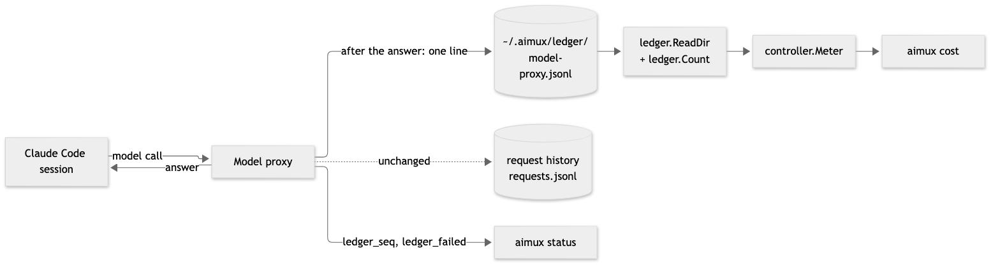

# Stage 1: The Ledger Implementation Plan

> **For agentic workers:** REQUIRED SUB-SKILL: Use superpowers:subagent-driven-development (recommended) or superpowers:executing-plans to implement this plan task-by-task. Steps use checkbox (`- [ ]`) syntax for tracking.

**Goal:** The model proxy writes one ledger line per model call, and `aimux cost` reads the ledger to show requests and tokens per session, model and day.

**Architecture:** `internal/ledger` grows from a line type and a counting rule into a writer (one file per writer, numbered lines, failures counted) and a reader (every file in the folder, unknown versions skipped and reported). The model proxy writes a `model_call` line after each response, beside its existing request history, which stays. One controller function, `controller.Meter`, reads the ledger; the CLI calls it.



**Tech Stack:** Go standard library only. No new dependency.

**Spec:** `docs/superpowers/specs/2026-11-23-aimux-governance-metering-and-evals-design.md` sections 1, 2 and 5; `docs/ledger-identity.md`; `docs/superpowers/specs/2026-11-25-aimux-product-shape-draft.md` ("Versions"). Tracker: `docs/superpowers/plans/governance-roadmap.md`, stage 1.

## Global Constraints

- A ledger line never holds a prompt, an answer, a tool argument, a file path or free text. Outcomes come from a fixed list.
- One writer per file, always a long-running process. The stable model proxy writes `~/.aimux/ledger/model-proxy.jsonl`; a proxy on any other port writes `model-proxy-<port>.jsonl`, so the dev listener never shares a file.
- The folder is mode 0700 and files 0600.
- A write that fails is counted and shown and never changes what happened to the request. The proxy answers the same with the ledger folder missing or full.
- Readers never write.
- Every line carries `schema: "aimux.ledger/1"`. A reader that meets another schema skips the line, counts it, and marks totals that span it incomplete. A writer that finds a newer schema at the end of its file refuses to write.
- Field names follow OpenTelemetry's generative-AI conventions where one exists (`gen_ai.request.model`, `gen_ai.response.model`, `gen_ai.usage.input_tokens`, `gen_ai.usage.output_tokens`); conventions 1.27.0, the first version with `gen_ai.usage.input_tokens` (1.26.0 still says `prompt_tokens`), and each line records `semconv: "1.27.0"`. aimux's own fields use the `aimux.` prefix.
- The session id is the harness's own, in full. The request history's 8-character tag is not used in the ledger.
- The model proxy's request history (`requests.jsonl`) and `aimux model proxy stats` are not changed.
- Core packages must not import `bubbletea`, `lipgloss` or `tui/`. `internal/ledger` imports nothing from the repository.
- Tests use real files and the real fake Codex app-server (`internal/modelproxy/testdata/fakecodex`). No mocks.
- Each task is one pull request, names "Stage 1" at the top of its description, updates the tracker in the same change, and gets at most two pre-push review rounds.
- The model proxy change (task 3) runs on the dev channel (port 7386) before the owner promotes it.

## Review Focus

1. **A torn last line** after a crash or a full disk: the reader skips it and reports it; the writer continues its numbering from the last complete line. Test in task 2.
2. **Two proxies at once** (stable and dev): each writes its own file and its own numbering. Test in task 3.
3. **A ledger folder that cannot be written** (missing, read-only, disk full): the request is answered normally, the failure is counted, and `aimux status` says so. Tests in tasks 2 and 3.
4. **A request with no session id** (a background call): its line is written, the reader lists it as unmatched, and the meter shows the count instead of dropping it. Tests in tasks 3 and 4.
5. **Day boundaries**: a call at 23:59 and one at 00:01 local time fall on different days in `aimux cost --by day`, and the day is the owner's local day, not UTC. Test in task 4.


### Task 1: What identifies a turn (evidence, no product code)

The spec leaves open how a turn id is derived so that the model proxy and, later, a hook arrive at the same value. This task records what each side can see and fixes the rule the proxy uses.

**Files:**
- Create: `internal/modelproxy/testdata/turns/*.json` (request shapes: roles and block kinds only, no text)
- Create: `docs/superpowers/specs/2026-11-25-turn-identity.md`
- Modify: `docs/ledger-identity.md` (the turn row and "Not yet confirmed")
- Modify: `docs/superpowers/plans/governance-roadmap.md`

**Interfaces:**
- Produces: five fixtures named `fresh-prompt.json`, `tool-continuation.json`, `subagent.json`, `background.json`, `after-compaction.json`, each `{"session": "<id or empty>", "outcome": "<the proxy's session outcome>", "messages": [{"role": "user|assistant", "kinds": ["text"|"tool_use"|"tool_result"]}], "starts_turn": true|false, "side": true|false}`. Task 3's tests read them.
- Produces: the rule, written in the turn-identity document, in this form: "a turn number per session; it goes up by one when a request on the session's main conversation ends in a user message that is not only tool results; a request off the main conversation (a subagent or background call) takes the session's current number and is marked `side`".

- [ ] **Step 1: Capture the shapes.** Run the dev proxy (`aimux-dev model proxy serve --port 7386`) with a temporary debug line that prints, per request, the session id's presence, the proxy's session outcome, and each message's role and block kinds. In one Claude Code session through it: send a prompt that uses a tool, start a subagent, wait for a background call, then `/compact` and send another prompt. Save one request of each kind as a fixture. Remove the debug line; it is not committed.

- [ ] **Step 2: Capture the other side.** With `aimux remote hooks` installed, record the field names (not values) a `UserPromptSubmit` and a `PostToolUse` hook receive, and the fields of one user entry in the session's transcript. Record whether an MCP `tools/call` request reaching the MCP proxy carries the harness's tool-use id (roadmap, "Not yet verified" item 2): print the names of the request's `_meta` keys once.

- [ ] **Step 3: Write the turn-identity document.** One page: what the proxy sees, what a hook sees, the rule above, whether the fixtures confirm it, and what a hook must count to reach the same number (expected: the user prompts in the transcript). State plainly which parts are confirmed and which are left to slice 3.

- [ ] **Step 4: Check the fixtures hold no content.**

Run: `grep -L '"text":' internal/modelproxy/testdata/turns/*.json | wc -l`
Expected: `5` (no fixture contains a `text` field)

- [ ] **Step 5: Commit** with `git ship -m "docs: what identifies a turn, with request shapes as fixtures" <paths>` and open the pull request.


### Task 2: Line schema, writer and reader (`internal/ledger`)

**Files:**
- Modify: `internal/ledger/line.go`
- Create: `internal/ledger/writer.go`, `internal/ledger/writer_test.go`
- Create: `internal/ledger/reader.go`, `internal/ledger/reader_test.go`
- Modify: `docs/ledger-identity.md` (first paragraph: what exists)

**Interfaces:**
- Produces, in `line.go`:

```go
const Schema = "aimux.ledger/1"
const SemConv = "1.27.0"

// Added to Line. Every new field is omitempty except Schema.
Schema        string `json:"schema"`
SemConv       string `json:"semconv,omitempty"`
Harness       string `json:"aimux.harness,omitempty"`       // "claude-code", "codex", ""
Side          bool   `json:"aimux.side,omitempty"`          // off the session's main conversation
RequestModel  string `json:"gen_ai.request.model,omitempty"`
ResponseModel string `json:"gen_ai.response.model,omitempty"`
Engine        string `json:"aimux.engine,omitempty"`        // "codex"
Effort        string `json:"aimux.effort,omitempty"`
InputTokens   int64  `json:"gen_ai.usage.input_tokens,omitempty"`  // the whole prompt, cached part included
OutputTokens  int64  `json:"gen_ai.usage.output_tokens,omitempty"`
CacheRead     int64  `json:"aimux.usage.cache_read_input_tokens,omitempty"`
CacheWrite    int64  `json:"aimux.usage.cache_write_input_tokens,omitempty"`
Estimated     bool   `json:"aimux.usage.estimated,omitempty"`
TTFBMillis    int64  `json:"aimux.ttfb_ms,omitempty"`       // -1: no byte was sent
DurationMs    int64  `json:"aimux.duration_ms,omitempty"`
Outcome       string `json:"aimux.outcome,omitempty"`       // "ok" or one of the Outcome* constants
```

- Produces, in `writer.go`:

```go
// OpenWriter appends to dir/name.jsonl, creating dir (0700) and the file (0600). name is also the writer's name
// on every line. Numbering continues from the last complete line on disk. A nil *Writer writes nothing.
func OpenWriter(dir, name string) (*Writer, error)
// Write stamps Writer, Seq, Schema, SemConv and, when zero, At, and appends the line. It never returns an error:
// a failed write is counted in Stats and the sequence number it used is not reused.
func (w *Writer) Write(l Line)
type WriterStats struct{ Seq, Failed uint64 }
func (w *Writer) Stats() WriterStats
func (w *Writer) Close() error
// ErrNewerSchema: the file's last line has a schema this build does not know.
var ErrNewerSchema = errors.New("the ledger file was written by a newer aimux")
```

- Produces, in `reader.go`:

```go
type ReadReport struct {
	Files   int
	Skipped int // lines with another schema
	Torn    int // lines that are not complete JSON
}
// ReadDir reads every *.jsonl in dir. A missing dir is no lines and no error.
func ReadDir(dir string) ([]Line, ReadReport, error)
```

- [ ] **Step 1: Write the failing writer tests** in `writer_test.go`:

```go
func TestWriter_NumbersLinesAndContinuesAfterReopen(t *testing.T)
// two writes, close, reopen, one write: file has seq 1,2,3; every line has schema "aimux.ledger/1",
// semconv "1.27.0", writer == the name given; file mode 0600, dir mode 0700.

func TestWriter_ContinuesAfterATornLastLine(t *testing.T)
// file ends with `{"seq":3,"wri` (no newline): reopen, write: the new line is seq 3 on its own line,
// and ReadDir reports Torn == 1 and returns seq 1, 2, 3.

func TestWriter_FailedWriteIsCountedNotReturned(t *testing.T)
// close the writer's file underneath it (w.Close then w.Write): Stats().Failed == 1, no panic.

func TestWriter_RefusesAFileFromANewerSchema(t *testing.T)
// last line has "schema":"aimux.ledger/2": OpenWriter returns ErrNewerSchema and the file is unchanged.

func TestWriter_NilWritesNothing(t *testing.T)
// var w *Writer; w.Write(Line{}); w.Stats() == WriterStats{}; w.Close() == nil.

func TestWriter_ConcurrentWritesKeepOneLineEach(t *testing.T)
// 50 goroutines each write once: 50 lines, seq 1..50 with none missing or repeated.
```

- [ ] **Step 2: Run them to see them fail.**

Run: `go test ./internal/ledger/ -run TestWriter -count=1`
Expected: FAIL, `undefined: OpenWriter`

- [ ] **Step 3: Implement `writer.go` and the new `Line` fields.** One mutex around stamping and the single `Write` call; the line and its newline go in one write.

- [ ] **Step 4: Write the failing reader tests** in `reader_test.go`:

```go
func TestReadDir_MergesEveryFile(t *testing.T)
// two writers, three lines each: 6 lines, Files == 2.

func TestReadDir_SkipsAnotherSchemaAndCountsIt(t *testing.T)
// one line with "schema":"aimux.ledger/2" between two good ones: 2 lines, Skipped == 1.

func TestReadDir_MissingFolderIsEmpty(t *testing.T)
// ReadDir(filepath.Join(t.TempDir(), "none")) returns no lines, a zero report and a nil error.

func TestReadDir_ModelCallRoundTrips(t *testing.T)
// a line with RequestModel "claude-sonnet-5-5", ResponseModel "codex:gpt-6.2-sol", InputTokens 91200,
// CacheRead 90000, OutputTokens 40, Outcome "ok" is written and read back equal, and the raw file contains
// `"gen_ai.request.model":"claude-sonnet-5-5"` and no key named "prompt", "text" or "path".
```

- [ ] **Step 5: Run, implement `reader.go`, run again.**

Run: `go test ./internal/ledger/ -count=1 -race`
Expected: PASS, including the existing `Count` tests

- [ ] **Step 6: Commit** with `git ship -m "feat(ledger): numbered writer and a reader that skips what it does not know" <paths>` and open the pull request.


### Task 3: The model proxy writes a line per model call

**Files:**
- Create: `internal/modelproxy/turns.go`, `internal/modelproxy/turns_test.go`
- Create: `internal/modelproxy/ledgerline.go`, `internal/modelproxy/ledgerline_test.go`
- Modify: `internal/modelproxy/http.go` (`serveMessage`, `NewHandler` options)
- Modify: `internal/modelproxy/health.go` (`Liveness`)
- Modify: `cmd/aimux/cmd/model_proxy.go` (open the writer), `cmd/aimux/cmd/status_probes.go` (`readModelStatus`)
- Modify: `docs-site/src/content/docs/advanced/model-proxy-channels.mdx`, `.claude/CLAUDE.md`, the tracker

**Interfaces:**
- Consumes: `ledger.OpenWriter`, `(*ledger.Writer).Write`, `Stats`, `ledger.Line` (task 2); the fixtures and the rule (task 1).
- Task 1 settled the rule (`docs/superpowers/specs/2026-11-25-turn-identity.md`): a request is a side request when it carries the `X-Claude-Code-Agent-Id` header or has no session id in its metadata, and a turn starts on a request that is not a side request and whose last user message holds no `tool_result`. `ledger.Line` gains `Agent string` with the JSON name `aimux.agent`, the subagent's id.
- Produces:

```go
// WithLedger makes the handler write one model_call line per answered request. A nil writer writes nothing.
func WithLedger(w *ledger.Writer) HandlerOption

// LedgerFile is the writer's name for a proxy on port: "model-proxy" on StablePort, else "model-proxy-<port>".
func LedgerName(port int) string

// turns numbers a session's turns. next reports the turn a request belongs to: side is true for a subagent or
// background request; startsTurn is true when the last user message holds no tool_result; prompts is how many
// user messages without a tool_result the request's own message list holds. The number never
// goes below prompts, so a session the table forgot, or a proxy that restarted, does not reuse a number while the
// conversation is still in the request. It is returned as a decimal string, "" when session is empty.
type turns struct{ /* per-session counters, bounded like the session table */ }
func (t *turns) next(session string, side, startsTurn bool, prompts int) (turn string)
// seed sets each session's counter from lines already in the ledger, so a restart after a compaction (when the
// request no longer holds the earlier prompts) still goes on from the last number written.
func (t *turns) seed(lines []ledger.Line)

// WithLedgerOff records that the ledger could not be opened, so health can say so instead of looking healthy.
func WithLedgerOff() HandlerOption

// Added to Liveness, each omitted when zero:
LedgerSeq    uint64 `json:"ledger_seq,omitempty"`
LedgerFailed uint64 `json:"ledger_failed,omitempty"`
LedgerOff    bool   `json:"ledger_off,omitempty"` // the ledger file could not be opened at start
```

- Line content: `Kind` `model_call`; `Session` the full id from the request's `metadata.user_id` `session_id`, else the `X-Claude-Code-Session-Id` header, else empty; `Side` and `Agent` by the rule above; `Turn` from `turns.next`; `Call` a new id (`"mc_" + rand.Text()`); `RequestModel` the model the client named; `ResponseModel` `"codex:" + turn.Model`; `Engine` `"codex"`; `Harness` `"claude-code"` when the `User-Agent` starts with `claude-cli`, else empty; tokens, estimate flag, time to first byte and duration from the same values the request history gets; `Outcome` `"ok"` or the value the history's `error` field would hold. A request the proxy rejects before Codex (`invalid_request`) writes no line: it is not a model call.

- [ ] **Step 1: Write the failing turn tests** in `turns_test.go`, driven by task 1's fixtures:

```go
func TestTurns_FromRecordedShapes(t *testing.T)
// each fixture's own starts_turn and side fields are what the request classifier returns for its shape;
// then, in one session: fresh-prompt -> "1"; tool-continuation and tool-continuation-with-text -> "1";
// subagent -> "1"; background -> "1"; a second fresh-prompt -> "2"; after-compaction -> "3" (the number
// goes on although its list holds 2 prompts).

func TestTurns_SessionsDoNotShareNumbers(t *testing.T)
// session A prompt, session B prompt, session A prompt: A is "1" then "2", B is "1".

func TestTurns_ForgetsIdleSessions(t *testing.T)
// more sessions than the table holds: the oldest is dropped and the table does not grow past its bound.

func TestTurns_AForgottenSessionDoesNotReuseANumber(t *testing.T)
// session A reaches "2" and is dropped from the table; its next prompt arrives with prompts == 3: the turn is "3".

func TestTurns_SeededFromTheLedgerAfterARestart(t *testing.T)
// seed with lines for session A up to turn "7"; a prompt after a compaction (prompts == 1) is turn "8".
```

- [ ] **Step 2: Run to see them fail, implement `turns.go`, run to see them pass.**

Run: `go test ./internal/modelproxy/ -run TestTurns -count=1`

- [ ] **Step 3: Write the failing handler tests** in `ledgerline_test.go`, against the fake Codex app-server through `NewHandler`:

```go
func TestLedger_OneLinePerAnsweredRequest(t *testing.T)
// a streamed request naming "claude-sonnet-5-5" with a session id: one line with kind "model_call",
// that session in full, turn "1", a call id starting "mc_", gen_ai.request.model "claude-sonnet-5-5",
// gen_ai.response.model "codex:gpt-6.2-sol", engine "codex", the fake's token counts (17 in, 3 out),
// outcome "ok", ttfb_ms >= 0. The request history still gets its own line.

func TestLedger_BackgroundRequestHasNoSessionAndIsStillWritten(t *testing.T)
// no metadata and no header: a line with empty session and turn. With the header only: the header's value.

func TestLedger_FailedTurnIsWrittenWithItsKind(t *testing.T)
// the fake's "crash" prompt: outcome "app_server_exited", status 502 to the client, one line.

func TestLedger_RejectedRequestWritesNoLine(t *testing.T)
// a malformed body: HTTP 400, the request history records invalid_request, the ledger file has no line.

func TestLedger_AFailingLedgerDoesNotChangeTheAnswer(t *testing.T)
// the writer is closed underneath the handler (removing an open file would not stop writes to it): the request
// answers 200 with the same body as without a ledger, and Liveness reports ledger_failed == 1.

func TestLiveness_SaysWhenThereIsNoLedger(t *testing.T)
// a handler built with WithLedgerOff(): GET /healthz carries "ledger_off":true.

func TestLedger_TwoProxiesWriteTwoFiles(t *testing.T)
// LedgerName(StablePort) == "model-proxy"; LedgerName(7386) == "model-proxy-7386"; two handlers with two
// writers in one folder each number from 1.

func TestLiveness_ReportsLedgerSeq(t *testing.T)
// after two answered requests GET /healthz carries "ledger_seq":2 and no "ledger_failed".
```

- [ ] **Step 4: Run to see them fail, implement, run to see them pass.** The line is written in `serveMessage`'s existing deferred block, after the response, next to `requests.Record`.

Run: `go test ./internal/modelproxy/ -count=1 -race`
Expected: PASS

- [ ] **Step 5: Wire the command and the status row.** `model proxy serve` opens `ledger.OpenWriter(filepath.Join(home, ".aimux", "ledger"), modelproxy.LedgerName(bound))`; when that fails it prints `model proxy: no ledger: <error>`, passes `WithLedgerOff()` and serves on, as it does for the request history. On success it seeds the turn table from the file's lines (`ledger.ReadDir` on the folder, keeping this writer's). `readModelStatus` adds an attention item `N ledger lines were not written` when `ledger_failed > 0` and `the ledger is off` when `ledger_off`, both with the fix `aimux model proxy status`. Add `TestProbe_ModelProxyLedgerFailures` in `status_probes_test.go` asserting each item.

- [ ] **Step 6: Run it for real on the dev channel.**

Run: `scripts/model-proxy-promote build-dev`, then `aimux-dev model proxy serve --port 7386`, then one Claude Code prompt through it with `claude-codex-dev`.
Expected: `~/.aimux/ledger/model-proxy-7386.jsonl` exists with mode 0600, holds one line per request with both model names, and `jq -r 'keys[]' | sort -u` over it lists no key outside the schema above.

- [ ] **Step 7: Full suite, commit, pull request.**

Run: `go build ./... && go vet ./... && make test`
Then `git ship -m "feat(modelproxy): one ledger line per model call" <paths>`. The pull request says the owner promotes it.


### Task 4: The first meter and `aimux cost`

**Files:**
- Create: `internal/controller/meter.go`, `internal/controller/meter_test.go`
- Create: `cmd/aimux/cmd/cost.go`, `cmd/aimux/cmd/cost_test.go`
- Modify: `cmd/aimux/cmd/root.go`, `internal/e2e/cli_test.go`
- Modify: `README.md`, `.claude/CLAUDE.md` (operations table, parity gaps), `docs-site/src/content/docs/guides/cost-tracking.mdx`, the tracker

**Interfaces:**
- Consumes: `ledger.ReadDir`, `ledger.Count`, `ledger.Line` (task 2).
- Produces:

```go
type MeterBy string
const ( MeterBySession MeterBy = "session"; MeterByModel MeterBy = "model"; MeterByDay MeterBy = "day" )

type MeterOptions struct {
	Since   time.Time      // zero: everything
	By      MeterBy        // default MeterBySession
	Session string         // only this session, when set
	Zone    *time.Location // for days; nil is time.Local
}
type MeterRow struct {
	Key          string   `json:"key"`     // the session id, the served model, or a day as 2006-01-02
	Requests     int      `json:"requests"`
	Failed       int      `json:"failed"`  // outcome other than "ok"
	InputTokens  int64    `json:"input_tokens"`        // uncached: the line's input tokens minus its cache read
	CachedTokens int64    `json:"cached_input_tokens"`
	OutputTokens int64    `json:"output_tokens"`
	Estimated    bool     `json:"estimated,omitempty"` // any call in the row had estimated usage
	Models       []string `json:"models,omitempty"`    // served models, sorted, when the row is not by model
	Asked        []string `json:"asked,omitempty"`     // models the client named, sorted
}
type MeterReport struct {
	Rows       []MeterRow              `json:"rows"`  // most tokens first
	Total      MeterRow                `json:"total"`
	Unmatched  int                     `json:"unmatched"`  // model calls with no session
	Skipped    int                     `json:"skipped"`    // lines of another schema
	Torn       int                     `json:"torn"`
	Gaps       map[string][]ledger.Gap `json:"gaps,omitempty"`
	Incomplete bool                    `json:"incomplete"` // Skipped, Torn or Gaps is non-empty
}
// Meter reads the ledger folder and sums its model calls. It never writes.
func Meter(dir string, opts MeterOptions) (MeterReport, error)
```

- CLI: `aimux cost [--since 24h] [--by session|model|day] [--session <id>] [--json]`. Default `--since 24h`. Exit 0; exit 2 on a bad flag value. Table columns: the key (`SESSION`, `MODEL` or `DAY`), `ASKED` (the models the client named), `SERVED` (the models that answered; left out when the key is the model), `CALLS`, `IN`, `CACHED`, `OUT`, `COST`. `ASKED` is what shows a Claude model name answered by Codex. `COST` reads `unpriced` on every row until prices exist (slice 5). A session key is cut to its first 8 characters in the table and is whole in `--json`. Under the table, one line each when non-zero: `N calls with no session`, `N lines skipped (another ledger version)`, `N lines missing from <writer> (seq a to b)`, and `totals are incomplete` when `Incomplete`.

- [ ] **Step 1: Write the failing controller tests** in `meter_test.go`, with real files written through `ledger.OpenWriter`:

```go
func TestMeter_SumsBySession(t *testing.T)
// session A: 2 calls (lines with input 91200 and 800, cache read 90000 and 0, 40+60 out, one failed); session B: 1 call.
// rows[0] is A with Requests 2, Failed 1, InputTokens 2000, CachedTokens 90000, OutputTokens 100,
// Models ["codex:gpt-6.2-sol"], Asked ["claude-sonnet-5-5", "codex:gpt-6.2-sol"]; Total.Requests 3.

func TestMeter_ByModelUsesTheServedModel(t *testing.T)
// two calls asking "claude-sonnet-5-5" and "codex:gpt-6.2-sol", both served by "codex:gpt-6.2-sol": one row.

func TestMeter_ByDayUsesTheLocalDay(t *testing.T)
// zone UTC+1; calls at 22:59Z and 23:01Z on the same UTC date: two rows, "2026-11-24" and "2026-11-25".

func TestMeter_SinceLeavesOutOlderCalls(t *testing.T)

func TestMeter_CallsWithNoSessionAreCountedApart(t *testing.T)
// one line with an empty session: Unmatched == 1, it is in no row and not in Total.

func TestMeter_ReportsWhatItCouldNotRead(t *testing.T)
// a line of schema 2, a torn line and a missing sequence number: Skipped 1, Torn 1, Gaps has the writer,
// Incomplete true.

func TestMeter_EmptyFolder(t *testing.T)
// no folder: no rows, zero total, Incomplete false, nil error.

func TestMeter_OnlyModelCallsCount(t *testing.T)
// a tool_call line and a verdict line in the folder do not change Requests.
```

- [ ] **Step 2: Run to see them fail, implement `meter.go`, run to see them pass.**

Run: `go test ./internal/controller/ -run TestMeter -count=1`

- [ ] **Step 3: Write the failing command tests** in `cost_test.go`:

```go
func TestCost_Table(t *testing.T)
// the exact table for a two-session report, COST column "unpriced", under 100 columns.

func TestCost_NotesWhatIsMissing(t *testing.T)
// Unmatched 2, Skipped 1, a gap: the three note lines and "totals are incomplete".

func TestCost_JSONCarriesTheReport(t *testing.T)
// --json decodes to controller.MeterReport with whole session ids.

func TestCost_BadByIsAUsageError(t *testing.T)
// --by week: an error naming session, model and day.
```

- [ ] **Step 4: Implement `cost.go`, register it in `root.go`, add `TestCostJSON` to `internal/e2e/cli_test.go`** (with `HOME` set to an empty temp folder: exit 0, `rows` is an empty list, `incomplete` false).

Run: `go test ./cmd/aimux/cmd/ -run TestCost -count=1 && go test -tags e2e ./internal/e2e/ -run TestCost -count=1`
Expected: PASS

- [ ] **Step 5: Docs.** The cost-tracking guide gains a section on `aimux cost`: what it counts (model calls that passed the model proxy), what it does not (sessions that talk to Anthropic directly; prices), and what each note line means. `.claude/CLAUDE.md` gets the operations-table row (`Meter()`, CLI `aimux cost`, TUI and web `-- TODO`) and the parity gap.

- [ ] **Step 6: Full suite, commit, pull request.**

Run: `go build ./... && go vet ./... && make test`
Then `git ship -m "feat: aimux cost, the first meter over the ledger" <paths>`


### Task 5: Close the stage on real use

**Files:**
- Modify: `docs/superpowers/plans/governance-roadmap.md`, `docs/ledger-identity.md`

- [ ] **Step 1: After the owner has promoted task 3 and used the proxy for a day, compare the two records.**

Run: `aimux cost --since 24h --by model --json | jq '.total.requests'` and `aimux model proxy stats --since 24h`
Expected: the ledger's `total.requests` plus its `unmatched` (calls with no session are in neither a row nor the total) equals the history's count of requests that reached Codex (the history's total minus its `invalid_request` rows). Write both numbers in the tracker's "Done" table. A difference is investigated before the stage is closed, not explained away.

- [ ] **Step 2: Read the open item the ledger was meant to answer.** For the first request after the promote's restart, read its line's `aimux.ttfb_ms` and `aimux.duration_ms` and note them under "Not yet verified" item 10 (why a first answer took 28 to 50 seconds).

- [ ] **Step 3: Mark stage 1 done in the tracker**, set "Now" to stage 2, and tell the owner that the eval session can start its phases 0 and 1 if he wants it resumed.

- [ ] **Step 4: Commit** with `git ship -m "docs: stage 1 closed on a day of real use" <paths>`.

## Not in this stage

- Prices, allowances and the `measured / estimated / unpriced` split beyond the word `unpriced` (slice 5).
- Rotation, a retention window and a size cap for ledger files. At a few thousand lines a day a file grows about a megabyte a day; decided with real volumes after slice 3.
- The periodic check of ledger counts against transcripts and Claude Code's own totals.
- `run`, `project` and `host` on a line: the proxy does not know them until the entry wrapper supplies them (slice 2).
- Spans produced from the ledger (slice 6); the terminal UI and the dashboard reading the meter (stage 6).
