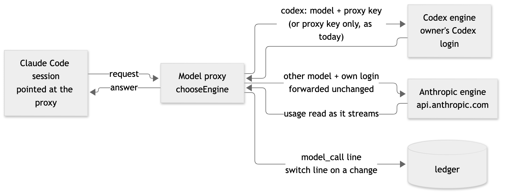

# Stage 3: A Second Engine, by Choice Implementation Plan

> **For agentic workers:** REQUIRED SUB-SKILL: Use superpowers:subagent-driven-development (recommended) or superpowers:executing-plans to implement this plan task-by-task. Steps use checkbox (`- [ ]`) syntax for tracking.

**Goal:** A Claude Code session the owner points at the model proxy can run on Anthropic, with his own login, recorded in the ledger, and switch to Codex and back with `/model`.

**Architecture:** The model proxy gains a second engine beside Codex: a forwarder that passes a request to Anthropic unchanged, with the caller's own credential, and reads only the usage figures off the response as it streams by. One small function decides which engine answers a request, from the model it names and the credential it carries. Requests that carry only the proxy key behave exactly as today, so `claude-codex` sessions do not change.



**Tech Stack:** Go standard library (`net/http`, `net/http/httputil`). No new dependency.

**Spec:** `docs/superpowers/specs/2026-11-23-aimux-governance-metering-and-evals-design.md` section 6 ("The second engine comes before the router", "When the choice is made"); `docs/superpowers/specs/2026-11-24-passthrough-spike-results.md`; `docs/superpowers/specs/2026-11-25-turn-identity.md`. Tracker: `docs/superpowers/plans/governance-roadmap.md`, stage 3.

## Global Constraints

- A session changes nothing unless the owner points it at the proxy. A request that carries the proxy key and no credential of its own is answered exactly as today, whatever model it names.
- The forwarder sends to one fixed upstream, `https://api.anthropic.com`. The upstream is never taken from a request.
- The caller's credential is forwarded and never stored, logged, written to the ledger or the request history, or echoed in an error.
- The proxy key is never forwarded upstream.
- The proxy key is still required for the Codex engine, which spends the owner's Codex login. A request without it gets no Codex answer.
- A request body and a response body pass through unchanged, byte for byte. The proxy reads the usage figures from the response as it passes; it stores no content.
- Nothing switches a conversation's engine by itself in this stage. The engine follows the model the client names.
- A change of engine inside a session is written to the ledger as a `switch` line.
- The sandbox entrance is not in this stage: its test is still open with the Wingman session.
- Tests use a real HTTP server standing in for Anthropic and the real fake Codex app-server. No mocks.
- Each task is one pull request, names "Stage 3" at the top of its description, and gets at most two pre-push review rounds. Pull requests stay small.
- The proxy changes run on the dev channel (port 7386) before the owner upgrades the stable proxy.

## Review Focus

1. **A dead or slow upstream:** Anthropic unreachable, or cut mid-stream. The client sees the upstream's own failure or a clear proxy error, the ledger line says which, and nothing hangs past the client's own timeout. Tests in task 2.
2. **A credential in the wrong place:** a request for a `codex:` model that carries an Anthropic login and no proxy key gets a 401 that names the fix, and the login is not sent to Codex or written anywhere. Test in task 3.
3. **A client that goes away mid-stream:** the upstream request is cancelled, and the ledger line records `client_gone` with the tokens seen so far. Test in task 2.
4. **Response shapes the usage reader does not know:** a non-streamed JSON body, a streamed body with no usage event, a gzip-encoded body, an upstream error body. The bytes still reach the client unchanged, and the line says the usage is unknown instead of zero. Tests in task 2.
5. **Switching back and forth:** Anthropic, then Codex, then Anthropic in one conversation. Each change writes one `switch` line, and the turn number does not restart. Test in task 3; a real run in task 5.

### Task 1: How the key and the login travel together (evidence, no product code)

A subscription session sends its login in `Authorization`. The proxy key cannot go there too. This task finds where it can go, and settles three smaller unknowns, before anything is built on a guess.

**Files:**
- Create: `docs/superpowers/specs/2026-11-25-second-engine-evidence.md`
- Modify: `docs/superpowers/plans/governance-roadmap.md`

**Interfaces:**
- Produces: the decision on how a passthrough session presents the proxy key, one of: a path prefix in `ANTHROPIC_BASE_URL` (`http://127.0.0.1:7385/k/<key>`), or a header from `ANTHROPIC_CUSTOM_HEADERS`. Task 3 implements the one this task shows working. If both work, the path prefix is used, because it needs nothing from the client but a base URL.

- [ ] **Step 1: Run the throwaway forwarder from the passthrough test** on a spare port, recording header names, paths and one-way hashes only, never values.

- [ ] **Step 2: Answer each question with a real `claude -p` run on the subscription login**, and write the answer in the evidence document:

| Question | How |
|---|---|
| Does a base URL with a path prefix reach the forwarder with the prefix kept, on every path Claude Code calls? | `ANTHROPIC_BASE_URL=http://127.0.0.1:<port>/k/test` |
| Does a header from `ANTHROPIC_CUSTOM_HEADERS` arrive on every request? | `ANTHROPIC_CUSTOM_HEADERS='x-aimux-key: test'` |
| Which paths does a session call besides `POST /v1/messages`? | The forwarder's list of paths |
| Does a subagent's request and a background request carry the same `Authorization` hash as the main one? | The forwarder's hashes |
| Can the session name a `codex:` model with `--model`, and does the request then carry the login, the key, or both? | `claude -p --model codex:gpt-6.2-sol` against the forwarder |

- [ ] **Step 3: Write the evidence document** with a "Confirmed, and not" table, in the form of `2026-11-25-turn-identity.md`. State plainly what an interactive `/model` would need that `claude -p` did not show; the owner checks that part in task 5.

- [ ] **Step 4: Commit** with `git ship -m "docs: how the proxy key and the login travel together" <paths>` and open the pull request.

### Task 2: The Anthropic engine

**Files:**
- Create: `internal/modelproxy/anthropic.go`, `internal/modelproxy/anthropic_test.go`
- Create: `internal/modelproxy/usagereader.go`, `internal/modelproxy/usagereader_test.go`
- Create: `internal/modelproxy/testdata/anthropic/*.sse`, `*.json` (response shapes with placeholder text)

**Interfaces:**
- Produces:

```go
// AnthropicUpstream is where the Anthropic engine sends requests.
const AnthropicUpstream = "https://api.anthropic.com"

// anthropicEngine forwards a request to its upstream unchanged and reports how it went.
type anthropicEngine struct {
	upstream *url.URL       // AnthropicUpstream; a test server in tests
	client   *http.Client   // no overall timeout: a turn can stream for minutes; the client's context ends it
}
func newAnthropicEngine(upstream string) (*anthropicEngine, error)

// forward sends r to the upstream at path, with the proxy's own key headers removed, copies the response to w as
// it arrives, and returns what it saw. It never returns the credential or any body text.
func (e *anthropicEngine) forward(w http.ResponseWriter, r *http.Request, path string, body []byte) forwardResult

type forwardResult struct {
	Status   int
	Model    string   // the model the response names; empty when it named none
	Usage    Usage    // from the response; UsageKnown false when the response carried none
	UsageKnown bool
	Outcome  string   // "ok", "upstream_error", "upstream_unreachable", "client_gone", "stream_cut_short"
}

// usageReader watches a response body pass and keeps only its usage figures and model name.
type usageReader struct{ /* ... */ }
func newUsageReader(contentType, contentEncoding string) *usageReader
func (u *usageReader) Write(p []byte) (int, error) // always len(p), nil: it must never slow or break the copy
func (u *usageReader) result() (model string, usage Usage, known bool)
```

- `Usage` gains `CacheCreationInputTokens int` (`json:"cache_creation_input_tokens"`), which Anthropic reports and Codex does not.
- Headers removed before forwarding: `x-aimux-key`, and `x-api-key` when its value is the proxy key. Hop-by-hop headers are handled by the standard library. `Host` is the upstream's.

- [ ] **Step 1: Write the failing usage-reader tests** in `usagereader_test.go`, from fixtures:

```go
func TestUsageReader_StreamedMessage(t *testing.T)
// message_start with input 1200, cache_read 90000, cache_creation 300; message_delta with output 40:
// model "claude-sonnet-5-5", Usage{InputTokens: 1200, CacheReadInputTokens: 90000, CacheCreationInputTokens: 300, OutputTokens: 40}, known.

func TestUsageReader_EventsSplitAcrossWrites(t *testing.T)
// the same stream written one byte at a time gives the same result.

func TestUsageReader_JSONBody(t *testing.T)
// a non-streamed response: the same figures from its "usage" object.

func TestUsageReader_UnknownShapes(t *testing.T)
// an error body, a stream with no usage event, a gzip-encoded body, an empty body: known is false, no panic,
// and Write always returns len(p), nil.

func TestUsageReader_KeepsNoText(t *testing.T)
// after a stream whose text block is "SECRET-ANSWER", no field of the reader holds that string
// (checked with fmt.Sprintf("%+v", reader)).
```

- [ ] **Step 2: Run to see them fail, implement `usagereader.go`, run to see them pass.**

Run: `go test ./internal/modelproxy/ -run TestUsageReader -count=1`

- [ ] **Step 3: Write the failing engine tests** in `anthropic_test.go`, against an `httptest.Server` that answers as Anthropic does:

```go
func TestAnthropicEngine_ForwardsUnchanged(t *testing.T)
// the upstream receives the same body bytes, the caller's Authorization, Anthropic-Version and Anthropic-Beta,
// and neither x-aimux-key nor an x-api-key holding the proxy key; the client receives the upstream's status,
// headers and body bytes unchanged.

func TestAnthropicEngine_StreamsAsItArrives(t *testing.T)
// the upstream sends one event, waits, sends the next: the client has the first before the second is sent.

func TestAnthropicEngine_UpstreamError(t *testing.T)
// a 429 with a JSON error body: the client gets the 429 and the body; Outcome "upstream_error", UsageKnown false.

func TestAnthropicEngine_UpstreamUnreachable(t *testing.T)
// the upstream's listener is closed: the client gets 502 with an api_error that names no address or
// credential; Outcome "upstream_unreachable".

func TestAnthropicEngine_ClientGone(t *testing.T)
// the client cancels mid-stream: the upstream's request context is cancelled, Outcome "client_gone".

func TestAnthropicEngine_StreamCutShort(t *testing.T)
// the upstream closes after message_start: Outcome "stream_cut_short", the usage seen so far is returned.

func TestAnthropicEngine_NeverSendsElsewhere(t *testing.T)
// a request with an absolute URL in its path, a Host header for another site, and X-Forwarded-Host: the
// request still goes to the engine's upstream and nowhere else.
```

- [ ] **Step 4: Run to see them fail, implement `anthropic.go`, run to see them pass.**

Run: `go test ./internal/modelproxy/ -count=1 -race`
Expected: PASS, including every existing test

- [ ] **Step 5: Commit** with `git ship -m "feat(modelproxy): an Anthropic engine that forwards unchanged and reads usage" <paths>` and open the pull request. Nothing calls the engine yet.

### Task 3: Choosing the engine, and writing what was chosen

**Files:**
- Create: `internal/modelproxy/engines.go`, `internal/modelproxy/engines_test.go`
- Modify: `internal/modelproxy/http.go` (`NewHandler`, `validKey`, `serveMessage`, `listModels`), `internal/modelproxy/ledgerline.go`, `internal/modelproxy/turns.go`
- Modify: `internal/ledger/line.go` (switch fields), `internal/controller/meter.go` (cache creation), `cmd/aimux/cmd/model_proxy.go`
- Modify: `docs-site/src/content/docs/advanced/model-proxy-channels.mdx`, `.claude/CLAUDE.md`, the tracker

**Interfaces:**
- Consumes: `anthropicEngine.forward`, `forwardResult` (task 2); the key delivery task 1 chose.
- Produces:

```go
// credentials is what a request carried, read once.
type credentials struct {
	proxyKey bool // the proxy key, by x-api-key, a Bearer token, or the way task 1 chose
	own      bool // an Authorization that is not the proxy key: the caller's own login
}

// chooseEngine decides who answers. It reads the model name and the credentials, never the prompt.
//   codex:* model, proxy key            -> "codex"
//   codex:* model, no proxy key         -> refused: errNeedsProxyKey
//   other model, own login              -> "anthropic"
//   other model, proxy key, no login    -> "codex" (today's behaviour: the default Codex model answers)
//   nothing usable                      -> refused: errNoCredential
func chooseEngine(model string, c credentials) (engine string, err error)

// WithAnthropic turns the Anthropic engine on. Without it every request is answered as before this stage.
func WithAnthropic(upstream string) HandlerOption
```

- `ledger.Line` gains, for `switch` lines: `FromEngine string` (`aimux.from_engine`) and `ToEngine string` (`aimux.to_engine`). A `switch` line carries the session and the turn.
- The turn table remembers each session's last engine. When a main-conversation request is answered by another engine than the session's last one, the proxy writes a `switch` line before the `model_call` line. A side request never writes one.
- For an Anthropic call the `model_call` line has `Engine` `"anthropic"`, `ResponseModel` from the response, tokens from the response (input is the whole prompt: uncached plus cache read plus cache creation), `CacheWrite` the cache-creation tokens, `Estimated` false, and when the response carried no usage, `aimux.usage.unknown: true` (new field `UsageUnknown`) instead of zeros.
- `GET /v1/models` with the Anthropic engine on, and a request carrying the caller's own login, is forwarded to Anthropic and the Codex models are appended to its list; otherwise it answers as today.
- Paths other than `/v1/messages`, `/v1/messages/count_tokens` and `/v1/models` that task 1 found Claude Code calls are forwarded when the request carries the caller's own login, and are 404 otherwise, as today.
- The 401 for `errNeedsProxyKey` reads: `this model runs on the owner's Codex login and needs the proxy key; start the session with: eval "$(aimux model proxy env)"`.

- [ ] **Step 1: Write the failing tests** in `engines_test.go`:

```go
func TestChooseEngine(t *testing.T)
// the table above, row by row, plus: an empty model name with the proxy key -> "codex".

func TestHandler_ProxyKeyOnlyBehavesAsBefore(t *testing.T)
// with WithAnthropic on: a request with the proxy key naming "claude-sonnet-5-5" is answered by the fake Codex
// app-server, and the fake Anthropic server receives nothing.

func TestHandler_OwnLoginGoesToAnthropic(t *testing.T)
// a request with Authorization and no proxy key naming "claude-sonnet-5-5": the fake Anthropic server answers,
// the fake Codex app-server is not started, and the ledger line has engine "anthropic", the response's
// model, its tokens, estimated false.

func TestHandler_CodexModelWithoutTheKeyIsRefused(t *testing.T)
// Authorization only, model "codex:gpt-6.2-sol": 401 with the message above; neither engine is called; no
// ledger line; the login appears in no log and no response.

func TestHandler_BothCredentialsCanUseBothEngines(t *testing.T)
// the proxy key the way task 1 chose, plus Authorization: "claude-sonnet-5-5" goes to Anthropic with the
// login and without the key; "codex:gpt-6.2-sol" goes to Codex.

func TestLedger_SwitchLineWhenASessionChangesEngine(t *testing.T)
// one session: Anthropic, Codex, Anthropic. Lines in order: model_call, switch (anthropic -> codex),
// model_call, switch (codex -> anthropic), model_call; the turns are 1, 2, 3; a subagent's request on the
// other engine in between writes no switch line.

func TestHandler_WithoutTheOptionNothingChanges(t *testing.T)
// no WithAnthropic: Authorization only is 401 as today, for every model name.

func TestModels_ListsBothWhenTheLoginIsPresent(t *testing.T)
```

- [ ] **Step 2: Run to see them fail, implement, run to see them pass.**

Run: `go test ./internal/modelproxy/ ./internal/ledger/ ./internal/controller/ -count=1 -race`

- [ ] **Step 3: Wire the command.** `aimux model proxy serve` gains `--anthropic` (default off in this stage); the stable proxy's job gets it only when the owner turns it on in task 5. `aimux cost` shows the engine: add `ENGINE` to `--by model`, and count cache-creation tokens into `IN` with a note line when present. Update `TestCost_*` and `TestMeter_*` for the new field.

- [ ] **Step 4: Full suite, docs, commit, pull request.**

Run: `go build ./... && go vet ./... && make test`
Then `git ship -m "feat(modelproxy): the engine follows the model named and the credential carried" <paths>`

### Task 4: One command to point a session at the proxy

**Files:**
- Modify: `cmd/aimux/cmd/model_proxy.go`; Create: `cmd/aimux/cmd/model_proxy_env.go`, `cmd/aimux/cmd/model_proxy_env_test.go`
- Modify: `docs-site/src/content/docs/advanced/model-proxy-channels.mdx`, `README.md`, the tracker

**Interfaces:**
- Produces: `aimux model proxy env [--port N]`, which prints shell lines for `eval`. It sets `ANTHROPIC_BASE_URL` (and whatever task 1 chose to carry the proxy key), unsets `ANTHROPIC_API_KEY` and `ANTHROPIC_AUTH_TOKEN` so the subscription login is used, and sets nothing about the model. It prints to stdout only what is safe to `eval`, and one line to stderr saying what the session will do. It fails, printing nothing to stdout, when the proxy does not answer or was started without `--anthropic`.

- [ ] **Step 1: Write the failing tests** in `model_proxy_env_test.go`:

```go
func TestProxyEnv_PrintsWhatAShellCanEval(t *testing.T)
// stdout is only export and unset lines, each value single-quoted; `sh -n` accepts it.

func TestProxyEnv_FailsWhenTheProxyDoesNotAnswer(t *testing.T)
// nothing listens: a non-nil error naming `aimux status`, and stdout is empty.

func TestProxyEnv_FailsWhenAnthropicIsOff(t *testing.T)
// the proxy answers and its health says the Anthropic engine is off: an error naming the flag, stdout empty.

func TestProxyEnv_NeverPrintsTheKeyToStderr(t *testing.T)
```

- [ ] **Step 2: Implement.** `Liveness` gains `Engines []string` (`"codex"`, `"anthropic"`), which `env` and `aimux status` read.

- [ ] **Step 3: Run it for real** on the dev channel: `eval "$(aimux-dev model proxy env --port 7386)"`, then `claude -p 'Reply with the word ok.'`.
Expected: the answer arrives; `aimux cost --by model` shows one call with engine `anthropic` under a Claude model name.

- [ ] **Step 4: Full suite, docs, commit, pull request.**

### Task 5: Close the stage on real use

**Files:**
- Modify: `docs/superpowers/plans/governance-roadmap.md`, `docs/superpowers/specs/2026-11-25-second-engine-evidence.md`

- [ ] **Step 1: Measure what the proxy costs.** Twenty short `claude -p` turns direct and twenty through the dev proxy on Anthropic. Write the median time to first byte of each in the tracker. The spec's bound is about 33 ms added.

- [ ] **Step 2: The owner checks what `claude -p` cannot.** In one interactive session started with `eval "$(aimux-dev model proxy env --port 7386)"`: a prompt with a tool call on a Claude model; `/model` to a `codex:` model and a prompt that refers to the first; `/model` back and a prompt that refers to both. This is roadmap item 5 under "Not yet verified" (a transcript written under Codex, continued on Anthropic).
Expected: all three answers arrive and recall what came before; `aimux cost --session <id>` shows both engines; the ledger has two `switch` lines.

- [ ] **Step 3: A dead proxy.** Stop the dev proxy with a session pointed at it and send a prompt.
Expected: Claude Code reports a connection error. Write down exactly what the owner sees and the one command that returns the shell to going direct (`unset ANTHROPIC_BASE_URL`), in the guide.

- [ ] **Step 4: The owner turns it on for the stable proxy** by adding `--anthropic` to its job and running `aimux upgrade model-proxy`. Mark stage 3 done in the tracker when step 2 has passed on the stable proxy.

## Not in this stage

- The sandbox entrance, and Wingman's stages on a second engine. It waits on the sandbox half of the passthrough test.
- Choosing an engine by role, by allowance or on a limit error (stage 4). Here the engine only follows the model the client names.
- An OpenAI-compatible engine.
- The inference proxy in front of every session (stage 7). This stage is opt-in per shell.
- Prices. An Anthropic call is recorded with measured tokens and still shows `unpriced`.
- Keeping both engines warm, so that switching back costs only the missed turns.
