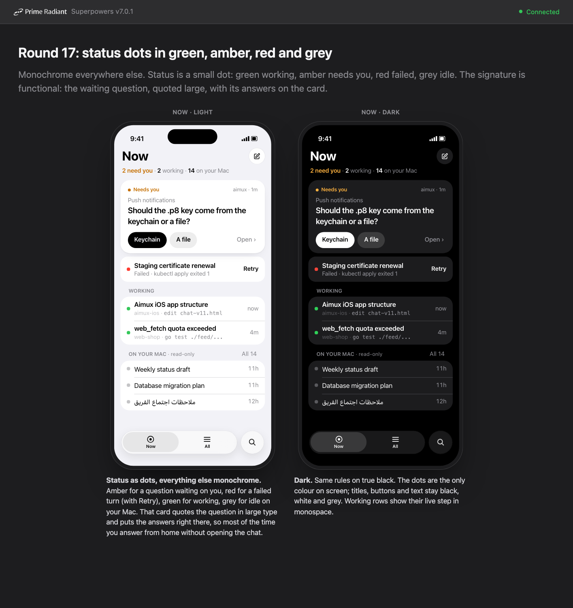
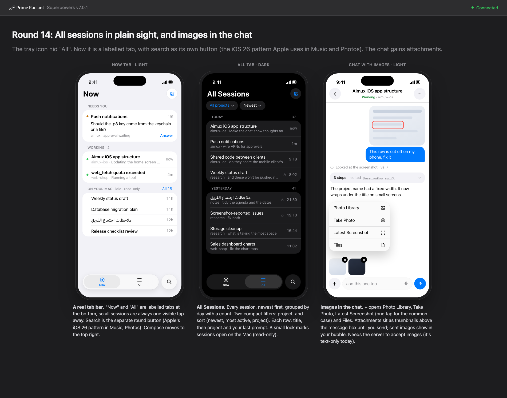
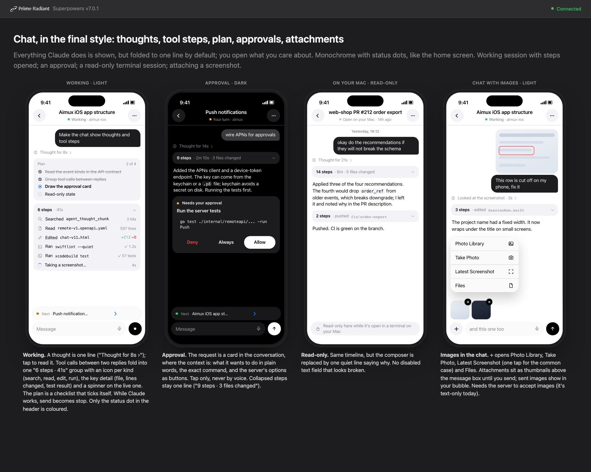
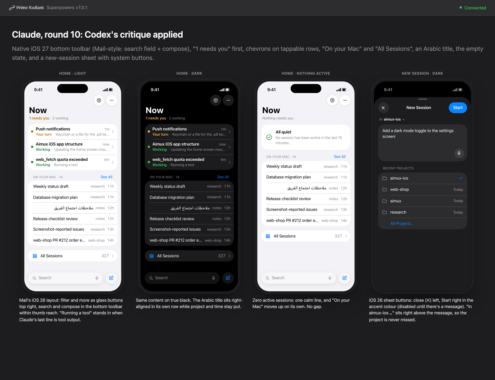

# aimux clients: iPhone app and web client design

A native iPhone app for aimux's remote API, and the phone web client brought to the same design. This document is the agreed design for both clients' main screens and the server work they need. Mockups are in `images/`; the HTML sources there render inside the brainstorm frame, so open the PNGs.

## Intent

The owner runs many Claude Code sessions on their Mac and wants to follow, answer and start them from the phone. The first build (0.1) listed sessions newest first. With real data it failed: 327 sessions across 24 projects (251 in one project), 18 open in a terminal of which about 4 are active, and a flat list that meant scrolling to find anything. Search was keyword-only over whole transcripts, so tool output (bash commands, paths, diffs) drowned the results.

The design optimizes one thing: **time to information**. Open the app and see what needs you, what is working, and nothing else, without scrolling.

## Goals

- The home screen answers "what needs me, what is running" at a glance, on one screen, at any number of sessions.
- Running sessions and all sessions are separate views. Running opens first. They are never mixed by default.
- Compact: many sessions per screen, still legible.
- Less switching between the list and a chat: answer simple questions from the home screen, and move between active sessions inside the chat.
- Start new sessions from the phone, by typing or dictating.
- The chat shows what Claude is doing (thoughts, tool calls, plan, approvals) without the noise.
- Attach images and screenshots to a message.
- Search that finds a session by what it was about, like `aimux sessions <query>`.

## Non-goals

- Replacing the Mac. Sessions open in a terminal stay read-only from the phone.
- Codex and other agents' sessions (the API is Claude only).
- iPad layout (iPhone only for now). The web client targets phone-sized browsers; a desktop layout is out of scope.
- Answering approvals by voice. Approvals are always a tap.

## Anti-goals

These would make it a failure even if it works:

- **Looks generated.** Rainbow colours, emoji icons, initials badges, gradient wallpapers, decorative glass. The owner rejected all of these in review ("adding colours does not mean we are going to a party").
- **Bland.** A correct but characterless list. The owner rejected that too.
- **Scrolling to find the session that needs you.**
- **A list that grows with the number of sessions.** 20 working sessions must not mean 20 rows on the home screen.

## Constraints

From the API today (`api/remote-v1.openapi.yaml` in aimux; see `docs/brief.md`):

- Session states: `idle`, `busy`, `open_in_terminal`, `unavailable`, plus unknown values to keep.
- Sessions open in a terminal (`open_in_terminal`) are read-only from the phone (409 on send). The server cannot see what they are doing: no live events, no "working" vs "waiting".
- Sessions the API drives stream events: `turn_started`, `update` (ACP: `agent_message_chunk`, `agent_thought_chunk`, `tool_call`, `tool_call_update`, `plan`), `approval` (with options and `toolCall.rawInput`), `approval_resolved`, `turn_done`, `turn_error`.
- `GET /v1/sessions?limit=` (max 500, about 0.3 s for all of them), `GET /v1/search` (keyword only), `GET /v1/projects` (12 most recent folders), `POST /v1/sessions` (new session), `POST /v1/sessions/{id}/messages` (text only).
- No push notifications, no images in messages, no paging.

## Approaches

### How the app is built

| Option | For | Against |
|---|---|---|
| **1. Native SwiftUI inside the aimux repo** (`clients/ios/`) | API, server and app change in one PR. Most next features (search, activity state, push, images) need both sides. Native list density, Live Activities, on-device speech. | iOS builds in aimux CI; the heavy pre-push review needs to be path-aware. |
| 2. Native SwiftUI, separate repo (today) | Lighter repo | Every feature is two coordinated PRs; the contract is copied. |
| 3. WebView shell around the aimux web client (the Omnigent model: [omnigent-ai/omnigent](https://github.com/omnigent-ai/omnigent) keeps thin iOS/Android WebView shells in its monorepo) | One UI for browser and phone | Hard to reach the native feel and density; Live Activities, speech and push each need a bridge that grows until most of the product is native. |

**Decision: option 1** (recommended by Claude and, independently, Codex; confirmed by the owner). Keep it modular: `clients/ios/` owns XcodeGen, Swift code and tests; the OpenAPI file stays the single contract; CI runs iOS jobs only when `ios/` or the contract changes; the pre-push review skips iOS-only diffs or reviews them separately. The plan covers both the app and the aimux server work; they are one owner's projects. The owner decided to move first: the app moves into aimux under `clients/ios/` before build step 1, as one folder.

### Where the clients live

All clients move under one `clients/` folder in aimux, each talking to the server only through `api/remote-v1.openapi.yaml`:

```
aimux/
  api/remote-v1.openapi.yaml   # the one contract
  clients/
    ios/        # the iPhone app (moved from aimux-ios)
    web/        # the phone web client, moved from internal/remoteclient (its Go embed file moves with it)
    dashboard/  # later, optional: the React dashboard now in web/
    raycast/    # later, optional: now in raycast/
```

`clients/web/` stays a small Go package because `go:embed` only reads files in or below its own folder; `cmd/aimux/cmd/remote.go` changes one import. CI and the pre-push review filter by path: `clients/ios/**` runs the Xcode jobs, `clients/web/**` the Go and web tests, and `api/**` every client's contract tests. The dashboard and Raycast extension move later or not at all, since moving them touches the Makefile and release pipeline.

### The web client

The owner decided the web client follows the same design as the iPhone app: the same screens (Now, All, search, chat, new session), ranking rules, status dots and visual system, adapted to the browser. It stays a no-install client served at `/app/` and keeps its plain JS/CSS (no framework) unless a screen proves too complex for that.

Differences from the iPhone app, by necessity:

- **Navigation:** the same Now / All tabs and search button, drawn in HTML and CSS; light and dark follow `prefers-color-scheme`.
- **Voice:** dictation only where the browser's speech recognition works; no voice mode (Safari's speech was unreliable on iPhone, which is why voice moved to the app).
- **Attachments:** a file input (photo library, camera and files on a phone); no "Latest Screenshot".
- **No Live Activity or push** until the browser supports web push for the installed page.

To keep the two clients from drifting, the rules that decide what appears where (active window, needs you, finished, failed, grouping above 5 working, the On your Mac cap) are written once as shared test fixtures: JSON files in `api/testdata/clients/` with a session list in and the expected sections out. The Swift tests and the web tests both run against them. The server does not compute the sections; it reports each session's activity state and the clients rank.

### How the home screen is organized

Considered and rejected during review: large cards (too much space each), a flat newest-first list (the 0.1 problem), pinned avatars for running sessions (don't scale past about 8), chips for projects (looked cheap), a segmented Running/All switch at the top (costs header height), a bottom "dock" with a custom glass search bar and a hidden tray button for All (the owner could not find All). Three "personality" directions (editorial serif, mission-control dark with an activity chart, tinted glass with project colours) were rejected as too colourful.

Chosen: **rank by what you can act on**, near-monochrome, native tab bar, one functional signature element. Four independent reviewers (iOS design, power user, visual design, product) voted 3 to 1 for this direction over Codex's own design; the details below fold in their fixes and the best parts of Codex's design (decision card in chat, "Next" bar, explicit read-only labelling).

## Navigation

- A native iOS 26/27 tab bar with two labelled tabs, **Now** and **All**, and **search** as the separate round button beside them (the pattern Apple uses in Music and Photos).
- **Compose** (new session) is the button at the top right of Now and All.
- A session opens as a pushed chat screen.

## Visual system

- **Colour.** Black, white and system greys. Colour appears only as small status dots:
  - green: working
  - amber: needs you (a question or approval waiting)
  - red: failed (the last turn errored)
  - grey: idle on your Mac
  The summary count "N need you" and the "Needs you" label are amber text; nothing else is coloured. Buttons are black on white (white on black in dark).
- **Light and dark** follow the system setting. Dark is true black with grouped rows on `#1c1c1e`.
- **Type.** System font (SF Pro). Large title 32 pt bold; row titles 16.5 to 17 pt semibold; secondary 14 to 15 pt in secondary grey; live tool steps in SF Mono 13.5 pt. Times use tabular digits in one right-aligned column.
- **Components.** Native: tab bar, navigation bar buttons, inset grouped lists, sheets with system close and confirm buttons, menus. Glass only on floating controls (tab bar, search, buttons), never on content.
- **Text direction.** Titles may be Arabic. Each title is bidi-isolated and starts at the leading edge like every other row; project names and times are isolated so they don't reorder.
- **Dynamic Type.** At larger sizes, rows move the project and time under the title instead of truncating.
- **Signature element.** The "needs you" card: the waiting question in large type with its answers as buttons on the card.

## Screen: Now



Top to bottom:

1. **Title** "Now" and a **summary line**: "2 need you · 2 working · 14 on your Mac".
2. **Needs you.** Sessions waiting on the owner, newest first.
   - A question or approval is a **card**: the session title, the question or the requested action in large type, its options as buttons (from the approval's `options`, or the choices in Claude's question when the server can extract them), and "Open ›" for the full chat. Approvals show the command from `rawInput`.
   - A **failed** session is a compact row with a red dot, the error in one line ("Failed · kubectl apply exited 1") and **Retry**.
   - Never folded, whatever the count.
3. **Just finished.** Sessions whose turn ended since the owner last opened them, with Claude's result in one line. Cleared when opened.
4. **Working.** Sessions with a turn running.
   - **5 or fewer:** one row each: green dot, title, then "project · live step" (the current tool call in monospace, or "Thinking"), time on the right.
   - **More than 5:** grouped by project, one row per project with the count and the newest activity; tap to expand that project's sessions as one-line rows. More than 5 projects fold into "N more projects". See [the 20-working mockup](images/now-20-working.png).
5. **On your Mac · read-only.** Sessions open in a terminal with no activity for 15 minutes or more: grey dot, title, idle time, one line each. Show as many as fit above the tab bar (at most 8), then "All 14" opens the full list. When the screen is busy (more than 5 needing you, finished or working) this section shrinks to its header and the link.
6. **Empty state.** When nothing needs you, nothing finished and nothing is working: one line "Nothing needs you" under the title, and On your Mac moves up. No illustration, no card.

Definitions (server-side, see Server work):

- **Active window:** a session counts as working, finished or needing you only if it had activity in the last 15 minutes or has an unresolved approval.
- **Needs you:** an unresolved `approval`, or a turn that ended with a question to the owner.
- **Failed:** the last turn ended with `turn_error`.

Until the server reports activity for terminal sessions, they appear in Working as "Active 4m" (no live step) if their `lastActive` is within the window, and never in Needs you.

## Screen: All



- Every session, newest first, grouped by day ("Today 37", "Yesterday 41", then dates).
- Two filters under the title: **project** (menu of all projects with counts) and **sort** (newest, most active, project).
- Row: title, then "project · last prompt", time on the right. A small grey lock on sessions open in a terminal.
- Pull to refresh. The last list is cached and shown at launch.

## Search

- The round search button opens search over all sessions.
- Results come from the server's hybrid search (keyword plus semantic, the engine behind `aimux sessions <query>`), ranking titles and the owner's own prompts above tool output.
- Each result shows the title, project, time and a snippet with the matched words in bold.
- While the server's search runs (it can take seconds), title matches from the cached list appear at once.
- Recent searches are kept on the device.

## Screen: Chat



Header: back, session title, a status dot with the state ("Working", "Your turn", "Failed", or "Open on your Mac · 14h ago") and project, and a more menu. The chat follows the same visual system as Now: the status dot is the only colour; the approval card is a neutral card with an amber dot, a black Allow and a red Deny; send and stop are black.

Timeline, oldest at top:

- **Your messages** as right-aligned near-black bubbles (dark grey in dark mode); attached images above the text.
- **Thoughts** (`agent_thought_chunk`) as one grey line, "Thought for 8s ›"; tap to read. Not streamed inline; collapses when the reply starts.
- **Tool calls** between two replies fold into one group: "6 steps · 41s · 3 files changed". Opened, each step is one line: an icon for its kind (search, read, edit, run), the target, and the key result (lines found, `+212 −0`, "✓ 57 tests"); a spinner on the running step, a red mark on a failed one. Tapping a step shows its input and the last 20 lines of output; diffs collapsed by default.
- **Plan** (`plan`) as a checklist ("2 of 4") updated in place, never repeated.
- **Claude's replies** as plain text, left-aligned, no bubble; code in monospace.
- **Approval** (`approval`) as a card in the timeline: what it wants to do in plain words, the exact command or path from `rawInput`, and the server's options as buttons (Deny styled destructive). On `approval_resolved` it collapses to one line ("Allowed `go test`"). For terminal sessions the card says "Approve on your Mac" with no buttons.

Bottom:

- **Next bar** above the composer: the next session that needs you, or the next working one ("Next · Push notifications · your turn ›"). Tap to move there without going back. Hidden while an approval card is open in this chat.
- **Composer:** + (attachments), the message field with mic, send. While Claude works, send becomes **stop** (cancel).
- **Read-only sessions** (open in a terminal) replace the composer with one line: "Read-only here while it's open in a terminal on your Mac".

### Attachments

- + opens a menu: **Photo Library**, **Take Photo**, **Latest Screenshot**, **Files**.
- Attachments wait as thumbnails above the field, each removable, until sent.
- Needs the server to accept images (see Server work).

## Sheet: New session



- Title "New Session", close (✕) left, **Start** right, disabled until there is a message.
- "in **aimux-ios** ⌄" directly above the message field: the project the session will start in.
- The message field with mic, focused on open.
- **Recent projects** below as a plain list with a checkmark on the selected one and when each was last used (from `GET /v1/projects`), then "All Projects…" with search.
- After Start, the sheet closes and the new session appears in Working (or opens its chat; builder's choice).

## Voice

From the brief, unchanged: dictation with on-device `SFSpeechRecognizer` (the mic in the composer and the new-session field), and a voice mode in the chat that reads Claude's replies aloud with `AVSpeechSynthesizer` and reads approvals aloud but never answers them by voice. Voice mode is a toggle in the chat's more menu. It ships after the chat timeline (build step 2) and is not drawn in the mockups.

## Devices

Claude's call: design for 6.1-inch iPhones and up (the owner's iPhone 14 Pro, iOS 27); layouts must still work on the 4.7-inch iPhone SE through the Dynamic Type rules (rows wrap, sections fold earlier), tested on the SE simulator, but thresholds such as "N more projects" are tuned for 6.1 inches.

## Live Activity (later)

Active sessions as a Live Activity on the Lock Screen and the Dynamic Island: counts ("2 working · 1 needs you") and the top sessions, with Open and Reply. Needs push from the server. Not in the first build of this design.

## Server work

In order of what unblocks the most:

1. **Activity state for every session**, including terminal sessions (Claude's call on the mechanism: tail each live session's transcript JSONL, which Claude Code appends to as it works and aimux already indexes; derive working, needs-you, finished and failed from the last entries; Claude Code hooks are a later refinement if tailing proves too coarse): working, needs you, just finished, failed, idle, with the current step ("go test ./feed/...", "Thinking") and Claude's last human-readable line (not raw tool output). Without it the home screen falls back to "Active Nm".
2. **Hybrid search in `/v1/search`**, reusing the `aimux sessions` engine; titles and the owner's prompts rank above tool output.
3. **Images in messages** (`POST /v1/sessions/{id}/messages` and new sessions), passed to ACP as image content.
4. **Question options**: when a turn ends with a choice ("keychain or a file?"), expose the options so the card can offer them as buttons. Approvals already carry options.
5. **Push** (APNs) for approvals and finished turns, then Live Activity updates.

Each is an additive change to `/v1`, announced through `capabilities` in `/v1/health`, so the app can tell which ones a server supports.

## What changes in the app

The 0.1 code (`AimuxKit` client, models, cache, tests) stays. The list screen is replaced:

- `SessionGrouping` (Active / Today / Yesterday / Last 7 days / Earlier) becomes the Now ranking (needs you, finished, working, on your Mac) plus All's day grouping.
- The project menu moves into All's filters; search moves to the tab bar button.
- New: tab bar, question card, failed row, project grouping for working sessions, chat timeline, attachments, new-session sheet.

## Build order

0. Move this repo's app into aimux under `clients/ios/` (XcodeGen project, `AimuxKit`, tests, fixtures, docs) and the web client to `clients/web/`, with path-filtered CI and a pre-push review that handles client-only diffs; all tests green in the new locations.
1. Now and All, in both clients, with today's API (states degrade to "Active Nm"; no question cards yet), tab bar, search on the cached list plus today's server search. Claude's call on data: Now polls `GET /v1/sessions` on open, on pull and every 15 s while visible, plus one `events?wait=0` snapshot per busy API-driven session to surface pending approvals and `turn_error`; no long-lived streams on Now. Live streams open only inside a chat.
2. Chat timeline, in both clients, for API-driven sessions: messages, thoughts, tool steps, plan, approvals, Next bar, stop; read-only view for terminal sessions.
3. New-session sheet, in both clients.
4. Server: activity state and hybrid search; then light up question cards, finished, failed, live steps and better search.
5. Voice mode in the iPhone app (spoken replies), then attachments in both clients (with server images).
6. Push and Live Activity (iPhone app).

## Test cases

- 0, 1, 5, 6 and 20 working sessions (grouping switches above 5).
- 0 and 8 sessions needing you; a failed session with Retry.
- 40 idle terminal sessions (On your Mac stays capped).
- Long titles, Arabic titles, mixed Arabic and English.
- Dynamic Type at the largest accessibility size.
- Light and dark on the smallest iPhone the owner uses and on an iPhone 14 Pro.
- Server without the new capabilities (falls back cleanly).
- Offline launch (cached list, clear message).

## Left to the builder

- Exact spacing and type sizes within the scale above.
- Animations (row insertion, the working spinner, folding steps).
- Where a new session lands after Start.
- How "Just finished" is cleared (on open, or after a time).
- The "N more projects" threshold if 5 feels wrong on a small screen.
