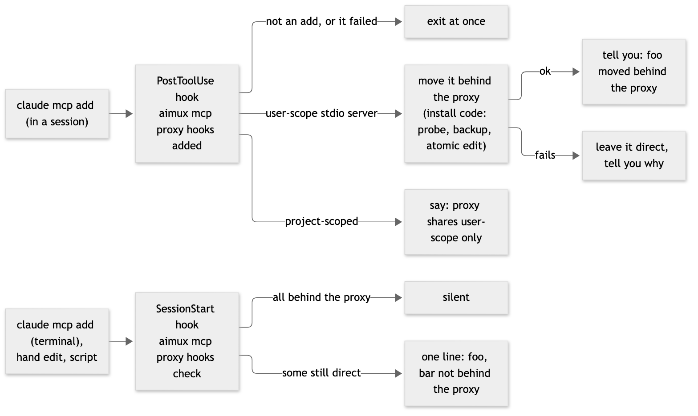

# MCP proxy: keep new servers behind the proxy (hooks)

## Intent

The proxy saves memory only while every stdio MCP server is behind it. Today a server added later (`claude mcp add`) stays a direct server until someone re-runs `aimux mcp proxy install`, and every new Claude Code session starts its own copy of it again. Nothing tells the owner. This adds two Claude Code hooks, installed by `aimux mcp proxy install`, so a new server is moved behind the proxy as soon as it is added in a session, and any server still direct is named when a session starts.

## Goals

1. A server added in a Claude Code session (`claude mcp add`, `add-json`, `add-from-claude-desktop`) is moved behind the proxy right after the command, and the session says so.
2. When a session starts, one line names every stdio server still direct (added in a terminal, by hand or by a script), with the command to move it. Silent when there is none.
3. `install` adds both hooks, `uninstall` removes them, `status` shows whether they are on. Anyone using the proxy gets them, not one machine.

## Non-goals

- Moving servers at session start. Nobody asked for anything then; a reminder is enough.
- Changing a server's scope. A project-scoped server (a repo's `.mcp.json`, or `claude mcp add` without `--scope user`) is named, not moved: the proxy serves user-scope servers only.
- Watching `~/.claude.json` from the daemon.
- Codex: its config is separate and untested with the proxy.

## Anti-goals

- A hook that slows every Bash call noticeably, or that can fail a tool call.
- A move the owner does not see, or a failed move that leaves the server half-changed.
- Touching the owner's other hooks, or any settings key besides `hooks` and the existing idle timeout.

## Approaches considered

1. **aimux hooks installed by `aimux mcp proxy install` (chosen).** Hook entries in `~/.claude/settings.json` call `aimux mcp proxy hooks <event>`; the logic is aimux code with tests and ships to every user. Reuses the merge, backup and uninstall code of `aimux remote hooks install` (`internal/waiting`).
2. **Hand-written hooks on one machine.** Works only for the owner and lives outside aimux. Rejected.
3. **A hookify rule.** Hookify supports `warn` and `block` only and has no SessionStart handler, so it can neither move a server nor remind at session start. Rejected; hookify stays for policy rules and runs alongside.

## Design

### The hooks

| Event | Entry | Does |
|---|---|---|
| `PostToolUse`, matcher `Bash` | `<aimux> mcp proxy hooks added \|\| true` | Reads the hook input on stdin. Returns at once unless the Bash command matches `claude mcp add`, `add-json` or `add-from-claude-desktop` and the tool succeeded. Then moves every stdio user-scope server not behind the proxy yet (the same code as `install`, keeping `--skip` ones direct) and answers with `systemMessage` (the owner sees it) and `additionalContext` (Claude sees it). |
| `SessionStart` | `<aimux> mcp proxy hooks check \|\| true` | Reads `~/.claude.json` and the install manifest only (no daemon call, no server start). Prints nothing when every stdio user-scope server is moved or skipped; otherwise one `systemMessage` line. |

`<aimux>` is the resolved binary path, chosen as `remote hooks install` does (refuses a `go run` or temp build, prefers the `aimux` on `PATH` when it is the same file). `|| true` keeps a broken hook from failing a tool call.

### Messages

- Moved: `foo moved behind the aimux proxy (tools unchanged; it starts on first use). Open sessions keep their direct copy until they restart.`
- Move failed: `foo stays a direct server: <reason, e.g. it did not start: …>. Run aimux mcp proxy install after fixing it.` Nothing is changed for that server.
- Project-scoped add: `foo was added for this project only; the proxy shares user-scope servers. To share it: claude mcp remove foo, then claude mcp add --scope user …`
- Session start: `2 MCP servers are not behind the aimux proxy: foo, bar. Run aimux mcp proxy install.` (project-scoped ones listed as such)

### Install, uninstall, status

- `install` merges both entries into `settings.json` under `hooks` through `jsonedit.EditKey` (only that key's bytes change, backup first, owner's hooks kept), records `hooks: added` in the manifest, and is idempotent.
- `uninstall` removes only aimux's two entries (either command form recognised, also inside a group with the owner's hooks).
- `status` adds a line: `Hooks: on` / `off (run aimux mcp proxy install)`.
- The install help text's "no settings file is read or written" is stale since the idle timeout; it is corrected to name both settings changes.

### Speed and safety

- The PostToolUse hook runs on every Bash call: it decodes stdin and checks the command with a regex before reading any file; target under 30 ms on a no-match (measured).
- The move runs with the install code's probe, backup and atomic edit; hook timeout 120 s (a slow server's first start).
- A move and a manual `install` at the same time serialise on the existing install lock.

## Testing

- Matcher: the three add commands match (with flags, `-s user`, `--scope=user`, `-e` env, quoted JSON); `claude mcp list`, `remove`, `get`, other commands and failed tool calls do not.
- Added: a new user-scope stdio server is moved and the message names it; a project-scoped one is named, not moved; a server that fails its probe stays direct with the reason; `--skip` ones stay direct.
- Check: silent when all are moved or skipped; one line listing the rest.
- Install and uninstall: hooks merged with the owner's kept, a second install changes nothing, uninstall restores `settings.json` byte for byte when nothing else changed.
- A no-match PostToolUse timing benchmark.
- Live: one `claude mcp add` in a session and one in a terminal, through the real hooks.

## Left to the builder

- File and function names; whether the hook code lives in `internal/mcpproxy` or beside it.

## To verify while building

- Whether Claude Code fires any hook for a `claude mcp add` typed in a terminal. Expected: no (hooks fire on events inside a session); the SessionStart check covers it either way.
