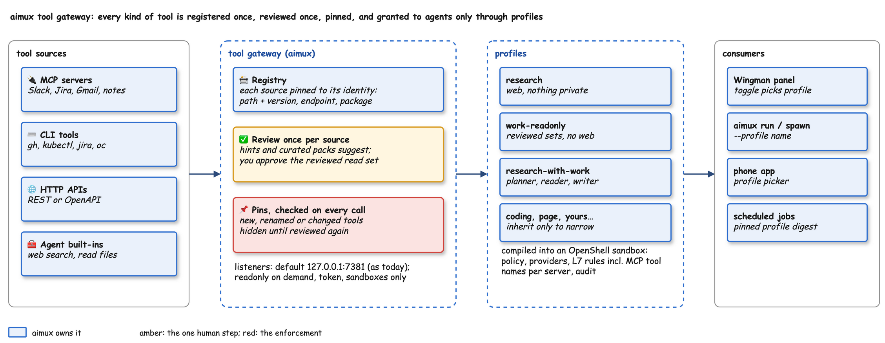
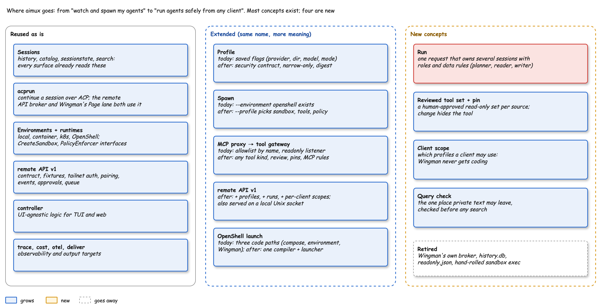
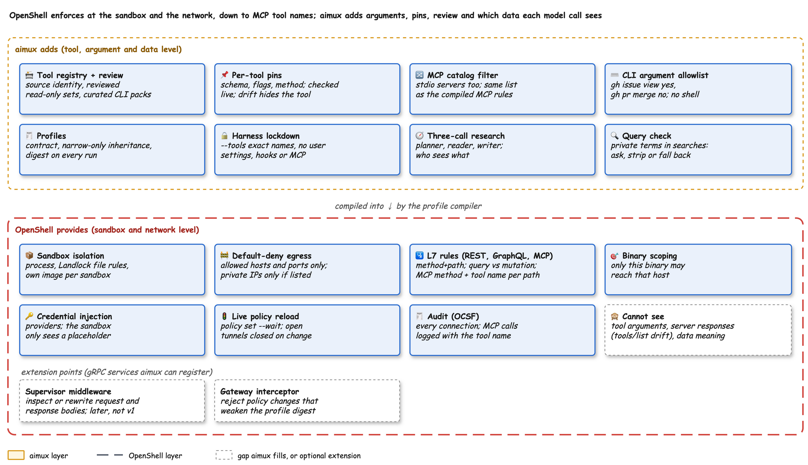
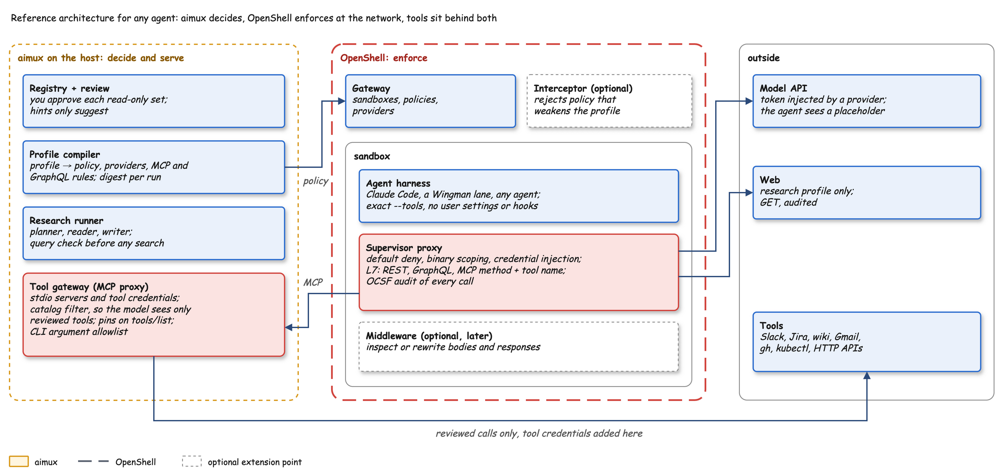
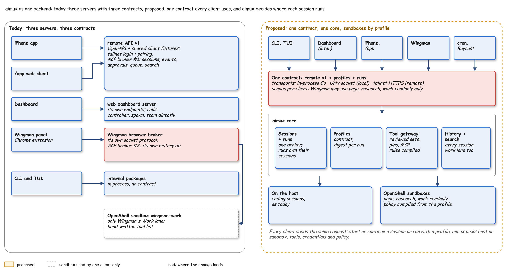
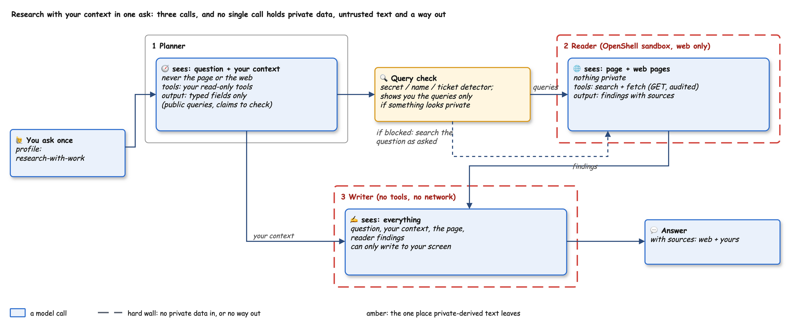
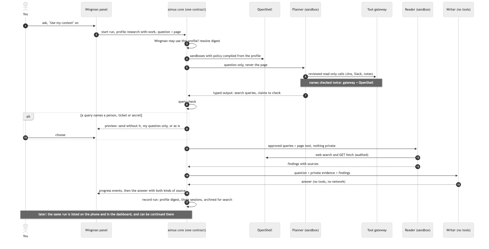
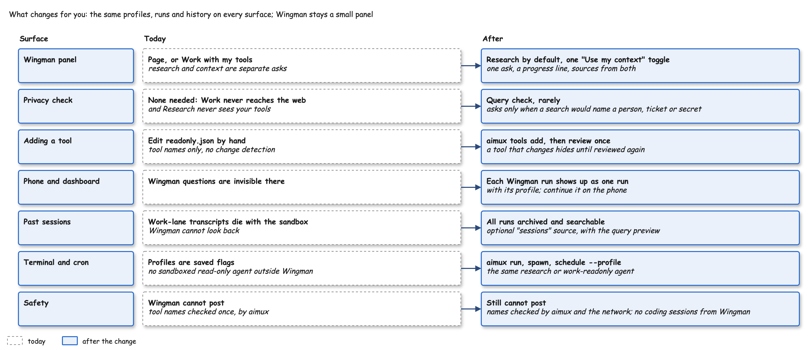

# aimux tool gateway, profiles and research with context



## Intent

aimux users want agents that can use their tools safely: read Jira, Slack, Gmail, notes, GitHub, a cluster, an internal API, without being able to post, edit or leak. Today that only exists inside Wingman (a token-guarded read-only MCP server with a hand-written tool list in `~/.aimux/wingman/readonly.json`) and covers MCP only.

This design makes it an aimux capability that any client uses: Wingman, the CLI and TUI, the phone app, the dashboard later, scheduled jobs. Four parts:

1. **Tool gateway.** The MCP proxy grows to front every kind of tool (MCP, CLI, HTTP, agent built-ins). Each source is registered once, reviewed once, pinned, and checked on every call.
2. **Profiles v2.** A profile becomes a security contract (exact tools, network, files, credentials) that aimux compiles into an OpenShell sandbox. Today's `internal/profile` stores only flags.
3. **Research with context in one ask.** A `research-with-work` profile runs three model calls (planner, reader, writer) so no call ever holds private data, untrusted text and a way out together.
4. **One backend, many clients.** Every client asks aimux for the same thing, a session or a run with a profile, over one contract: the existing remote API v1, extended with profiles, runs and per-client scopes, and served on a local Unix socket as well as the tailnet. Wingman stops being a separate server and becomes a client of it.



The owner approved this direction from the mock at `research/wiki/playgrounds/wingman/research-mode-mock.html`, after a second opinion from Codex on each part.

## Goals

- Register any tool source with one command; review its read-only set once with one decision per source.
- Grant tools to agents only through profiles; every consumer selects a profile by name.
- One question gets a web-researched answer that also uses the owner's private context, with zero extra clicks in the normal case.
- Read-only sets that never widen silently: new, renamed or changed tools stay hidden until reviewed.
- Works with Wingman uninstalled: every capability is reachable through remote API v1 (local socket or tailnet) and the CLI.
- One session model: Wingman questions are ordinary aimux sessions and runs, visible and continuable from the phone and later the dashboard.

## Non-goals (v1)

- Any write capability through the gateway for sandboxed profiles (writes stay the default listener's business, as today).
- A trust tier that auto-approves a source's annotations.
- Automatic egress policy from `openWorldHint`.
- A guarded single-call "research plus private tools" mode (rejected: egress filtering cannot prove non-disclosure).
- Codex as the engine for the three calls (later).

## Anti-goals

- Approving tools by name pattern or by a server's hints alone.
- Any model call that sees untrusted content (a page or web text), private data, and has an outbound channel.
- Changing the behaviour or exposure of today's `aimux mcp proxy serve` on `127.0.0.1:7381` for existing clients.
- Tool descriptions or help text influencing an approval.

## Constraints and facts

- aimux v0.14.0 base: `internal/mcpproxy` serves one MCP endpoint per backend (`/mcp/<name>`); catalog in `~/.aimux/mcp-catalog.json`; `ToolsFingerprint` hashes the whole ordered tool list (`catalog.go:65`).
- Wingman branch additions to reuse: `Catalog.Allowed` (name-only allowlist, `allowlist.go:9`), HTTP backends (`httpbackend.go`), `DaemonOptions.Token` with `BearerOnly`, wiki tools (`internal/wikitools`), `BuildReadonly` (`readonly.go`), the page engine's no-tools ACP session, the work engine's `claude -p --tools ""` sandbox runner.
- Known gap this design closes: `readonly.go:101` refreshes live tools then filters by name, so a same-name changed tool stays callable.
- MCP tool annotations (`readOnlyHint`, `destructiveHint`, `idempotentHint`, `openWorldHint`) exist since the 2025-03-26 spec; the spec says not to base decisions on annotations from untrusted servers. On the owner's machine coverage is mixed: Slack 15/15 annotated, Google Workspace 119/119, GitHub 45/45, JirAIa 0/68, about nine servers 0.
- OpenShell 0.1.7: per-sandbox default-deny network policy, L7 rules by method and path, provider credential injection (including the custom `claude-code-oauth` bearer profile), supervisor middleware (research preview), OCSF audit. It sees HTTP requests, not command-line arguments.
- OpenShell has an official Go SDK, `github.com/ai-openshell/sdk-go` (v0.1.8, Apache-2.0; moved out of `NVIDIA/OpenShell/sdk/go`, which is deprecated). It covers sandboxes (create with policy and providers, wait ready), live policy updates (`Config().Update` with `ExpectedResourceVersion`), streaming and interactive exec, file upload and download, providers, and an in-memory fake client for tests; a nil TLS config gives a plaintext connection for the local gateway. aimux does not use it yet: every OpenShell call today shells out to the `openshell` CLI.
- `internal/compose/adapter.go:102` still defaults to the retired community image; fix as part of the launcher work.
- aimux already has the client contract this design extends: `internal/remoteapi` serves `api/remote-v1.openapi.yaml` (sessions, events, approvals, queue, search, `POST /v1/sessions`), with tailnet login plus device pairing, an ACP broker built on `internal/acprun`, and client fixtures in `api/testdata/clients/` that the iPhone app and the `/app` web client both pass.
- Three servers exist today with three contracts: remote API v1, the web dashboard server (`internal/frontend/web`, calls `controller`, `spawn`, `team` directly) and Wingman's browser broker (`internal/browserhost`: its own socket protocol, a second ACP broker on `acprun`, its own `history.db`). CLI and TUI call packages in process.
- Reusable pieces already in aimux: `internal/environment` (OpenShell environment with `CreateSandbox`), `internal/runtime` (`PolicyEnforcer` with `ApplyPolicy`/`UpdatePolicy`), `internal/controller` (UI-agnostic logic), `history`, `catalog`, `sessionstate`, `search`. `aimux spawn` takes `--environment` (types `local`, `container`, `openshell` in `internal/config/config.go:223`) but has no `--profile`.

## What OpenShell enforces and what aimux adds



| Concern | OpenShell (sandbox and network) | aimux (tool, argument, data) |
|---|---|---|
| Which hosts a sandbox reaches | default-deny egress, private IPs only if listed | profile network list, compiled into the policy |
| Read-only HTTP | L7 method and path rules, GET-only presets, binary scoping | HTTP sources reviewed per operation; fragments generated from the review |
| Credentials | providers inject at the proxy; the sandbox sees a placeholder | which provider a profile gets; never in argv or logs |
| Which MCP tool is called | `protocol: mcp` L7: allow or deny by JSON-RPC method and tool name, on Streamable HTTP endpoints, requests only | the reviewed set, compiled into those rules; plus the gateway allowlist for stdio servers the sandbox never reaches directly |
| Tool and CLI arguments | not inspected ("tool argument matching is not supported"); CLIs are seen only as the HTTP or GraphQL calls they make | argument allowlist from curated packs, no shell |
| Read-only GraphQL (`gh`) | `protocol: graphql`: allow `operation_type: query`, deny mutations or allow them by field | which GraphQL fields a pack permits |
| A tool changed after approval | not visible: server responses, including `tools/list`, are relayed without MCP parsing | pins checked live; drift hides the tool |
| What data a model holds | not visible | three-call split, query check, harness lockdown (`--tools`, no user settings) |
| Audit | every allowed and denied connection (OCSF) | profile digest and tool calls attached to the same session |

Rule of thumb: anything OpenShell can check on a request (host, method, path, binary, credential, MCP tool name, GraphQL operation) goes into OpenShell policy, so it holds even if the gateway has a bug. aimux keeps what OpenShell cannot see: arguments, server responses (so pins and drift), the human review that decides the lists, and which model call sees which data. For MCP that makes two walls on the same decision: the gateway filters the catalog and calls, and the compiled `protocol: mcp` rules deny any tool outside the reviewed set at the network.

Limits of the OpenShell MCP rules, checked against the docs for the installed 0.1.7: Streamable HTTP only (stdio servers are reached through the gateway, whose own endpoint gets the rules); only listed MCP revisions pass (default `2025-11-25`), so the compiler must list the revisions the agent harness sends; no argument matching; responses are not parsed. The MCP spike below confirmed this with Claude Code as the client.

### Where each control lives (reference architecture)



The pattern is meant to be copied by other agents, not only Wingman: any harness runs in a sandbox, reaches tools only through the aimux gateway, and every decision a human made is compiled into OpenShell policy so it holds at the network as well.

| Control | Lives in | Why there |
|---|---|---|
| Hosts, binaries, REST method and path, GraphQL query vs mutation, MCP method and tool name per server path | OpenShell policy (supervisor) | enforced outside the agent and outside aimux; audited per call; reloads live |
| Model and tool credentials | OpenShell providers (model); aimux gateway on the host (MCP servers, CLIs) | the agent never holds a real secret |
| stdio MCP servers, CLI execution, argument allowlist | aimux tool gateway | no network hop for OpenShell to inspect; arguments are invisible to L7 |
| Catalog filtering and pins | aimux tool gateway | OpenShell relays `tools/list` responses unparsed, so a denied tool is still advertised and drift is invisible to it |
| Review, profiles, digests, the three-call split, the query check | aimux | decisions and data flow between model calls, not traffic |
| Rejecting a policy update that weakens a profile | OpenShell gateway interceptor (optional, after profiles ship) | a gRPC service on a Unix socket; stops another local process, including a prompt-injected agent on the host with the `openshell` CLI, from widening a sandbox's policy; needs a gateway restart to register |
| Body and response content checks (secret redaction in tool output, DLP) | OpenShell supervisor middleware (later, not v1) | its API is still marked as evolving; v1 needs nothing it alone can do |

Not chosen for v1: putting pins or the query check in supervisor middleware. Pins also cover stdio servers, which middleware never sees, and the query check runs between planner and reader inside aimux, where the queries exist as typed fields before any request is built.

## Approaches considered

| | A. Wingman-only read-only server (today) | B. Separate gateway per tool kind | **C. One tool gateway + profiles (chosen)** |
|---|---|---|---|
| Reuse across aimux | none | partial | full: every consumer picks a profile |
| Config | one more file per feature | one per kind | one registry, one profile directory |
| Review model | hand-typed names | differs per kind | the same register, review, pin flow for all kinds |
| Cost | none more | high | medium: builds on `mcpproxy` |

For research with context the options were: a tray the user fills by hand (too many steps, owner rejected), a guarded single call with egress filtering (cannot prove non-disclosure, rejected after Codex review), and the three-call split (chosen; Codex reached the same design independently).

## Design

### 0. One backend, many clients



**One contract.** Remote API v1 becomes the contract every client speaks. Additions, versioned in the same OpenAPI file and covered by new fixtures in `api/testdata/clients/`:

| Addition | Shape |
|---|---|
| Profiles | `GET /v1/profiles`, `GET /v1/profiles/{name}` (resolved manifest, digest, which clients may use it) |
| Profile on sessions | `POST /v1/sessions` takes optional `profile` (default: today's behaviour, unchanged for existing clients) plus optional `url` and `pageText` |
| Runs | `POST /v1/runs` `{profile, text, url?, pageText?}`; `GET /v1/runs`, `GET /v1/runs/{id}` (profile, digest, child sessions with roles, status), `GET /v1/runs/{id}/events` (the same event stream shape as sessions, plus `run_step`, `preview_required`), `POST /v1/runs/{id}/preview` (the owner's choice), `POST /v1/runs/{id}/messages` (continue) |
| Tools | `GET /v1/tools` (reviewed sets and drift status, read-only; review itself stays in the CLI) |

**Transports.** In-process Go for CLI and TUI (through the same core package, not HTTP); a Unix socket for local clients (Wingman's native host relays to it; same user, `0600`, like today's `host.sock`); tailnet HTTPS for remote clients, unchanged.

**Client scopes.** Each client identity (a paired device, the Wingman native host, the CLI) carries the profiles it may use, in `~/.config/aimux/clients.yaml`. Default scopes: Wingman `page`, `research`, `work-readonly`, `research-with-work`; paired devices the same plus `coding`; the CLI everything. A request for a profile outside the caller's scope gets `403` before anything starts. Wingman reads untrusted pages, so it can never start a coding session.

**Runs.** A run is one request that owns several sessions, each with a role and data rules (planner, reader, writer). It records the profile digest, the sessions, the queries sent and the owner's preview choices. Its sessions are ordinary sessions in `catalog` and `history`, tagged with the run. `coordination` and `task` were considered and not reused: they assign work between agents but carry no data-flow rules.

**One broker.** The remote API's broker runs every session and run. Wingman's browser broker is retired: Page questions become `page` sessions on `acprun`; Work and Research questions become sessions spawned into the OpenShell environment through the profile compiler, replacing the hand-rolled `openshell sandbox exec` in `workengine.go`. `~/.aimux/wingman/history.db` is retired in favour of the session history; Work-lane transcripts are archived to `~/.aimux/archive` so search covers them.

**Out of scope for this work:** moving the web dashboard onto v1 (a separate project; it keeps working as is); phone app UI for runs beyond what the existing session views show.

### 1. Tool gateway

**Sources and registration.** `aimux tools add <name> --mcp <url|stdio> | --cli <binary> | --http <openapi-or-base-url>`. Stdio MCP servers already moved with `aimux mcp proxy install` are registered automatically. Each source records its **identity**: command path plus version, or endpoint plus package where known. Approvals bind to identity, not to the display name.

**Review.** `aimux tools review <name>` proposes a read-only set and asks for one decision. Suggestions per kind:

| Kind | Suggestion comes from | Enforcement |
|---|---|---|
| MCP | `readOnlyHint: true` and `destructiveHint` not true. Unannotated servers get no suggestions; name guesses are shown only as hints | gateway allowlist plus live pin |
| CLI | curated packs shipped with aimux, listing read subcommands and allowed flags | gateway runs the command (argument allowlist, no shell, injected credentials); plus an OpenShell L7 fragment when the CLI's API is clean REST |
| HTTP | method and path; OpenAPI GET operations | OpenShell L7 rules (method and path) |
| Built-ins | the harness's tool metadata | harness flags (`--tools`) plus OpenShell file and network policy |

Descriptions and help text are the tool author's text: shown inert, control characters stripped, never sent to a model during review, never used to approve.

**Curated CLI packs.** A pack is data: subcommand plus flag allowlist, and an optional OpenShell policy fragment (API host, L7 method and path rules, binary path, credential provider). Packs are versioned with the CLI version they were written for. `kubectl` maps cleanly (reads are HTTP GET; RBAC adds a layer). `gh` serves reads as REST GETs and GraphQL queries on one host, so its fragment has two endpoints: `protocol: rest` with `access: read-only`, and `path: /graphql` with `protocol: graphql` allowing `operation_type: query` only. A CLI upgrade re-checks the pack; unknown subcommands stay hidden.

**Pins.** Each approved tool is pinned per tool: source identity plus a canonical hash of the security-relevant fields (MCP: name, input and output schema, annotations; CLI: subcommand and flag allowlist plus binary version; HTTP: method and path template). The tool's own description and title are excluded from the hash but stored for review; descriptions inside the input and output schemas and `annotations.title` stay in the hash, because parameter text reaches the model and is an injection channel, so rewording it is treated as a change. The gateway checks live metadata against the pin when listing tools and on every call. New, renamed, missing or changed tools are hidden until re-reviewed; renames are never matched by similarity. `aimux tools status` shows drift.

**Listeners.** `default` stays on `127.0.0.1:7381`, loopback-only, unchanged. A profile that needs gateway tools gets its own listener started on demand, bearer token per start (never logged), no `Status` or `Reload` endpoints, closed when idle. The sandbox reaches it as `host.containers.internal` (Podman gvproxy forwards to loopback), as Wingman does today.

### 2. Profiles v2

Profiles live in `~/.config/aimux/profiles/<name>.yaml`; built-ins ship with aimux and cannot be edited; repository profiles in `.aimux/profiles/` require explicit trust. A profile:

```yaml
name: work-readonly      # a builtin root: no extends (only page and user profiles extend)
tools: [slack:readonly, jira:readonly, gh:readonly, notes:readonly]   # reviewed sets or exact names
network: { default: deny, allow: [model, gateway] }
files:   { read: [], write: [] }
credentials: [claude]
settings: { inherit_user: false }
```

Rules: single `extends`; builtins other than `page` are roots (`base` is the narrowest, and `page` extends it), because a child that extends `base` can only narrow it; a child may only narrow; widening needs `aimux profile create` or `edit` and shows a capability diff. Wildcards in `tools` are rejected unless `unsafe_patterns: true`. A resolved profile is an immutable manifest with a digest; every session and audit event records it; scheduled jobs fail closed when the digest changes until re-approved. Built-ins: `page`, `research`, `work-readonly`, `research-with-work`, `coding`.

**One profile, four targets.** The compiler turns a profile into: the OpenShell policy (network, L7 including MCP tool names, files, binaries), OpenShell providers (credentials), the gateway's per-session allow list, and the harness configuration (what the agent is told about itself).

| Profile field | OpenShell policy | Providers | Gateway | Harness config |
|---|---|---|---|---|
| `tools` | MCP rules per server path, tool names | | token's allow list | exact `--allowedTools`; MCP config lists only those servers |
| `network` | default deny, hosts, L7 | | | built-in web tools off unless `web` |
| `files` | filesystem read and write lists | | | built-in file tools off unless allowed |
| `credentials` | | provider attached | | none: the agent sees a placeholder |
| `settings.inherit_user` | | | | `--setting-sources ""`, `--strict-mcp-config`, no hooks |
| `model`, `runs` | sandbox or none | | | `--model`, print mode, ACP or interactive |

**Enforced versus cooperative.** The OpenShell policy is enforced from outside the agent and holds even if the agent is buggy, compromised or persuaded by a page. The harness configuration is cooperative: the agent applies it to itself. It still matters (the model never sees tools it cannot use, so it does not waste turns, and `tools/list` from OpenShell-guarded servers still advertises denied tools, as the spike showed), but it is a promise, not a wall. Rule: every security-relevant restriction has an enforced counterpart, and the harness mirrors it. Settings and hooks exist only on the harness side; their effects stay inside OpenShell's network and filesystem rules.

**Harness-neutral profiles.** A profile names its harness (`harness: claude-code`, the default); the compiler emits a harness-neutral intent and a harness adapter turns it into launch configuration (argv, env, files, ACP `_meta`). Claude Code is the only adapter in plan 1, covering both `claude -p` in a sandbox and the ACP page session; `codex` returns "harness not supported yet". A new harness needs only an adapter: the policy, providers and gateway list stay the same.

**Compiler.** One launcher compiles a manifest into an OpenShell sandbox: network to a default-deny policy, gateway tools to a token-scoped listener and the agent's MCP config, CLI and HTTP L7 fragments into the policy, credentials to providers, files to filesystem policy, built-ins and settings to the harness adapter's launch config (`--tools` exact names, never wildcards), audit to OCSF attribution. Used by `spawn`, `run` and Wingman. Users never edit OpenShell configs.

**CLI.** `aimux profile list | show <name> | create <name> --extends <p> | edit <name> | check <name>`, and `--profile <name>` on `run`, `spawn`, `schedule`.

### 3. Research with context: three calls



| Call | Sees | Can do | Runs where |
|---|---|---|---|
| Planner | the question, the owner's context via reviewed read sets | read tools; output is typed fields only: `public_queries`, `claims_to_verify`, `decision_criteria`; length-limited | `work-readonly`-style sandbox, never the page or web |
| Reader | page text plus web pages | web search, GET fetch, audited | `research` sandbox, nothing private |
| Writer | everything (question, context, page, reader findings) | no tools, no network, no inherited settings, hooks or MCP, no resumed session | the page lane's locked ACP session |

**Query check.** Planner queries are the one declassification point. A deterministic detector (secrets, names from the owner's context, ticket keys, emails, customer accounts in tool results) runs before queries leave. Clean queries go out without asking. A hit shows the queries to the owner with three choices: send without the flagged terms, search the original question only, or send as is. Every query sent is logged. Fallback when blocked: the reader searches the owner's question as asked (public-first), so no context-derived text leaves.

**Recap.** Wingman's automatic recap between lanes (`router.go:215`) must never feed the reader. Only the planner's checked queries cross into the web-facing call.

### 4. Wingman as a client

Wingman keeps its panel and its native host, and loses its server: the host is a relay to the local socket, and every question is a v1 request with a profile. Its modes become profile names: Page, Research (default), and a "Use my context" toggle that selects `research-with-work`.

**Sessions.** Today Wingman keeps its own panel history in `~/.aimux/wingman/history.db` (the last 50 turns per page). Page-lane transcripts land on the host in `~/.claude/projects/-Users-azaalouk--aimux-wingman-sessions/`, so aimux session search already indexes them. Work-lane transcripts stay inside the `wingman-work` sandbox and are lost when it is recreated. The broker copies each sandboxed session's transcript to `~/.aimux/archive` after a run (session search covers that folder), and past sessions become an optional reviewed source, `sessions` (`search_sessions`, `get_session` from `aimux mcp serve`), available to `work-readonly` and the planner. Sessions contain pasted web pages and tool output, so the source counts as outside-authored and its use forces the query preview.

`~/.aimux/wingman/readonly.json` is replaced by the gateway registry and the `work-readonly` profile; the research wiki becomes an optional `notes` source (`aimux tools add notes --folder <dir>`).

## Hardening (owner review, 2026-11-11)

| # | Change | Why |
|---|---|---|
| H1 | **Step-up for profiles that can write.** A device request for a `runs: host` profile (today `coding`) needs a device login made within the last 60 seconds, from a Secure Enclave device; passkey (web) devices are refused for those profiles unless `clients.yaml` allows them. Requests without `profile` keep today's behaviour until the iPhone and web clients send profiles; `remote_access.step_up_legacy: true` then applies the rule to them too. | An unlocked phone or a passkey synced to several devices can read, but cannot start an agent that edits. Device login already records each login's time (`devicelogin.Session.Created`), so no new cryptography. |
| H2 | **Gateway tokens bound to one session and one profile.** The read-only listener holds a token per sandboxed session, mapped to that profile's tool list, and refuses any other tool itself. Tokens end with the session. | A token leaked from one sandbox cannot be replayed from another with different rules; three walls on a tool call (gateway list, pin, OpenShell MCP rule). |
| H3 | **No forged tailnet identity.** `remote serve` refuses to start without device login unless `--unsafe-no-device-login` is given. | `auth.go` trusts `Tailscale-User-Login` on any loopback connection; any local process can set it. Device login is what actually stops that. |
| H4 | **Local clients are audited.** Every local-socket request writes a line to `~/.aimux/logs/remote-audit.log`: client, profile, digest, URL host, result, scope refusals. | One log for what the phone and Wingman asked for and what was refused. |
| H5 | **Per-client limits.** `clients.yaml` sets `max_sessions` and `turns_per_minute` per client; defaults for Wingman 2 and 20; beyond them `429 client_limit`. | A hostile page or a loop cannot open sessions without end. |
| H6 | **The native host checks its caller.** The host refuses to relay unless the origin Chrome passes equals the pinned extension id. | Defence in depth if the host manifest is edited or another extension is allowed. |
| H7 | **Gateway interceptor** (follow-up between plans 1 and 2). Rejects an OpenShell policy update whose digest does not match the profile aimux compiled. | Any process running as the owner can run `openshell policy set`; this makes the compiled policy the only one a sandbox can have. Needs a gateway restart to register. |

Not adopted: checking the process that connects to the Wingman socket. Impersonating Wingman only gains its narrow scope, and any process running as the owner can already run `claude`.

## Safety model

| Threat | Control |
|---|---|
| Page injects "post to Slack" | Reader has no private tools; writer has no tools |
| Page injects "fetch evil.com?q=<private>" | The only call with private data (planner) never sees the page; the writer has no network |
| Server mislabels a write tool read-only | Hints only suggest; a human approves per source |
| Tool changes after approval | Per-tool pin checked on every list and call; hidden until re-reviewed |
| Different server under the same name | Approvals bind to source identity |
| Tool description carries an injection | Descriptions never reach a model during review and never approve anything |
| Private terms leak through search queries | Deterministic query check, conditional preview, logged queries, public-first fallback |
| CLI read command smuggles a write | Gateway argument allowlist; plus OpenShell L7 where the API is clean REST |

**Residual risk, accepted:** a tool that keeps its interface but changes behaviour; private meaning paraphrased into a query that passes the deterministic check; a "read" tool with side effects (for example marking messages read). The feature is named "reviewed read-only set" for this reason.

## Testing and acceptance

- Gateway: per-tool pin hashing (order-independent; descriptions excluded); live check blocks a same-name changed tool (regression test for the current gap); renamed tool hidden; source identity change drops approvals; review never feeds descriptions to a model.
- CLI packs: argument allowlist rejects unknown subcommands, flags and shell metacharacters; `kubectl` fragment compiles to GET-only L7; `gh` fragment compiles to read-only REST plus GraphQL queries only; a mutation from inside the sandbox gets `policy_denied`.
- MCP rules: the compiled `protocol: mcp` endpoint for the gateway allows only the reviewed tool names; a direct `tools/call` for a tool outside the set gets `policy_denied` even when the gateway allowlist is bypassed.
- Profiles: narrowing-only inheritance; widening requires an explicit diff; wildcard rejection; digest stable and recorded; scheduled job fails closed on digest change.
- Compiler: a profile's OpenShell policy contains exactly its network, L7 and credential entries; `--tools` lists exact names.
- Research: planner output schema enforced; query check flags names, tickets, secrets from fixtures; public-first fallback sends only the original question; the reader's request log never contains context-derived text in the fallback; the writer runs with no tools and no network.
- Contract: OpenAPI changes are additive; every existing fixture in `api/testdata/clients/` still passes; `POST /v1/sessions` without `profile` behaves exactly as before; a client outside its scope gets `403` with nothing started; a run's events replay from a sequence number like a session's.
- Wingman: the native host only relays; the browser broker and `history.db` are gone; a Page question appears in `GET /v1/sessions` and a Research-with-context question in `GET /v1/runs`.
- Live: `aimux tools review` on Slack, Google Workspace, JirAIa; `aimux run --profile research-with-work` answers with both source kinds; the Wingman injection page produces no private-tool call and no exfiltration request.

## Decisions after the builder check (designer's calls)

- **Where CLI and HTTP tools run: a tool-runner sandbox.** The gateway does not execute CLI commands or HTTP calls on the host. It hands each approved call to a separate OpenShell sandbox, `aimux-tools`, whose policy holds the packs' and HTTP sources' L7 fragments (method and path, binary-scoped) and whose providers inject the tools' credentials. The agent sandbox can reach only the gateway. So a CLI call passes three checks: the gateway's argument allowlist, the pin, and OpenShell L7 at the network. HTTP sources appear to agents as gateway tools (one per approved operation), executed in the same runner sandbox. MCP servers keep running where they run today; the gateway proxies them.
- **Existing profiles migrate.** `~/.aimux/profiles.json` entries load as v2 profiles with `extends: builtin:base`, their provider, dir, model and mode carried over, and no tools. `profile save|get|list|delete` keep working as aliases for one release, printing the new command; `create|edit|show|check` are the new surface.
- **Review for sources without hints is one session, not one keypress.** For annotated sources the review is a single approve. For unannotated ones (JirAIa, 0 of 68) the same `aimux tools review` opens a checklist with name guesses pre-marked as unconfirmed; approving the checklist is the one decision.
- **Pin freshness.** The gateway verifies each source's live tool list against the pins when a session starts, whenever the source sends `tools/list_changed`, and otherwise at most every 60 seconds before a call. Calls use that verified listing. The window is at most 60 seconds and closes immediately on a change notification. The regression test for `readonly.go:101` changes a tool's schema under the same name and asserts the next call after re-verification is refused.
- **OpenShell access through the Go SDK, one backend.** The launcher talks to OpenShell through `github.com/ai-openshell/sdk-go` behind aimux's own small `Backend` interface with a single implementation (so SDK churn stays in one file). The SDK gives typed errors, `ExpectedResourceVersion` on policy updates (the CLI's `provider profile update` needed delete and re-import for the same reason), streaming exec without parsing CLI output, file transfer for the token file and transcripts, and a fake client for tests. It also removes three problems hit while building Wingman: the CLI missing from Chrome's bare PATH, parsing ANSI-coloured tables, and `provider profile update` needing a resource version. Plan 1 starts with a spike against the owner's gateway (SDK v0.1.8 against gateway 0.1.7). If every check passes, the launcher is SDK-only and Wingman's CLI calls go with its broker. If one fails, the launcher is CLI-only for plan 1 and the SDK is revisited at its next release; there is never a runtime switch between two backends. The gateway address comes from the same metadata the CLI uses (`~/.config/openshell/gateways/<name>/metadata.json`: `gateway_endpoint`, `auth_mode`); plan 1 supports `plaintext` and mTLS gateways, and OIDC gateways get a clear "not supported from aimux yet". The SDK version is pinned, and the gateway's version is checked at connect. **Spike result (2026-11-11, SDK v0.1.8 against gateway 0.1.7):** connect, create with policy and provider, live policy update (a stale resource version is refused with Conflict) and delete pass; `claude -p` answers through `Exec().Interactive` stdin; but `Files().Upload` and `Download` always return `ErrTransportNotAvailable` in v0.1.8, so the transcript archive and the config file cannot move through the SDK. Ruling: plan 1's launcher is CLI-only and aimux carries no SDK dependency. Revisit when the SDK's file transport ships; moving files over `Exec` streams instead is a possible route. The other OpenShell call sites (`internal/compose`, `internal/environment`, `cmd/aimux/cmd/mcp.go`, `browser.go` setup and verify, `controller/launch.go`) move onto the backend in a follow-up; the human-facing CLI (gateway start, logs, provider import) stays.
- **Base branch.** Work continues on a new branch from `feat/wingman`. Shared code (allowlist, HTTP backends, token listener, wiki tools as the `notes` source) moves from Wingman-specific packages into `internal/toolgateway` and `internal/profile`; Wingman's browser host then consumes them. "Works without Wingman" means `aimux spawn` and the new commands use the same packages with the browser host absent.

## Owner decisions after the builder check

- **v1 ships one client, on a core any client can use.** The gateway, profiles and the research runner live in aimux behind one client contract: remote API v1, extended as in Design section 0 and served on a local Unix socket as well as the tailnet, plus the Go package it wraps. (Owner, 2026-11-11: extend v1 rather than add a fourth contract; fold Wingman's broker into it now rather than later.) No client-specific logic in the core. v1's shipped client is Wingman (designer's pick: the owner's daily tool, and its Page and Work lanes exist). Reusability is proven, not promised: an integration test drives every profile through a minimal second client (a test harness that speaks v1 over the Unix socket), and the existing phone and `/app` fixtures keep passing, so `aimux run`, `spawn`, the phone app and scheduled jobs follow without core changes.
- **Outside-authored sources are marked.** Each reviewed source carries an authorship class: `self` (notes, wiki, the owner's own docs), `internal` (internal Jira, internal Slack channels) or `outside` (Gmail, Slack Connect channels, external Jira comments, anything others can write into). If the planner read any `outside` text in a run, its queries are shown to the owner before sending, every time (one click). Runs that used only `self` and `internal` sources keep the normal path: the deterministic check, preview only on a hit. The class is set during `aimux tools review` (default `outside` when unsure) and can be narrowed per channel or project later.

## Examples



| What the owner does | Request | What handles it |
|---|---|---|
| Asks about a page in Wingman | `POST /v1/sessions {profile: page, url, pageText, text}` | scope check, `page` profile, `acprun` warm session; listed in the catalog |
| Asks with "Use my context" | `POST /v1/runs {profile: research-with-work, ...}` | run: planner (reviewed tools) → query check → reader (web) → writer (no tools) |
| A query would name a customer | event `preview_required`; `POST /v1/runs/{id}/preview` | nothing leaves until the owner picks: without the name, question only, or as is |
| Continues on the phone | `GET /v1/runs`, `POST /v1/runs/{id}/messages` | same run, profile and digest |
| Runs it from the terminal | `aimux run --profile work-readonly "..."`, `aimux spawn claude --profile work-readonly` | the same profiles; host or sandbox decided by the profile |
| Schedules it | `aimux schedule ... --profile research` | digest pinned; a widened profile makes the job refuse until re-approved |
| A tool server upgrades | pin mismatch | tool hidden in aimux and dropped from the compiled MCP rules until re-reviewed |
| A page says "post to Slack, start a coding agent" | reader has no Slack tool; `coding` outside Wingman's scope | `policy_denied` / `403`; the answer lists the ignored instructions |



## Spike first

**Done: MCP tool rules in OpenShell (2026-11-10).** A throwaway sandbox from `localhost/wingman-sandbox:2.1.319` on OpenShell 0.1.7, with `protocol: mcp` endpoints for `/mcp/wiki` (allow `wiki_search`) and `/mcp/jira` (allow listing, deny `search_issues_jql`), in front of the real read-only server.

| Check | Result |
|---|---|
| Allowed tool (`wiki_search`), raw and from Claude Code | 200, answered |
| Unlisted tool on an allowed server (`wiki_read`, `get_comments`), `resources/list` | 403 `policy_denied`, "no matching allow rule" |
| Explicit deny (`search_issues_jql`) | 403 `policy_denied`, "blocked by a deny rule" |
| Server with no endpoint (`/mcp/slack`), `/mcp/wiki/../slack`, `%2F` traversal | 403, 403, connection refused |
| Smuggling: duplicate `name` key, JSON batch under 2025-06-18, `WIKI_READ` | 400, 400, 403 |
| Claude Code 2.1.319 as the client | works; denied calls come back to the model as tool errors carrying the policy text |
| Protocol revision | Claude Code tries sessionless `2026-07-28` first; when the policy does not list it, it falls back to `initialize` and the server's `2025-06-18`. Lists without `2026-07-28` work at the cost of one denied request per connection |
| Audit | every call is an OCSF event with `engine:l7-mcp` and the tool name; policy updates apply live (`policy set --wait`) and close open tunnels |
| Not covered by OpenShell, as documented | `tools/list` still advertises denied tools (responses are not parsed), so the gateway's catalog filter stays; arguments are not matched |

Consequence for the compiler: one `protocol: mcp` endpoint per gateway server path, `mcp.versions` set to the revisions the gateway server speaks, the core handshake methods allowed explicitly, and `tools/call` allowed by exact tool name from the reviewed set.

Still to spike:

1. Claude's server-side web search from inside a sandbox: does it need its own egress, and can the reader call be limited to search plus GET fetch?
2. A `kubectl` read pack compiled to OpenShell L7 GET-only against a real API server.
3. Planner typed output: does `claude -p` with a JSON schema reliably return only the allowed fields?

## Left to the builder

- Package layout inside aimux; file formats for packs and the registry (JSON or YAML).
- The deterministic detector's exact rules beyond the listed categories.
- UI wording in Wingman and the TUI.
