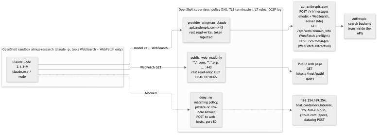

# Spike: the `research` profile (web search and fetch in an OpenShell sandbox)

Goal: decide how `research` (Claude Code `claude -p` inside OpenShell, answering with web search and page fetches, read-only, safe against prompt injection from pages) compiles, which parts OpenShell enforces, and what plan 1.5 builds. This closes "Still to spike" item 1 of `2026-11-10-tool-gateway-profiles-design.md` (section "Spike first").

Setup: OpenShell CLI and gateway `openshell 0.1.7` (`openshell --version`), gateway `local` at `http://127.0.0.1:8090`, image `localhost/wingman-sandbox:2.1.319` (Claude Code `2.1.319`, from `claude --version` in the sandbox), provider `wingman-claude` of type `claude-code-oauth` (credential key `CLAUDE_CODE_OAUTH_TOKEN`, from `openshell provider get wingman-claude`). OpenShell source references are to tag `v0.1.7` of the local clone `zanetworker/OpenShell` (`git show v0.1.7:<path>`). Live logs below are from a throwaway sandbox `aimux-research-spk`, deleted afterwards (`openshell sandbox list` shows no match).



## Answers

| # | Question | Answer | Strongest evidence |
|---|---|---|---|
| 1 | Is WebSearch server side; what does the sandbox need? | Yes. It is Anthropic's server-side web search, run inside the Messages API. The sandbox only needs the model endpoint `api.anthropic.com:443`. Works with the OAuth subscription provider. | Live run: a WebSearch answer with only `api.anthropic.com` traffic in the OCSF log; docs say WebSearch "runs a query against Anthropic's web search backend" |
| 2 | Does WebFetch fetch from the sandbox; extra calls? | Yes, from inside the sandbox. Two extra calls, both to `api.anthropic.com`: the domain safety preflight `GET /api/web/domain_info` and an extraction model call `POST /v1/messages`. The provider endpoint already allows both, so no skip setting is needed. | Live log lines `GET https://api.anthropic.com/api/web/domain_info` and `GET https://en.wikipedia.org/wiki/Rust_(programming_language)` from `claude.exe` |
| 3 | Can OpenShell express "any public host, GET and HEAD only, private ranges blocked, every request logged"? | Partly. GET, HEAD and OPTIONS only, private and metadata ranges blocked, and per-request logging all work. "Any public host" does not: `*` and `**` hosts are rejected, a TLD wildcard is rejected, and a hostless `allowed_ips` endpoint on 443 is rejected next to the model provider's endpoint. The workable shape is a reviewed list of `**.*.<tld>` wildcards, which misses apex hosts such as `github.com`. Logged URLs omit the query string. | Policy validation error from the live create (below); `crates/openshell-policy/src/lib.rs:1687-1690`; `crates/openshell-supervisor-network/src/l7/relay.rs:2141` |
| 4 | Live check | Done. WebSearch and WebFetch answer; POST to a web host gets `403 policy_denied`; `169.254.169.254`, `host.containers.internal:7381`, names resolving to `192.168.127.254`, `169.254.169.254` or `127.0.0.1`, apex `github.com` and port 80 are all denied and logged. | Log excerpts below |

## 1. WebSearch

- Claude Code docs: "WebSearch runs a query against Anthropic's web search backend and returns result titles and URLs. It doesn't fetch the result pages." and "The search backend is not configurable." ([tools reference, WebSearch tool behavior](https://code.claude.com/docs/en/tools-reference#websearch-tool-behavior)). Availability: "WebSearch is available on the Claude API, Claude Platform on AWS, Claude Models on Google Cloud (Anthropic managed), and Microsoft Foundry ... Amazon Bedrock doesn't expose the server-side web search tool." (same page).
- API docs: "The API runs the searches and provides Claude with the results"; it is enabled "unless an administrator has disabled it in the Claude Console"; `$10 per 1,000 searches` ([web search tool](https://platform.claude.com/docs/en/agents-and-tools/tool-use/web-search-tool)). The endpoint is `POST https://api.anthropic.com/v1/messages` with a `web_search_*` tool (same page).
- Permission: WebSearch is a "Requires permission: Yes" tool and its rules "take no specifier. A bare `WebSearch` entry in `allow` or `deny` is the only form" ([tools reference](https://code.claude.com/docs/en/tools-reference)).
- Live, OAuth provider, `--tools WebSearch,WebFetch` without `--allowedTools`: the model called WebSearch and got `permission_denials: [{'tool_name': 'WebSearch', ...}]`, answer "The WebSearch tool needs permission, and that permission wasn't granted". So the tool exists under the subscription token, and `-p` denies it unless allowed.
- Live with `--allowedTools WebSearch,WebFetch`: answered "Rust 1.96.0 ... Source: https://ai-news-site-1ih.pages.dev/...", `permission_denials: []`. The sandbox log for that run shows only `api.anthropic.com` (`POST /v1/messages`, `GET /api/claude_code/policy_limits`, `GET /api/claude_code/settings`, `GET /api/claude_cli/bootstrap`, `HEAD /api/hello`, `POST /api/event_logging/v2/batch`), all `[policy:_provider_wingman_claude engine:l7]`. No search host is contacted from the sandbox.
- What the sandbox sees: OpenShell sees the HTTPS request to `api.anthropic.com/v1/messages` (path only), not the query text; the queries travel inside the request body.

Consequence: WebSearch needs nothing beyond the egress the provider already grants (`claude-code-oauth` profile endpoint `api.anthropic.com:443`, `protocol: rest`, `access: read-write`, from `openshell provider profile export claude-code-oauth`).

## 2. WebFetch

- Runs on the machine Claude Code runs on. Docs: it "fetches the page and converts the response to Markdown ... then runs the prompt against the content in a separate model call", refuses `localhost` and dotless hosts, upgrades HTTP to HTTPS, does not follow cross-host redirects (returns them to Claude), and sends `User-Agent: Claude-User...` ([tools reference, WebFetch tool behavior](https://code.claude.com/docs/en/tools-reference#webfetch-tool-behavior)).
- Domain safety preflight: "Before fetching a URL, the WebFetch tool sends the requested hostname to `api.anthropic.com` ... Only the hostname is sent ... If your network blocks `api.anthropic.com`, WebFetch requests fail until you either allowlist the domain or set `skipWebFetchPreflight: true`" and it "is not affected by `CLAUDE_CODE_DISABLE_NONESSENTIAL_TRAFFIC`" ([data usage, WebFetch domain safety check](https://code.claude.com/docs/en/data-usage#webfetch-domain-safety-check)).
- Availability caveat: for "a session whose plan Claude Code can't determine, such as one running under a claude.ai token that another app supplied", WebFetch waits for the organization policy from `api.anthropic.com` ([tools reference, WebFetch availability](https://code.claude.com/docs/en/tools-reference#webfetch-availability)). In the sandbox that request passed (`GET https://api.anthropic.com/api/claude_code/policy_limits ... ALLOWED`) and WebFetch was available.
- Live log of one WebFetch (`en.wikipedia.org`):

```
HTTP:GET  ALLOWED GET https://api.anthropic.com/api/web/domain_info [policy:_provider_wingman_claude engine:l7]
CONFIG:PUBLISHED Policy DNS mapped en.wikipedia.org resolved=185.15.59.224 synthetic=198.18.0.5 ports=443
NET:OPEN  ALLOWED .../claude-code/bin/claude.exe(0) -> en.wikipedia.org:443 [policy:public_web_readonly engine:opa]
HTTP:GET  ALLOWED GET https://en.wikipedia.org/wiki/Rust_(programming_language) [policy:public_web_readonly engine:l7]
HTTP:POST ALLOWED POST https://api.anthropic.com/v1/messages [policy:_provider_wingman_claude engine:l7]
```

Hosts egress must allow: `api.anthropic.com:443` (model, WebSearch, preflight, extraction; already granted by the provider) plus the fetched hosts on 443. If the preflight were blocked, the fix is `--settings '{"skipWebFetchPreflight": true}'` (`--setting-sources ""` stops a settings file from supplying it); not needed here.

## 3. OpenShell policy

What works (all on 0.1.7):

- GET-only: `access: read-only` "permits `GET`, `HEAD`, and `OPTIONS`" (`docs/how-it-works/policies/network-rules.mdx:186`; preset table `schema.mdx:237`). Requires `protocol: rest`; `enforcement` defaults to `audit`, so `enforce` must be explicit (`schema.mdx:158`).
- HTTPS method enforcement: TLS is terminated by default; "OpenShell generates the sandbox CA at startup and injects it into the process trust stores (`NODE_EXTRA_CA_CERTS`, ...)" (`docs/security/best-practices.mdx:124`). Live: `CONFIG:ENABLED TLS termination enabled: ephemeral CA generated`, and `NODE_EXTRA_CA_CERTS` is set in the sandbox.
- SSRF: "Network policy never authorizes an outbound endpoint whose destination is loopback, link-local, or unspecified, including the cloud metadata address `169.254.169.254`" and "Wildcard and hostless endpoints can reach private addresses only through `allowed_ips`" (`schema.mdx:136-145`; code `crates/openshell-core/src/net.rs:57-90`, which also rejects `0.0.0.0/0` in `allowed_ips`). Exact hostnames, by contrast, "can reach the private addresses they resolve to" (`schema.mdx:136-137`).
- Audit: every connection and every L7 request is an OCSF event (`NET:OPEN`, `HTTP:GET`, `docs/observability/logging.mdx:36-38`), allowed and denied.

What does not work, with the reason:

| Wanted shape | Result | Evidence |
|---|---|---|
| `host: "*"` or `"**"` | rejected | `crates/openshell-policy/src/lib.rs:1687-1690` (`if host == "*" \|\| host == "**" { return true; }` in `host_wildcard_shape_invalid`) |
| `host: "**.com"` | rejected as a TLD wildcard (two labels) | `lib.rs:1512-1519`; docs "A wildcard host must have at least three DNS labels" (`schema.mdx:132`) |
| hostless endpoint, `ports: [443]`, `allowed_ips` = the public IPv4 complement (51 CIDRs) plus `2000::/3` | rejected at create next to the provider endpoint | live: `network endpoint ambiguity validation failed: network policies 'public_web_readonly' endpoint[0] (<any-host>:443) and '_provider_wingman_claude' endpoint[0] (api.anthropic.com:443) overlap on port(s) 443 with conflicting metadata: allowed_ips=[...] vs []`; rule in `crates/openshell-policy/src/ambiguity.rs:53-112` and `connection_conflicts` (`allowed_ips` must match on overlapping host and port) |
| full URL in the log | query string is dropped | live: node `GET https://echo.free.beeceptor.com/probe?leak=spike-secret-42` reached upstream (echo body shows `"path": "/probe?leak=spike-secret-42"`) but was logged as `HTTP:GET ALLOWED GET https://echo.free.beeceptor.com/probe`; source comment "Uses redacted_target (path only, no query params) to avoid logging secrets" (`crates/openshell-supervisor-network/src/l7/relay.rs:2141`) |

The shape that validates and runs (live, accepted by `sandbox create`):

```yaml
network_policies:
  public_web_readonly:
    name: public_web_readonly
    endpoints:
      - host: "**.*.com"        # one entry per reviewed TLD: com, org, net, io, dev, ai, edu, gov, ...
        port: 443
        protocol: rest
        enforcement: enforce
        access: read-only
        # no allowed_ips: wildcard endpoints then never reach private addresses,
        # and the entry does not conflict with the provider's api.anthropic.com:443
    binaries:
      - path: /usr/bin/node
      - path: /usr/lib/node_modules/@anthropic-ai/claude-code/bin/claude.exe
```

`**.*.com` matches hosts with three or more labels (`www.example.com`, `en.wikipedia.org` under `.org`), not apex hosts (`github.com`, `endoflife.date`). The provider adds `_provider_wingman_claude` (`api.anthropic.com:443`, read-write) itself, visible in `openshell policy get aimux-research-spk --full`.

Apex hosts could be added as exact entries with `allowed_ips` set to the public complement: an exact host does not overlap `api.anthropic.com`, so the ambiguity rule does not fire, and `allowed_ips` restores the private-range block that exact hosts otherwise lack. Not tested live.

Also found: OpenShell limits sandbox names to 19 characters ("name exceeds maximum length (20 > 19)" on `aimux-research-spike`; `MAX_ROUTABLE_NAME_LEN = 19` in `crates/openshell-server/src/grpc/mod.rs:150`). The compiler names sandboxes `"aimux-" + m.Name` (`internal/profile/compile.go:128`), so `aimux-research-with-work` (24) cannot be created; `sandboxNameRE` in `internal/sandboxlaunch/cli.go:167` allows 63.

## 4. Live check

Created as `internal/sandboxlaunch/cli.go` does (`sandbox create --name ... --from ... --policy ... --provider wingman-claude --no-auto-providers --no-tty --detach -- sleep infinity`), prompts on stdin to `sandbox exec --no-login-shell --no-tty ... -- claude -p ...`, never in argv. Results:

| Probe | Outcome | Log line |
|---|---|---|
| WebSearch (Rust version) | answered | only `api.anthropic.com` events (section 1) |
| WebFetch `https://en.wikipedia.org/wiki/Rust_(programming_language)` | answered | `HTTP:GET ALLOWED GET https://en.wikipedia.org/wiki/Rust_(programming_language) [policy:public_web_readonly engine:l7]` |
| WebFetch `https://www.example.com/?probe=spike-query-123` | answered | `HTTP:GET ALLOWED GET https://www.example.com/` (query not logged) |
| WebFetch `http://169.254.169.254/latest/meta-data/` | `connect EACCES 169.254.169.254:443` | `NET:OPEN [MED] DENIED ... -> 169.254.169.254:443 [reason:transparent_tcp_policy_denied]` |
| WebFetch `http://host.containers.internal:7381/` | `getaddrinfo ENOTFOUND` | `NET:REFUSE [MED] DENIED host.containers.internal [reason:policy_dns_ineligible]` |
| `192-168-127-254.nip.io` (resolves to the host gateway, `dig` on the Mac) | `ENOTFOUND` | `NET:REFUSE [MED] DENIED 192-168-127-254.nip.io [reason:policy_dns_no_valid_address]` |
| `169-254-169-254.nip.io`, `127-0-0-1.nip.io` (resolve to metadata and loopback, `dig` on the Mac) | `ENOTFOUND` | `NET:REFUSE [LOW] DENIED ... [reason:policy_dns_upstream_nxdomain]` |
| node `POST https://echo.free.beeceptor.com/probe` | `403 {"error":"policy_denied",...,"detail":"POST /probe not permitted by policy"}` | `HTTP:POST [MED] DENIED POST https://echo.free.beeceptor.com/probe [policy:public_web_readonly engine:l7]` |
| node `HEAD https://www.example.com/` | 200 | `HTTP:HEAD ALLOWED` |
| `http://www.example.com/` (port 80) | `EACCES` | `NET:OPEN [MED] DENIED /usr/bin/node(0) -> 198.18.0.6:80 [reason:transparent_tcp_mapping_denied]` |
| apex `https://github.com/` and `endoflife.date` | `EACCES` | `NET:REFUSE [MED] DENIED github.com [reason:policy_dns_ineligible]` |
| Claude Code telemetry to Datadog | denied by read-only | `HTTP:POST [MED] DENIED POST https://http-intake.logs.us5.datadoghq.com/api/v2/logs` (it matched `**.*.com`) |

Noise seen: repeated `DENIED ... -> 198.18.0.2:443 [reason:transparent_tcp_mapping_denied]` (an expired synthetic mapping for `api.anthropic.com`); answers were unaffected.

## Recommendation

**Minimal compiled policy for `research`.** The filesystem and landlock blocks as `buildPolicy` emits today, no gateway endpoint (research has no tools besides `wiki:readonly`, see below), and one network policy `public_web_readonly`: one `**.*.<tld>` endpoint per entry of a reviewed TLD list, `port: 443`, `protocol: rest`, `enforcement: enforce`, `access: read-only`, no `allowed_ips`, binaries `/usr/bin/node` and `.../claude-code/bin/claude.exe`. Model egress comes from the `wingman-claude` provider, unchanged. Optional, behind review: exact apex hosts with `allowed_ips` set to the public complement. Note: `research.yaml` today also lists `tools: [wiki:readonly]` with `network.allow: [model, web]` but no `gateway`, which `Compile` rejects (`internal/profile/compile.go:114-116`); either drop the wiki tool from `research` or add `gateway`.

**Harness flags.** `claude -p --output-format stream-json --verbose --tools WebSearch,WebFetch --allowedTools WebSearch,WebFetch --strict-mcp-config --mcp-config <file> --setting-sources ""`, env `DISABLE_TELEMETRY=1 DISABLE_ERROR_REPORTING=1`. Today `claudePrint` puts `WebSearch,WebFetch` in `--tools` only (`internal/harnessconfig/claude.go:44-51`); the live run proves `-p` then denies them. Bare `WebFetch` allows every domain; the domain wall is OpenShell, not the harness.

**Enforced versus cooperative.**

| Control | Where | Kind |
|---|---|---|
| Only `api.anthropic.com` and reviewed-TLD hosts on 443; only node and claude.exe | OpenShell policy | enforced |
| GET, HEAD, OPTIONS only to web hosts | OpenShell L7 `read-only` | enforced |
| No loopback, link-local, metadata, private or host-gateway destinations | OpenShell SSRF rules and policy DNS | enforced |
| Every connection and request recorded (path only) | OpenShell OCSF log | enforced |
| No Bash, Write, Edit, MCP servers; no user settings or hooks | `--tools`, `--strict-mcp-config`, `--setting-sources ""` | cooperative (backstopped: no other binary has egress, read-write files are only `/sandbox`, `/tmp`) |
| WebFetch domain blocklist preflight, no cross-host redirect following, 100k character cap | Claude Code | cooperative |
| Full fetched URLs (with query) | stream-json `tool_use` inputs, archived by aimux | cooperative record |

**Open risks.**

1. Exfiltration through GET: query strings, paths and subdomains of an allowed TLD carry data to any matching host, and policy DNS resolves matching names upstream. OpenShell cannot block this and does not log queries (`relay.rs:2141`). The real mitigation is the design's data split: the reader sandbox holds no private data (no private tools, no context; only the planner's checked queries enter), so there is nothing to leak beyond the question. Nothing at the network layer mitigates it.
2. `api.anthropic.com` is `read-write` on every path under the owner's token (provider profile). A persuaded model could only reach it through the harness's own calls, since no generic HTTP tool exists, but the network wall there is wide.
3. Coverage: apex hosts and unlisted TLDs are denied, so some citations fail to fetch (the run that could not reach `endoflife.date`).
4. Injection still reaches the model through WebSearch results and WebFetch extraction output; the reader's answer must be treated as untrusted by the writer.
5. Claude Code background traffic (telemetry, `event_logging`) rides the same endpoints; disable it with env so the log shows only research traffic.

**Plan 1.5 (small).**

1. Compiler: accept `network.allow: web`; emit `public_web_readonly` from a reviewed, versioned TLD list in the builtin profile data; never emit `allowed_ips` on wildcard entries; golden-file tests for the YAML and a test that the policy digest changes with the list.
2. Intent and harness: set `Intent.Web`; when set, add `WebSearch,WebFetch` to `--allowedTools`; pass `DISABLE_TELEMETRY=1 DISABLE_ERROR_REPORTING=1`; test the argv.
3. Names: check the 19-character sandbox name limit in `Compile` and give `research-with-work` a short sandbox name.
4. Audit: archive every WebFetch URL (from stream-json) with the session and profile digest, since OCSF drops queries.
5. Live test behind the existing live-test gate, repeating this spike's probes (public GET answers; POST, metadata, host gateway, private-resolving names denied).
6. Upstream: file an OpenShell issue for a public-only "any host" endpoint (`**` limited to public addresses, or hostless `allowed_ips` that may coexist with a provider endpoint on the same port), which would remove the TLD list and the apex gap.
