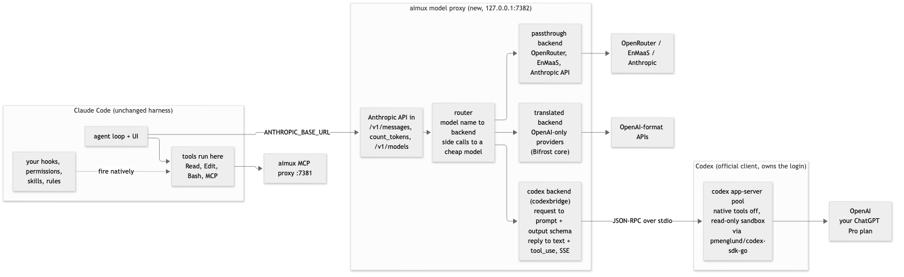
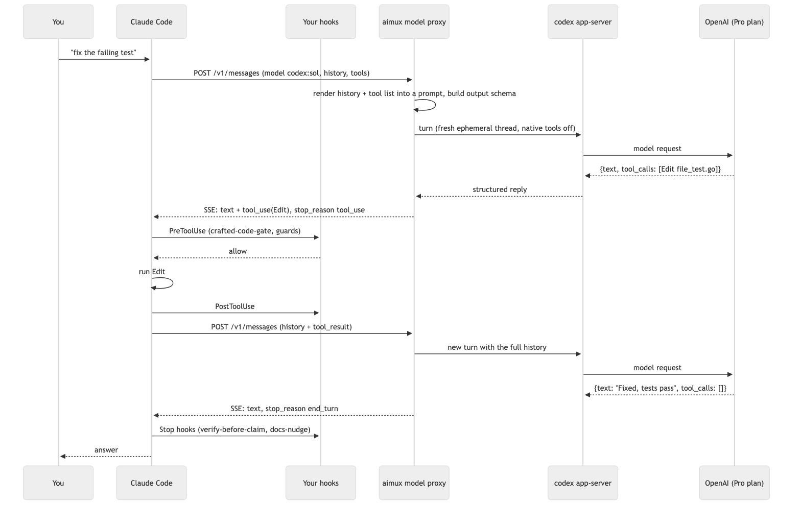

# Model proxy spike: Codex as the model behind Claude Code

## Goal

`aimux model proxy serve` runs a local Anthropic Messages API on 127.0.0.1. Claude Code points at it with `ANTHROPIC_BASE_URL`, and every model request is answered by Codex (`codex app-server`, the official client, which keeps its own ChatGPT login). Codex only decides; Claude Code runs every tool, so its hooks, permissions, skills and MCP stay native.

This is a spike: prove the Codex backend end to end with the smallest code that is still tested. Passthrough and translated backends are later work; leave a clear seam (a `Backend` interface with one implementation) and nothing more.

## Verified Codex 0.170 behavior (probe: `assets/codex-appserver-probe.py`, PASS)

Transport: spawn `codex app-server` (stdio, newline-delimited JSON-RPC 2.0). Generate the full schema with `codex app-server generate-json-schema --experimental --out <dir>` when a shape is unclear; do not guess.

1. `initialize` `{clientInfo:{name,version}, capabilities:{experimentalApi:true}}`, then notification `initialized`. `experimentalApi` is required for `dynamicTools`.
2. `thread/start` `{ephemeral:true, cwd:<empty temp dir>, sandbox:"read-only", approvalPolicy:"never", model, baseInstructions:<Claude Code system prompt>, dynamicTools:[{type:"function", name, description, inputSchema}]}` → `result.thread.id`. About 1.3 s after spawn.
3. `thread/inject_items` `{threadId, items:[...]}` with raw Responses API items. The model uses them:
   - `{"type":"message","role":"user","content":[{"type":"input_text","text":...}]}`
   - `{"type":"message","role":"assistant","content":[{"type":"output_text","text":...}]}`
   - `{"type":"function_call","name":...,"call_id":...,"arguments":"<JSON string>"}`
   - `{"type":"function_call_output","call_id":...,"output":"<string>"}`
4. `turn/start` `{threadId, input:[{"type":"text","text":...}], effort}` → `result.turn.id`.
5. Notifications: `item/agentMessage/delta` (`params.delta`, streamed text), `thread/tokenUsage/updated` (`params.tokenUsage.total.inputTokens`/`outputTokens`), `turn/completed` (`params.turn.status`).
6. Server request `item/tool/call` `{threadId, turnId, callId, tool, arguments:<object>}` when the model calls a dynamic tool. Answer by sending `turn/interrupt` `{threadId, turnId}` (acknowledged), after which `turn/completed` arrives with status `interrupted`.
7. Native tools off: start the process with `--disable` for `shell_tool unified_exec unified_exec_tty view_image image_generation apps plugins browser_use browser_use_external computer_use multi_agent skill_search tool_suggest goals sleep_tool hooks in_app_browser realtime_conversation worktrees`, plus `-c web_search="disabled"` and `-c tools.update_plan.enabled=false`. `hooks` must stay disabled so the owner's Codex hooks never fire inside the proxy. Prefer `codex-lean` (on PATH) over `codex` so the owner's 34 MCP servers do not start; make the command configurable.
8. Usage counts against the ChatGPT plan (`account/rateLimits/updated`, `limitId:"codex"`).

## Open questions the spike must answer (record answers in the results doc)

- **Token overhead.** A tiny request costs about 16.6k input tokens: Codex adds the global AGENTS.md, a skills list and environment context, which Claude Code already sends. Try `-c include_environment_context=false`, `include_permissions_instructions=false`, `include_apps_instructions=false`, `include_collaboration_mode_instructions=false`, and skill discovery off; measure `inputTokens` for each and keep the settings that cut it without breaking the turn.
- **Tools the model sees.** With `thread/start` `experimentalRawEvents:true`, check the raw request and confirm only the dynamic tools are offered (is `update_plan` gone?).
- **Continuing after a tool result.** When the last Claude Code message holds only `tool_result` blocks, inject them as `function_call_output` and start the turn. Does `turn/start` accept `input: []`? If not, what minimal input works without changing behavior?
- **pmenglund/codex-sdk-go.** Use it (`CompatibilityPolicy: codex.Warn`) if its 0.167 types cover `thread/inject_items`, `dynamicTools`, `experimentalApi` and the `item/tool/call` server request. If not, write a minimal JSON-RPC client in the package and say why.

## Anthropic side

Endpoints on `127.0.0.1:<port>` (default 7382): `POST /v1/messages` (stream and non-stream), `POST /v1/messages/count_tokens` (estimate is fine: bytes/4), `GET /v1/models` (lists `codex:gpt-6.2-sol` and `codex:gpt-6.2-astra`). Accept any `x-api-key`; bind loopback only.

Request mapping:
- `system` (string or text blocks) → `baseInstructions`.
- `tools` → `dynamicTools` (`input_schema` → `inputSchema`).
- `messages[:-1]` plus any `tool_result` blocks in the last message → injected items. `tool_use` → `function_call` (its `id` is the `call_id`, `input` marshalled to the `arguments` string); `tool_result` → `function_call_output` (text content joined; `is_error` prefixed as `Error: `).
- Text in the last user message → `turn/start` input.
- `model`: `codex:<id>` selects `<id>`; any other name (Claude Code's background calls use Haiku/Sonnet names) maps to the default model with `effort: low`.
- `thinking` blocks are dropped; image blocks are rejected with 400 `images are not supported by the codex backend` (spike scope).

Response mapping (Anthropic SSE, in order): `message_start`, text as `content_block_start`/`content_block_delta(text_delta)`/`content_block_stop` while deltas arrive, then for a tool call `content_block_start(tool_use {id: callId, name: tool, input:{}})`, one `content_block_delta(input_json_delta {partial_json: <arguments JSON>})`, `content_block_stop`, then `message_delta {stop_reason: "tool_use" | "end_turn", usage}` and `message_stop`. Non-stream returns the same content as one JSON message. Interrupt on the first tool call (one call per step is fine for the spike; note it).

Concurrency: one shared app-server process; demultiplex responses by JSON-RPC id and notifications and server requests by `threadId`. Each HTTP request gets its own ephemeral thread. Restart the process if it exits. HTTP request cancellation interrupts the turn.

## Code layout and rules (aimux)

- New package `internal/modelproxy` (backend interface, Anthropic types and SSE writer, request and event mapping, codex backend, HTTP handler) and `cmd/aimux/cmd/model_proxy.go` for `aimux model proxy serve [--port] [--codex-command]`, following `mcp_proxy.go`'s style.
- Test-first, one cycle per function. Assertions on returned values and emitted SSE, including error paths (bad JSON, images, app-server crash, interrupted turn, cancelled request).
- No mocks (aimux rule). Tests use a real fake app-server: a small Go program under `internal/modelproxy/testdata/fakecodex/` built in `TestMain`, speaking the JSON-RPC subset above from a scripted scenario. One opt-in live test (`AIMUX_LIVE_CODEX=1`) runs the real `codex app-server`; never run it by default.
- `gofmt`, `go vet ./internal/modelproxy/ ./cmd/...`, `go test ./internal/modelproxy/ ./cmd/aimux/... -timeout 300s` must pass. Do not change unrelated packages. Do not commit.
- Write `docs/superpowers/specs/2026-11-21-model-proxy-codex-spike-results.md`: what works, test evidence, answers to every open question with measured numbers, and what is left for a real implementation.
