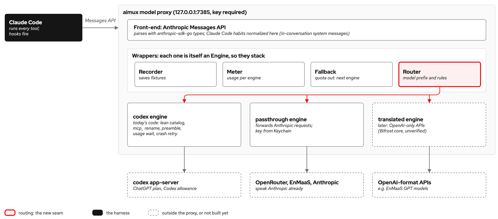

# Model proxy: engines and conformance

Two pieces of follow-up work for `aimux model proxy`, planned for the next session:

- **A. Engines:** turn the Codex-only proxy into a composable one (router, fallback, recorder, meter, more engines) with Anthropic's Go SDK types as the shared contract.
- **B. Conformance:** keep the proxy in step with Codex's app-server protocol and with Claude Code's use of the Messages API, so drift fails loudly instead of quietly.

Do A first: B's SDK round-trip tests and recorder depend on A's types and wrapper seam.



## Where things stand (resume here)

- Code: worktree `~/go/src/github.com/zanetworker/aimux-worktrees/model-proxy`, branch `spike/model-proxy`. **Nothing is committed yet.** Commit first (with the owner's OK; `git ship` pushes the branch, no PR) so a cleanup cannot lose it.
- Read first: `2026-11-21-model-proxy-codex-spike.md` (the spike spec) and `2026-11-21-model-proxy-codex-spike-results.md` (everything measured, fixed and still open).
- Tests: `go test ./internal/modelproxy/ ./cmd/aimux/... -count=1 -timeout 300s`. Live, against the owner's logged-in Codex: `AIMUX_LIVE_CODEX=1 go test ./internal/modelproxy/ -run '^TestLiveCodex$' -v`. The dashboard assets must exist in the worktree (`internal/frontend/web/dist`, copied from the main checkout).
- Try it: `go run ./cmd/aimux model proxy serve` (port 7385, key in Keychain entry `aimux-model-proxy`), then `claude-codex` in another shell (function in `~/.zshrc`), then `claude`.
- aimux rules that apply: logic in core packages with tests before any command wiring; no mocks (tests use the real fake app-server binary in `internal/modelproxy/testdata/fakecodex`); test-first; worktrees under `aimux-worktrees/`.

### What the proxy does today (all verified live on Codex 0.170 and Claude Code)

| Area | Behavior |
| --- | --- |
| Front | Anthropic Messages API: `POST /v1/messages` (stream and not), `count_tokens` (bytes/4 estimate), `GET /v1/models` (two fixed Codex models) |
| Auth | Key from Keychain `aimux-model-proxy` (account `aimux`), `x-api-key` or Bearer, constant-time; empty key rejects all |
| Codex | One shared `codex app-server` (via `codex-lean`), an ephemeral read-only thread per request, history through `thread/inject_items`, Claude Code's tools as dynamic tools, `turn/interrupt` at the first tool call after its usage report (at most 3 s) |
| Lean Codex | Catalog from `codex debug models`, every model rewritten to direct tool mode with no multi-agent version, no `apply_patch`, no experimental tools (0600 temp file, refuse to start without it); `--enable omit_skill_descriptions`; environment, permissions and apps instructions off; native tools and Codex hooks disabled; a preamble before Claude Code's system prompt |
| Claude Code quirks | In-conversation `system` messages become developer items (trailing ones keep order); `mcp__` tools renamed `mcp_` and mapped back |
| Robustness | Crash before any output: one retry on a fresh process; version warning when Codex is not 0.170.x |
| Measured | ~5.6k input tokens per model call (was ~16k); the model is offered only Claude Code's tools |

## A. Engines

### Problem (verified in the code)

The seam exists but sits in the wrong place: `Backend.Run(ctx, TurnRequest, emit)` (`backend.go:33`) takes a Codex-shaped `TurnRequest` (`Tools []dynamicTool`, `History []any` of Responses items, `ToolNames` for the `mcp_` rename), and the handler converts every request to that shape before any backend is chosen (`http.go:84` `mapRequest`, then `http.go:100` `backend.Run`). Routing is a `codex:` prefix check (`request.go:92`) and `listModels` returns two fixed entries (`http.go:56-59`). A passthrough or OpenAI engine cannot plug in without editing shared code.

### Design

```go
// Engine answers one Anthropic Messages request. req is the request as Claude Code sent it
// (after front-end normalization); out writes Anthropic stream events.
type Engine interface {
    Models() []Model
    Serve(ctx context.Context, req *MessageRequest, out EventWriter) (Usage, error)
}
```

- **Contract types:** `MessageRequest` and the response and stream event types come from `github.com/anthropics/anthropic-sdk-go` where they fit, so schema changes arrive with SDK updates (Dependabot). First task of A: verify the SDK's request type round-trips Claude Code's real requests without dropping fields; fall back to the current hand-written types where it does not, and record why.
- **`EventWriter`:** `Text(delta)`, `ToolUse(id, name, input)`, `Done(stopReason, usage)`, plus a raw-bytes path so a passthrough engine can forward Anthropic's own stream untouched.
- **Front-end:** parses and normalizes Claude Code habits that are not engine-specific (in-conversation `system` messages stay as they are in the Anthropic request; each engine maps them). Auth stays here.
- **Engines:**
  - `codex`: today's code moved behind the interface. `mapRequest`, the `mcp_` rename, the preamble, the lean catalog, usage wait and crash retry all become internal to it. Its tests carry over at its boundary.
  - `passthrough`: forwards to an Anthropic-format upstream (OpenRouter, EnMaaS `/v1/messages`, Anthropic). Key from a Keychain reference, never from the config file.
  - `translated` (later, not in this round): OpenAI-format upstreams; Bifrost's embedded core is the candidate (unverified that it accepts Anthropic-format input).
- **Wrappers (each is an `Engine`):**
  - `Router`: by model prefix (`codex:`, `openrouter:`, `enmaas:`) plus rules, for example Claude Code's background calls (Haiku-class model names) to a free model.
  - `Fallback`: primary then secondary when the primary returns a quota error (Codex's rate-limit error, a 429). Only before any output reached the client, like crash retry.
  - `Recorder`: writes redacted request fixtures (B4).
  - `Meter`: usage per engine; exposes Codex's `rateLimits` `usedPercent` for a status page or HUD.
- **Config:** `~/.aimux/model-proxy.yaml` (engines, routes, Keychain key names), read at start; same pattern as the MCP proxy's saved servers. `/v1/models` merges every engine's `Models()`.

### Tasks (test-first, one cycle per function)

1. Verify `anthropic-sdk-go` types against a recorded Claude Code request and a proxy stream; decide SDK types vs current types per message.
2. `Engine`, `EventWriter`, front-end; move the Codex code behind `codexEngine`; all current tests pass unchanged at the HTTP boundary.
3. `Router` with prefix routes; `/v1/models` merges engines.
4. `passthrough` engine against a local fake Anthropic server (a real HTTP server in the test, no mocks).
5. `Fallback` on quota errors, before output only.
6. Config file and the `serve` wiring.

Acceptance: the live test and a `claude-codex` end-to-end run pass unchanged; `/model openrouter:<id>` works through the same proxy; no Codex-specific code outside the `codex` engine (`grep` check in a test).

## B. Conformance

| Step | Guard | Catches |
| --- | --- | --- |
| B1 | Commit `codex app-server generate-json-schema --experimental` output for 0.170 under `internal/modelproxy/testdata/codex-schema/0.170/`; validate every message the proxy sends **and** every message the fake app-server sends against it (a JSON Schema validator library); a `scripts/codex-schema-drift` that regenerates from the installed Codex and diffs | Wrong field names; the fake drifting from real Codex; protocol changes on upgrade |
| B2 | Extend the live test: `experimentalRawEvents`, assert the `additional_tools` item offers only the request's dynamic tools | Catalog fields renamed or silently ignored (a schema diff cannot see this) |
| B3 | Round-trip tests: decode the proxy's JSON and SSE responses with `anthropic-sdk-go` (its message accumulator for streams) | Responses Claude Code would reject |
| B4 | `--record <dir>` (the `Recorder` wrapper) saves redacted real Claude Code requests as fixtures, stamped with `claude --version`; tests replay them | Claude Code habits no schema describes (the in-conversation `system` messages and `mcp__` names were both this kind) |
| B5 | Nightly launchd job: schema drift, live Codex test, one `claude-codex` end-to-end task; macOS notification on failure, never auto-fixes. README compatibility table ("tested with Codex 0.170, Claude Code x.y") updated by the job on success. Dependabot for Go modules | All of the above, without anyone remembering to run it |

B3's assumption to verify first: that the SDK's stream accumulator can be fed a byte stream from a test server.

## Other open items (not in this round)

- Keychain experiment: a separate `CODEX_HOME` for the proxy with Codex's login in the Keychain (`cli_auth_credentials_store`, value unverified) would drop the AGENTS.md copy and the skills list, about 4.6k tokens per call. Check that the entry is not keyed by folder and that concurrent refreshes are safe before switching the owner's main Codex.
- Parallel tool calls (collect calls for a short window, return several `tool_use` blocks), images (Codex image items; `DynamicToolCallOutputContentItem` has `imageUrl`).
- A quality comparison of GPT-6.2 through the proxy against Claude on real tasks.
- Before merge: README section, `qa-tools:pr-review`, a launchd agent so the proxy runs on its own.
- OpenAI terms for using Codex as another tool's engine remain unconfirmed.
