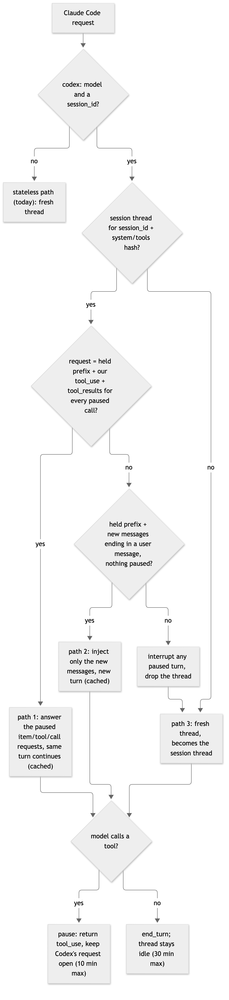

# Model proxy: prompt caching through session threads

## Problem (measured)

The first real Codex-mode session (102 model steps, 32 minutes) took a median 9.3 s per step (Claude: 5.1 s) and sent about 153k input tokens per step with 0% cache hits, moving the weekly Codex allowance from 19% to 20%. The proxy opens a fresh ephemeral Codex thread for every Claude Code request, so OpenAI's prompt cache never matches.

## Facts this design rests on (probed against Codex 0.170, Nov 22 2026)

1. **Reuse caches.** Within one thread, every model request after the first had `cachedInputTokens` of about 16.6k out of 16.8k input (~99%), read from `thread/tokenUsage/updated` → `tokenUsage.last`.
2. **Interrupt then inject does not work in a reused thread.** After `turn/interrupt` at an `item/tool/call`, injecting a `function_call_output` for that call and starting a new turn left the model unable to see the result (it answered "Unknown." instead of the injected fruit). An interrupted call is not resumable this way.
3. **Holding the tool call works.** Not interrupting, keeping the `item/tool/call` server request unanswered for 60 s, then answering it with `{"contentItems":[{"type":"inputText","text":...}],"success":true}` let the same turn continue; the model used the result correctly. Longer waits are untested.
4. `thread/items/list` is not supported in 0.170 (`-32601`); the proxy must track what a thread holds itself.
5. Claude Code sends `metadata.user_id` as a JSON string containing `session_id` (captured request, Claude Code 2.1.330).
6. Codex has `turn/steer` (add user input to the active turn); verify its params from the generated schema before using it.

## Design

A **session thread** is a long-lived (still ephemeral) Codex thread for one Claude Code conversation, keyed by `session_id` plus a hash of the system prompt and the tool list (so subagents, which have their own prompt, get their own thread). Background calls (non-`codex:` model names) and requests without a `session_id` keep today's stateless path.

The proxy records, per session thread: the hash of the conversation prefix it already holds (system, tools, and the messages accounted for), and, while a turn is paused, the pending tool calls (Codex call id → JSON-RPC request id) and the turn id.

On each request for a session thread:

1. **Continue a paused turn** when the request is exactly the held prefix + the assistant message the proxy returned (its `tool_use` blocks) + a user message whose `tool_result` blocks answer every pending call. Answer each pending `item/tool/call` with the result (text as `inputText`, images as `inputImage`, `is_error` → `success:false`), then stream the same turn's events into this HTTP response. Extra text in that user message (Claude Code's system reminders) goes in through `turn/steer` if verified, otherwise is dropped and logged.
2. **New turn on an idle thread** when the request is the held prefix + new messages ending in a user message with no pending calls: inject only the new non-final messages (developer messages for in-conversation `system`) and start a turn with the final user message as input.
3. **Anything else** (prefix changed: rewind, compaction, edited history; tools or system changed; model changed; a pending call the new request does not answer; the thread or app-server gone): interrupt any paused turn, drop the session thread, and serve the request on a fresh thread the way the proxy does today, which then becomes the session thread.

At a tool call the turn is **paused, not interrupted**: the proxy emits `tool_use` and ends the HTTP response (stop_reason `tool_use`) but leaves Codex's request unanswered. A paused turn is interrupted after 10 minutes without a matching request (the next request then takes path 3). Idle session threads are unsubscribed after 30 minutes. Parallel tool calls: collect calls that arrive within 300 ms of the first, return them all as `tool_use` blocks, and require all of them answered on continuation.

**Usage per HTTP request** is the sum of `tokenUsage.last` over the model requests made during it, including `cachedInputTokens`; Anthropic's response reports `usage.cache_read_input_tokens` from it. (Today's code reads `total`, which grows with a reused thread and would over-report.)

**Logging** (stderr, one line per request, no content): session hit or the fallback reason, input and cached tokens, time to first byte.

## Code and tests

- `internal/modelproxy`: a `sessions` component (state above, guarded by a mutex, one in-flight request per session thread) used by the codex backend; matching by prefix hash; the paused-turn handoff. Keep the stateless path as is for background calls.
- Test-first with the real fake app-server (`testdata/fakecodex`), extended to: hold `item/tool/call` until the client answers and then continue the turn; report `tokenUsage.last` with cached tokens; accept `turn/steer` if used. Cover: continuation hit, idle-thread new turn, each fallback reason (rewind, compaction, changed tools, unmatched call, timeout, app-server restart), parallel calls, usage summing, and that a background call never touches a session thread.
- Live: extend `TestLiveCodex` (opt-in) to a two-step tool task in one session and assert the second step's `cachedInputTokens` is above 80% of its input.
- Do not change the stable proxy on port 7385. Build with `scripts/model-proxy-promote build-dev`; run checks on 7386.

## Acceptance

All tests and lint pass; live test passes with the cache assertion; a `claude -p` Read → Edit → Bash task through a dev proxy on 7386 still completes correctly; measured with the transcript script: median time per step and input tokens per step against the 9.3 s and 153k baseline.
