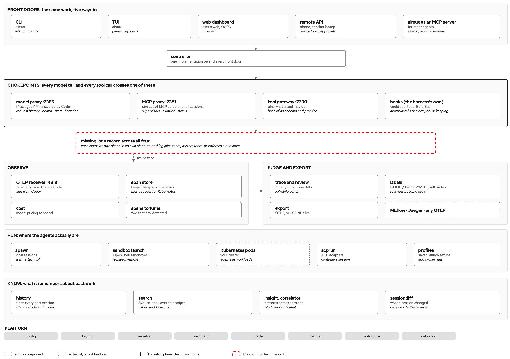

# aimux: one record, one base, one door

A design for turning aimux from a tool that watches agents into the place where every agent action is
visible, attributable, metered and, when it earns it, governed; where work is routed to the best engine
within what is left; and where real sessions become evaluation data.

Two shorter versions sit beside this file: `aimux-design-one-page.html` (five minutes, to decide) and
`aimux-governance-design-review.html` (the architecture explained with diagrams). This file is for whoever
builds it. Where the three disagree, this file is right and the others are stale.



## Why

In the owner's words:

- "the goal of the proxy is not just to use it for this only, but also to be where I govern access to
  everything and see my use, potentially also enforce policy"
- "we should have visibility over everything to allow for actuators after, where actuators could switch quotas
  or backends because we have now built the plumbing for it"
- "I want to build the evaluation system in here too"
- "The goal eventually is to build something that is reusable ... Other proxies might come in play."

The driver is concrete. The owner runs out of Claude allowance, the Codex Fast tier spends the ChatGPT
allowance faster, and switching engine by what is left needs two numbers nothing produces together: what is
left, and what each session is spending.

The argument was demonstrated once already. On 2026-11-22 a Codex session took 36 to 56 seconds a step and
nothing in aimux could say why, because each component kept its own notes and none named a session. One
extra field in one record found the cause in minutes.

## Goals

1. **One record.** Every model call, tool call and rule outcome is one line, in one shape, with one
   identity, wherever it happened.
2. **Attribution.** "What did this turn cost and what did it touch" is one query, not a timestamp match.
3. **Metering.** Spend and volume per run, session, project, day, model and tool, against the allowances
   that actually run out.
4. **Reuse.** A new proxy writes only its protocol; identity, records, rules, health and upgrade come from a
   shared base.
5. **Routing per task, keeping context.** One model door, several engines, and the right one for each
   task inside a session, chosen for quality, speed and cost, without the session losing what it knows.
6. **Rules and actuators.** Rules written once and applied at each door; actions on what the meter says.
7. **Evals from real work.** A corrected turn becomes a test case. Paused; this programme only keeps the
   door open for it (section 8).

## Non-goals

- A hosted or multi-user service. This governs one developer's machine. Other form factors are sequenced
  after it, not excluded ("Where this runs").
- Replacing MLflow or Jaeger. They stay the durable stores for traces and eval results.
- Running benchmarks inside aimux. `agentic-evals-harbor` runs them and stays its own repo.
- Enforcing a sandbox's policy. OpenShell enforces its own; aimux observes it and may draft it.
- Governing what offers no hook and no proxy. What cannot be intercepted is reported as not covered.
- A new UI. Everything lands in the fronts that exist.

## Anti-goals

These would mean failure even if every feature shipped.

- **A slower agent.** The model proxy adds about 33 ms, measured against a fake app-server, on steps that
  take 3 to 5 seconds. Bookkeeping must not spend that budget, and a hook that runs on every tool call must
  be measured before it is on by default.
- **Silent gaps.** A layer that quietly misses built-in `Read`, `Edit` and `Bash`, or a whole consumer such
  as Wingman, would report coverage it does not have. Anything not covered says so.
- **Content in the ledger.** Lines hold names, counts, timings and outcomes. Never prompts, answers, tool
  arguments, file paths or commands.
- **Several readers of the same transcripts.** There are three today. There is one after this.
- **Rules nobody can predict.** A rule the owner cannot explain before it runs gets turned off after its
  first surprise.
- **A framework.** Nothing is abstracted before its second user exists.

## Names used in this document

Several words were doing double duty. These are fixed:

| Word | Means |
|---|---|
| door | a place agent actions pass through. Today: the model proxy, the MCP proxy, the tool gateway, and a harness's hooks |
| base | the shared code under every door |
| ledger | the JSONL record under `~/.aimux/ledger/` |
| line | one ledger entry |
| verdict | an allow, refuse or cap outcome, with who reached it (`governed_by`): one of aimux's doors applying a rule, or a sandbox applying its own policy |
| decision | a routing choice made by `internal/decide`, logged in `decisions.jsonl`. Never a rule outcome |
| rules | aimux's own allow, refuse and cap statements |
| sandbox policy | the OpenShell policy file. aimux does not enforce it |
| engine | whatever answers a model turn behind the model proxy |
| engine policy | an ordered list of engines allowed for a session or a Wingman stage, with a role map and whether fallback is allowed |
| catalog | the engine list with what each model is good at, its tradeoffs and the evidence. One file |
| auto | a model name meaning "the router chooses for this task" |
| run, stage | one Wingman question, and one of its child sessions (planner, reader, writer). Not used for evals, where the words are "execute" and "step" |
| profile | a Wingman launch setup in `internal/profile`. Nothing else |

## What exists today

Verified in the code and on the owner's machine, 2026-11-23 and 24.

**The doors are uneven.**

- The model proxy (:7385) records one line per request (`internal/modelproxy/requestlog.go`): time, outcome,
  detail, a short session tag, the model asked for, effort, status, timings, tokens. It does not record the
  model that answered, the project, the turn or the call. Only sessions started in Codex mode reach it; a
  normal Claude Code session talks to Anthropic directly.
- The MCP proxy (:7381) serves local sessions with no pins and no per-call record. It sees a transport
  session, not a Claude Code one.
- The tool gateway (:7390) serves sandboxes. It ties each sandbox call to a session through a per-turn
  lease, checks pins on every call, and writes text log lines only. It also accepts an admin-token caller
  (the browser and work lanes), which has no lease and so no session.
- Hooks belong to the harness. aimux installs eight entries into Claude Code: two keep the MCP proxy in
  order, six drive the phone's "waiting for you" alert through `aimux remote hooks notify`. None records a
  tool call or refuses one, none is marked async, and so an aimux process already runs, and is waited for,
  after every tool call. Codex has hooks too (`~/.codex/hooks.json`), with nearly the same event names and
  no `PostToolUseFailure`; aimux installs none there, and Codex skips a hook until the owner has trusted
  its exact definition. A hook refuses by printing `permissionDecision` in its JSON and exiting 0, so the
  `|| true` aimux appends to its hook commands does not prevent refusal.

**Local sessions are already counted, in totals.** Telemetry is switched on in `~/.zshrc`. Every terminal
Claude Code session reports to the collector (`aimux collect`, :4318), which keeps one file per session under
`~/.aimux/data/context/` with calls, tokens and cost per tool, built-in tools included. It spreads a
session's cost over its tools by call count, which is an estimate. It also has an endpoint for hook events
(`POST /v1/hooks` in `internal/otel/receiver.go`: session id, tool name, Claude Code's `tool_use_id`), which
today only makes a span in memory. What nothing keeps is the single call: when, in what order, how long,
allowed or not.

**Wingman does not use the model proxy.** Its sandboxed stages call Anthropic directly through a fixed
provider (`SandboxProvider = "wingman-claude"`, `internal/profile/compile.go`); a profile's `model.provider`
is parsed and ignored. Its sandboxes run without hooks and without telemetry
(`internal/harnessconfig/claude.go`). On 2026-11-23 its planner stopped on Claude's weekly limit and nothing
could take over.

**Four background processes, no single view.** launchd runs the model proxy, the MCP proxy, the tool gateway
and the collector. Each proxy has its own `status` in its own format; `aimux doctor` has about twenty checks
for Wingman's lane; there is no `aimux status`. Only the model proxy has a tested promote step
(`scripts/model-proxy-promote`, run outside Claude Code). On the morning of 2026-11-24 the four ran three
different builds. Three jobs are named `com.aimux.*` and log under `~/.aimux/logs/`; the collector is
`com.azaalouk.aimux-collect` and logs under `~/.claude/logs/`. `~/.aimux/` holds about forty entries at one
level.

**The proxies share almost nothing.** `internal/modelproxy` imports one other aimux package. Checking a
request's key is written in five packages, appending to a log file in nine places, starting a listener in
six, installing a launchd job in two, and a status answer in three different shapes (the model proxy's
`/health`, the MCP proxy's `/status`, the gateway's `/v1/status`). The gateway does reuse the MCP proxy's
serving and backend code.

**Pricing.** `internal/cost/tracker.go` prices the Claude 5.x models, with per-request tiering. It has no
`gpt-6.2` model (it does price the older `gpt-5.3-codex`), so the Codex models in daily use are unpriced.

**The observe and export half is mature.** Span store, spans to turns, the trace and review view, labels,
and export to MLflow, Jaeger or JSONL already work, and already use OpenTelemetry's names for AI calls.

**Routing parts exist.** `internal/decide` is a generic decision client (thresholds, hedging, a decision
log); `internal/autoroute` uses it to pick a Wingman mode from a truncated question and three booleans, with
zero data retention required of the outside decider; `aimux router status` and `router test` are its dry
run.

**House rules that bind this work.** Controller first: every operation is a controller function with tests,
and each front is an adapter. Test first, against the real fake app-server, no mocks. Composability, in the
owner's words: "I like my creations to be composable." Eval datasets are his and confidential; the framework
need not be.

## The shape

Each door appends lines to a shared ledger; aimux joins and shows them. Rules are checked at the doors, not
by a central service. That is the smallest design that works, it puts nothing new in the path of a request,
and what the ledger shows is what tells us which rules are worth having.

Two alternatives were set aside. A governor service that every door asks before acting gives one place for
rules but adds a dependency to every call and a process to keep alive; it can be added later because the
verdict is already a defined line. Doing everything in hooks is cheapest and governs only Claude Code.

## 1. The ledger

### What a line holds

One JSON object per line. Field names follow OpenTelemetry's conventions for generative AI where they exist,
which aimux's span code already uses; aimux's own fields sit in an `aimux.` namespace. The conventions were
still marked as in development when last checked, so the version followed is pinned and each line records
it.

| Group | Fields |
|---|---|
| when and what | time, `kind` (`model_call`, `tool_call`, `verdict`, `switch`) |
| who wrote it | writer name and a sequence number that only goes up |
| identity | run, session, turn and call ids (section 2); stage for a Wingman run; project (the repository's name plus a hash of its path, never the path); harness; host |
| a model call | its own call id; `gen_ai.request.model` and `gen_ai.response.model` (asked for, and answered); engine; effort; tokens in, out, cache read and cache write; time to first byte; duration; outcome |
| a tool call | `gen_ai.tool.name`, the server for an MCP tool, `gen_ai.tool.call.id`, duration, outcome |
| a verdict | allow, refuse or cap; the rule; a reason from a fixed list, never free text; `governed_by` (which door, or a sandbox) |
| a switch | from and to engine; from and to session id when a new session was started; who or what asked; the resend cost |
| cost | an amount and currency; whether it is measured, estimated or unpriced; the price table version used |

### Who writes, when, and where

| Writer | Lines | When | File |
|---|---|---|---|
| model proxy | model calls, switches, its verdicts | after the response has been sent | `~/.aimux/ledger/model-proxy.jsonl` |
| MCP proxy | its verdicts, and a secondary line per local MCP call (see below) | when the call returns | `~/.aimux/ledger/mcp-proxy.jsonl` |
| tool gateway | calls to sandboxed tools, its verdicts. A call from an admin-token caller is written with the caller's class and no session | when the call returns | `~/.aimux/ledger/tool-gateway.jsonl` |
| collector | every tool call a hook reports, built-in and MCP; a hook's own refusals; verdicts read from sandbox logs once the OCSF reader exists | after the tool has run | `~/.aimux/ledger/collector.jsonl` |

File names are illustrative. Four rules are not:

- **One writer per file, always a long-running process.** The request log rotates under a mutex only its own
  process holds, so two processes on one file could discard each other's lines.
- **A hook never owns a file.** It is a short program started once per tool call, so many run at once. The
  hook process aimux already runs (`remote hooks notify`) hands the event to the collector's existing
  endpoint, and the collector writes it. If the collector does not answer, the hook leaves the event as one
  small file under `~/.aimux/ledger/spool/`, one file per event, and the collector takes them in when it is
  next up. An outage delays those lines; it does not lose them.
- **Every tool invocation has exactly one line that counts.** Where a hook covers the session, the line the
  hook reported is the record, for built-in and MCP tools alike. In a sandbox, the gateway's line is the
  record. The MCP proxy's line for the same call is marked secondary: a reader counts it only when no primary
  line carries the same call id, and otherwise uses it as a cross-check. A secondary line without a call id
  is listed apart and never counted. Order of arrival does not matter, because the rule is applied on read.
- **A verdict is written by whoever reached it.** There is no policy process. A proxy or the gateway writes
  a refusal before the answer goes back; every other line is written after its action. A hook that refuses
  reports through the collector like any hook event, so its record can lag; the refusal does not wait for it.
- **Hook events are idempotent.** Each carries an event id (the call id plus the hook event's name). The
  collector drops one it has already written, and a spool file is deleted only after its line is on disk, so
  a lost reply or a retry cannot write a line twice.
- **Readers never write.** They open every file in the folder, merge by time and group by id.

Labels are not ledger lines. They stay in `~/.aimux/evaluations/` and join through the session and turn ids.

### How reliable, and how that is known

The ledger is good enough for a meter and for visibility. It is not an audit log: a line written after its
action is lost if the process dies between the two. Completeness is measured, not asserted:

- a missing sequence number is a lost line, visible to any reader. A writer continues its numbering across
  restarts from the last line on disk, and reports its latest number in its health answer, so lines lost at
  the end of a file show up as well;
- a periodic check compares ledger counts per session with the transcripts, which no aimux code writes, and
  with the totals from Claude Code's own telemetry, leaving out anything the collector learned from a hook
  or from replayed ledger spans (both are marked by source), and shows the difference;
- a write that fails is counted and shown, and never changes what happened to the call.

Files are readable by the owner only, kept for a stated window and under a total size cap. If rotation
removes lines the span export had not reached, the gap is recorded and any total spanning it is marked
incomplete.

### Reading and exporting

One controller function reads the ledger, and every front calls it. Nothing is joined afterwards by timing
or text: a line with missing ids is shown as unmatched. At a few thousand lines a day reading files is fast
enough; if it stops being so, an index is built from the files, which stay the record.

Spans are produced from the ledger, by replay with a cursor, and sent to the collector as OTLP, so the trace
view, MLflow and Jaeger see ledger lines with everything else. Because the names already match, that is a
change of envelope. The ledger is the one authoritative copy; export lag and dropped spans are shown.

## 2. Identity

Every line carries up to four ids, and the join is decided when the line is written.

| Id | Is | Comes from |
|---|---|---|
| run | one Wingman question, spanning its stages | new: the run engine mints it per question and passes it to each stage with the lease. `profilerun.RunState.Children` already maps each stage to its session. Never inferred from a sandbox name |
| session | one conversation in a harness | the harness's own session id, in full. The 8-character tag derived from it stays for display only |
| turn | one user request and everything done for it | new; the model proxy and the hook both derive it |
| call | one tool invocation, or one model request | for a tool, the harness's own id for it (`tool_use_id` in Claude Code, the call id in Codex): hooks receive it, and the model proxy sees it in the conversation. For a model request, the model proxy mints one |

Three joins are weak today, and each has a fix and a rule for the meantime:

- **MCP proxy lines.** The proxy does not know which session a call belongs to, and whether it receives the
  harness's call id with an MCP request is unverified. Because its lines are secondary (section 1), this
  weakness cannot cause double counting or a wrong charge; it only limits the cross-check. The fix, when it
  is wanted: bind each MCP connection to a session and project at setup. The test: two projects calling the
  same tool at the same time.
- **Background model calls** arrive with no session in the request body. Claude Code does send a session
  id header (`X-Claude-Code-Session-Id`) on every request, seen in the passthrough test, which the proxy
  does not read today; whether background calls carry the same id as their conversation is not yet known.
  Fix: read the header, and let the entry wrapper supply what is still missing. Until then they are grouped
  and counted as sessionless.
- **Model calls that do not cross the model proxy** are known only as the collector's totals: Claude Code
  talking straight to Anthropic, and native Codex sessions. Wingman's sandboxed stages send no telemetry, so
  their model calls are not covered at all. Fix for Claude Code and Wingman: the passthrough engine (section
  6). If its test fails, these stay as they are and are shown as totals only, or not covered.

Anything unmatched is shown as unmatched. Nothing is guessed into a turn.

## 3. The doors and their shared base

### The base

The reusable part is a small base under every door, so a new door writes only what is particular to its
protocol.

| The base, written once | Each door, written per protocol |
|---|---|
| identity: run, session, turn, call | the protocol it speaks, its listener, its key check and its startup |
| | how it finds the ids in its own requests |
| writing ledger lines, numbered, with failures counted | which lines it writes |
| the rule check and its failure cases (section 7) | where in its flow the check sits |
| the health answer `aimux status` reads | its own detail, and its engines or backends |

The meter, routing, traces and evals read the ledger and never learn which door wrote a line. That is what
lets a new door arrive without touching them.

The base is deliberately this small: four pieces. Listeners, key checks and startup stay with each service,
because a hook that runs for milliseconds and three long-running processes have different lives, and sharing
that code would couple them for little gain.

**The base is extracted, not designed.** Each piece moves into the shared package when its second user is
being written, taken from code that already works, with the first user switched over in the same change.
Health comes out in step 0, the line writer and identity in step 1, both go to the MCP proxy in step 4, and
the tool gateway follows.

Of the other places this design could vary, only one gets an interface now: the harness, because Claude Code
and Codex both exist. The entry point is one concrete wrapper, the fronts stay controller functions, export
is one ledger reader, and the engine interface is drawn when the second engine works (section 6).

### What changes at each door

- **Model proxy.** Writes ledger lines, records both models, gains engines behind it and a sandbox entrance
  (section 6). Its existing request history keeps being written until the ledger reader is proven, so
  `aimux model proxy stats` never breaks.
- **MCP proxy, local path.** Gains a secondary line per call and the pin check sandboxes already get, in
  warn mode. Binding a connection to a session comes later, if the cross-check proves worth it. `toolgateway.Pins.Filter` hides a changed tool, so warn mode needs
  its own path: a changed tool stays usable and the warning appears in `aimux tools status`. It is never put
  in the tool's response. More places to show it wait for evidence that the warning gets missed.
- **Tool gateway.** Same pins and leases; it now writes ledger lines. It is the best-identified door.
- **Hooks.** Report every tool call, built-in ones included, through the path in section 1. Two parts:
  - *A per-harness installer*: a small interface (install, uninstall, status) with today's
    `internal/claudehooks` as the Claude Code implementation and a Codex one beside it. Event lists are per
    harness. For Codex, status reports three states apart: installed, awaiting the owner's trust, and seen
    firing. The same installer carries the phone alerts and MCP housekeeping to native Codex.
  - *Reporting from the process that already runs.* The hook reads only the fields it needs: its input is
    capped at 1 MiB (`internal/waiting/hook.go`), and a large tool result must not cost the event. Refusal,
    when wanted, is a separate `PreToolUse` entry.
- **Sandboxes.** A sandboxed stage has no hooks and no telemetry. Its lines come from the model proxy's
  sandbox entrance, the tool gateway, and OpenShell's own OCSF log, which the collector reads and maps to
  verdict lines. A stage with none of those is shown as not covered.

### The entry wrapper

The owner does not use the launcher or spawn; he uses a shell function in `~/.zshrc`. An aimux-owned entry
point replaces it. In step 2 it starts a harness with the proxy address, telemetry and identity wired, and
makes sure the hooks aimux already has are installed; it is what gives background calls a session. It learns
to install the reporting hook in step 3 and to apply an engine policy in step 8.

## 4. One view of the processes

The four stay separate processes: a restart of one must not drop the others' connections, they change at
different rates, and launchd already supervises them. What is added is a thin layer that treats them as one
system.

1. **`aimux status`**, below.
2. **One health answer.** Every long-running process answers the same small JSON: state, build, started,
   last activity, problems each with one fix. It carries state and counts only. The collector's `/debug`
   endpoint can return prompt excerpts, so diagnostics stay separate and anything a sandbox can reach asks
   for the key first.
3. **One upgrade, in two stages.** First, the existing promote script is extended: it shows which build
   each service runs and restarts the ones the owner names. That is enough to end mixed builds. Later, and
   only if that proves clumsy, `aimux upgrade` does the whole thing: test each service's candidate on a
   spare port with scratch state (the collector derives its data folder from the home directory whatever its
   port), swap the binary once, restart the services one at a time with a health check after each, and on a
   failed check restart exactly the ones already switched on the previous build. A service with live
   connections restarts when idle or on the owner's confirmation.
4. **One place per kind of file.** Logs under `~/.aimux/logs/<service>/`, the collector included and its job
   renamed `com.aimux.collector`; backups in `~/.aimux/backups/`. Moving existing files is its own step with
   a backup, never a side effect of something else. Every file two processes share carries a format
   version, and a process that meets a newer one than it knows refuses to write.

### What `aimux status` prints

An example, with made-up values:

```
aimux v0.14.0-184    4 services, 2 need attention

SERVICE       STATE     BUILD  UP    ADDRESS         LAST ACTIVITY
model proxy   ok        184    38m   127.0.0.1:7385  turn 2m ago
mcp proxy     ok        128 !  2d    127.0.0.1:7381  call 12h ago
tool gateway  degraded  184    2d    127.0.0.1:7390  lease 1d ago
collector     ok        184    2d    127.0.0.1:4318  span 4s ago

NEEDS ATTENTION                                   FIX
tool gateway: 1 of 5 backends down (slack)        aimux mcp proxy status
mcp proxy: build 128 is older than the CLI (184)  aimux mcp proxy restart
```

Each of these is a test:

- **Always all four lines**, in a fixed order.
- **Four states only**: `ok`, `degraded`, `down`, `not installed`. A service the owner chose not to run is
  `not installed` and does not change the exit code. A port answered by something else is
  `down: wrong process`; the collector today ignores a failed listen and still says it is listening.
- **Every problem has exactly one fix**, a command to paste.
- **It cannot hang or change anything.** Each service is asked in parallel with a two-second limit; one that
  does not answer is `down` and the others still print.
- **The exit code is the answer**: 0 when nothing needs attention, 1 when anything does, 2 on bad
  arguments. A service can be `ok` and still need attention, as the drifted build above does; `not
  installed` by the owner's choice needs none.
- **`--json` carries the same facts**, and the table is drawn from it.
- **Ages, not timestamps**; readable without colour; under 100 columns; never a secret or an environment
  value.
- **A different build always says why.** `restart pending` during an upgrade, `pinned` for one kept back on
  purpose, both words already used by `internal/mcpproxy/status.go`. Anything else is drift and a
  `NEEDS ATTENTION` line.
- **Detail stays in the per-service commands.**

It is one controller function, built first from what `aimux doctor` and the per-proxy status commands
already know, so `not installed`, a wrong process and a failed key each read differently before any service
speaks the health answer.

### When a process is down

- **Collector down:** hook events wait in the spool and span export is delayed. Nothing else changes.
- **Model proxy down:** a session routed through it stops with a clear message naming the fix. It is never
  silently sent direct, because that changes both what is governed and what is billed. Going direct is the
  owner's explicit choice.
- **Coverage that cannot be shown is unknown.** A process healthy now says nothing about yesterday; a window
  without evidence is reported as unknown, never as governed.

## 5. Meter

The meter is a read-only controller function over the ledger: spend and volume per run, session, project,
day, model and tool, beside the allowances that run out.

- **A first meter ships with the visibility release**: requests, tokens and unknown attribution per session,
  before cost or MCP attribution are complete.
- **It prices the model that answered**, not the one asked for.
- **Three kinds of cost are never mixed**: measured, estimated (a session's cost spread over its tools by
  call count), and unpriced (no `gpt-6.2` model has a price yet). An unpriced model shows tokens and the word
  `unpriced`, never a zero. Estimated API dollars are shown apart from the subscription allowance observed.
- **Allowances.** The Codex allowance is polled every two minutes and carries its age; a reading older than
  a stated limit decides nothing. Claude reports no allowance, so the only Claude-side signal is the limit
  error itself (section 6).

`aimux model proxy stats` is the meter's first adapter and the dashboard its second.

## 6. Engines, routing and switching

Codex mode is the first feature of the model proxy, not its purpose. The proxy is one door that speaks the
Messages API, with engines behind it. An engine is whatever answers a turn: a model API, or another harness
running its own loop. Codex is already the second kind.

| Engine | Kind | Status |
|---|---|---|
| Codex app-server | a harness used as a backend | running |
| Anthropic passthrough | a model API | next |
| OpenAI-compatible endpoint (vLLM, an internal gateway) | a model API | later |
| Codex with a native tool switched on, such as web search | a harness used as a backend | a setting per listener |

The last row is a capability, off by default: native Codex tools are disabled wholesale today
(`web_search="disabled"` in `codex.go`), because a native tool runs inside Codex, outside hooks, permissions
and the transcript. Where it is switched on, each use is recorded from the `web_search_call` items Codex
reports, so the exception stays visible. Until then a stage answered by Codex cannot search, which is why
Wingman's web reader stays on its current route.

### The second engine comes before the router

Passthrough is built second, for two reasons. It is as unlike Codex as an engine can be, so the engine
interface is drawn from two real ones. And it closes a gap: with it, every Claude Code model call crosses
the door, where today only Codex-mode sessions do.

It rests on something untested: whether Claude Code's subscription login works through a local base URL.
That test is run first, before anything is built on the answer, from the host and from inside a sandbox,
with a streamed tool call and its result. The proxy today takes the API-key header for its own key and
translates every request to Codex form, so passthrough needs both hops authenticated and the original
request preserved. If the test fails, direct Claude calls stay known through the collector's totals, and the
owner approves the meter knowing which calls it sees.

### One engine list, and what an entry says

The engine list lives with the model proxy. There is no second registry: a session's entry point, or a
Wingman profile, names an **engine policy**, an ordered list of engines. Each engine entry states its
endpoint, its credential by reference, its capabilities, and whether it **may receive private data**. A
policy may only list engines its data is allowed to reach: Wingman's planner sees Jira and Slack, its reader
sees the public web, and they draw from different sets.

### When the choice is made

**Changing engine inside an open conversation always has a price**: the other engine must read what it has
not seen, 36 to 56 seconds measured on a long session, against about 5 for a step on a warm one. So nothing
switches a conversation silently or by default. A switch is asked for by the owner, made by an engine policy
that says so, or triggered by a limit error where the policy opted in, and it is always recorded with its
cost. The next subsection is how per-task routing works within that. The proxy
identifies a conversation by the session id plus a hash of the system prompt and the tool list
(`newSessionInput` in `internal/modelproxy/sessions.go`). So an engine can be chosen, at no warm-up cost,
for anything that is its own conversation:

- **a terminal session**, when it starts;
- **a helper inside a session** (a subagent, a background call), when it starts;
- **a Wingman stage**, per stage per turn. The run engine starts a new session for every stage on
  every turn, so each stage starts cold and no conversation is carried between turns; stage cost on the
  Codex engine is measured before any stage is moved to it.

Apart from the owner's own choice, two things trigger one:

1. **At the start**, on the allowance left. This is a threshold over a fresh reading and makes no model
   call.
2. **When a limit error comes back.** It is the only signal Claude gives. An engine policy states whether
   fallback on it is allowed; it is off unless stated, never silent, and shown as "Claude weekly limit
   reached, continuing on <engine>". The failed request is retried on the next engine only when it failed
   before any output was sent and before any tool ran. Otherwise the session stops with the message and the
   owner decides.

A third input needs no model either: what the work needs. An engine policy lists engines in order, and an
engine without a required capability (web search, say) is skipped.

Those three, plus the roles of the next subsection, are the router's rules: ordered lists, capability
checks, an allowance threshold and a role map. The rules read only metadata, never the prompt. Manual choice
comes before any automatic one, and everything automatic ships first as a dry run that prints what it would
choose and why.

Choosing by kind of work, by cost and by what actually worked is "auto", described two subsections below.
Its outside decider follows the mode router's rule (a truncated question and a few booleans at most, zero
data retention) and counts as sending data to a provider, so the approval below applies to it.

### Routing per task, keeping context

This is the feature the owner asked for by name: use the best model for each task inside one session,
for quality, speed and cost, without losing context. It rests on one fact and has one cost.

**The fact: the harness holds the context, not the engine.** Claude Code keeps the whole transcript and
sends it with every request. Whichever engine answers the next request receives everything, so no content
is ever lost by changing engine. The proxy already picks the engine per request from the model name the
harness sends (`codex:<model>` selects a Codex model today, in `mapRequest`).

**The cost: warmth, not content.** Each engine keeps its own fast path to a conversation it has seen (a
Codex thread held by the proxy; Anthropic's prompt cache). An engine that has not seen the recent turns must
read them first. On a long session that is the 36 to 56 seconds measured, and the tokens to match.

So the design is about paying that cost rarely, and knowing when it is worth paying. Four levels, each
useful alone, in the order they are built:

1. **By hand, inside a session.** With passthrough in place, changing the model in the harness (`/model`
   in Claude Code) changes the engine for the next request, because the model name is the router's input.
   No new interface. The owner can plan on one model, implement on another and review on a third in one
   session, with full context throughout.
2. **By role, with no warmth cost at all.** Work the harness already separates into its own conversation is
   routed on its own: a subagent, a background call, a plan step versus an execute step. Each has its own
   system prompt and tool list, which is exactly how the proxy tells conversations apart, so each can sit on
   a different engine while the main conversation stays warm on its own. An engine policy maps roles to
   engines, for example: main conversation on Opus, implementation subagents on Sol, review on Astra,
   background calls on Sol at low effort. A subagent receives a brief, not the whole transcript; that is
   the harness's design, and it is why this level is free.
3. **Keeping both sides warm.** When a session moves between two engines, the one left behind keeps its
   conversation for a while. On the way back it is given only the turns it missed, not the whole history.
   For Anthropic this is the prompt cache, which matches on the unchanged start of the transcript and so
   needs nothing from the proxy while the cache lives. For Codex it is new work: today a thread that sees
   turns it did not produce is discarded and rebuilt (`prefix_changed`). Whether a held Codex thread can be
   given another engine's turns as history is unverified.
4. **Automatically, when the owner chooses "auto".** The router picks the model for the task from the
   catalog (next subsection), and switches the main conversation only when the expected saving on the task
   is larger than the cost of warming the other engine, which it can compute: the tokens the other engine
   has not seen, at its price and speed, against the size of the task. It ships as a dry run that shows the
   choice and the sum.

What "best" means is measured, not assumed. The ledger gives time and cost per engine per role, the labels
give quality, and the meter shows them side by side, so an engine policy can be changed on evidence. Public
benchmarks are a starting point only: none measures these models inside this harness.

Two limits. A switch never happens while a tool call is outstanding. And mixed transcripts are a tested
case, not an assumption: another model's thinking blocks are dropped on the way in, and a session that has
alternated engines several times must still continue cleanly on each.

### The model catalog, and "auto"

Two things make per-task routing usable: a written account of what each model is good at, and a way to
say "you choose".

**The catalog is the engine list, with what each model is for.** It is one file, the same one that lists
engines, so there is no second registry. For each model it records:

| Field | Example |
|---|---|
| good at | understanding a large codebase; judgment and review; fast, well-specified implementation |
| weak at | an unfamiliar repository without named files; very long sessions |
| speed and cost | time per step and cost per task, with the effort level that is worth paying for |
| capabilities | web search, image input, context size |
| may receive private data | yes or no |
| evidence | where each claim comes from (a public benchmark, or the owner's own sessions), and its date |

`aimux models` prints it as a table, so the document the owner reads and the data the router uses are the
same thing and cannot drift apart. It starts from public numbers, marked as such:

| Model | Good at | Tradeoff | Evidence today |
|---|---|---|---|
| Fable 5.2 | design, review, judgment | slowest and most expensive; effort above high buys nothing | public benchmarks |
| Opus 5.5 | implementation in a large existing codebase | about a tenth the speed-for-cost of Sol | public benchmarks |
| gpt-6.2-astra | a second opinion from another vendor; mid-cost implementation | about 5 points behind Opus on coding | public benchmarks |
| gpt-6.2-sol | fast, cheap, tightly specified steps with tests as the gate | weak at understanding an unfamiliar repository | public benchmarks; speed measured here |
| Sonnet 5.5, Haiku 5.5 | not yet known | | almost no data |

Every row is replaced by the owner's own measurements as they arrive (below). A claim with no measurement
behind it stays labelled as public or unknown.

**"Auto" is a model name.** The owner picks a model as he does today, or picks `auto`, and the router
chooses for that task. Because the choice arrives as the model name the harness sends, auto needs no new
interface, works per session, per subagent and per Wingman stage, and can be switched off by naming a model.
An explicit choice always wins.

**How auto chooses, in two tiers.**

1. *Rules first, with no model call*: the role (main conversation, subagent, background, plan or execute),
   the capability needed, the data class, the allowance left, and the catalog. Most choices end here.
2. *The route function Wingman already uses, when the rules do not settle it.* `internal/decide` is a
   generic decider (named decider, ordered backends, threshold, hedge, a decision log) and
   `internal/autoroute` uses it to pick a Wingman mode. A model router is a second use of it, a sibling
   package: given a truncated question and a few facts, it picks a kind of work (understand, implement,
   review, look up), and the catalog maps that to a model. It is asked once per task, at a new request from
   the owner, never per step. It inherits everything the mode router has: a threshold below which it does
   not decide and the rules' answer stands, a time limit, `aimux router status` and `router test` as the
   dry run, overrides that skip it, and the privacy rule (a truncated question and a few booleans, zero data
   retention, and the owner's approval before a project's questions go to it).

**Who decides, and how it stays out of the way.**

- *The owner writes the rules; the model proxy applies them.* The rules are lines in the catalog and the
  engine policy. The router is plain code inside the model proxy. No model decides anything in the first
  tier, and in the second a model only names the kind of work; the owner's file turns that into a model.
- *Nothing changes unless auto is chosen.* The default is today's behaviour: the model the owner named.
- *Auto never interrupts.* It chooses only at a boundary: when a session or a helper starts, or when the
  owner sends a new request. Never between the steps of a turn and never while a tool is running.
- *By default auto leaves the main conversation where it is* and chooses only for helpers and new sessions,
  which costs no warm-up. Letting it move the main conversation is a separate setting, off at first, and
  even then it moves only when the saving is larger than the warm-up.
- *It says what it did.* One line when a choice differs from the previous one: which model, and the rule or
  the decision that chose it. `aimux router test` shows what it would choose without doing it.
- *It cannot stall a request.* The rules are instant. The decider has a time limit, and when it is slow,
  unsure or unreachable the rules' answer is used.

An earlier version of this design put the outside decider off as unnecessary. It is back because the owner
asked for it and because it already exists and is already trusted for Wingman; the rules tier keeps it out
of the common case.

**How the catalog learns, which is where labels and evals come in.**

- Every auto choice is a decision in `decisions.jsonl`, with its id on the ledger lines of the turn it
  chose for. So each choice can be joined to what it cost, how long it took, and how the turn was labelled.
- *Feedback* is already part of the route function: whether the owner kept the choice or changed the model
  straight after. That is the cheapest signal and needs no labelling.
- *Labels* (good, bad, wasteful, and the correction kind) give quality per model per kind of work.
- *Evals* give the controlled comparison: the owner's own cases replayed on each engine (section 8), which
  is the only way to compare models on the same task.
- The meter shows the result per model and kind of work, and the catalog's "evidence" column moves from
  public to measured. Changing what auto does stays a change to the file, made by the owner, with the
  numbers in front of him. The router never rewrites its own catalog.

### Switching a session that is already running

The owner can move a running session, and an opted-in rule may when a limit is hit.

**Same harness, other engine** (Claude Code between Anthropic and Codex). Nothing is copied: Claude Code
holds the transcript and sends it with every request, so the session continues under the other engine on its
next request. The price is one full resend. The proxy already drops another model's thinking blocks on the
way in.

**Other harness** (Claude Code to native Codex, or back) is designed here and built later. Same-harness
switching covers the immediate need, continuing work when an allowance runs out. When it is built, a new
session is started and the whole history goes with it, in three layers, because keeping everything and
fitting everything into a model's context are different promises:

1. *Nothing is lost.* The original transcript stays where it is and the new session can read any part of it
   on demand, through the shared session reader (section 9). The existing `get_session` is not enough: it
   returns prompts and prose only, cuts each exchange at 20,000 bytes, and leaves out tool results.
2. *As much as fits, word for word.* History is loaded newest first up to a stated share of the target's
   context window. Only what does not fit is summarised, and the summary says how many exchanges it stands
   for.
3. *Converted, where the target can take it.* The proxy already rebuilds a Codex conversation from a Claude
   transcript whenever it starts one; a handoff reuses that. Those conversations are created as `ephemeral`
   today, which Codex does not keep, so a handoff needs a kept one.

A session longer than the target's window cannot be held whole by any harness. Layer 1 is what makes that
safe. The operation is one controller function, `handoff`.

Safeguards on every switch:

- it happens only between turns, after every outstanding tool result has come back;
- the source session stays resumable until the target has answered once;
- the first time a project's content of a given data class would go to a provider it has not been sent to
  before, the owner is asked, once. This covers a switch, a first choice of engine for a stage that sees
  private data, and any outside decider. A rule cannot make that choice;
- it is a `switch` line in the ledger, and for a handoff both session ids are recorded so the meter and the
  trace treat them as one piece of work.

## 7. Rules and actuators

Rules live in one config file and are checked by one function in the base that each door calls. A rule
names what it watches, a threshold, and an action. Two ship first:

- **Allowance cap.** When an allowance passes a threshold, new sessions are refused with the reason, or the
  owner is notified. Starting them on another engine instead becomes possible in step 8.
- **Per-project tool rule.** A tool or server refused in a given project. It is one rule applied wherever
  the tool can be reached: the MCP proxy, the tool gateway for sandboxes, and the hook once the hook is
  allowed to refuse.

Actuators are what a rule or the owner can do: choose or switch an engine, cap, refuse, pause a session,
notify.

**Failure cases, kept separate.**

| What failed | What happens |
|---|---|
| a rule cannot be evaluated | the call is allowed and that is recorded (fail-open). A rule may be marked fail-closed where that is its point |
| the record of a verdict cannot be written | the verdict stands. An allowed call proceeds and is marked unattributed; a refused call stays refused |
| a door was down for part of a window | that window is unknown, not governed |

The acceptance test for the second row: refuse a tool, make the ledger unwritable, and check the tool never
runs.

## 8. Evals, paused

Eval work is paused until this programme is done, by the owner's decision on 2026-11-24. Continuous learning
(CL) keeps running as it does today, so nothing breaks by waiting.

**The eval design lives elsewhere**: `wiki/agentic-evals/my-eval-loop/aimux-eval-engine-design.md` in the
owner's research repo, written by the eval session (`87e18ef3`). It has grown into an 11-stage engine
(capture, detect, cluster, review, dataset, rubric, run, score, calibrate, report, improve) that would move
all of CL into aimux, with a fix lifecycle, tips, scoring of live sessions and model comparison. That is
more than this programme, which is why it waits. This spec no longer keeps a second copy of it.

**What this programme promises evals, so resuming is cheap:**

- the run, session, turn and call ids on every ledger line (section 2), so a labelled turn or a case can be
  joined to its cost and its tool calls;
- one shared session reader (section 9), which the eval engine needs for capture;
- the rule that an eval export contains transcript text, so it redacts secrets and needs the owner's
  per-project approval before it goes to a new destination, the same approval as a switch to a new provider;
- labels staying where they are (`~/.aimux/evaluations/`), joined by ids, not copied into the ledger.

The eval session added three needs of its own, recorded here and not yet designed: transcripts kept
readable until their cases are compiled (Claude Code can delete them first); a model-call path inside aimux
for its detect and cluster stages, with the cost on the ledger like any other call; and a scheduled run.
Its reader also needs each turn's user and assistant text, not only tool calls.

**Facts from the eval session's review that bind any later work**, kept here so they are not lost:
`case_key` is already defined in `continuous-learning/scripts/cl_regression.py` and a Go port must match it
byte for byte; an exclusion is its own record, never a flag on a correction; a correction line should carry
the session and turn ids, which is why its format is specified after step 1 and not before.

**When it resumes**: once the turn id exists (after step 1), the two documents are reconciled, starting
with the `corrections.jsonl` format.

**What "auto" does without evals.** Its learning starts from keep-or-change feedback, which needs no eval
work (section 6). Labels and replayed cases feed the catalog only at its last level.

## 9. Consumers, and what they share

**The terminal sessions** the owner runs every day are the first consumer and everything above is shaped
for them.

**Wingman is the second.** It is a browser side panel that asks aimux and draws the answer; aimux holds its
logic. Its requirements are folded into sections 3, 6 and 7: a sandbox entrance on the model proxy, engine
policies per stage, fallback on the limit error, the private-data flag, the run and stage ids, and the tool
gateway as a writer. Its stage rules hold under any engine: the planner keeps read-only tools and no web,
the writer keeps no tools. Its prompts now put fixed instructions first, then earlier exchanges, then the
question (`TestRun_StagePromptsPutStableTextFirst`); the writer gains little from that, because its third
instruction sentence embeds a per-turn citation tag, and moving it is an open choice. Two record streams it
already writes are read, not copied: `~/.aimux/logs/decisions.jsonl` and `~/.aimux/logs/remote-audit.log`.

**Evals are the third**, paused; section 8.

**Policy from sessions is a fourth, not yet a project.** A session titled "session-to-policy" profiles past
sessions (tools, binaries, hosts, paths, risky commands) to draft an OpenShell sandbox policy. It cannot use
the ledger as its source, by design: it needs the commands and paths the ledger leaves out. Its sources are
the transcripts and sandbox OCSF logs; the ledger tells it which sessions and turns to look at and supplies
the refusals. What it becomes is the owner's call. One finding to keep: agents made about 500 writes under
`~/.claude`, which a generated policy should make unwritable from inside a sandbox, while aimux's installer
writes there from the host.

**Two things these consumers share, built once:**

- **One session reader.** There are three parsers of the same transcripts today (aimux's,
  `session-to-evals`', the policy profiler's). The Go reader serves all of them: live, archived and Codex
  transcripts, subagents folded into their parent, tool calls with their arguments, a flag for automated
  sessions, and one redaction list (API keys, GitHub and Slack tokens, AWS keys, bearer tokens, private key
  blocks, emails).
- **One OCSF reader**, for sandbox verdicts and for policy from traces. Until it exists, what a sandbox
  allowed or refused is shown as not covered.

## Where this runs

**One developer on one laptop first, made solid. Other form factors are sequenced, not ruled out.** The
control plane is the laptop: launchd runs the processes, state lives under `~/.aimux`, the key is in the
Keychain.

| Later | What keeps it cheap to add |
|---|---|
| a second machine, or a control plane that is not the laptop | the reader takes a location; nothing hard-codes localhost |
| lines from several hosts | every line carries the host |
| a team, tenants, roles | identity is a field, not an assumption |
| a session that runs while the laptop sleeps | the pull pattern exists (`K8sReader`); until then that window is unknown |

What v1 assumes and a second form factor would revisit first: one machine, with one writer per ledger file.

**Who governs what.** aimux governs what crosses its own doors. For an agent launched into an environment
that governs itself, aimux observes and attributes, and each verdict records `governed_by`.

- **OpenShell sandboxes**, which aimux already launches, log every allowed and refused connection, request,
  process and file access as OCSF. aimux names the sandbox when it creates it, so it owns the mapping to a
  session. OCSF says nothing about model calls or cost: a complement, not a substitute.
- **OCE as a launch backend, later.** When it arrives, OCE governs and aimux reads.

A watch-out: multi-tenant, always-on, cluster-deployed agent governance is OpenShell and OCE, the owner's
day job. If this design starts needing an operator and roles, that is a choice to build a different thing,
not something to slide into.

## What "solid" means

- **The daily loop keeps working** at every step.
- **No silent loss and no number that cannot be backed.** Gaps, drops, estimates and unpriced models are
  labelled as such.
- **Tested the way the proxy work was**: test first, the real fake app-server, mutation checks where a
  failure would be invisible, and a live test before anything replaces a running service.
- **Measured before and after.** Each step states the number it moves.

## Build order

**First, three things that need nothing else.**

- **0a. The passthrough test**, host and sandbox. It decides what the meter can see and whether step 8 can
  start with passthrough.
- **0b. `aimux status`**, read-only, then the health answer extracted into the base.
- **0c. The identity contract, on paper and in one test.** Which id each kind of line carries, where each
  writer gets it, and the one-line-that-counts rule, proven by a test that feeds the reader a model call, a
  hook-reported tool call, a secondary MCP line for the same call, a duplicate hook event and a verdict, and
  checks each is counted once. Everything after this stands on it.

**The visibility release. Nothing is refused or switched.**

1. **The ledger and identity**, with the model proxy as the first writer: the line schema, the ids, both
   models, the reader as a controller function, and a first meter (requests and tokens).
2. **The entry wrapper**, replacing the shell function: proxy address, telemetry, identity, existing hooks.
3. **The reporting hook** through the collector and the spool, report-only, for Claude Code first; then the
   per-harness installer and Codex. Its cost per tool call is measured, with large results and with the
   collector down, before it is on by default.
4. **MCP proxy and tool gateway as writers**: secondary lines from the MCP proxy, primary lines from the
   gateway, pins in warn mode on the local path. Then the OCSF reader, so sandbox verdicts are covered.

**Acting on it.**

5. **Meter, in full**: Codex prices, the three kinds of cost, allowances with their age.
6. **Spans from the ledger**, by replay.
7. **Rules**: the base's rule check, the per-project tool rule, and the allowance cap as refuse or notify.
8. **Engines and routing per task**: (a) the passthrough engine and the sandbox entrance, which also gives
   switching by hand inside a session through the harness's own model setting; (b) engine policies: roles
   mapped to engines, and choice at the start on allowance and capability; (c) fallback on a limit error;
   (d) the catalog and `aimux models`, and "auto" by rules; (e) keeping both engines warm, so switching back
   costs only the missed turns; (f) the route function as auto's second tier, with keep-or-change feedback feeding the catalog. Labels
   and eval replays join when eval work resumes.

**Later, each only when the earlier steps show the need:** the eval engine (section 8), resumed once the
turn id exists; switching
across harnesses (`handoff`), which needs the shared session reader; the full `aimux upgrade`; tidier file locations and the collector's job name; binding
MCP connections to sessions.

## Unverified, and tested before anything depends on it

1. Claude Code's subscription login through a local base URL from inside a sandbox (step 0a). From the
   host it works: see `2026-11-24-passthrough-spike-results.md`.
2. A transcript written under Codex, continued on Anthropic (step 8c).
3. Codex's own terminal resuming a conversation created through the proxy's conversion (later, with handoff).
4. Writing a Claude Code transcript from a Codex one (later, with handoff).
5. The status of the OpenTelemetry AI conventions (step 1).
6. The cost of the reporting hook per tool call (step 3).
7. The live shape of Codex's `web_search_call` events; only the strings were confirmed.
8. Whether an MCP request carries the harness's call id to the MCP proxy and the gateway (step 0c).
9. That Codex hooks receive a call id the model proxy also sees (step 0c).
10. Whether a held Codex thread can be given turns another engine produced, so a switch back costs only
    the missed turns (step 8d).
11. That Anthropic's prompt cache still matches after a session has spent turns on another engine, and for
    how long (step 8d).
12. Quality of each model inside this harness, per role. No public number covers it (step 8b onward).

## Who builds what

- **The design** stays in this one file. Other sessions send corrections here and do not edit it.
- **The ledger, identity, the base, `aimux status`, engines and routing**: the session that owns this
  design.
- **Wingman's side** is folded into this programme. Files both would change, where whoever goes second
  rebases on the first: `internal/profile/compile.go` and `manifest.go`, the built-in profiles,
  `internal/profilerun/run.go` and `sandbox.go`, `internal/sandboxlaunch/cli.go`,
  `internal/modelproxy/codex.go` and `http.go`, a package beside `internal/autoroute`, `internal/errcode`.
- **Evals**: paused. When resumed, the eval session owns `internal/evaluation`,
  `internal/controller/export.go` and the eval commands.

## Open questions for the owner

1. **Approve the whole programme, or the visibility release (steps 0 to 4) first?** Recommended: the
   visibility release.
2. **Should the hook be able to refuse at all in this programme?** Step 3 is report-only whatever the
   answer. Recommended: decide after the visibility release, with real data on what would have been refused.
   Refusing puts aimux in the path of every built-in tool call.
3. **Evals** are paused, so their questions wait with them: whether `session-to-evals` and continuous
   learning both move into aimux, and the eval session's own three open decisions.
4. **Is there a source for Claude's remaining allowance?** If not, the limit error is the only trigger.
5. **What should "session-to-policy" become**: an aimux command, a sibling of `session-to-evals`, or a
   separate tool? And is its work saved to the research wiki?
6. **Should the Wingman writer's citation sentence move** so its prompt caches as well as the planner's?

Answered: native Codex sessions are in scope; other form factors are sequenced, not ruled out; the eval
session builds the eval work; Wingman's model-backend work is folded in here, with the passthrough test
first.

## Left to the builder

- Ledger rotation, the retention window and the size cap. Decide with the first real volumes, after step 3.
- The rule file's syntax. It should be readable without documentation; borrow the shape of the tool-set
  config.
- How a refusal is explained to the agent, so the model adapts instead of retrying blindly.
- How the turn id is derived so that the model proxy and the hook arrive at the same value.
- The share of a context window a handoff may fill.
